- [P10: 复现 GPT-2 (124M 参数)](#p10-复现-gpt-2-124m-参数)
  - [链接](#链接)
- [1. gpt2简述](#1-gpt2简述)
- [2. gpt2权重可视化](#2-gpt2权重可视化)
  - [2.1 wpe（位置嵌入）](#21-wpe位置嵌入)
  - [2.2 gpt2的wpe可视化](#22-gpt2的wpe可视化)
- [3. gpt模型实现](#3-gpt模型实现)
  - [3.1 与Transformer模型的关键差异](#31-与transformer模型的关键差异)
  - [3.2 TensorFlow vs huggingface(pytorch)历史差异](#32-tensorflow-vs-huggingfacepytorch历史差异)
  - [3.3 GELU激活函数](#33-gelu激活函数)
  - [3.x ❗GELU近似/精确结果对比](#3x-gelu近似精确结果对比)
  - [3.4 网络初始损失校准](#34-网络初始损失校准)
  - [3.5 AdamW优化器](#35-adamw优化器)
  - [3.6 ❗weight tying(gpt2的wte层和lm\_head层的共享关系)](#36-weight-tyinggpt2的wte层和lm_head层的共享关系)
  - [3.7 ❗data\_ptr 指向 和 .grad 的关系](#37-data_ptr-指向-和-grad-的关系)
  - [3.8 ❗self.transformer.wte.weight  = self.lm\_head.weight 背后执行了什么](#38-selftransformerwteweight---selflm_headweight-背后执行了什么)
  - [3.9 ❗共享权重的反向过程](#39-共享权重的反向过程)
  - [3.10 gpt2初始化问题](#310-gpt2初始化问题)
    - [1. LayerNorm 和 nn.Linear(Conv1d)](#1-layernorm-和-nnlinearconv1d)
    - [2. residual layers采用 pre-norm带来的问题](#2-residual-layers采用-pre-norm带来的问题)
    - [3. 最简单的例子说明不同缩放的区别](#3-最简单的例子说明不同缩放的区别)
    - [4. 现有实现(huggingface)](#4-现有实现huggingface)
    - [5. zero-initialized attention mechanism](#5-zero-initialized-attention-mechanism)
- [4. 训练](#4-训练)
  - [4.1 认识硬件/充分发挥硬件性能](#41-认识硬件充分发挥硬件性能)
  - [4.2 Tensor Cores以及混合精度](#42-tensor-cores以及混合精度)
    - [4.2.1 理论说明](#421-理论说明)
    - [4.2.2 实测(pytorch中启用TF32, BF16)](#422-实测pytorch中启用tf32-bf16)
  - [4.3 torch.compile](#43-torchcompile)
- [其他](#其他)
  - [4.1 pytorch的matrix vs tensor](#41-pytorch的matrix-vs-tensor)
  - [4.2 model.eval()什么时候发挥作用](#42-modeleval什么时候发挥作用)
  - [4.3  model.to(device) vs x = x.to(device)](#43--modeltodevice-vs-x--xtodevice)
    - [4.3.1 model.to](#431-modelto)
    - [4.3.2 tensor.to](#432-tensorto)
    - [4.3.3 Module.to的底层实现](#433-moduleto的底层实现)
    - [4.3.4 总结和延伸](#434-总结和延伸)
  - [4.4 交叉熵损失](#44-交叉熵损失)
  - [4.5 torch.long vs. torch.int64](#45-torchlong-vs-torchint64)
  - [4.6 vscode调试进入 torch魔法代码](#46-vscode调试进入-torch魔法代码)
  - [4.7 运行过程 + 交互式调试](#47-运行过程--交互式调试)

# P10: 复现 GPT-2 (124M 参数)
## 链接
B站视频链接：
+ [Andrej Karpathy【中英⚡从零构建 GPT（重制版）|Neural Networks: Zero to Hero】](https://www.bilibili.com/video/BV1mqrTBvEaf/?p=3&spm_id_from=333.1007.top_right_bar_window_history.content.click&vd_source=1019ffdc843339404e9df6ae52ff9e77)

Github项目：
+ [Github: karpathy/nn-zero-to-hero](https://github.com/karpathy/nn-zero-to-hero)
+ <https://github.com/karpathy/llm.c>
+ <https://github.com/karpathy/nanoGPT>

# 1. gpt2简述

发布的GPT2有不同的规格，其中**论文和博客里给的数据和实际有些出入**，这里我们需要复现的是 1.24M(最小的参数量，论文里写的是117M)版本
+ https://github.com/openai/gpt-2
  ```bash
    * Note that our original parameter counts were wrong due to an error (in our previous blog posts and paper). Thus you may have seen small referred to as 117M and medium referred to as 345M.
  ```
+ https://openai.com/research/better-language-models/

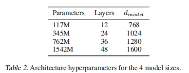

---

GPT-2是2019年2月的工作了，已经是七年前的内容了，放到现在来说，1小时可能就训练好了~
+ 这里除了借鉴GPT-2，还参考了GPT-3的论文，因为OpenAI的论文很少会公布训练详情
+ GPT-3中有参数设置，优化配置方面提供了更为详尽的说明
+ 在[gpt2-src/model.py](https://github.com/openai/gpt-2/blob/master/src/model.py)中，可以看到，原始发布的gpt2代码是`TensorFlow`写的,这里改用基于`pytorch`实现的`huggingface`的`transformers`库。
  + [huggingface/src/transformers/models/gpt2/modeling_gpt2.py](https://github.com/huggingface/transformers/blob/main/src/transformers/models/gpt2/modeling_gpt2.py)
  + 这个脚本的可读性是中等，但是关键在于完成了原始的gpt2的TensorFlow版本到pytorch版本的转换(完全兼容)

----

+ [openai-community/gpt2](https://hf-mirror.com/openai-community/gpt2)
    + **This is the smallest version of GPT-2, with 124M parameters.**, 默认的gpt2对应的是最小参数的版本
    + 其他参数的版本在其他仓库
    + [openai-community/gpt2-large](https://huggingface.co/openai-community/gpt2-large)
    + [openai-community/gpt2-medium](https://huggingface.co/openai-community/gpt2-medium)
    + [openai-community/gpt2-xl](https://huggingface.co/openai-community/gpt2-xl)

# 2. gpt2权重可视化
## 2.1 wpe（位置嵌入）

**固定成正余弦函数 vs 随机初始化**
1. GPT-2 的 `wpe` 是随机初始化的（正态分布，std=0.02），并且是可学习的。初始化链路是这样的：
   1. `GPT2Model.__init__` 里创建 `self.wpe = nn.Embedding(...)` 后调用 `self.post_init()`（[modeling_gpt2.py:503](https://github.com/huggingface/transformers/blob/main/src/transformers/models/gpt2/modeling_gpt2.py#L503) ）；
   2. `post_init()` 会递归地对每个子模块调用 `_init_weights`。GPT2 自己的 `_init_weights`（[modeling_gpt2.py:433](https://github.com/huggingface/transformers/blob/main/src/transformers/models/gpt2/modeling_gpt2.py#L433)）先执行 `super()._init_weights(module)`，它只额外处理了 `Conv1D` 和注意力输出投影的缩放初始化，**没有覆盖** `nn.Embedding` 的处理；
   3. 因此 `wpe` 走的是基类逻辑（[modeling_utils.py:2321](https://github.com/huggingface/transformers/blob/main/src/transformers/models/modeling_utils.py#L2321)）：`init.normal_(module.weight, mean=0.0, std=std)`，其中 `std = config.initializer_range`，GPT2Config 默认值为 **0.02**（[configuration_gpt2.py:89](https://github.com/huggingface/transformers/blob/main/src/transformers/models/gpt2/configuration_gpt2.py#L89)）。
   4. 所以：**是从 N(0, 0.02²) 随机采样初始化的可学习参数**，随预训练一起更新。这也意味着它是“学习的绝对位置嵌入”——预训练时模型自己学出每个位置的向量，而不是公式算出来的。当然，如果用 `from_pretrained("openai-community/gpt2")` 加载，`wpe` 会被 checkpoint 里的预训练值覆盖，随机初始化只影响从头训练的场景。
2. 原始论文用的是 sin/cos 位置编码——但严格说是“固定编码”，不是“初始化”。《Attention Is All You Need》中的正弦位置编码公式为：
   $$PE_{(pos, 2i)} = \sin\left(\frac{pos}{10000^{2i/d_{model}}}\right), \quad PE_{(pos, 2i+1)} = \cos\left(\frac{pos}{10000^{2i/d_{model}}}\right)$$
   + 论文里的位置编码是**直接由公式确定、没有任何可学习参数**的固定向量，不进行训练，完全不更新。
   + 论文还做过对比实验：学习的位置嵌入和正弦编码效果基本相当，他们选正弦编码是希望对更长的序列有外推能力。
3. **两种方案的关系**：
   1. GPT/GPT-2 采用的是“学习的位置嵌入”路线（`wpe`，随机初始化 + 训练），而没有沿用 Transformer 原论文的固定正弦编码。
   2. transformers 里正弦编码的实现，可以参考 `SinusoidalPositionalEmbedding`，BART、Marian 等模型还在用它。

---

## 2.2 gpt2的wpe可视化

可以看到，虽然是随机初始化的，但是训练之后，确实有些也类似正余弦函数，详见：  [code\10_gpt.ipynb](../code/10_gpt.ipynb)

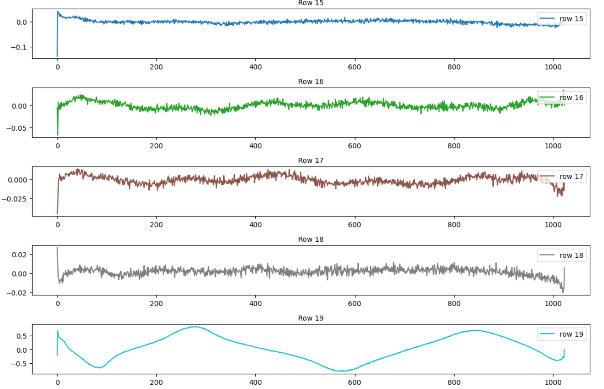


# 3. gpt模型实现

## 3.1 与Transformer模型的关键差异
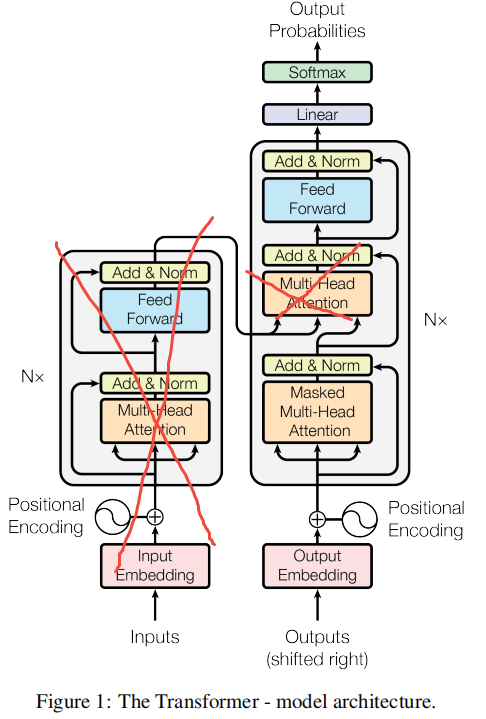

gpt2模型的结构和原始的Transformer有所不同，其采用的是`decoder-only` transformer结构，即：
+ 删除了encode部分，没有编码器，只有解码器，同时删除了解码器中(decode)用于连接编码器(encode)的`cross-attention`部分, 其余地方基本保持不变
+ 还有一些差异：
  + 在gpt2的论文中(**2.3 Model**)中提到：`Layer normalization (Ba et al., 2016) was moved to the input of each sub-block, similar to a
pre-activation residual network (He et al., 2016) and an additional layer normalization was added after the final self-attention block.`
  + LN层归一化放到了每个注意力模块的输入的地方，同时在最后一个自注意力块后面加了一个LN层

## 3.2 TensorFlow vs huggingface(pytorch)历史差异
**prompt**:

已知加载的gpt2模型权重有以下结构：
```bash
transformer.h.1.mlp.c_fc.weight torch.Size([768, 3072])
transformer.h.1.mlp.c_fc.bias torch.Size([3072])
transformer.h.1.mlp.c_proj.weight torch.Size([3072, 768])
transformer.h.1.mlp.c_proj.bias torch.Size([768])
```
但是根据 pytorch的nn.linear, weight.shape为(out_features,in_features),bias的shape为
(out_features)，是不是和上面显示的不一致啊

----

**回答**：

出现这种“不一致”的原因，主要源于**历史框架差异**以及 **Hugging Face 的兼容实现**。以下为您详细拆解背后的原因：
1. 历史原因：TensorFlow 与 PyTorch 的默认设定不同。GPT-2 最初是由 OpenAI 使用 **TensorFlow** 训练和发布的。
     - 在 TensorFlow 的 `tf.layers.dense` 或 `tf.keras.layers.Dense` 中，全连接层的权重默认形状是 `(in_features, out_features)`。
     - 而在 PyTorch 的 `nn.Linear` 中，为了优化矩阵乘法的内存访问，权重默认形状被设计为 `(out_features, in_features)`（即数学公式 $y = xW^T + b$ 中的 $W^T$ 的转置）。
2. Hugging Face 的兼容实现：自定义 `Conv1D`， 当 Hugging Face 的 `transformers` 库将 GPT-2 移植到 PyTorch 时，为了能够**直接、无缝地加载原始的 TensorFlow 权重**（避免在转换时做大量的转置操作），他们并没有直接使用 PyTorch 原生的 `nn.Linear`，而是实现了一个自定义的 `Conv1D` 类来模拟全连接层。
   + [transformers/src/transformers/models/gpt2/modeling_gpt2.py](https://github.com/huggingface/transformers/blob/main/src/transformers/models/gpt2/modeling_gpt2.py)中，有`from ...pytorch_utils import Conv1D`
   + [transformers/src/transformers/pytorch_utils.py](https://github.com/huggingface/transformers/blob/main/src/transformers/pytorch_utils.py#L95)
    ```python
    class Conv1D(nn.Module):
        """
        1D-convolutional layer as defined by Radford et al. for OpenAI GPT (and hence used in GPT-2).
        """
        def __init__(self, nf, nx):
            super().__init__()
            self.nf = nf  # out_features
            self.nx = nx
            # 注意这里的初始化：形状是 (nx, nf) 即 (in_features, out_features)
            self.weight = nn.Parameter(torch.empty(nx, nf)) 
            self.bias = nn.Parameter(torch.zeros(nf))
            nn.init.normal_(self.weight, std=0.02)

        def forward(self, x):
            size_out = x.size()[:-1] + (self.nf,)
            # 核心计算：x @ weight + bias，而不是 nn.Linear 的 x @ weight.T + bias
            x = torch.addmm(self.bias, x.view(-1, x.size(-1)), self.weight)
            x = x.view(size_out)
            return x
    ```

**源码解析：**
- **权重初始化**：`torch.empty(nx, nf)` 明确指定了权重形状为 `(in_features, out_features)`，这与 TensorFlow 保持一致。
- **前向传播**：使用了 `torch.addmm(bias, x, weight)`，其数学本质是 $x \times weight + bias$。因为 $x$ 的最后一维是 `in_features`，`weight` 的形状是 `(in, out)`，所以矩阵乘法可以直接进行，最终输出维度为 `out_features`。这与 `nn.Linear` 中 $x \times weight^T + bias$ 的数学结果是完全等价的。

---
所以如果不想重写一个`Conv1D`, 可以直接把`nn.Linear`的(`in_features`, `out_features`)参数交换一下即可。

例如：以这层为例
```bash
transformer.h.1.mlp.c_fc.weight torch.Size([768, 3072])
transformer.h.1.mlp.c_fc.bias torch.Size([3072])
```
+ `Conv1d`
  + 定义是: `self.c_fc = Conv1D(4*embed_dim, embed_dim)`， 参考[src/transformers/models/gpt2/modeling_gpt2.py](https://github.com/huggingface/transformers/blob/main/src/transformers/models/gpt2/modeling_gpt2.py#L636)
  + 执行的操作则是: $(*, nx)*(nx,nf) = (*, nf)$, `nx`是`in_features`, `nf`是`out_features`
  + 即： $(*,in)*(in,out) = (*, out)$, 
  + 定义是`Conv1D(out, in)`, 打印出来是`w = (in,out), bias = out`
+ `nn.Linear`
  + 正常定义是 `nn.Linear(in_features,out_features)`, 执行的操作是$x \times weight^T + bias$, 即$(*, in)*(in,out)=(*,out)$, 其实也就是多一个把`weight`转置的操作
  + 所以计算其实是一样的，但是传入参数的顺序以及`w`矩阵打印的形状不同
+ 假设这里要用`nn.Linear`来实现上面`Conv1d`的功能，
  + mlp的上一层是
    ```python
        self.ln_2 = nn.LayerNorm(config.n_embed)
        self.mlp = MLP(config)
        # 所以mlp的输入是(*, 768)
    ```
  + 则初始化就要变为: `nn.Linear(768, 3072)`, 则执行的操作就是: `(*,768)*(768,3072)= (*, 3072)`, 打印的`w = (3072, 768), bias = (3072)`
  + 只是打印出来的结果矩阵维度有些不同，但是实际执行的操作是一样的

## 3.3 GELU激活函数
+ https://docs.pytorch.org/docs/2.14/generated/torch.nn.GELU.html
+ [[proposal] Add approx variant option to F.gelu#39853](https://github.com/pytorch/pytorch/issues/39853)
  + 大意就是在作者开发这个激活函数的时候，用的还是TensorFlow，因为计算速度的原因，所以搞了一个近似版本，即`nn.GELU(approximate='tanh')`,但是后来精确版本计算很快也没有数值问题，所以没有理由继续用近似版本，建议用精确版本
    >[!NOTE]
    > `hendrycks`(GELU论文的作者) on Jun 23, 2020<br/>
    > I used the tanh approximation simply because the error function erf was slow in tensorflow some years ago. If the exact version is fast enough now and does not have numerical issues, I do not see a reason to use an inexact version.
  + 这里为了和gpt2一致，因此实现的时候也用了近似版本，可以试试把这个近似版本去掉，对比一下~
+ 论文已下载翻译在本地


**选择GELU**的一个很直观的原因：
+ `GELU`的[-2,0]这段的梯度不为0，相对于原始的`RELU`的`dead neuron`来说，会保证神经元不会静止/不动弹
+ `GELU`求导的结果：
  + **？**

## 3.x ❗GELU近似/精确结果对比


## 3.4 网络初始损失校准

对于gpt2，词表大小是 50257，则CrossEntropyLoss应该是:

$$
\begin{align}
loss = & -log(\frac{e^{\frac{1}{50257}}}{ e^{\frac{1}{50257}} + e^{\frac{1}{50257}} + ... + e^{\frac{1}{50257}}}) \\
     = & -log(\frac{e^{\frac{1}{50257}}}{50257*e^{\frac{1}{50257}}}) \\
     = & -log(\frac{1}{50257}) \\
     = & log(50257)\\
\end{align}
$$

```python
In [1]: import math
In [2]: math.log(50257)
Out[2]: 10.82490511970208
```

所以初始损失在10.8附近才是ok的，即：如果训练的时候损失比这还高，说明比瞎猜的正确率还低。。。

## 3.5 AdamW优化器

+ [Adam和AdamW](https://zhuanlan.zhihu.com/p/643452086)
+ [01-第一章-预训练/神经网络的优化器（十一）AdamW.md](https://github.com/luhengshiwo/LLMForEverybody/blob/main/01-%E7%AC%AC%E4%B8%80%E7%AB%A0-%E9%A2%84%E8%AE%AD%E7%BB%83/%E7%A5%9E%E7%BB%8F%E7%BD%91%E7%BB%9C%E7%9A%84%E4%BC%98%E5%8C%96%E5%99%A8%EF%BC%88%E5%8D%81%E4%B8%80%EF%BC%89AdamW.md)
+ [Decoupled Weight Decay Regularization](https://arxiv.org/abs/1711.05101)
+ [Adam: A Method for Stochastic Optimization](https://arxiv.org/abs/1412.6980)
+ <https://docs.pytorch.org/docs/2.15/generated/torch.optim.Adam.html>
+ <https://docs.pytorch.org/docs/2.15/generated/torch.optim.AdamW.html>


## 3.6 ❗weight tying(gpt2的wte层和lm_head层的共享关系)
```python
# 1. 验证 object id和data完全共享
import os
os.environ["HF_ENDPOINT"] = "https://hf-mirror.com"
os.environ["HF_HOME"] = "E:/learnGPT/learnGPTfromScratch/other" 

import transformers
from transformers import GPT2LMHeadModel
model_hf = GPT2LMHeadModel.from_pretrained("gpt2") 
sd_hf = model_hf.state_dict()

wte = sd_hf['transformer.wte.weight']
lm_head = sd_hf['lm_head.weight']

print(f"wte.shape: wte.shape, lm_head.shape: {lm_head.shape}")
print( (wte == lm_head).all())

print(wte.data_ptr())
print(lm_head.data_ptr())

# 得到以下输出：
wte.shape: wte.shape, lm_head.shape: torch.Size([50257, 768])
tensor(True)
1876425355219
1876425355219
# 即： 这两个层本质上是一个对象

# 2. 验证grad是否共享
loss.backward() 
print(model.transformer.wte.weight.grad) 
print(model.lm_head.weight.grad)  
print( (model.transformer.wte.weight.grad== model.lm_head.weight.grad).all() ) # True  因为wte和lm_head是共享权重的，所以梯度也是共享的
# tensor(True, device='cuda:0')

```

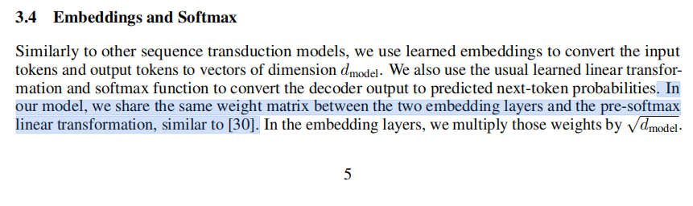

+ 在原始的Transformer论文里，就可以看到，`wte`和`lm_head`层的权重是共享的
+ 引用的论文： [Using the Output Embedding to Improve Language Models](https://arxiv.org/abs/1608.05859)
+ 引用的论文： [Tying Word Vectors and Word Classifiers: A Loss Framework for Language Modeling](https://arxiv.org/abs/1611.01462)
+ 在[OpenAI-gpt2/src/model.py](https://github.com/openai/gpt-2/blob/master/src/model.py#L171)中，有：
  ```python
      def model(hparams, X, past=None, scope='model', reuse=False):
        ....
        wte = tf.get_variable('wte', [hparams.n_vocab, hparams.n_embd],
                             initializer=tf.random_normal_initializer(stddev=0.02))
        ....
        h_flat = tf.reshape(h, [batch*sequence, hparams.n_embd])
        logits = tf.matmul(h_flat, wte, transpose_b=True)   # 可以看到，这里直接用了wte来作为lm_head, 所以这里直接提现了共享权重
        logits = tf.reshape(logits, [batch, sequence, hparams.n_vocab])
        results['logits'] = logits
        return results
  ```

---

其他实现：
+ OpenAI发的TensorFlow版本的gpt2： 
  + <https://github.com/openai/gpt-2/blob/master/src/model.py#L171>
  + 默认开启权重共享
+ Huggingface的Transformer库的gpt2实现: 
  + <https://github.com/huggingface/transformers/blob/main/src/transformers/models/gpt2/configuration_gpt2.py#L103>
  + <https://huggingface.co/docs/transformers/v5.22.1/en/model_doc/gpt2#transformers.GPT2Config>
  + 默认`tie_word_embeddings: bool = True`

---

| 特性 | `nn.Embedding` | `nn.Linear` |
| :--- | :--- | :--- |
| **输入类型** | **整数张量** (LongTensor)，如 Token ID | **浮点张量** (FloatTensor)，如隐藏层状态 |
| **输入 Shape** | `(*, )` 任意维度的整数，如 `(batch, seq_len)` | `(*, in_features)`，最后一维必须是输入特征数 |
| **输出 Shape** | `(*, embedding_dim)` | `(*, out_features)` |
| **权重 Shape** | `(num_embeddings, embedding_dim)` | `(out_features, in_features)` **（注意是 out × in）** |
| **梯度更新** | **稀疏更新**：反向传播时，仅更新被索引到的行，其余行梯度为0 | **稠密更新**：整个权重矩阵都参与前向和反向计算 |

这里直接权重共享:
1. `nn.Embedding`和`nn.Linear`的`weight`的shape一样，都是`(50257, 768)`
2. `nn.Embedding`的`weight`是用来进行索引的，在反向时是稀疏更新
3. `nn.Linear`的`weight`是用来进行映射的，在反向时是稠密更新


## 3.7 ❗data_ptr 指向 和 .grad 的关系
和 [3.8 ❗self.transformer.wte.weight  = self.lm_head.weight 背后执行了什么](#38-selftransformerwteweight---selflm_headweight-背后执行了什么) 也有关，看完把[3.8 ❗self.transformer.wte.weight  = self.lm_head.weight 背后执行了什么](#38-selftransformerwteweight---selflm_headweight-背后执行了什么)也看了
```python
# 直接去  code\gpt2\train_gpt2.py 把下面这个函数的这几句取消注释，在箭头那行打断点
def train_test():
    ...
    # 验证 wte和lm_head是否也是梯度共享的
    #  
    loss.backward()  # 反向传播，计算梯度
    weight_data_ptr = model.transformer.wte.weight.data_ptr()
    weight_grad_ptr = model.transformer.wte.weight.grad.data_ptr()
    print("权重数据 (data) 的内存地址:", weight_data_ptr)    # 权重数据 (data) 的内存地址: 47336914944
    print("权重梯度 (grad) 的内存地址:", weight_grad_ptr)    # 权重梯度 (grad) 的内存地址: 48723132416
    print(f"\n两者的地址相同吗? {weight_data_ptr == weight_grad_ptr}") # 两者的地址相同吗? False
    # 所以  weight.data_ptr()   和 weight.grad.data_ptr() 是两个不同的对象
    
    print(model.transformer.wte.weight.grad)  
    print(model.lm_head.weight.grad)  
    print(type(model.transformer.wte.weight))  # <class 'torch.nn.parameter.Parameter'>
->  print( (model.transformer.wte.weight.grad== model.lm_head.weight.grad).all() ) # True  因为wte和lm_head是共享权重的，所以梯度也是共享的
    # tensor(True, device='cuda:0')
    return 
```

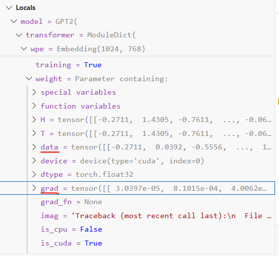

+ 这里可以看到， `data`和`grad`是分别使用两个tensor来表示的，同时，这两个tensor里的grad都是空，grad.data里放的才是 wte的weight的grad
+ 在上面打印中，执行反向后可以看到
  ```python
    weight_data_ptr = model.transformer.wte.weight.data_ptr()
    weight_grad_ptr = model.transformer.wte.weight.grad.data_ptr()
    print("权重数据 (data) 的内存地址:", weight_data_ptr)    # 权重数据 (data) 的内存地址: 47336914944
    print("权重梯度 (grad) 的内存地址:", weight_grad_ptr)    # 权重梯度 (grad) 的内存地址: 48723132416
    # 这两个的内存地址不同
  ```

---

同时根据[pytorch/c10/core/TensorImpl.h](https://github.com/pytorch/pytorch/blob/main/c10/core/TensorImpl.h#L3309)
```h
class C10_TensorImpl_Size_Check_Dummy_Class : private TensorImpl {
  // Names of (non-bitfield) fields in TensorImpl; used to provide
  // compile-time info about fields whose size changes unexpectedly.
  enum class FieldNameEnum {
    storage_,     // 这部分是存储 data的
    autograd_meta_, // 这部分是管理grad的，这里面会额外再有一个TensorImpl
    extra_meta_,
    version_counter_,
    pyobj_slot_,
    sizes_and_strides_,
    storage_offset_,
    numel_,
    data_type_,
    device_opt_,
    key_set_,
    TOTAL_SIZE
  };
```

以及：[PyTorch internals/ezyang's blog](https://blog.ezyang.com/2019/05/pytorch-internals/), 直接在页面中搜索`grad`

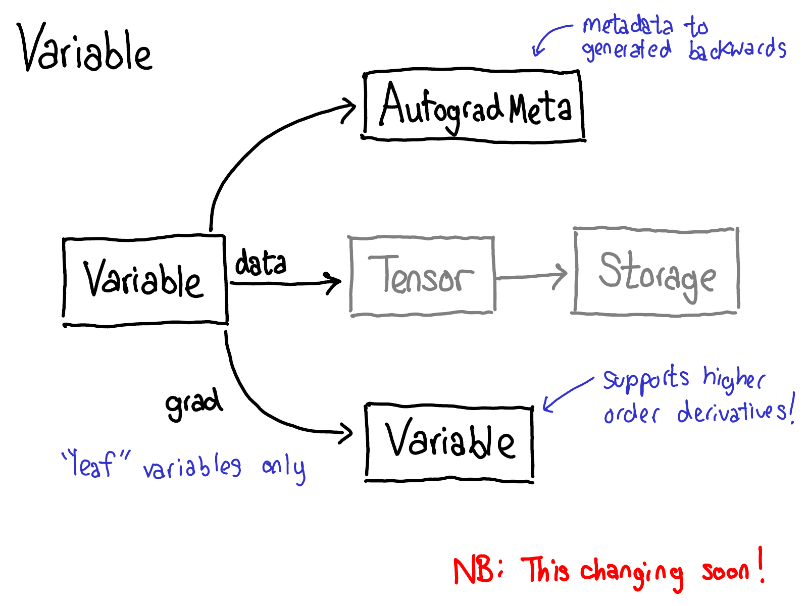

---

结合AI的回答：
```bash
[Python 层面]
  +-----------------------------+
  |  nn.Parameter (Python 对象)  |  <-- 你代码中的 lm_head.weight 或 wte.weight
  +-----------------------------+
               | (包裹/Wrapper)
               v
[C++ 层面: ATen]
  +-----------------------------+
  |      TensorImpl (控制中心)   |  <-- 只有一个实例！
  |-----------------------------|
  | sizes: [2, 2]               |
  | dtype: torch.float32        |
  | requires_grad: True         |
  |-----------------------------|
  | storage_  ------------------+-----> [ Storage 1: 权重数据 ]
  | (指向 Data)                 |      | data_ptr(): 0xAAAA (物理内存 A) |
  |-----------------------------|      +---------------------------------+
  | autograd_meta_ --------------+
  | (仅当 requires_grad=True)   |
  +-----------------------------+      +---------------------------------+
               |                       |      AutogradMeta               |
               |                       |---------------------------------|
               |                       | grad_fn_: <SumBackward0 object> |
               +---------------------> | grad_: -----------------------+ |
                                       +---------------------------------+ |
                                                                           |
                                                                           v
                                                             +-----------------------------+
                                                             |   TensorImpl (梯度控制中心)  | <-- 独立的梯度 Tensor
                                                             |-----------------------------|
                                                             | sizes: [2, 2]               |
                                                             | requires_grad: False        |
                                                             |-----------------------------|
                                                             | storage_ -------------------+-----> [ Storage 2: 梯度数据 ]
                                                             | (指向 Grad Data)                  | data_ptr(): 0xBBBB (物理内存 B) |
                                                             +---------------------------------+---------------------------------+
```

这个结果就和
```python
  weight_data_ptr = model.transformer.wte.weight.data_ptr()
  weight_grad_ptr = model.transformer.wte.weight.grad.data_ptr()
  print("权重数据 (data) 的内存地址:", weight_data_ptr)    # 权重数据 (data) 的内存地址: 47336914944
  print("权重梯度 (grad) 的内存地址:", weight_grad_ptr)    # 权重梯度 (grad) 的内存地址: 48723132416
  # 这两个的内存地址不同
```
一致了

---

##  3.8 ❗self.transformer.wte.weight  = self.lm_head.weight 背后执行了什么

和 [3.7 ❗data_ptr 指向 和 .grad 的关系](#37-data_ptr-指向-和-grad-的关系) 是一个问题，先看 [3.7 ❗data_ptr 指向 和 .grad 的关系](#37-data_ptr-指向-和-grad-的关系)

直接打断点，调试，看程序执行是什么样的，如果是vscode，需要debug的时候设置一下`launch.json`,详见： [4.6 vscode调试进入 torch魔法代码](#46-vscode调试进入-torch魔法代码)

```python
# code\gpt2\train_gpt2.py 函数中对这行代码打断点，执行到这里后，按F11 Step Into
# class GPT2(nn.Module)->def __init__(self, config: GPT2Config):
self.transformer.wte.weight  = self.lm_head.weight

↓

# C:\Users\shanhuang\AppData\Roaming\Python\Python310\site-packages\torch\nn\modules\module.py
  def __getattr__(self, name: str) -> Union[Tensor, "Module"]:
      if "_parameters" in self.__dict__:
          _parameters = self.__dict__["_parameters"]  # 一开始停在这里，继续F10 Step Over
          if name in _parameters:   # name = 'lm_head',  _parameters = {}  继续F10 Step Over
              return _parameters[name]  #  _parameters = {}
          if "_buffers" in self.__dict__:
              _buffers = self.__dict__["_buffers"]
              if name in _buffers:
                  return _buffers[name]  #  _buffers = {}
          if "_modules" in self.__dict__:
              modules = self.__dict__["_modules"]
              if name in modules:
                  return modules[name]  # modules = {'transformer': ModuleDict((wte): Embedding(50257, 768) (wpe): Embedding(1024, 768)...
          raise AttributeError(
              f"'{type(self).__name__}' object has no attribute '{name}'"
          )
# 这个函数遍历两三次之后，看到name是 wte，执行完这个函数，就会跳转到`__setattr__`函数了
def __setattr__(self, name: str, value: Union[Tensor, "Module"]) -> None:
  params = self.__dict__.get("_parameters")
  if isinstance(value, Parameter):
    ...
    self.register_parameter(name, value)  # self._parameters[name] = param

def register_parameter(self, name: str, param: Parameter | None) -> None:
  ...
  self._parameters[name] = param
```
+ [pytorch/torch/nn/modules/module.py __setattr__()函数](https://github.com/pytorch/pytorch/blob/v2.15.0/torch/nn/modules/module.py#L1980)
+ 即：对于 `self.transformer.wte.weight  = self.lm_head.weight`
  1. **触发 `__setattr__`**：`self.transformer.wte` 是一个 `nn.Embedding` 实例（继承自 `nn.Module`）。执行 `wte.weight = ...` 时，会调用 `nn.Module.__setattr__` 方法。
  2. **参数注册机制**：`nn.Module.__setattr__` 会检查被赋值的对象类型。如果发现赋值的对象是一个 `nn.Parameter`（`nn.Linear` 的 `weight` 默认就是 `requires_grad=True` 的 `nn.Parameter`），它**不会**将其当作普通的 Python 属性，而是将其注册到该模块的 `_parameters` 字典中。
  3. **引用共享**：执行后，`self.transformer.wte._parameters['weight']` 和 `self.lm_head._parameters['weight']` 在 Python 层面指向了**内存中的同一个 `nn.Parameter` 对象**。


关于`赋值顺序`，把谁的值给谁
```python
# 在 Python 语言的最底层设计中，A = B 永远只是“让名字 A 指向名字 B 当前指向的内存对象”
# 表现出来的就是： B的值赋给了A，但是实际上是： A的指针指向了B的内存首地址
self.transformer.wte.weight  = self.lm_head.weight

# 这句在执行的时候，触发的是 self.transformer.wte 这个对象的 __setattr__ 方法。
def __setattr__(self, name: str, value: Union[Tensor, "Module"])

# self (即被修改的对象)：是 self.transformer.wte（一个 nn.Embedding 实例）。
# name：是字符串 'weight'。
# value：是 self.lm_head.weight（一个 nn.Parameter 实例，即 lm_head 的权重对象）。
# 最终生效的关键代码  
# self._parameters[name] = param
# 即执行的是  self.transformer.wte._parameters[weight] = self.lm_head.weight
```

这里涉及到python原生的两个魔法函数的作用：

| 特性 | `__setattr__` | `__getattr__` |
| :--- | :--- | :--- |
| **拦截动作** | 属性**赋值** (`obj.x = 1`) | 属性**读取** (`obj.x`) |
| **触发条件** | **每次**赋值都会触发 | **仅当属性找不到时**触发 |
| **核心用途** | 参数校验、状态同步、只读控制 | 动态属性生成、代理模式、惰性加载 |
| **易错点** | 内部赋值必须用 `super()` 或 `__dict__`，否则死循环 | 内部如果访问了不存在的属性，会再次触发自身导致死循环 |

---

这里的赋值操作，对比`deepcopy()`操作, 在[torch/nn/parameter.py](https://github.com/pytorch/pytorch/blob/main/torch/nn/parameter.py#L85)中
```python
def __deepcopy__(self, memo):
    if id(self) in memo:
        return memo[id(self)]
    else:
        result = type(self)(
            self.data.clone(memory_format=torch.preserve_format), self.requires_grad
        )
        memo[id(self)] = result
        return result
```
+ `clone()` 方法在底层 C++ 会调用 `c10::cuda::CUDACachingAllocator`（如果是 GPU）或 CPU 的内存分配器，`申请一块全新的、物理隔离的显存/内存空间`，并将原 Tensor 的数据逐字节拷贝过去。
+ `type(self)(...)`会实例化一个新的 `Python Parameter` 对象，Python 解释器会为其分配 `PyObject` 头部及属性字典所需的堆内存
+ 关于 **data 的复制** ，体现在`self.data.clone(memory_format=torch.preserve_format)`
  + `self.data`：获取 Parameter 底层包装的纯 Tensor（即权重数据）。
  + `.clone()`：执行数据的物理深拷贝。
  + `memory_format=torch.preserve_format`：这是一个工程细节，确保拷贝后的 Tensor 保持原有的内存布局（例如是连续的 contiguous，还是 channels_last 格式）
+ 关于 **grad 的复制（隐式重置为 None）**
  + 代码中没有任何地方拷贝 `self.grad`。
  + 执行 `type(self)(new_data, self.requires_grad)` 时，新创建的 Parameter 的 grad 属性默认是 `None`。
  + 这是因为 `grad` 是反向传播时动态计算出来的中间产物，不属于模型的“固有状态”。
  + LLM 的梯度张量与权重张量一样大（甚至更大，如果保留了高阶导数）。深拷贝时不拷贝 grad，可以直接节省一半的峰值显存。


## 3.9 ❗共享权重的反向过程
以gpt为例：
```python
class GPT2(nn.Module):
    def __init__(self, config: GPT2Config):
        super().__init__()
        self.config = config
        self.transformer = nn.ModuleDict(dict(
            wte = nn.Embedding(self.config.vocab_size, self.config.n_embed),
            wpe = nn.Embedding(self.config.block_size, self.config.n_embed),
            h = nn.ModuleList(Block(config) for _ in range(self.config.n_layer)),
            ln_f = nn.LayerNorm(self.config.n_embed) 
        ))
        self.lm_head = nn.Linear(self.config.n_embed, self.config.vocab_size, bias = False)
        self.transformer.wte.weight  = self.lm_head.weight
    
    def forward(self,idx):
        B, T = idx.size() 
        assert T <= self.config.block_size, f"Cannot forward sequence of length {T}, block size is only {self.config.block_size}"

        pos = torch.arange(0,T,dtype=torch.long, device=idx.device) 
        pos_emb = self.transformer.wpe(pos) 
        tok_emb = self.transformer.wte(idx)  
        x = pos_emb + tok_emb 
        for block in self.transformer.h:
            x = block(x)
        x = self.transformer.ln_f(x)
        logits = self.lm_head(x) 
        return logits
```
这里很明显，只考虑 以下几个节点： `wte(lm_head)`, `wpe`, `transformer.h`, `transformer.ln_f`, `logits(loss)`
```bash
# 正向的流动顺序（在micrograd中会记录prev 上个节点）
# 这里只关注 wte/lm_head部分，暂时不考虑wpe

# 元组的第一个元素是prev，第二个是当前
(x, wte/lm_head)
(wte/lm_head, transformer.h)
(transformer.h, transformer.ln_f)
(transformer.ln_f, logits(loss))

# 前向就是上面箭头指向左边，反向就是上面箭头指向右边。。。
```
正向顺序和反向是一一对应的，如图：

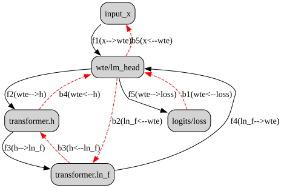

```python
import graphviz

def draw_llm_graph():
    dot = graphviz.Digraph(comment='LLM Computation Graph')
    dot.attr('node', shape='box', style='rounded,filled', fillcolor='lightgrey')
    dot.node('x', 'input_x')
    dot.node('wte', 'wte/lm_head')
    dot.node('h', 'transformer.h')
    dot.node('ln_f', 'transformer.ln_f')
    dot.node('loss', 'logits/loss')
    # 【关键】所有 label 的值必须用双引号包裹
    # forward/data  f1的f表示forward
    dot.edge('x', 'wte', style='solid', color='black', label='f1(x-->wte)')
    dot.edge('wte', 'h', style='solid', color='black', label='f2(wte-->h)')
    dot.edge('h', 'ln_f', style='solid', color='black', label='f3(h-->ln_f)')
    dot.edge('ln_f', 'wte', style='solid', color='black', label='f4(ln_f-->wte)')
    dot.edge('wte', 'loss', style='solid', color='black', label='f5(wte-->loss)')
    # backward/grad   b1的b表示backw
    dot.edge('loss', 'wte', style='dashed', color='red', label='b1(wte<--loss)')
    dot.edge('wte', 'ln_f', style='dashed', color='red', label='b2(ln_f<--wte)')
    dot.edge('ln_f', 'h', style='dashed', color='red', label='b3(h<--ln_f)')
    dot.edge('h', 'wte', style='dashed', color='red', label='b4(wte<--h)')
    dot.edge('wte', 'x', style='dashed', color='red', label='b5(x<--wte)') # 从这里就可以看出来，就是把正向的过程，倒着，把箭头换个方向即可
    
    output_filename = 'E:/learnGPT/learnGPTfromScratch/code/gpt2/llm_graph'
    dot.render(output_filename, format='svg', cleanup=True)
    print(f"图像已成功保存为 {output_filename}.svg")
    # print(dot.source) # 这个输出的dot内容，直接复制到draw.io里会丢失样式，很容易解析错误

draw_llm_graph()

```
按照[Autogenerated dependency graphs](https://www.drawio.com/docs/diagram-types/dependency-graphs/#autogenerated-dependency-graphs)的操作，
1. 新建一个`llm_graph.drawio`, 工具栏`Arrange`->`Insert`->`Advanced`->`from text`, 在`From text`的对话框里，`Close`的左侧有个下拉框，改为`Diagram`,复制上面的`graphviz dot`内容
2. 但是这个输出的dot内容，直接复制到draw.io里会`丢失样式`，很容易`解析错误`(遇到`->`就直接解析为新的线，遇到空格就是新的节点)，
3. 还是换成保存为`svg`文件，然后直接截图得到更好的图像（`png`和`svg`图像显示有差异，`svg`图像更清晰）


## 3.10 gpt2初始化问题
### 1. LayerNorm 和 nn.Linear(Conv1d)
+ [Layer Normalization](https://arxiv.org/abs/1607.06450)
+ <https://docs.pytorch.org/docs/2.15/generated/torch.nn.LayerNorm.html>
  + pytorch实现里的， `elementwise_affine`这个参数就是控制要不要有$\gamma$(默认初始化为全1)和$\beta$(默认初始化为全0)
  + 之前在 <code\zero_gpt\7_start_GPT.ipynb>中有涉及到  `Xavier` 初始化 和 `Kaiming` 初始化
+ 以gpt2这里的线性层的初始化为例：
  ```python
    # 自注意力机制中的
    self.c_attn = nn.Linear(config.n_embed, 3*config.n_embed) 
    self.c_proj = nn.Linear(config.n_embed, config.n_embed) 

    # MLP中的
    self.c_fc = nn.Linear(config.n_embed, 4*config.n_embed)
    self.c_proj = nn.Linear(4*config.n_embed, config.n_embed)
  ```
  + 设置为 std=0.02, 其实类似于`Xavier` 初始化中 服从$\mathcal{N}(0, \sqrt{\frac{1}{infeatures}}) = (0, \sqrt{\frac{1}{768}})$
  + 对于 gpt2的最小版本， 是 `(1/768)**0.5 = 0.0360`
  + 对于 gpt2的其他版本， $d_{model} = 1024， 1280，1600$来说，得到的结果就分别是：
    + `(1/1024)**0.5 = 0.03125`
    + `(1/1280)**0.5 = 0.02795084971874737`
    + `(1/1600)**0.5 = 0.025` 


>[!TIP]
>**gpt2 里需要额外设置初始化，是因为TensorFlow本身对于自定义的层以及相关参数没有给出默认优化后的初始化设置**，所以才需要人工额外调整
> + 所以会看到实验中，如果不按照gpt2的设置，前向的loss是`tensor(10.8736, device='cuda:0', grad_fn=<NllLossBackward0>)`
> + 而按照gpt2的初始化设置后，前向的loss是`tensor(10.9520, device='cuda:0', grad_fn=<NllLossBackward0>)`
> + 反而gpt2的初始化设置与理想的损失：`-ln(1/50257) = 10.82`差距更大

gpt2的代码是2019年左右出的，kaiming_init是 2015年发表的论文，xavier_init 是 2010年左右发表的论文
+ 找了一些古早的文档，tf已经停止运营了，所以想找API都不好找了
+ 根据[tf.get_variable](https://zhuanlan.zhihu.com/p/30844533), 所以默认`tf.get_variable`是需要自己指定`初始化方案的`
  ```python
  def conv1d(x, scope, nf, *, w_init_stdev=0.02):
    with tf.variable_scope(scope):
        *start, nx = shape_list(x)
        w = tf.get_variable('w', [1, nx, nf], initializer=tf.random_normal_initializer(stddev=w_init_stdev))
        b = tf.get_variable('b', [nf], initializer=tf.constant_initializer(0))
        c = tf.reshape(tf.matmul(tf.reshape(x, [-1, nx]), tf.reshape(w, [-1, nf]))+b, start+[nf])
        return c

  def norm(x, scope, *, axis=-1, epsilon=1e-5):
    """Normalize to mean = 0, std = 1, then do a diagonal affine transform."""
    with tf.variable_scope(scope):
        n_state = x.shape[-1].value
        g = tf.get_variable('g', [n_state], initializer=tf.constant_initializer(1))
        b = tf.get_variable('b', [n_state], initializer=tf.constant_initializer(0))
        u = tf.reduce_mean(x, axis=axis, keepdims=True)
        s = tf.reduce_mean(tf.square(x-u), axis=axis, keepdims=True)
        x = (x - u) * tf.rsqrt(s + epsilon)
        x = x*g + b
        return x

  wpe = tf.get_variable('wpe', [hparams.n_ctx, hparams.n_embd],
                        initializer=tf.random_normal_initializer(stddev=0.01))
  wte = tf.get_variable('wte', [hparams.n_vocab, hparams.n_embd],
                        initializer=tf.random_normal_initializer(stddev=0.02))
  get_variable(name, shape=None, dtype=None, initializer=None,
  initializer:
        1. If `None` (the default), the default initializer passed in
    the variable scope will be used.
        2. If that one is `None` too, a `glorot_uniform_initializer` will be used.
        3. If a Tensor, in which case the variable is initialized to this value and shape.
  ```
+ 所以 **gpt2 这样设置权重，完全是因为当时的tf没有自动给出优化的初始方案**

### 2. residual layers采用 pre-norm带来的问题
gpt2论文中有：

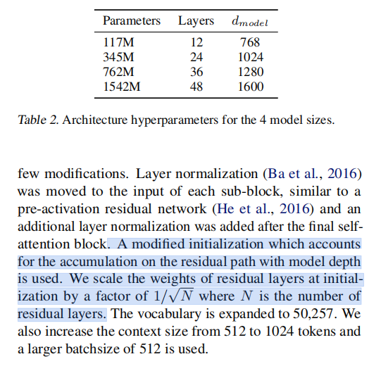

这里会有对残差流进行scale的原因，是因为gpt2用的是`pre-norm`方式
```python
def forward(self, x):
    x = x + self.attn(self.ln_1(x))  
    x = x + self.mlp(self.ln_2(x))
    return x
```
**Pre-LayerNorm (Pre-LN)** 架构会导致**残差流方差累积**问题。
- **传统的 Post-LN**：`x = LayerNorm(x + Sublayer(x))`。残差相加后立刻进行归一化，天然地将残差流的方差控制在合理范围。
- **GPT-2 采用的 Pre-LN**：`x = x + Sublayer(LayerNorm(x))`。
  - LayerNorm 只作用于子层的**输入**，而残差流 `x` 本身在连续相加时，**不会**被重新归一化。
  - 在初始化阶段，如果每个子层（Attention 或 MLP）的输出方差约为 1，那么经过 $N$ 层残差累加后，残差流的总方差会增长到 $O(N)$。对于深层网络（如 GPT-2 XL 的 48 层），这会导致训练初期的激活值和梯度方差过大，引发训练不稳定。
- 为了解决这个问题，GPT-2 论文提出：
  - **在初始化时，将残差分支的输出投影层（即 Attention 的 `c_proj` 和 MLP 的第二个 `c_proj`）的权重标准差缩小 $1/\sqrt{N}$ 倍**。
  - 这样每层贡献的方差变为 $O(1/N)$，累加 $N$ 层后，总方差依然能保持在健康的 $O(1)$ 水平 
  - 注意，这个操作是 老师实现的，[nanogpt-from-scratch/model.py](https://github.com/varad-more/nanogpt-from-scratch/blob/main/model.py#L370)
  - 但是确实和 Huggingface的实现一样的，都是对

```python
# standard deviation grows inside the residual stream
# 残差流中的标准差增长
import torch
x = torch.zeros(768)
n = 100

for i in range(n):
    x+= torch.randn(768)
print(x.std())  # tensor(9.4192)

# 这里残差连接加法后的方差变化，其实和线性层初始化是一个问题，（100，10)*(10,100)=(100,100)， 这(100,100)个数，每个都是 10和10元素对应相乘后再相加，所以是加了10次
# 多个方差为1的分布相加，最后加多少次，标准差就是根号下多少
# 这里直接加了100次，所以标准差就约等于 100**0.5 = 10
```
### 3. 最简单的例子说明不同缩放的区别

先去：[### 4. 现有实现(huggingface)](#4-现有实现huggingface)中看这个残差连接的求导，

本质上，这个式子，更关心的是$x = x+ F(x)$中$F(x)$的值，对于MLP和Attention模块来说，就是最后一个`c_proj`层的权重要尽量为0 → 方差尽量小

这里完全不关注等式右边的$x$, 因为求导之后就是1，

所以这里的加法关注的不是$x + F(x)$, 而是单纯关注$F(x)$被加多次带来的问题

```python
# 优化方法1
import torch
x = torch.zeros(768)
n = 100
for i in range(n):
    x+=torch.randn(768)*n**(-0.5)
print(x.std())


# 优化方法2
import torch
x = torch.zeros(768)
n = 100
for i in range(n):
    x+= torch.randn(768)
x = x*n**(-0.5)
print(x.std())


# 优化方法3
import torch
x = torch.zeros(768)
n = 100
for i in range(1,n+1):
    x+=torch.randn(768)*i**(-0.5)
print(x.std())
```
**优化1和优化2**的对比： 
+ 二者的区别在于进行缩放的时刻， 优化1是每次加法的时候都缩放，优化2是直接最后缩放一次
  + **在纯数学和统计学的理想假设下，这两种做法是完全等价的。**: 根据方差的线性性质，如果每次增加的随机变量独立同分布，那么“每次加的时候缩小 $1/\sqrt{N}$” 和 “全部加完之后整体缩小 $1/\sqrt{N}$”，最终结果的方差是相同的（都会收敛到 1 左右）。
  + 但是**神经网络不是简单的线性累加，而是逐层的非线性变换，且每一层的输出会作为下一层的输入。**
+ **中间激活值的方差会“中途爆炸”**
  + 假设在残差网络中，第 $l$ 层的隐藏状态计算为：
    $$ x_l = x_{l-1} + F(x_{l-1}, W_l) $$
  + 其中 $F$ 是残差分支（包含 Attention 或 MLP）。
  - **GPT-2 的做法（逐层缩放）**：每经过一层，残差分支的贡献方差被控制在 $O(1/N)$。因此，无论在第 1 层还是第 50 层，$x_l$ 的总方差始终保持在健康的 $O(1)$ 水平。
  - **简化做法（最后缩放）**：在前 $N-1$ 层中，残差分支的贡献方差是 $O(1)$。这意味着在第 $k$ 层时，$x_k$ 的方差会线性增长到 $O(k)$。如果 $N=100$，那么在第 50 层时，激活值的方差已经是初始状态的 50 倍左右。
+ **非线性激活函数直接“饱和失效”**
  - GPT-2 的残差分支内部包含 `gelu` 等非线性激活函数。这些函数在输入值过大或过小时，会进入**饱和区**（导数趋近于 0）。
  - 采用“最后缩放”的做法，中间层的 $x$ 值会变得极其巨大。当这些巨大的值传入下一层的 `gelu` 或 `tanh` 时，激活函数的输出将变成一条平坦的直线，导致**梯度消失**，反向传播时权重根本无法更新，模型训练会直接崩溃。
+ **LayerNorm 的数值稳定性被破坏**
  + 虽然 GPT-2 使用的是 Pre-LayerNorm（在残差分支内部先做 LayerNorm），但 LayerNorm 的计算依赖于输入数据的均值和方差。如果残差流 $x$ 的数值范围随着层数剧烈膨胀，会导致：
  - 浮点数计算精度丢失（大数吃小数）。
  - 即使 LayerNorm 强行将其拉回均值为 0、方差为 1，其缩放参数（$\gamma$）和偏移参数（$\beta$）的梯度也会因为输入分布的极端变化而变得极不稳定，破坏 Adam 等优化器的动量估计。


**优化1和优化3**的对比：
+ 同样都是每次进行残差分支相加时，对残差分支进行缩放，一个是使用`N`,另一个是使用当前相加的次数`i`
+ 这里需要提前搞清楚一个概念：
  ```python
    import torch
    # 示例1
    x = torch.zeros(768)
    n = 100
    for i in range(n):
        x+=torch.randn(768)*n**(-0.5)
    print(x.std())
    # tensor(0.9721)  这是 多次独立采样求和

    # 示例2
    x = torch.zeros(768)
    x = x + 100*(torch.randn(768)*n**(-0.5))
    print(x.std())
    # tensor(10.0891)  这是 单次采样后放大
  ```
  - 对于示例1，
    - 相当于循环了 100 次，`torch.randn` 被调用了 100 次，产生了 **100 个相互独立** 的随机变量 $Z_1, Z_2, ..., Z_{100}$。
    - **单次方差**：每次加上的项是 $0.1 \times Z_i$, 注意：($\sqrt{\frac{1}{100}} = \frac{1}{10} = 0.1$)，其方差为 $0.1^2 \times \text{Var}(Z_i) = 0.01$。
    - **总方差**：根据概率论，**独立**随机变量之和的方差，等于它们方差的**和**。
      $$ \text{Var}(X_1) = \sum_{i=1}^{100} \text{Var}(0.1 \times Z_i) = 100 \times 0.01 = 1 $$
    - **结果**：`x.std()` 会非常接近 **1.0**。
  - 对于示例2，
    -  `torch.randn` **只被调用了 1 次**，只产生了一个随机变量 $Z$。然后这个**同一个**随机变量被乘以了常数 $10$ （因为 $100 \times 100^{-0.5} = 10$）。
    - **总方差**：根据概率论，随机变量乘以常数 $c$，其方差会放大 **$c^2$ 倍**。
      $$ \text{Var}(X_2) = \text{Var}(10 \times Z) = 10^2 \times \text{Var}(Z) = 100 \times 1 = 100 $$
    - **结果**：`var`方差是100，则标准差`x.std()` 会非常接近 **10.0**。
  - 因此，**示例1和示例2并不等价**！不可以把示例1简化为： $x + (F(x)\times \sqrt{\frac{1}{100}})\times 100$
  - **独立随机变量求和**与**标量乘法**在方差计算上的核心差异。在深度学习中，控制方差的关键在于控制**每一次独立采样**的幅度，而不是试图去修正已经累积完成的总和。
+ 每次都缩放`N`，则可以简化为公式为上面的，就不用讨论了，肯定是`std=1`
+ 每次都缩放`i`，则可以计算为:
  - 第一层，加上的项是 $1 \times Z_i$, 注意：($\sqrt{\frac{1}{1}} = \frac{1}{1} = 1$)，其方差为 $1^2 \times \text{Var}(Z_i) = 1$。
  - 第二层，加上的项是 $\frac{1}{2} \times Z_i$, 注意：($\sqrt{\frac{1}{2}}$)，其方差为 $(\sqrt{\frac{1}{2}})^2 \times \text{Var}(Z_i) = \frac{1}{2}$。
  - 则整体的计算为:
    $$ \text{Var}(X_1) = (1 + \frac{1}{2} +  \frac{1}{3} +  \frac{1}{100})\times Z_i = \sum_{i=1}^{k} \frac{1}{i} \approx \ln(k) \quad \text{(调和级数)} = ln(100) \approx 4.605$$
  - `math.log(3) = 1.0986`所以可以认为：**只要大于等于3层，用这种每层的层数来进行缩放的，最后方差依然会放大，且不同层的信号尺度不一致，会给 LayerNorm 和优化器带来不必要的波动**。
+ 类似的，每次缩放`N`的计算公式就可以表达为:
  $$ \text{Var}(X_1) = \sum_{i=1}^{N} \text{Var}(\sqrt\frac{1}{N} \times Z_i) = \sum_{i=1}^{N} \frac{1}{N} = N* \frac{1}{N} = 1$$
  - 以第$k$层为例，则方差可以表示为: $\text{Var}(x_k) \approx k \times \frac{1}{N} = \frac{k}{N}$
  - 因为 $k \le N$（当前层数永远小于等于总层数），所以 **$\frac{k}{N} \le 1$**。同时**前几层方差偏小（$\frac{k}{N} < 1$）不是坏事**，在训练的最初阶段，模型权重是随机初始化的，产生的梯度噪声极大。前几层的激活值方差较小（例如第 1 层只有 $1/N$），相当于在网络的前端提供了一层**隐式的正则化或 Warmup 效果**，防止初期的剧烈更新直接摧毁浅层特征。随着训练进行，权重会偏离初始分布，方差会自然增长到健康水平。
  - 这意味着，**无论网络运行到第几层，激活值的方差永远被严格限制在 $1$ 以内！**
  - 同时当到达最后一层（$k=N$）时，方差恰好达到最大值 $1$，完美归一化。本质上是**设定了一个“全局方差上界 (Global Variance Upper Bound)”，确保网络中任何一层的激活值都不会爆炸。**
+ 综上，确实**只有保证每层都基于总层数缩放，才能保证最后的方差是1**

### 4. 现有实现(huggingface)
现有实现：
1. openai的TensorFlow实现的gpt2的官方给的里没有开源代码没有体现这个操作，issue里有人问，<https://github.com/openai/gpt-2/blob/master/src/model.py#L123>
2. huggingface的实现, [transformers/src/transformers/models/gpt2/modeling_gpt2.py](https://github.com/huggingface/transformers/blob/main/src/transformers/models/gpt2/modeling_gpt2.py#L433)里有以下：
   ```python
    @torch.no_grad()
    def _init_weights(self, module):
        """Initialize the weights."""
        super()._init_weights(module)
        if isinstance(module, Conv1D):
            init.normal_(module.weight, mean=0.0, std=self.config.initializer_range)
            if module.bias is not None:
                init.zeros_(module.bias)

        # Reinitialize selected weights subject to the OpenAI GPT-2 Paper Scheme:
        #   > A modified initialization which accounts for the accumulation on the residual path with model depth. Scale
        #   > the weights of residual layers at initialization by a factor of 1/√N where N is the # of residual layers.
        #   >   -- GPT-2 :: https://openai.com/blog/better-language-models/
        #
        # Reference (Megatron-LM): https://github.com/NVIDIA/Megatron-LM/blob/main/megatron/model/gpt_model.py
        # Megatron-LM的代码改位置了：
        # https://github.com/NVIDIA/Megatron-LM/blob/v2.0/megatron/model/gpt_model.py#L74
        # 会引用到其他两个文件：
        # https://github.com/NVIDIA/Megatron-LM/blob/v2.0/megatron/model/utils.py#L32
        # https://github.com/NVIDIA/Megatron-LM/blob/v2.0/megatron/model/language_model.py#L45
        if isinstance(module, (GPT2Attention, GPT2MLP)):
            # Special Scaled Initialization --> 2 residual paths (attention and MLP) per Transformer Block
            std = self.config.initializer_range / math.sqrt(2 * self.config.n_layer)
            init.normal_(module.c_proj.weight, mean=0.0, std=std)
   ```

所以可以认为现有实现，都是

**在初始化时，将残差分支的输出投影层（即 Attention 的 `c_proj` 和 MLP 的第二个 `c_proj`）的权重标准差缩小 $1/\sqrt{N}$ 倍， N = (2 * self.config.n_layer)**
```python
def forward(self, x):
    # attn中forward的最后一个操作: y = self.c_proj(y)
    x = x + self.attn(self.ln_1(x))  
    # mlp中的forward的最后一个操作: self.c_proj(self.gelu(self.c_fc(x)))
    x = x + self.mlp(self.ln_2(x))
    return x
```

但是我一开始的设想是, 对于`code\gpt2\train_gpt2.py`中的`Block`中的残差连接，因为执行了两次残差连接，即：做了两次加法，一般是认为有两个残差层，所以要乘以$\sqrt\frac{1}{2}$，即：
```python
def forward(self, x):
    x = x + self.attn(self.ln_1(x))  
    x = x + self.mlp(self.ln_2(x))
    x = x*2**(-0.5)
    return x
```

所以 **为什么是缩放 `c_proj` 的权重，而不是在 $x = x + \text{attn}(x)$ 之后直接对 $x$ 乘以缩放系数？**
+ **为了保护“恒等映射”的梯度流不被破坏。**
+ 残差网络之所以能训练得深，核心在于它提供了**恒等映射（Identity Mapping）** 的捷径。在标准的残差块中，前向传播是：
  $$ x_l = x_{l-1} + F(x_{l-1}) $$
+ 直接求导可知：
  $$\frac{\partial x_l}{\partial x_{l-1}}= 1 + \frac{\partial F(x_{l-1})}{\partial x_{l-1}}$$

  - 由于梯度为**1**就保证了在反向传播时，梯度可以无损地、原封不动地穿过无数层传回底层，从根本上解决了梯度消失问题。
  - 所以希望$\frac{\partial x_l}{\partial x_{l-1}} \approx 1$, 则需要$\frac{\partial F(x_{l-1})}{\partial x_{l-1}} \approx 0$
+ 一般$F(x_{l-1})$是`MLP`或者`Attention`, 这里直接简化表示为$\frac{\partial F(x_)}{\partial x} \approx 0$
+ 以`MLP`为例，`x = x + self.mlp(self.ln_2(x))`, 则前向计算过程可以抽象为：
  $$ F(x) = W_{c_{proj}} \cdot( \text{Norm}(x) ) $$
  - 因为 `MLP`的前向是`return self.c_proj(self.gelu(self.c_fc(x)))`, 最后一层也是`c_proj`,和`Attention`的分析一样，所以看一个就可以 
+ 以`Attention`为例，`x = x + self.attn(self.ln_1(x)) `, 则前向计算过程可以抽象为：
  $$ F(x) = W_{c_{proj}} \cdot( \text{Norm}(x) ) $$
  - $\text{Norm}$ 是 LayerNorm
  - $W_{c_{proj}}$ 是**最后一个线性投影层**（在 GPT-2 代码中就是 `c_proj` 的权重矩阵）。
  - 如果想要 $\frac{\partial F}{\partial x} \approx 0$, 最简单的方式就是让$W_{c_{proj}} \approx 0$
  - gpt2的做法是：将$W_{c_{proj}}$的权重初始化标准差缩小了 $1/\sqrt{N}$ 倍。
因为 $N$（层数）通常很大（比如 12 层、48 层甚至 96 层），所以 $1/\sqrt{N}$ 是一个**非常小的值**（例如 $1/\sqrt{48} \approx 0.14$，再乘以基础标准差 0.02，最终 $W_{out}$ 的初始标准差只有 0.0028 左右）。**整个乘积 $\frac{\partial F}{\partial x}$ 都会被强行拉低，接近于 0。**


### 5. zero-initialized attention mechanism
+ [On Zero-Initialized Attention: Optimal Prompt and Gating Factor Estimation](https://arxiv.org/abs/2502.03029)
+ [LLaMA-Adapter: Efficient Fine-tuning of Language Models with Zero-init Attention](https://arxiv.org/abs/2303.16199)

直接对Atten的最后一层$W_{c_{proj}}$权重初始化为0，达到真正的初始化的时候导数为0。

“全零初始化”在数学上完美地实现了绝对的恒等映射，彻底杜绝了训练初期的梯度爆炸/消失问题

# 4. 训练
## 4.1 认识硬件/充分发挥硬件性能

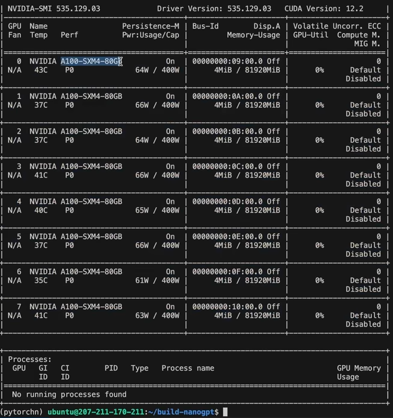

老师的卡，8个[A100的80GB的卡](https://www.nvidia.com/content/dam/en-zz/Solutions/Data-Center/a100/pdf/nvidia-a100-datasheet-us-nvidia-1758950-r4-web.pdf)，对应的型号是：**A100 80GB SXM**， 真富裕啊

想知道某个卡的情况，直接搜索 卡型号+datasheet，例如： `A100 datasheet`;

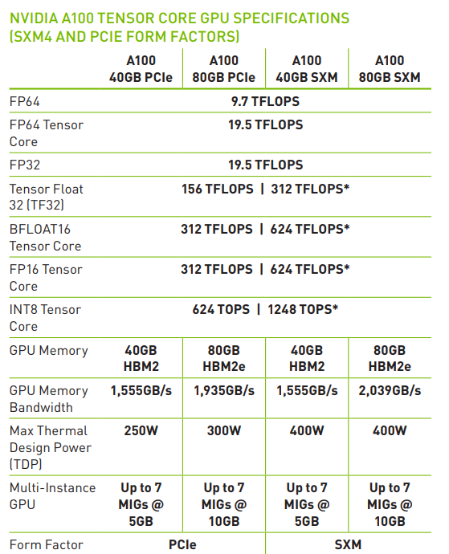

+ 虽然A100最高支持`FP64`的精度，但是一般在深度学习中，用不到那么高的精度；科学计算才会用到`FP64`
+ 对于深度学习的训练来说，一般使用`FP32`(单精度浮点数即可)，即：每秒 19.5万亿次浮点数计算的性能， T(tera,万亿)
+ 有带星号的，是稀疏技术的，目前业界基本没有使用稀疏矩阵的，所以可以不看，主要看前面那个没有星号的就好
+ 除了显存之外，带宽也是另一个限制因素，**事实上，很多深度学习训练任务都受限于内存带宽 memory bound**; 核心算子大部分时候都受限于内存带宽运不过来数据，所以很多时候都在等待，处在`idle`空闲状态，所以gpu的利用率在60%左右就已经很不错了~

默认情况下，pytorch的浮点数都是`float32`，
```bash
>>> logits.dtype
torch.float32
```

关于数据精度： [Floating-Point 8: An Introduction to Efficient, Lower-Precision AI Training](https://developer.nvidia.com/blog/floating-point-8-an-introduction-to-efficient-lower-precision-ai-training/) 这里有张图不错

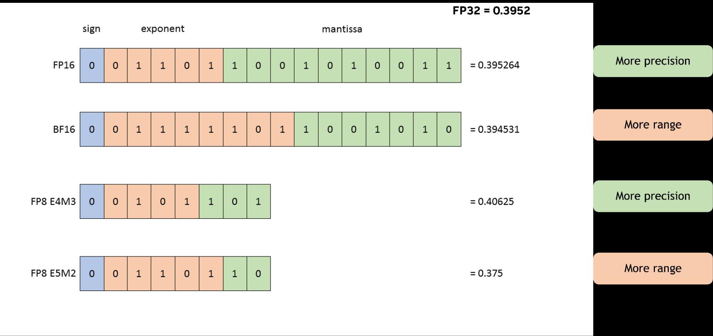

## 4.2 Tensor Cores以及混合精度
### 4.2.1 理论说明
如果想了解一些关于GPU的内容，可以去`developer blog`搜索，[developer blog/开发者博客 链接](https://developer.nvidia.com/blog)。
+ 比如： `Tensor cores`就可以看到: [NVIDIA Ampere Architecture In-Depth](https://developer.nvidia.com/blog/nvidia-ampere-architecture-in-depth/)， 这个是详细讲述`A100`的`tensor cores`架构的
  + 同时在[Accelerating Medical Image Segmentation with NVIDIA Tensor Cores and TensorFlow 2](https://developer.nvidia.com/blog/accelerating-medical-image-segmentation-tensor-cores-tensorflow-2/)可以看到，要充分利用`Tensor Cores`可以开启混合精度
    ```python
      tf.keras.mixed_precision.experimental.set_policy('mixed_float16')
      # 所以早年TF2.0对Tensor Cores混合精度这种支持还是比较前沿的
    ```


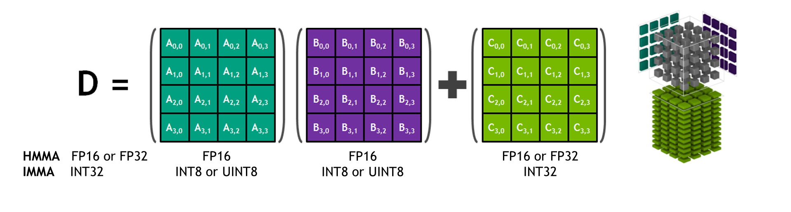   
+ 上图(老师的图)来自： 
  + [Accelerating WinML and NVIDIA Tensor Cores](https://developer.nvidia.com/blog/accelerating-winml-and-nvidia-tensor-cores/)
  + [Automatic Mixed Precision for NVIDIA Tensor Core Architecture in TensorFlow](https://developer.nvidia.com/blog/nvidia-automatic-mixed-precision-tensorflow/)
  + [Tensor Core Programming Using CUDA Fortran](https://developer.nvidia.com/blog/tensor-core-programming-using-cuda-fortran/)： 这里有关于这张图的详细解释
  + [Video Series: Mixed-Precision Training Techniques Using Tensor Cores for Deep Learning](https://developer.nvidia.com/blog/video-mixed-precision-techniques-tensor-cores-deep-learning/): 一系列视频，下面也有参考链接，基本很全面了
  + NVIDIA的Doc: [NVIDIA Docs Hub Homepage -> NVIDIA Deep Learning Performance -> Train With Mixed Precision](https://docs.nvidia.com/deeplearning/performance/mixed-precision-training/index.html)
  + [NVIDIA Tensor Core Programming](https://leimao.github.io/blog/NVIDIA-Tensor-Core-Programming/), 一直没有在NVIDIA的网站里找到高分辨率的图，这个博客里有
  + [Unlocking Tensor Core Performance for Machine Learning Interatomic Potentials](https://developer.nvidia.com/blog/unlocking-tensor-core-performance-for-machine-learning-interatomic-potentials/)
+ [Mixed Precision Training](https://arxiv.org/abs/1710.03740)


----

关于**Tensor core**最完善的学习资料是：[NVIDIA A100 Tensor Core GPU Architecture](https://images.nvidia.com/aem-dam/en-zz/Solutions/data-center/nvidia-ampere-architecture-whitepaper.pdf)

直接目录索引到：**图9**

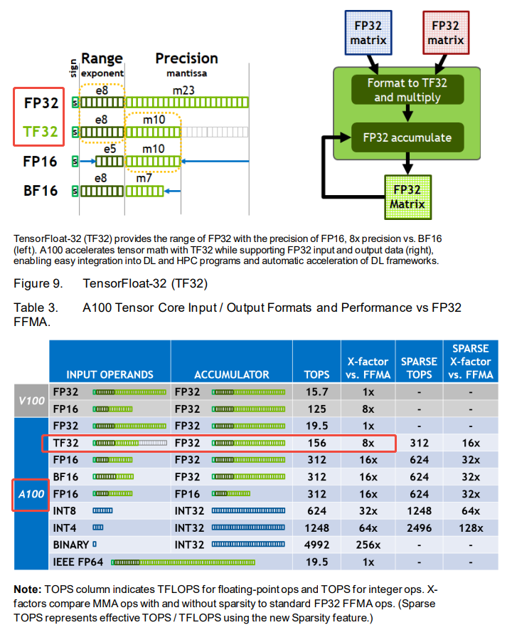

对于页面上半的图：
+ `FP32`，通常是32位，1个符号位(`s`),有8个指数位(`e8`)，23个尾数(`mantissa, m23`)
+ `TF32`和`FP32`一样，都是32位, 都是1个符号位(`s`),有8个指数位(`e8`)，但是其**尾数位在浮点数运算过程中会被截断**
  + 因此对于`TF32`来说，实际上只用了19位，而非完整的32位，末尾的13位会被截断丢弃
  + 计算过程都是在`instruction`(指令)内部完成，因此`pytorch`中并不能看到这种现象
+ TensorFloat-32（TF32）在保持FP32数值范围的同时，具备与FP16相当的精度，精度是BF16的8倍（左图）。
+ **A100通过TF32加速张量计算，同时支持FP32输入和输出数据**（右图），可轻松集成到深度学习和高性能计算程序中，并实现深度学习框架的自动加速。
  + 即：`input`和`output`以及`Accumulate`都保持FP32，但是在内部计算过程中，擦作数会被截断以提升计算速度
+ `BF16`和`TF32`非常像，都是8位指数（即：可表示的数据范围是一样的），但是`BF16`截断的尾数更多，所以相比于`TF32`，同样范围内的数据，`BF16`的数据精度更低
+ 而`FP16`则改变了数值的表示范围，指数位只有5个，即：FP16无法完整表示FP32(单精度浮点数)的全部数值范围
  + 由于`FP16`出现的比较早，所以前期确实有些人用这个格式训练
  + 但是由于数值表示范围的问题，需要配套使用一些`gradient scaling operations`梯度缩放操作
  + 随着A100（Ampere架构的诞生），BF16就成为了使用的主流
+ 关于pytorch中`BF16`对计算精度带来的影响，详见：
  + ✅[pytorch -> Recipes -> Automatic Mixed Precision](https://docs.pytorch.org/tutorials/recipes/recipes/amp_recipe.html)
  + [User Guide -> Developer Notes -> Automatic Mixed Precision examples](https://docs.pytorch.org/docs/2.15/notes/amp_examples.html)
  + 重点关注: [Adding torch.autocast#](https://docs.pytorch.org/tutorials/recipes/recipes/amp_recipe.html#adding-torch-autocast),
    ```python
      with torch.autocast(device_type=device, dtype=torch.float16):
    ```
  + 对应的文档:[class torch.autocast](https://docs.pytorch.org/docs/2.15/amp.html#torch.autocast),关键点:
    ```python
      # Creates model and optimizer in default precision
      model = Net().cuda()
      optimizer = optim.SGD(model.parameters(), ...)

      for input, target in data:
          optimizer.zero_grad()

          # Enables autocasting for the forward pass (model + loss)
          # 1. 只建议用autocast作为前向过程(包括损失计算)的上下文管理器,不建议用autocast来管理反向传播,反向传播的操作类型会和autocast管理的前向操作中的一致
          # 2. 在autocast管理的区域里,张量可能是任何dtype的,因此不可以用half()或者bfloat16()之类的指定Tensor的数据类型
          with torch.autocast(device_type="cuda"):
              output = model(input)
              loss = loss_fn(output, target)

          # Exits the context manager before backward()
          loss.backward()
          optimizer.step()
    ```


同样的情况在下面的表格中也可以看到，`TF32`在实际计算的时候，后面13位是空白状态
+ 虽然采用这种数据格式会增加计算速度，但是代价是：降低了计算精度
+ **只要你能接受微小的精度妥协，这几乎就是零成本的性能提升**
+ **代码完全不用改，这种优化完全封装在运算内部，用户感知就是运算速度提升了8倍**

### 4.2.2 实测(pytorch中启用TF32, BF16)
在pytorch中启用混合精度：
+ [NVIDIA Docs Hub Homepage ->  NVIDIA Deep Learning Performance -> Train With Mixed Precision -> pytorch](https://docs.nvidia.com/deeplearning/performance/mixed-precision-training/index.html#pytorch)
+ [Accelerating Generative AI Part III: Diffusion, Fast](https://pytorch.org/blog/accelerating-generative-ai-3/), 页面搜索`TF32`,有： 
  > Since we use an A100 GPU (Ampere architecture) here, we can specify `torch.set_float32_matmul_precision("high")` to benefit from the TF32 precision format.
+ 根据[Docs > torch > torch.set_float32_matmul_precision](https://docs.pytorch.org/docs/2.6/generated/torch.set_float32_matmul_precision.html)
  + 这个API很早就有了， 至少从torch2.6就支持了，torch最新的版本2.15也没有废弃
  + 2.15版本的文档看着舒服点：[Reference API->torch->torch.set_float32_matmul_precision](https://docs.pytorch.org/docs/2.15/generated/torch.set_float32_matmul_precision.html)
  + 但是 根据：[TensorFloat-32 (TF32) on Ampere (and later) devices](https://docs.pytorch.org/docs/2.15/notes/cuda.html#tensorfloat-32-tf32-on-ampere-and-later-devices)以及[TensorFloat-32 (TF32) on Nvidia Ampere (and later) devices](https://docs.pytorch.org/docs/2.15/notes/numerical_accuracy.html)
  + 似乎仅限于A100(`Ampere`之后的架构才可以开启这个特性)

```python
train_loader = DataloaderLite(B=16, T=1024)

   for i in range(50):
        t0 = time.time()
        x,y = train_loader.next_batch() 
        x = x.to(device)
        y = y.to(device)
        logits = model(x)  
        loss = F.cross_entropy(logits.view(-1, logits.size(-1)), y.view(-1))
        optimizer.zero_grad()
        loss.backward() 
        optimizer.step()
        torch.cuda.synchronize() 
        t1 = time.time()
        dt = (t1 -t0)*1000  # miliseconds(毫秒)
        tokens_per_sec = train_loader.B * train_loader.T / (t1 - t0) # 每秒处理的token数量 tokens per second throughout
        print(f"step {i}, loss: {loss.item()}, time: {dt:.2f}ms")
```
+ 当CPU调度GPU的时候，本质上只是在给GPU安排任务，只是在调度一些计算任务
+ 所以CPU给GPU发完指令之后，就会去继续执行别的后续指令了
+ 可能就会导致：`GPU`和`CPU`时钟不同步
  + 例如：上面的代码可能会给`GPU`一下子堆积了很多计算任务，但是`CPU`可能已经执行到计时部分了，此时：`CPU`执行得到的时间并不是真正的`GPU`执行时间
  + 本质上是个异步问题
+ 可以使用`torch.cuda.synchronize()`, 等待所有GPU操作(等待之前给GPU调度的任务)完成，确保计时准确
+ 另外，我们**更关注的不是每个batch的处理时间，而是tokens的处理时间**

执行时，同步使用`nvitop/watch 0.1 nvidia-smi`来监控用量

----

当使用`autocast`时,会改变张量的数据类型. 而`torch.set_float32_matmul_precision("high")`其实不会改变数据类型(只是改变数据计算的规则,但是FP32依然是FP32)
```python
# torch.set_float32_matmul_precision("high")
with torch.autocast(device_type=device, dtype=torch.bfloat16):
    logits = model(x)  # logits.dtype = torch.bfloat16, 
    loss = F.cross_entropy(logits.view(-1, logits.size(-1)), y.view(-1))
# 但是不是所有的数据的类型都会改变
# model.transformer.wte.weight.dtype = torch.float32
# 但是激活值,逻辑值都是 bf16
# 这就是称为混合精度的原因... 有些依然保持FP32,有些被降低为了bf16
```
+ 根据[torch.amp -> CUDA Ops that can autocast to float16](https://docs.pytorch.org/docs/2.15/amp.html#cuda-ops-that-can-autocast-to-float16)以及其后的`CUDA Ops that can autocast to float32`
```bash
# CUDA Ops that can autocast to float16
__matmul__, addbmm, addmm, addmv, addr, baddbmm, bmm, chain_matmul, multi_dot, conv1d, conv2d, conv3d, conv_transpose1d, conv_transpose2d, conv_transpose3d, GRUCell, linear, LSTMCell, matmul, mm, mv, prelu, RNNCell

# CUDA Ops that can autocast to float32
__pow__, __rdiv__, __rpow__, __rtruediv__, acos, asin, binary_cross_entropy_with_logits, cosh, cosine_embedding_loss, cdist, cosine_similarity, cross_entropy, cumprod, cumsum, dist, erfinv, exp, expm1, group_norm, hinge_embedding_loss, kl_div, l1_loss, layer_norm, log, log_softmax, log10, log1p, log2, margin_ranking_loss, mse_loss, multilabel_margin_loss, multi_margin_loss, nll_loss, norm, normalize, pdist, poisson_nll_loss, pow, prod, reciprocal, rsqrt, sinh, smooth_l1_loss, soft_margin_loss, softmax, softmin, softplus, sum, renorm, tan, triplet_margin_loss

# 即: 大部分和矩阵乘法相关的都可以autocast到float16,但是大部分的损失函数都是只能保持float32
```


---

|——|**FP32精度**|**TF32精度**|**BF16**|
|---|---|---|---|
|batch时间|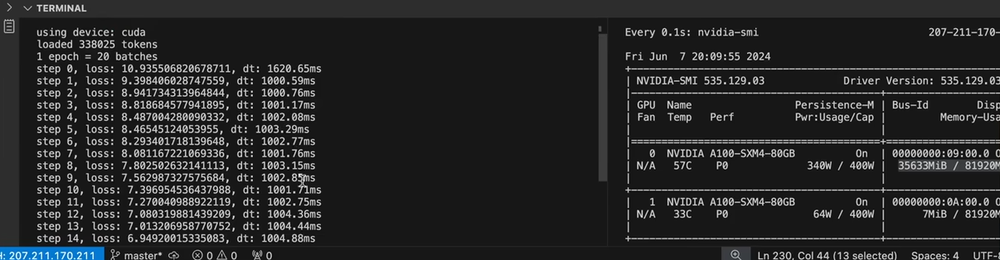| 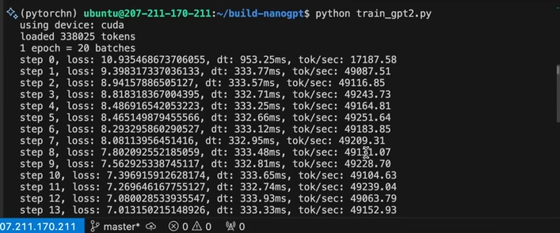|看上面 `A100 datasheet` 和 `图9` 的图<br/>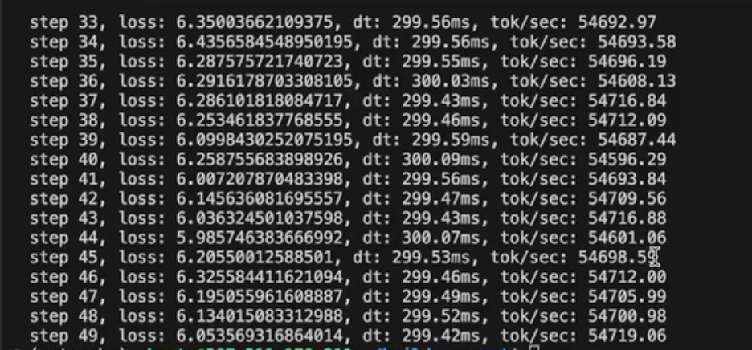|
|tokens吞吐量|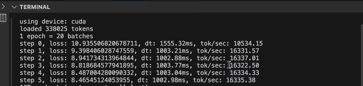<br/>**每秒大约处理1.63w个tokens**|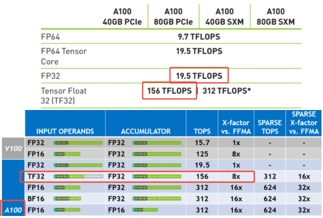虽然在A100的架构手册上写：改为TF32之后是提升8倍，但是**实测下来只有3倍**。| TP32是330ms多,BF16是300ms多,有增长,但是也没有很多|
|其他|8GB的显存无法执行比较大的batch(`B=16, T=1024`), 显存消耗基本是: `35GB/80GB`<br/>由于增加了batch_size， 所以1epoch只需要20个step即可<br/>首次迭代的时间比较长，因为首次的话，pytorch会执行一些初始化操作，比如：初始化梯度/张量缓冲区等|根据 [NVIDIA Docs Hub Homepage ->  NVIDIA Deep Learning Performance -> Train With Mixed Precision -> pytorch](https://docs.nvidia.com/deeplearning/performance/mixed-precision-training/index.html#pytorch)<br/>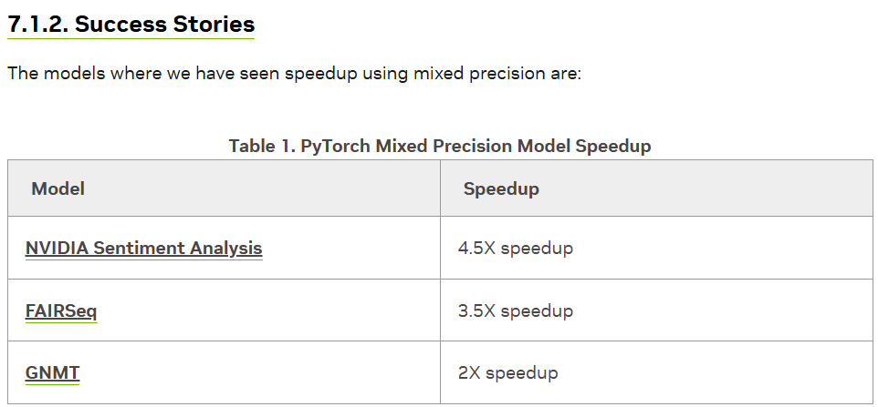<br/>1. 由于网络结构不同，矩阵乘法在整个网络计算量中的占比不同，因此，加速的倍数不一定是8倍，一般都低于8倍<br/>2. 网络带宽问题，虽然TF32理论上可以提供更高的吞吐量，但是搬运这些数据也会消耗很多时间，这些时间无法被提升<br/>**结论：** 我们无法改变要搬运的参数数量，但是可以减少要搬运的参数的位数，即从使用`TF32`变成使用`BF16`，这样要搬运的数据就少了一半|


这里可以大概算一下，`nn.Linear`在整个网络中的参数量占比
```bash
1层 lm_head(768, 50257) 
n_layer = 12
MLP模块 c_fc(768, 4*768)， c_proj(4*768, 768)
CasualSelfAttention模块 c_attn(768, 3*768),  c_proj(768, 768)

线性层的参数量为:
768*50257 + 12*(768*4*768*3) = 123532032 / 124M = 123532032/ (124*10**6) = 123532032/ (1.24*10**8) = 99.6226%
```

## 4.3 torch.compile
[Introduction to torch.compile](https://docs.pytorch.org/tutorials/intermediate/torch_compile_tutorial.html)
+ [Reference API -> torch ->torch.compile](https://docs.pytorch.org/docs/2.15/generated/torch.compile.html)
+ [torch.compile End-to-End Tutorial](https://docs.pytorch.org/tutorials/intermediate/torch_compile_full_example.html)
+ `torch.compile`

# 其他
## 4.1 pytorch的matrix vs tensor
+ <https://docs.pytorch.org/docs/2.14/generated/torch.matmul.html>中有：
  + `The first N-2 dimensions of each argument, the batch dimensions, are broadcast (and thus must be broadcastable). The last 2, the matrix dimensions, are handled as in the matrix-matrix product.`
    >[!NOTE]
    > 即：如果在进行矩阵相关的操作，但是输入的tensor维度大于2，则前`N-2`(减法)的维度都被认为是`batch`, 只有最后两个维度被认为是矩阵维度
+ 对于`torch.tril: Returns the lower triangular part of the matrix (2-D tensor) or batch of matrices input, the other elements of the result tensor out are set to 0.`
  + `Matrix`：在 PyTorch 中默认指代 2D Tensor（最后两维）。
  + `Batch of`：指代在 Matrix 前面附加的任意数量的维度（Batch 维度）。
  + `batch of matrices` 在 PyTorch 开发者的共识中，就等价于“最后两维是矩阵，前面是 Batch”。
+ **PyTorch 处理高维张量时的“全局通用约定”（Global Convention）**
  + **矩阵维度规则**：对于任何带有“矩阵”语义的操作（如 `tril`, `triu`, `matmul`, `bmm`, `det`, `inv`, `svd`, `eig` 等），**永远假设最后两个维度（dim=-2, dim=-1）是矩阵的行和列**。
  + **Batch 维度规则：前面的所有维度（dim=0 到 dim=-3）都是 Batch 维度**。操作会在这些 Batch 维度上独立、并行地进行（或者通过 Broadcasting 广播机制对齐）。

## 4.2 model.eval()什么时候发挥作用

**如果模型中绝对没有使用任何依赖 `self.training` 状态的模块（如 Dropout、BatchNorm 等），那么调用 `model.eval()` 和不调用，在前向传播的数学计算结果上是完全没有区别的。**
+  `model.eval()` 的本质
   + 在 PyTorch 中，`model.eval()` 的源码非常简单，它仅仅是递归地将模型中所有子模块的 `self.training` 属性从 `True` 修改为 `False`。
   - 对于 `BatchNorm`、`Dropout` 等模块，它们的 `forward` 函数内部会判断 `if self.training:`，从而在训练和推理时执行不同的逻辑。
   - 对于 `Linear`、`Conv2d`、`ReLU`、`LayerNorm`、`RMSNorm` 等绝大多数基础模块，它们的 `forward` 函数**根本不检查** `self.training` 状态，因此无论 `eval()` 还是 `train()`，计算逻辑完全一致。
   + 即：`BatchNorm`、`Dropout` 等模块需要`eval()`是因为有`self.training`这个参数的修改
+ 注意： - `model.eval()` **不会**关闭梯度计算（Autograd 引擎依然会构建计算图）。
  - 如果推理时只调用了 `model.eval()` 而没有关闭梯度，模型依然会计算并保存中间变量的梯度，导致**显存占用翻倍，且推理速度变慢**。

    **正确的做法是：**
    在推理时，必须配合使用上下文管理器来关闭梯度：
    ```python
    model.eval()
    with torch.no_grad():  # 或者使用更高效的 torch.inference_mode()
        output = model(input)
    ```

---

在`code\gpt2\train_gpt2.py`中的`sample_test()`函数把`model.eval() `注释掉，不影响结果（需要确认代码里没有`nn.Dropout()`）

## 4.3  model.to(device) vs x = x.to(device)

>[!NOTE]
> **`model.to(device)` 是“原地修改（In-place）”模型内部的参数和缓冲区；而 `x.to(device)` 是“创建一个新张量”并返回。**

### 4.3.1 model.to
在 PyTorch 中，`model`（即 `nn.Module` 的实例）本质上是一个**容器**，它内部包含了多个子模块、参数（`nn.Parameter`）和缓冲区（Buffer）。

调用 `model.to(device)` 时，底层实际执行的是：
1. **递归遍历**：它会递归地遍历模型内的每一个子模块。
2. **原地修改参数**：对于每一个参数和缓冲区，它会调用类似 `param.data = param.data.to(device)` 的操作。
3. **返回自身**：`nn.Module.to()` 方法最终返回的是 `self`（即模型对象本身）。

>[!IMPORTANT]
>+ **结论**：模型**内部引用的参数张量**的设备属性被**原地（in-place）** 改变了，但是对象本身的内存地址没有变，所以不需要重新赋值。(`self`指向的内存地址没变)
>+ 这里需要区分两个关键概念： `Python 对象的内存地址` 和 `张量底层数据的物理存储位置`
>    + Python 对象层（永远在 CPU 内存中）： 
>       + `model` 是一个 `nn.Module` 的 Python 对象。
>       + Python 解释器运行在 CPU 上，它管理的所有对象（包括 `nn.Module` 本身，以及它内部维护的存放参数的字典 `_parameters`）都**永远分配在 CPU 的系统内存（RAM）中**。
>       + “内存地址不变”（即 `id(model)` 不变），指的是这个 **Python 外壳对象**在 CPU 内存中的地址没有变。
>+ **C++ 底层数据层（可以在 CPU 或 GPU）**：
>   + `nn.Module` 内部包含的 `nn.Parameter` 本质上是 `torch.Tensor`。
>   + `Tensor` 在 Python 层只是一个“句柄（Handle）”，它内部包含一个指针（`data_ptr`），指向 C++ 底层实际存储数据的内存块。
>   + 当调用 `model.to('cuda')` 时，底层发生的是：
>       + 在 GPU 显存中分配一块新空间。
>       + 把数据从 CPU 拷贝到 GPU。
>       + **修改 Tensor 句柄内部的 `data_ptr` 指针**，让它指向 GPU 上的新地址。

----

### 4.3.2 tensor.to

>[!NOTE]
>`x = x.to(device)` 需要重新赋值

对于张量（`torch.Tensor`），PyTorch 的设计哲学是**元数据不可变**。张量的 `device`、`dtype`、`shape` 等元数据一旦确定，就不能被原地修改。

当调用 `x.to(device)` 时，底层实际执行的是：
1. 如果 `x` 已经在目标设备上，为了性能优化，它会直接返回 `x` 本身。
2. 如果 `x` 不在目标设备上（比如从 CPU 到 GPU），它会在目标设备上**分配一块全新的显存/内存**。
   1. **数据拷贝**：将原张量的数据拷贝到新分配的内存中。
   2. **返回新对象**：生成并返回一个**全新的张量对象**，原来的张量 `x` 依然留在原设备上，没有任何改变。


为什么这里不通过**修改 Tensor 句柄内部的 `data_ptr` 指针**，让它指向 GPU 上的新地址，来实现`x`的移动？
+ `Tensor`的结构:
  + Tensor（张量句柄）：包含形状（shape）、步长（stride）、偏移量（offset）等元数据。
  + TensorImpl（实现细节）：`Tensor` 指向它。
  + Storage（存储块）：`TensorImpl` 指向它。真正的 `data_ptr`（指向物理内存的指针）是保存在 Storage 里的
+ 如果在`to`的时候直接改了 `data_ptr`，
  ```python 
    # 例一： 视图（View）与内存共享彻底崩溃
     x = torch.randn(10, 10)      # x 在 CPU
     y = x.view(100)              # y 是 x 的视图，x 和 y 共享同一个 CPU Storage
     x = x.to('cuda')             # 假设这里直接修改了 x 的 data_ptr 指向 GPU
     
     # 如果直接修改 x 的底层指针
     # 则 y 的底层依然指向原来的 CPU Storage。
     # 则为了节省内存，PyTorch 把原来的 CPU Storage 释放了，y 瞬间变成了野指针（Dangling Pointer），程序直接崩溃。

     # 例二： 自动求导（Autograd）计算图断裂
     x = torch.randn(10, requires_grad=True)
     y = x * 2
     z = y.sum()
    # 此时计算图是：z -> y -> x
    # 如果直接修改了 x 的底层指针
    # 当执行 z.backward() 时，Autograd 引擎去计算 x 的梯度，发现 x 的底层指针已经指向了 GPU，而梯度累加器（Gradient Accumulator）还在 CPU 上，或者计算图的拓扑结构因为指针的突变而无法对齐，反向传播直接报错或计算出完全错误的梯度。
  ```

### 4.3.3 Module.to的底层实现

PyTorch 的设计哲学是：**张量的元数据（Device, Dtype）是不可变的（Immutable）**。
+ 因此`Tensor`要挪，必须创建一个新张量
+ 而`model`是原地操作，是因为`model`只是那些张量的封装，本身这个壳的指针是不变的
  + [文档：torch.Tensor/torch.Tensor.to](https://docs.pytorch.org/docs/2.15/generated/torch.Tensor.to.html#torch-tensor-to)
  + [文档：Module.to()](https://docs.pytorch.org/docs/2.15/generated/torch.nn.Module.html#torch.nn.Module.to)
+ [源码：torch/nn/modules/module.py-> to()](https://github.com/pytorch/pytorch/blob/v2.15.0/torch/nn/modules/module.py#L1259)
  + 需要看旧一点的torch版本：<https://github.com/pytorch/pytorch/blob/0c455332e8ca7b3c426b7eb95b696eef7bedee47/torch/nn/modules/module.py#L385>
  + 有以下关键内容：
   ```python
      # https://github.com/pytorch/pytorch/blob/0c455332e8ca7b3c426b7eb95b696eef7bedee47/torch/nn/modules/module.py#L573
      def to(self, *args, **kwargs):
          # 1. 解析 device, dtype, non_blocking 等参数
          device, dtype, non_blocking, convert_to_format = torch._C._nn._parse_to(*args, **kwargs)

          # 2. 定义一个闭包函数 convert，它的作用就是调用张量的 .to() 方法
          def convert(t):
              if convert_to_format is not None and t.dim() in (4, 5):
                  # 处理内存格式（如 channels_last），这里省略
                  return t.to(device, dtype if t.is_floating_point() else None, non_blocking, memory_format=convert_to_format)
              # 核心：调用底层张量的 to()，返回一个新的张量/参数
              return t.to(device, dtype if t.is_floating_point() else None, non_blocking)

          # 3. 将 convert 函数传递给核心方法 _apply
          return self._apply(convert)
      # https://github.com/pytorch/pytorch/blob/0c455332e8ca7b3c426b7eb95b696eef7bedee47/torch/nn/modules/module.py#L385
      def _apply(self, fn, recurse=True):
        # 1. 递归处理子模块 (Children)
        if recurse:
            for module in self.children():
                module._apply(fn, recurse)
        ...
        # 2. 核心：遍历并替换自身的 Parameters (参数)
        for key, param in self._parameters.items():
            if param is not None:
                # 调用传入的 fn (即上面的 convert 函数)
                # param.to(...) 会在 GPU 上创建一个新张量，并返回
                param_applied = fn(param)
                
                # 【关键代码】：将字典中的旧引用，替换为 fn 返回的新引用！
                # 如果返回的不是 Parameter，还需要重新包装一下
                if param_applied is not param:
                    self._parameters[key] = nn.Parameter(param_applied, requires_grad=param.requires_grad)
                    
        # 3. 核心：遍历并替换自身的 Buffers (缓冲区，如 BatchNorm 的 running_mean)
        for key, buf in self._buffers.items():
            if buf is not None:
                buf_applied = fn(buf)
                # 【关键代码】：同样，替换字典中的引用
                if buf_applied is not buf:
                    self._buffers[key] = buf_applied

        # 4. 返回自身 (self)
        return self
   ```

### 4.3.4 总结和延伸
* **为什么 `x = x.to(device)` 需要赋值？**
  + 因为对于普通张量 `x`，PyTorch 没有类似 `_apply` 这样的容器机制去替换它的底层引用。`x.to()` 只能返回一个新对象，如果您不写 `x = ...`，变量 `x` 在 Python 命名空间里依然绑定着那个旧的 CPU 张量。

* **为什么 `model.to(device)` 不需要赋值？**
  + 因为 `model.to()` 最终调用了 `_apply()`。`_apply()` 在内部通过 `self._parameters[key] = ...` **原地修改了模型内部字典的引用**。
  并且请注意 `_apply()` 的最后一行：**`return self`**。
  它返回的是模型对象本身。所以 `model = model.to(device)` 实际上等同于 `model = model`，毫无意义。

*  这里存在一个**致命的性能瓶颈**：
   + `_apply` 是**串行、逐个参数**调用 `fn(param)` 的。
     对于一个 7B 的 LLM，有几千个 `nn.Parameter`。这意味着 `model.to('cuda')` 会触发**几千次**独立的 CPU 到 GPU 的内存拷贝（PCIe 传输）。
     这种细粒度的拷贝不仅慢，而且在拷贝期间，GPU 的计算单元是闲置的。
   + **这就是为什么在 LLM 领域，会极力避免使用原生的 `model.to()`：**
       1. **HuggingFace 的 `device_map="auto"`**：它在底层完全绕过了 `nn.Module.to()`。它使用 `init_empty_weights` 初始化空壳模型，然后直接读取 Safetensors 权重文件，**按层（Layer）甚至按张量分块（Shard）**，以最大的块（Chunk）一次性通过 DMA（直接内存访问）搬运到 GPU 上，将 PCIe 的带宽利用率榨干。
       2. **DeepSpeed/Megatron**：在分布式初始化时，也是直接在目标设备上分配内存并加载分片权重，绝不会在 CPU 上实例化完整模型后再调用 `to()`。


## 4.4 交叉熵损失

之前的 [code\3_MLP_makemore.ipynb](../code/3_MLP_makemore.ipynb)
```python
F.cross_entropy(logits, Y)

V.S.

counts = logits.exp()
prob = counts/counts.sum(1,keepdim = True)
loss = - prob[torch.arange(32), Y].log().mean()

# 所以Y的作用仅仅是索引正确类的index
```

---

>[!NOTE]
>pytorch的[`CrossEntropyLoss`文档](https://docs.pytorch.org/docs/2.15/generated/torch.nn.CrossEntropyLoss.html), 
><br/>这个文档其实写的更简洁：[torch.nn.functional.cross_entropy](https://docs.pytorch.org/docs/2.15/generated/torch.nn.functional.cross_entropy.html)
><br/>但是直接搜索`CrossEntropyLoss`先出来的链接是上面那个复杂的~

几个容易造成误区的关键点(直接用llm把source里的说明部分全都翻译一下。。)
+ The `input` is expected to contain the unnormalized logits for each class (which do `not` need to be positive or sum to 1, in general). `input` has to be a Tensor of size $(C)$ for unbatched input, $(minibatch, C)$ or $(minibatch, C, d_1, d_2, ..., d_K)$ with $K \geq 1$ for the `K`-dimensional case. The last being useful for higher dimension inputs, such as computing cross entropy loss per-pixel for 2D images.
  + `input`: 包含对每个类的没有归一化过的`logits`, 不是必须保证和为1，即：不需要额外提前进行softmax归一化；
  + 对于`unbatched`的输入，`input`必须是$(C)$的张量
  + 对于`batch`的输入，`input`必须是$(minibatch, C)$或$(minibatch, C, d_1, d_2, ..., d_K)$shape的张量，对于后者， $K \geq 1$是针对于`K`维的情况
  + 这里 $C = \text{number of classes}$, $N =\text{batch size}$
+ `target`（目标标签）应包含以下两种形式之一：
  - `Class indices`，取值范围为 $[0, C)$，其中 $C$ 为类别总数；如果指定了 `ignore_index`，该损失函数也会接受此索引值（该索引不一定在正常的类别取值范围内）。当未进行归约（即 `reduction` 设置为 `'none'`）时，此情况下的损失计算公式如下：

    $$
    \ell(x, y) = L = \{l_1,\dots,l_N\}^\top, \quad l_n = - w_{y_n} \log \frac{\exp(x_{n,y_n})}{\sum_{c=1}^C \exp(x_{n,c})} \cdot \mathbb{1}\{y_n \neq \text{ignore\_index}\}
    $$

    其中，$x$ 为输入，$y$ 为目标标签，$w$ 为权重，$C$ 为类别总数。如果 `reduction` 参数不为 `'none'`（默认为 `'mean'`），
    
    标记 $x_{n,y_n}$中  
    
    **$n$ (样本索引)** 代表展平（flatten）后的第 $n$ 个样本。如果输入是 2D 的 `(batch_size, C)`，那么 $n \in [0, \text{batch\_size}-1]$；如果是处理图像分割或序列的 3D/4D 张量，$n$ 则跨越了 batch 维度以及空间维度 $d_1, \dots, d_k$.  
    
    **$y_n$ (真实类别索引)**代表第 $n$ 个样本的**真实标签（Ground Truth）** 所对应的类别下标。

    $x_{n,y_n}$ 表示：**对于第 $n$ 个样本，模型在“它真实的正确类别 $y_n$”上输出的原始预测得分（logit）。**

    $$
    \ell(x, y) = \begin{cases}
        \sum_{n=1}^N \frac{1}{\sum_{n=1}^N w_{y_n} \cdot \mathbb{1}\{y_n \neq \text{ignore\_index}\}} l_n, & \text{if reduction} = \text{'mean'};\\
        \sum_{n=1}^N l_n, & \text{if reduction} = \text{'sum'}.
    \end{cases}
    $$

    需要注意的是，这种情况在数学上等价于先对输入应用 `LogSoftmax`，然后再计算 `NLLLoss`。 即
    ```python
      counts = logits.exp()
      prob = counts/counts.sum(1,keepdim = True)
      loss = - prob[torch.arange(32), Y].log().mean()
    ```

  - `每个类别的概率`；当小批量（minibatch）中的每个样本需要包含多个类别的标签信息时（例如混合标签 blended labels、标签平滑 label smoothing 等场景），这种形式非常有用。当未进行归约（即 `reduction` 设置为 `'none'`）时，此情况下的损失计算公式如下：

    $$
    \ell(x, y) = L = \{l_1,\dots,l_N\}^\top, \quad l_n = - \sum_{c=1}^C w_c \log \frac{\exp(x_{n,c})}{\sum_{i=1}^C \exp(x_{n,i})} y_{n,c}
    $$

    其中，$x$ 为输入，$y$ 为目标标签，$w$ 为权重，$C$ 为类别总数。如果 `reduction` 参数不为 `'none'`（默认为 `'mean'`），则：

    $$
    \ell(x, y) = \begin{cases}
        \frac{\sum_{n=1}^N l_n}{N}, & \text{if reduction} = \text{'mean'};\\
        \sum_{n=1}^N l_n, & \text{if reduction} = \text{'sum'}.
    \end{cases}
    $$

  **注意**：通常情况下，当 `target` 采用**类别索引**（即第一种情况）时，该损失函数的计算性能更好，因为这种形式允许底层进行高度优化的计算。只有当“每个样本只能属于单一类别”这一假设过于严苛，无法满足实际需求时，才建议将 `target` 设置为类别概率分布。


----


1.  **Softmax 概率计算**：$\frac{\exp(x_{n,y_n})}{\sum_{c=1}^C \exp(x_{n,c})}$
    *   这就是标准的 Softmax 公式。分子是真实类别的 logit 指数，分母是所有 $C$ 个类别 logit 指数之和。计算结果就是模型预测第 $n$ 个样本属于真实类别 $y_n$ 的**概率 $p$**。
2.  **负对数似然 (NLL)**：$-\log(\dots)$
    *   对概率取对数并加负号。预测概率 $p$ 越接近 1，$\log(p)$ 越接近 0，Loss 越小；$p$ 越接近 0，Loss 越大。
3.  **类别权重**：$w_{y_n}$
    *   对应 PyTorch 中的 `weight` 参数。$w_{y_n}$ 表示真实类别 $y_n$ 的权重。主要用于处理**类别不平衡**问题（例如长尾分布），给少数类更大的权重。
4.  **忽略掩码**：$\mathbb{1}\{y_n \not= \text{ignore\_index}\}$
    *   这是一个指示函数。如果真实标签 $y_n$ 等于 `ignore_index`，则该项为 0，该样本的 loss 为 0，**不参与反向传播的梯度计算**。

---

映射到 LLM 的 **Next-token prediction (自回归语言模型)** 任务中

在 LLM 的 LM Head 输出后，计算 Loss 时：
*   **$C$ (类别数)**：等于 **词表大小 (Vocab Size)**，比如 32000 或 128000。
*   **$N$ (样本总数)**：等于 `batch_size * seq_len`（如果是 causal LM，通常还会减去 1，因为输入和标签有错位）。也就是当前 batch 中**所有需要预测的 token 总数**。
*   **$y_n$ (真实标签)**：第 $n$ 个位置上的**目标 token ID**（即输入序列往后错位一位的 token）。
*   **$x_{n, y_n}$**：模型在第 $n$ 个位置，预测出**真实目标 token ID** 的那个 logit 值。
*   **$\text{ignore\_index}$**：通常被设置为 **`pad_token_id`**。在 LLM 训练时，一个 batch 内的序列长度不一，短序列会用 pad token 补齐。设置 `ignore_index=pad_token_id` 后，模型在计算 loss 时就会**自动忽略所有 padding 位置**，只计算有效 token 的交叉熵。

---

数值稳定性 (Numerical Stability)

PyTorch 底层**并没有**直接按这个公式算，而是利用了 **LogSumExp trick** 进行了数学等价变换：
$$ -\log \frac{\exp(x_{n,y_n})}{\sum_{c} \exp(x_{n,c})} = -x_{n,y_n} + \log \sum_{c} \exp(x_{n,c}) $$
在计算 $\log \sum \exp(x_{n,c})$ 时，PyTorch 会先减去一个最大值 $m = \max_c(x_{n,c})$ 来保证指数运算的数值稳定性：
$$ \log \sum_{c} \exp(x_{n,c}) = m + \log \sum_{c} \exp(x_{n,c} - m) $$


## 4.5 torch.long vs. torch.int64
在 [torch.dtype](https://docs.pytorch.org/docs/2.15/tensor_attributes.html#torch-dtype)文档中，可以看到：

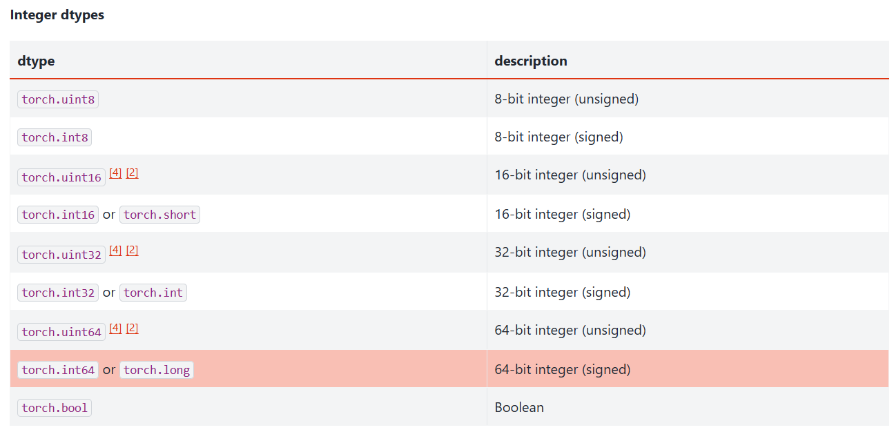

所以 `torch.long`和`torch.int64`是一个玩意。。。

在[torch.Tensor.long](https://docs.pytorch.org/docs/2.15/generated/torch.Tensor.long.html) 中，有: `self.long() is equivalent to self.to(torch.int64). `


## 4.6 vscode调试进入 torch魔法代码

想看看`self.transformer.wte.weight  = self.lm_head.weight`这句话到底跳转到了哪里，设置vscode的`launch.json`，重点是在默认生成的这个文件里，添加`"justMyCode": false`

VSCode 的 Python 调试器 (debugpy) 默认开启了 `"justMyCode": true`。
+ 这导致：调试器会自动跳过所有非你本人编写的代码（包括 site-packages 下的 PyTorch 源码）。
+ 因此按 F11 尝试进入 `_setattr_` 时，调试器发现它在 `PyTorch` 库里，就会直接执行完毕并跳到下一行。

开启后，就可以直接进去了

```json
{
    // Use IntelliSense to learn about possible attributes.
    // Hover to view descriptions of existing attributes.
    // For more information, visit: https://go.microsoft.com/fwlink/?linkid=830387
    "version": "0.2.0",
    "configurations": [
        {
            "name": "Python Debugger: Current File",
            "type": "debugpy",
            "request": "launch",
            "program": "${file}",
            "console": "integratedTerminal",
            "justMyCode": false  // <--- 关键：将这里的 true 改为 false
        }
    ]
}
```

## 4.7 运行过程 + 交互式调试

| 对比维度 | `code.interact(local=locals())`<br/>**基础暂停** | `IPython.embed()`<br/>**增强交互** | `breakpoint()` (Python 3.7+)<br/>**专业单步调试** |
| :--- | :--- | :--- | :--- |
| **核心定位** | 基础交互式暂停 | 增强型交互式暂停 | **真正的单步调试器 (Debugger)** |
| **依赖情况** | Python 内置，零依赖 | 需第三方库 (`pip install ipython`) | Python 内置，零依赖 |
| **上下文注入** | **手动** (需显式传 `locals()`) | **自动** (默认注入局部和全局变量) | **自动** (拥有完整的执行上下文) |
| **交互体验** | 原生 REPL (简陋，无高亮/补全) | **极佳** (语法高亮、自动补全、对象内省) | 命令行调试模式 (无语法高亮，纯命令驱动) |
| **核心能力** | 只能查看和简单计算变量 | 支持魔术命令 (如 `%timeit`)、快速查看对象属性 | **单步执行、查看调用栈、动态修改代码逻辑** |
| **退出方式** | `exit()` 或 `Ctrl+D` | `exit()` 或 `Ctrl+D` | `c` (continue) 或 `Ctrl+D` |
| **痛点/优点** |  * 必须手动传 `locals()`，如果还想用全局变量，得写成 `code.interact(local=locals(), globals=globals())`，非常繁琐。<br/>* 没有自动补全，没有语法高亮，查看复杂对象（如 PyTorch 的 Tensor）时，输出格式不够友好。|  * **自动上下文**：不需要传 `locals()`，直接就能访问当前所有的变量。<br/>* **对象内省（神器）**：输入 `tensor_name?` 或 `model.forward??`，可以直接在终端查看该对象的文档、源码和类型。在研究 LLM 源码（如 HuggingFace Transformers）时，快速查看某个类的实现极其方便。<br/>* **魔术命令**：可以使用 `%timeit` 测试某段 Attention 计算或数据预处理的耗时；使用 `%hist` 查看刚才输入的命令历史。|Python 3.7 引入的内置函数，底层默认调用 `pdb`（Python Debugger）。本质不是“交互式计算”，而是 **接管程序的控制流** <br/>* **单步执行**：可以一行一行地执行代码（`n` 下一步，`s` 进入函数内部），这对于排查 LLM 训练中复杂的梯度消失、NaN 问题、或者分布式训练（DeepSpeed/FSDP）的状态同步问题至关重要。<br/>* **查看调用栈**：输入 `w` (where)，可以清晰看到当前代码是被哪几层函数调用进来的，帮助理清复杂的模型前向传播逻辑。<br/>* **动态修改**：可以在调试时直接给变量重新赋值（例如把某个导致 OOM 的 batch_size 强行改小），然后输入 `c` 继续运行，而不需要重启漫长的模型加载过程。
| **本质** |最原始的“打桩”调试。它就像在代码里挖了个坑，程序掉进去后，给您一个最基础的 Python 命令行。|IPython 提供的增强型交互式环境。在算法和数据科学领域，IPython 几乎是标配。|
|**使用场景**|   |**日常数据探查与源码阅读**<br/>处理数据、或者阅读 HuggingFace 源码想搞清楚某个中间变量（如 `hidden_states`、`attention_mask`）的 shape 和具体数值时，用它最顺手。它的 `?` 内省功能能帮您快速看懂源码|**排查复杂 Bug 与逻辑错误**<br/>当模型训练 Loss 不降、出现 NaN、或者分布式训练卡死时，用 `breakpoint()` 配合单步调试，去追踪数据在每一层网络中的流转情况|
|**用法**|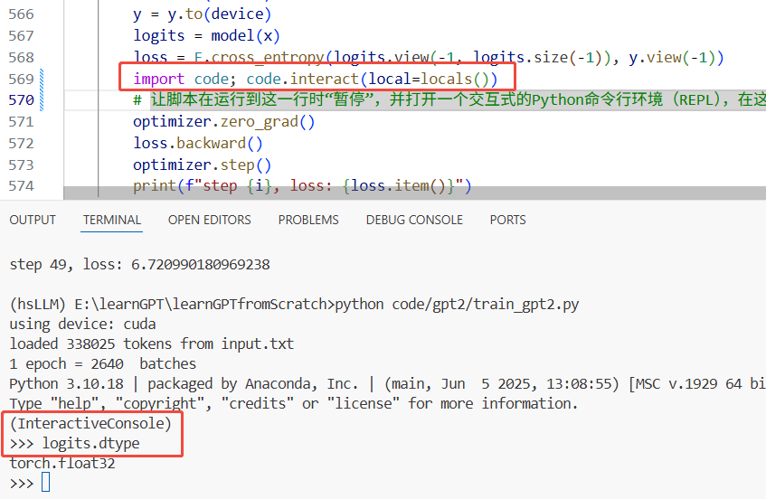<br/>这个结束后，会直接终止整个代码执行|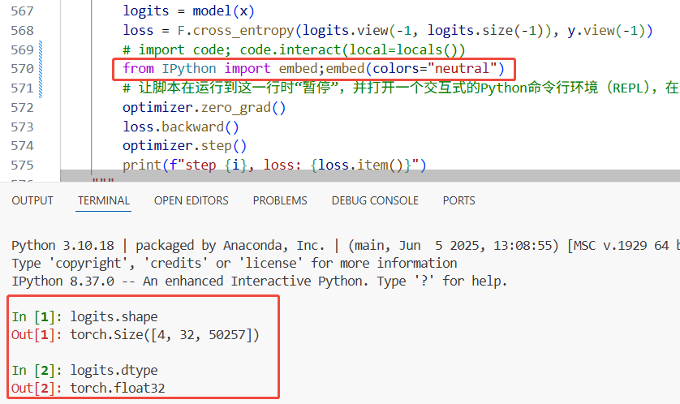<br/>这个退出后，不会影响代码的执行，所以如果是在`for`循环的话，还会重复进入`Ipython`中|
|**代码**|`import code; code.interact(local=locals())`|`from IPython import embed;embed(colors="neutral") `<br/>`colors="neutral"`，防止在某些终端下颜色显示错乱|

**其他**
1. **IDE 可视化调试**: 不用写`breakpoint()`。直接在行号旁边打个红点，使用 Debug 模式运行。IDE 的可视化调试器底层也是基于 `pdb` 的，但它提供了图形化的变量查看器（可以直观展开 Tensor 的维度）、条件断点和表达式求值，是排查 LLM 复杂 Bug 效率最高的方式。
2. 美化`breakpoint()`
    ```bash
      # pdb的命令行界面太丑，可以在终端执行
      export PYTHONBREAKPOINT="IPython.terminal.debugger.set_trace"
      # 替换breakpoint()的底层调试器是可以通过环境变量替换的，触发时就会进入 IPython 的调试环境，既拥有单步调试的能力，又拥有 IPython 漂亮的语法高亮和自动补全！
    ```
3. **常用 Pdb 命令速记**：
  * `n` (next): 执行下一行（不进入子函数）。
  * `s` (step): 执行下一行（**进入**子函数内部）。
  * `c` (continue): 继续运行，直到遇到下一个断点。
  * `p 变量名` (print): 打印变量。
  * `l` (list): 查看当前代码上下文。
  * `w` (where): 打印调用栈。