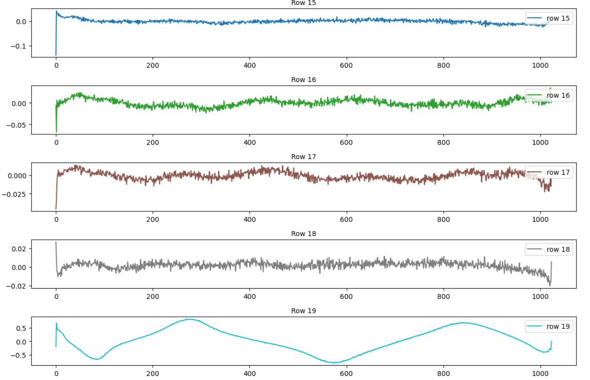
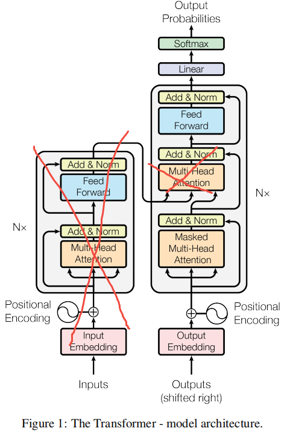

- [P10: 复现 GPT-2 (124M 参数)](#p10-复现-gpt-2-124m-参数)
  - [链接](#链接)
- [1. gpt2简述](#1-gpt2简述)
- [2. gpt2权重可视化](#2-gpt2权重可视化)
  - [2.1 wpe（位置嵌入）](#21-wpe位置嵌入)
  - [2.2 gpt2的wpe可视化](#22-gpt2的wpe可视化)
- [3. gpt模型实现](#3-gpt模型实现)
  - [3.1 与Transformer模型的关键差异](#31-与transformer模型的关键差异)
  - [3.2 TensorFlow vs huggingface(pytorch)历史差异](#32-tensorflow-vs-huggingfacepytorch历史差异)
  - [3.3 GELU激活函数](#33-gelu激活函数)
  - [3.x GELU近似/精确结果对比](#3x-gelu近似精确结果对比)
- [其他](#其他)
  - [4.1 pytorch的matrix vs tensor](#41-pytorch的matrix-vs-tensor)

# P10: 复现 GPT-2 (124M 参数)
## 链接
B站视频链接：
+ [Andrej Karpathy【中英⚡从零构建 GPT（重制版）|Neural Networks: Zero to Hero】](https://www.bilibili.com/video/BV1mqrTBvEaf/?p=3&spm_id_from=333.1007.top_right_bar_window_history.content.click&vd_source=1019ffdc843339404e9df6ae52ff9e77)

Github项目：
+ [Github: karpathy/nn-zero-to-hero](https://github.com/karpathy/nn-zero-to-hero)
+ <https://github.com/karpathy/llm.c>
+ <https://github.com/karpathy/nanoGPT>

# 1. gpt2简述

发布的GPT2有不同的规格，其中**论文和博客里给的数据和实际有些出入**，这里我们需要复现的是 1.24M(最小的参数量，论文里写的是117M)版本
+ https://github.com/openai/gpt-2
  ```bash
    * Note that our original parameter counts were wrong due to an error (in our previous blog posts and paper). Thus you may have seen small referred to as 117M and medium referred to as 345M.
  ```
+ https://openai.com/research/better-language-models/


---

GPT-2是2019年2月的工作了，已经是七年前的内容了，放到现在来说，1小时可能就训练好了~
+ 这里除了借鉴GPT-2，还参考了GPT-3的论文，因为OpenAI的论文很少会公布训练详情
+ GPT-3中有参数设置，优化配置方面提供了更为详尽的说明
+ 在[gpt2-src/model.py](https://github.com/openai/gpt-2/blob/master/src/model.py)中，可以看到，原始发布的gpt2代码是`TensorFlow`写的,这里改用基于`pytorch`实现的`huggingface`的`transformers`库。
  + [huggingface/src/transformers/models/gpt2/modeling_gpt2.py](https://github.com/huggingface/transformers/blob/main/src/transformers/models/gpt2/modeling_gpt2.py)
  + 这个脚本的可读性是中等，但是关键在于完成了原始的gpt2的TensorFlow版本到pytorch版本的转换(完全兼容)

----

+ [openai-community/gpt2](https://hf-mirror.com/openai-community/gpt2)
    + **This is the smallest version of GPT-2, with 124M parameters.**, 默认的gpt2对应的是最小参数的版本
    + 其他参数的版本在其他仓库
    + [openai-community/gpt2-large](https://huggingface.co/openai-community/gpt2-large)
    + [openai-community/gpt2-medium](https://huggingface.co/openai-community/gpt2-medium)
    + [openai-community/gpt2-xl](https://huggingface.co/openai-community/gpt2-xl)

# 2. gpt2权重可视化
## 2.1 wpe（位置嵌入）

**固定成正余弦函数 vs 随机初始化**
1. GPT-2 的 `wpe` 是随机初始化的（正态分布，std=0.02），并且是可学习的。初始化链路是这样的：
   1. `GPT2Model.__init__` 里创建 `self.wpe = nn.Embedding(...)` 后调用 `self.post_init()`（[modeling_gpt2.py:503](https://github.com/huggingface/transformers/blob/main/src/transformers/models/gpt2/modeling_gpt2.py#L503) ）；
   2. `post_init()` 会递归地对每个子模块调用 `_init_weights`。GPT2 自己的 `_init_weights`（[modeling_gpt2.py:433](https://github.com/huggingface/transformers/blob/main/src/transformers/models/gpt2/modeling_gpt2.py#L433)）先执行 `super()._init_weights(module)`，它只额外处理了 `Conv1D` 和注意力输出投影的缩放初始化，**没有覆盖** `nn.Embedding` 的处理；
   3. 因此 `wpe` 走的是基类逻辑（[modeling_utils.py:2321](https://github.com/huggingface/transformers/blob/main/src/transformers/models/modeling_utils.py#L2321)）：`init.normal_(module.weight, mean=0.0, std=std)`，其中 `std = config.initializer_range`，GPT2Config 默认值为 **0.02**（[configuration_gpt2.py:89](https://github.com/huggingface/transformers/blob/main/src/transformers/models/gpt2/configuration_gpt2.py#L89)）。
   4. 所以：**是从 N(0, 0.02²) 随机采样初始化的可学习参数**，随预训练一起更新。这也意味着它是“学习的绝对位置嵌入”——预训练时模型自己学出每个位置的向量，而不是公式算出来的。当然，如果用 `from_pretrained("openai-community/gpt2")` 加载，`wpe` 会被 checkpoint 里的预训练值覆盖，随机初始化只影响从头训练的场景。
2. 原始论文用的是 sin/cos 位置编码——但严格说是“固定编码”，不是“初始化”。《Attention Is All You Need》中的正弦位置编码公式为：
   $$PE_{(pos, 2i)} = \sin\left(\frac{pos}{10000^{2i/d_{model}}}\right), \quad PE_{(pos, 2i+1)} = \cos\left(\frac{pos}{10000^{2i/d_{model}}}\right)$$
   + 论文里的位置编码是**直接由公式确定、没有任何可学习参数**的固定向量，不进行训练，完全不更新。
   + 论文还做过对比实验：学习的位置嵌入和正弦编码效果基本相当，他们选正弦编码是希望对更长的序列有外推能力。
3. **两种方案的关系**：
   1. GPT/GPT-2 采用的是“学习的位置嵌入”路线（`wpe`，随机初始化 + 训练），而没有沿用 Transformer 原论文的固定正弦编码。
   2. transformers 里正弦编码的实现，可以参考 `SinusoidalPositionalEmbedding`，BART、Marian 等模型还在用它。

---

## 2.2 gpt2的wpe可视化

可以看到，虽然是随机初始化的，但是训练之后，确实有些也类似正余弦函数，详见：  [code\10_gpt.ipynb](../code/10_gpt.ipynb)




# 3. gpt模型实现

## 3.1 与Transformer模型的关键差异


gpt2模型的结构和原始的Transformer有所不同，其采用的是`decoder-only` transformer结构，即：
+ 删除了encode部分，没有编码器，只有解码器，同时删除了解码器中(decode)用于连接编码器(encode)的`cross-attention`部分, 其余地方基本保持不变
+ 还有一些差异：
  + 在gpt2的论文中(**2.3 Model**)中提到：`Layer normalization (Ba et al., 2016) was moved to the input of each sub-block, similar to a
pre-activation residual network (He et al., 2016) and an additional layer normalization was added after the final self-attention block.`
  + LN层归一化放到了每个注意力模块的输入的地方，同时在最后一个自注意力块后面加了一个LN层

## 3.2 TensorFlow vs huggingface(pytorch)历史差异
**prompt**:

已知加载的gpt2模型权重有以下结构：
```bash
transformer.h.1.mlp.c_fc.weight torch.Size([768, 3072])
transformer.h.1.mlp.c_fc.bias torch.Size([3072])
transformer.h.1.mlp.c_proj.weight torch.Size([3072, 768])
transformer.h.1.mlp.c_proj.bias torch.Size([768])
```
但是根据 pytorch的nn.linear, weight.shape为(out_features,in_features),bias的shape为
(out_features)，是不是和上面显示的不一致啊

----

**回答**：

出现这种“不一致”的原因，主要源于**历史框架差异**以及 **Hugging Face 的兼容实现**。以下为您详细拆解背后的原因：
1. 历史原因：TensorFlow 与 PyTorch 的默认设定不同。GPT-2 最初是由 OpenAI 使用 **TensorFlow** 训练和发布的。
     - 在 TensorFlow 的 `tf.layers.dense` 或 `tf.keras.layers.Dense` 中，全连接层的权重默认形状是 `(in_features, out_features)`。
     - 而在 PyTorch 的 `nn.Linear` 中，为了优化矩阵乘法的内存访问，权重默认形状被设计为 `(out_features, in_features)`（即数学公式 $y = xW^T + b$ 中的 $W^T$ 的转置）。
2. Hugging Face 的兼容实现：自定义 `Conv1D`， 当 Hugging Face 的 `transformers` 库将 GPT-2 移植到 PyTorch 时，为了能够**直接、无缝地加载原始的 TensorFlow 权重**（避免在转换时做大量的转置操作），他们并没有直接使用 PyTorch 原生的 `nn.Linear`，而是实现了一个自定义的 `Conv1D` 类来模拟全连接层。
   + [transformers/src/transformers/models/gpt2/modeling_gpt2.py](https://github.com/huggingface/transformers/blob/main/src/transformers/models/gpt2/modeling_gpt2.py)中，有`from ...pytorch_utils import Conv1D`
   + [transformers/src/transformers/pytorch_utils.py](https://github.com/huggingface/transformers/blob/main/src/transformers/pytorch_utils.py#L95)
    ```python
    class Conv1D(nn.Module):
        """
        1D-convolutional layer as defined by Radford et al. for OpenAI GPT (and hence used in GPT-2).
        """
        def __init__(self, nf, nx):
            super().__init__()
            self.nf = nf  # out_features
            self.nx = nx
            # 注意这里的初始化：形状是 (nx, nf) 即 (in_features, out_features)
            self.weight = nn.Parameter(torch.empty(nx, nf)) 
            self.bias = nn.Parameter(torch.zeros(nf))
            nn.init.normal_(self.weight, std=0.02)

        def forward(self, x):
            size_out = x.size()[:-1] + (self.nf,)
            # 核心计算：x @ weight + bias，而不是 nn.Linear 的 x @ weight.T + bias
            x = torch.addmm(self.bias, x.view(-1, x.size(-1)), self.weight)
            x = x.view(size_out)
            return x
    ```

**源码解析：**
- **权重初始化**：`torch.empty(nx, nf)` 明确指定了权重形状为 `(in_features, out_features)`，这与 TensorFlow 保持一致。
- **前向传播**：使用了 `torch.addmm(bias, x, weight)`，其数学本质是 $x \times weight + bias$。因为 $x$ 的最后一维是 `in_features`，`weight` 的形状是 `(in, out)`，所以矩阵乘法可以直接进行，最终输出维度为 `out_features`。这与 `nn.Linear` 中 $x \times weight^T + bias$ 的数学结果是完全等价的。

---
所以如果不想重写一个`Conv1D`, 可以直接把`nn.Linear`的(`in_features`, `out_features`)参数交换一下即可。

例如：以这层为例
```bash
transformer.h.1.mlp.c_fc.weight torch.Size([768, 3072])
transformer.h.1.mlp.c_fc.bias torch.Size([3072])
```
+ `Conv1d`
  + 定义是: `self.c_fc = Conv1D(4*embed_dim, embed_dim)`， 参考[src/transformers/models/gpt2/modeling_gpt2.py](https://github.com/huggingface/transformers/blob/main/src/transformers/models/gpt2/modeling_gpt2.py#L636)
  + 执行的操作则是: $(*, nx)*(nx,nf) = (*, nf)$, `nx`是`in_features`, `nf`是`out_features`
  + 即： $(*,in)*(in,out) = (*, out)$, 
  + 定义是`Conv1D(out, in)`, 打印出来是`w = (in,out), bias = out`
+ `nn.Linear`
  + 正常定义是 `nn.Linear(in_features,out_features)`, 执行的操作是$x \times weight^T + bias$, 即$(*, in)*(in,out)=(*,out)$, 其实也就是多一个把`weight`转置的操作
  + 所以计算其实是一样的，但是传入参数的顺序以及`w`矩阵打印的形状不同
+ 假设这里要用`nn.Linear`来实现上面`Conv1d`的功能，
  + mlp的上一层是
    ```python
        self.ln_2 = nn.LayerNorm(config.n_embed)
        self.mlp = MLP(config)
        # 所以mlp的输入是(*, 768)
    ```
  + 则初始化就要变为: `nn.Linear(768, 3072)`, 则执行的操作就是: `(*,768)*(768,3072)= (*, 3072)`, 打印的`w = (3072, 768), bias = (3072)`
  + 只是打印出来的结果矩阵维度有些不同，但是实际执行的操作是一样的

## 3.3 GELU激活函数
+ https://docs.pytorch.org/docs/2.14/generated/torch.nn.GELU.html
+ [[proposal] Add approx variant option to F.gelu#39853](https://github.com/pytorch/pytorch/issues/39853)
  + 大意就是在作者开发这个激活函数的时候，用的还是TensorFlow，因为计算速度的原因，所以搞了一个近似版本，即`nn.GELU(approximate='tanh')`,但是后来精确版本计算很快也没有数值问题，所以没有理由继续用近似版本，建议用精确版本
    >[!NOTE]
    > `hendrycks`(GELU论文的作者) on Jun 23, 2020<br/>
    > I used the tanh approximation simply because the error function erf was slow in tensorflow some years ago. If the exact version is fast enough now and does not have numerical issues, I do not see a reason to use an inexact version.
  + 这里为了和gpt2一致，因此实现的时候也用了近似版本，可以试试把这个近似版本去掉，对比一下~
+ 论文已下载翻译在本地


**选择GELU**的一个很直观的原因：
+ `GELU`的[-2,0]这段的梯度不为0，相对于原始的`RELU`的`dead neuron`来说，会保证神经元不会静止/不动弹
+ `GELU`求导的结果：
  + **？**

## 3.x GELU近似/精确结果对比


# 其他
## 4.1 pytorch的matrix vs tensor
+ <https://docs.pytorch.org/docs/2.14/generated/torch.matmul.html>中有：
  + `The first N-2 dimensions of each argument, the batch dimensions, are broadcast (and thus must be broadcastable). The last 2, the matrix dimensions, are handled as in the matrix-matrix product.`
    >[!NOTE]
    > 即：如果在进行矩阵相关的操作，但是输入的tensor维度大于2，则前`N-2`(减法)的维度都被认为是`batch`, 只有最后两个维度被认为是矩阵维度
+ 对于`torch.tril: Returns the lower triangular part of the matrix (2-D tensor) or batch of matrices input, the other elements of the result tensor out are set to 0.`
  + `Matrix`：在 PyTorch 中默认指代 2D Tensor（最后两维）。
  + `Batch of`：指代在 Matrix 前面附加的任意数量的维度（Batch 维度）。
  + `batch of matrices` 在 PyTorch 开发者的共识中，就等价于“最后两维是矩阵，前面是 Batch”。
+ **PyTorch 处理高维张量时的“全局通用约定”（Global Convention）**
  + **矩阵维度规则**：对于任何带有“矩阵”语义的操作（如 `tril`, `triu`, `matmul`, `bmm`, `det`, `inv`, `svd`, `eig` 等），**永远假设最后两个维度（dim=-2, dim=-1）是矩阵的行和列**。
  + **Batch 维度规则：前面的所有维度（dim=0 到 dim=-3）都是 Batch 维度**。操作会在这些 Batch 维度上独立、并行地进行（或者通过 Broadcasting 广播机制对齐）。
