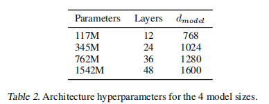

- [P10: 复现 GPT-2 (124M 参数)](#p10-复现-gpt-2-124m-参数)
  - [链接](#链接)
  - [关键内容](#关键内容)

# P10: 复现 GPT-2 (124M 参数)
## 链接
B站视频链接：
+ [Andrej Karpathy【中英⚡从零构建 GPT（重制版）|Neural Networks: Zero to Hero】](https://www.bilibili.com/video/BV1mqrTBvEaf/?p=3&spm_id_from=333.1007.top_right_bar_window_history.content.click&vd_source=1019ffdc843339404e9df6ae52ff9e77)

Github项目：
+ [Github: karpathy/nn-zero-to-hero](https://github.com/karpathy/nn-zero-to-hero)

## 关键内容

发布的GPT2有不同的规格，其中**论文和博客里给的数据和实际有些出入**，这里我们需要复现的是 1.24M(最小的参数量，论文里写的是117M)版本
+ https://github.com/openai/gpt-2
  ```bash
    * Note that our original parameter counts were wrong due to an error (in our previous blog posts and paper). Thus you may have seen small referred to as 117M and medium referred to as 345M.
  ```
+ https://openai.com/research/better-language-models/




---

GPT-2是2019年2月的工作了，已经是七年前的内容了，放到现在来说，1小时可能就训练好了~
+ 这里除了借鉴GPT-2，还参考了GPT-3的论文，因为OpenAI的论文很少会公布训练详情
+ GPT-3中有参数设置，优化配置方面提供了更为详尽的说明