- [P10: 复现 GPT-2 (124M 参数)](#p10-复现-gpt-2-124m-参数)
  - [链接](#链接)
- [1. gpt2简述](#1-gpt2简述)
- [2. gpt2权重可视化](#2-gpt2权重可视化)
  - [2.1 wpe（位置嵌入）](#21-wpe位置嵌入)
  - [2.2 gpt2的wpe可视化](#22-gpt2的wpe可视化)
- [3. gpt模型实现](#3-gpt模型实现)
  - [3.1 与Transformer模型的关键差异](#31-与transformer模型的关键差异)
  - [3.2 TensorFlow vs huggingface(pytorch)历史差异](#32-tensorflow-vs-huggingfacepytorch历史差异)
  - [3.3 GELU激活函数](#33-gelu激活函数)
  - [3.x ❗GELU近似/精确结果对比](#3x-gelu近似精确结果对比)
  - [3.4 网络初始损失校准](#34-网络初始损失校准)
  - [3.5 AdamW优化器和weight decay](#35-adamw优化器和weight-decay)
  - [3.6 ❗weight tying(gpt2的wte层和lm\_head层的共享关系)](#36-weight-tyinggpt2的wte层和lm_head层的共享关系)
  - [3.7 ❗data\_ptr 指向 和 .grad 的关系](#37-data_ptr-指向-和-grad-的关系)
  - [3.8 ❗self.transformer.wte.weight  = self.lm\_head.weight 背后执行了什么](#38-selftransformerwteweight---selflm_headweight-背后执行了什么)
  - [3.9 ❗共享权重的反向过程](#39-共享权重的反向过程)
  - [3.10 gpt2初始化问题](#310-gpt2初始化问题)
    - [1. LayerNorm 和 nn.Linear(Conv1d)](#1-layernorm-和-nnlinearconv1d)
    - [2. residual layers采用 pre-norm带来的问题](#2-residual-layers采用-pre-norm带来的问题)
    - [3. 最简单的例子说明不同缩放的区别](#3-最简单的例子说明不同缩放的区别)
    - [4. 现有实现(huggingface)](#4-现有实现huggingface)
    - [5. zero-initialized attention mechanism](#5-zero-initialized-attention-mechanism)
  - [3.11 根据gpt3的训练细节来调整超参](#311-根据gpt3的训练细节来调整超参)
  - [3.12 梯度裁剪实现原理](#312-梯度裁剪实现原理)
  - [3.13 cosine decay learning schedule with warmup(带有预热的余弦衰减学习率调度)](#313-cosine-decay-learning-schedule-with-warmup带有预热的余弦衰减学习率调度)
  - [3.14 weight decay分组](#314-weight-decay分组)
- [4. 训练](#4-训练)
  - [4.1 认识硬件/充分发挥硬件性能](#41-认识硬件充分发挥硬件性能)
  - [4.x 优化速度对比](#4x-优化速度对比)
  - [4.2 Tensor Cores以及混合精度](#42-tensor-cores以及混合精度)
    - [4.2.1 理论说明](#421-理论说明)
    - [4.2.2 实测(pytorch中启用TF32, BF16)](#422-实测pytorch中启用tf32-bf16)
  - [4.3 torch.compile](#43-torchcompile)
  - [4.4 GPU的存储分级以及和HBM的关系](#44-gpu的存储分级以及和hbm的关系)
  - [4.5 FlashAttention](#45-flashattention)
  - [4.6 检查网络中是否有非偶数的超参/调整是否会有影响](#46-检查网络中是否有非偶数的超参调整是否会有影响)
  - [4.7 CUDA底层对于分块(2的幂次的计算要求苛刻的原因)](#47-cuda底层对于分块2的幂次的计算要求苛刻的原因)
  - [4.8 可视化](#48-可视化)
  - [4.9 gradient accumulation梯度累积](#49-gradient-accumulation梯度累积)
  - [4.10 tensor.detach作用(梯度累积)](#410-tensordetach作用梯度累积)
  - [4.11 DDP(Distributed Data Parallel)](#411-ddpdistributed-data-parallel)
    - [WORLD\_SIZE,RANK,LOCAL\_RANK说明](#world_sizeranklocal_rank说明)
    - [DDP模型封装参数说明](#ddp模型封装参数说明)
    - [DDP前向和反向过程结合梯度累积](#ddp前向和反向过程结合梯度累积)
    - [DDP.module](#ddpmodule)
    - [DDP的极简DataLoader带来的数据边界不对齐问题](#ddp的极简dataloader带来的数据边界不对齐问题)
  - [4.12 为什么LLM预训练一般用global\_steps而不用epoch](#412-为什么llm预训练一般用global_steps而不用epoch)
- [5. 数据集](#5-数据集)
  - [5.1 Huggingface——datasets](#51-huggingfacedatasets)
  - [5.2 map vs imap](#52-map-vs-imap)
- [6. 评估](#6-评估)
- [其他](#其他)
  - [x.1 pytorch的matrix vs tensor](#x1-pytorch的matrix-vs-tensor)
  - [x.2 model.eval()什么时候发挥作用](#x2-modeleval什么时候发挥作用)
  - [x.3  model.to(device) vs x = x.to(device)](#x3--modeltodevice-vs-x--xtodevice)
    - [x.3.1 model.to](#x31-modelto)
    - [x.3.2 tensor.to](#x32-tensorto)
    - [x.3.3 Module.to的底层实现](#x33-moduleto的底层实现)
    - [x.3.4 总结和延伸](#x34-总结和延伸)
  - [x.4 交叉熵损失](#x4-交叉熵损失)
  - [x.5 torch.long vs. torch.int64](#x5-torchlong-vs-torchint64)
  - [x.6 vscode调试进入 torch魔法代码](#x6-vscode调试进入-torch魔法代码)
  - [x.7 运行过程 + 交互式调试](#x7-运行过程--交互式调试)
  - [x.8 optimizer.param\_groups](#x8-optimizerparam_groups)
  - [x.9 torch.compile注意事项(windows编译问题)](#x9-torchcompile注意事项windows编译问题)
  - [xx.10 model.named\_parameters()](#xx10-modelnamed_parameters)

# P10: 复现 GPT-2 (124M 参数)
## 链接
B站视频链接：
+ [Andrej Karpathy【中英⚡从零构建 GPT（重制版）|Neural Networks: Zero to Hero】](https://www.bilibili.com/video/BV1mqrTBvEaf/?p=3&spm_id_from=333.1007.top_right_bar_window_history.content.click&vd_source=1019ffdc843339404e9df6ae52ff9e77)

Github项目：
+ [Github: karpathy/nn-zero-to-hero](https://github.com/karpathy/nn-zero-to-hero)
+ <https://github.com/karpathy/llm.c>
+ <https://github.com/karpathy/nanoGPT>
+ <https://github.com/karpathy/build-nanogpt>

# 1. gpt2简述

发布的GPT2有不同的规格，其中**论文和博客里给的数据和实际有些出入**，这里我们需要复现的是 1.24M(最小的参数量，论文里写的是117M)版本
+ https://github.com/openai/gpt-2
  ```bash
    * Note that our original parameter counts were wrong due to an error (in our previous blog posts and paper). Thus you may have seen small referred to as 117M and medium referred to as 345M.
  ```
+ https://openai.com/research/better-language-models/

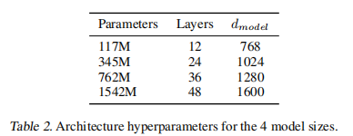

---

GPT-2是2019年2月的工作了，已经是七年前的内容了，放到现在来说，1小时可能就训练好了~
+ 这里除了借鉴GPT-2，还参考了GPT-3的论文，因为OpenAI的论文很少会公布训练详情
+ GPT-3中有参数设置，优化配置方面提供了更为详尽的说明
+ 在[gpt2-src/model.py](https://github.com/openai/gpt-2/blob/master/src/model.py)中，可以看到，原始发布的gpt2代码是`TensorFlow`写的,这里改用基于`pytorch`实现的`huggingface`的`transformers`库。
  + [huggingface/src/transformers/models/gpt2/modeling_gpt2.py](https://github.com/huggingface/transformers/blob/main/src/transformers/models/gpt2/modeling_gpt2.py)
  + 这个脚本的可读性是中等，但是关键在于完成了原始的gpt2的TensorFlow版本到pytorch版本的转换(完全兼容)

----

+ [openai-community/gpt2](https://hf-mirror.com/openai-community/gpt2)
    + **This is the smallest version of GPT-2, with 124M parameters.**, 默认的gpt2对应的是最小参数的版本
    + 其他参数的版本在其他仓库
    + [openai-community/gpt2-large](https://huggingface.co/openai-community/gpt2-large)
    + [openai-community/gpt2-medium](https://huggingface.co/openai-community/gpt2-medium)
    + [openai-community/gpt2-xl](https://huggingface.co/openai-community/gpt2-xl)

# 2. gpt2权重可视化
## 2.1 wpe（位置嵌入）

**固定成正余弦函数 vs 随机初始化**
1. GPT-2 的 `wpe` 是随机初始化的（正态分布，std=0.02），并且是可学习的。初始化链路是这样的：
   1. `GPT2Model.__init__` 里创建 `self.wpe = nn.Embedding(...)` 后调用 `self.post_init()`（[modeling_gpt2.py:503](https://github.com/huggingface/transformers/blob/main/src/transformers/models/gpt2/modeling_gpt2.py#L503) ）；
   2. `post_init()` 会递归地对每个子模块调用 `_init_weights`。GPT2 自己的 `_init_weights`（[modeling_gpt2.py:433](https://github.com/huggingface/transformers/blob/main/src/transformers/models/gpt2/modeling_gpt2.py#L433)）先执行 `super()._init_weights(module)`，它只额外处理了 `Conv1D` 和注意力输出投影的缩放初始化，**没有覆盖** `nn.Embedding` 的处理；
   3. 因此 `wpe` 走的是基类逻辑（[modeling_utils.py:2321](https://github.com/huggingface/transformers/blob/main/src/transformers/models/modeling_utils.py#L2321)）：`init.normal_(module.weight, mean=0.0, std=std)`，其中 `std = config.initializer_range`，GPT2Config 默认值为 **0.02**（[configuration_gpt2.py:89](https://github.com/huggingface/transformers/blob/main/src/transformers/models/gpt2/configuration_gpt2.py#L89)）。
   4. 所以：**是从 N(0, 0.02²) 随机采样初始化的可学习参数**，随预训练一起更新。这也意味着它是“学习的绝对位置嵌入”——预训练时模型自己学出每个位置的向量，而不是公式算出来的。当然，如果用 `from_pretrained("openai-community/gpt2")` 加载，`wpe` 会被 checkpoint 里的预训练值覆盖，随机初始化只影响从头训练的场景。
2. 原始论文用的是 sin/cos 位置编码——但严格说是“固定编码”，不是“初始化”。《Attention Is All You Need》中的正弦位置编码公式为：
   $$PE_{(pos, 2i)} = \sin\left(\frac{pos}{10000^{2i/d_{model}}}\right), \quad PE_{(pos, 2i+1)} = \cos\left(\frac{pos}{10000^{2i/d_{model}}}\right)$$
   + 论文里的位置编码是**直接由公式确定、没有任何可学习参数**的固定向量，不进行训练，完全不更新。
   + 论文还做过对比实验：学习的位置嵌入和正弦编码效果基本相当，他们选正弦编码是希望对更长的序列有外推能力。
3. **两种方案的关系**：
   1. GPT/GPT-2 采用的是“学习的位置嵌入”路线（`wpe`，随机初始化 + 训练），而没有沿用 Transformer 原论文的固定正弦编码。
   2. transformers 里正弦编码的实现，可以参考 `SinusoidalPositionalEmbedding`，BART、Marian 等模型还在用它。

---

## 2.2 gpt2的wpe可视化

可以看到，虽然是随机初始化的，但是训练之后，确实有些也类似正余弦函数，详见：  [code\10_gpt.ipynb](../code/10_gpt.ipynb)

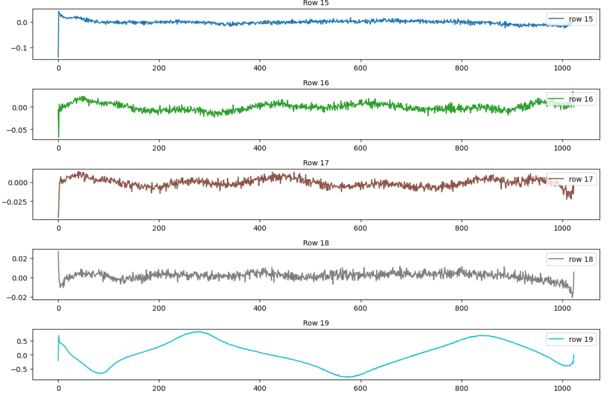


# 3. gpt模型实现

## 3.1 与Transformer模型的关键差异
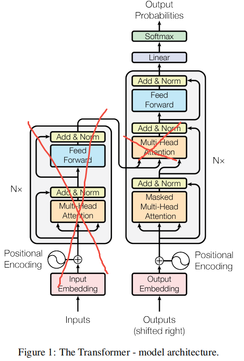

gpt2模型的结构和原始的Transformer有所不同，其采用的是`decoder-only` transformer结构，即：
+ 删除了encode部分，没有编码器，只有解码器，同时删除了解码器中(decode)用于连接编码器(encode)的`cross-attention`部分, 其余地方基本保持不变
+ 还有一些差异：
  + 在gpt2的论文中(**2.3 Model**)中提到：`Layer normalization (Ba et al., 2016) was moved to the input of each sub-block, similar to a
pre-activation residual network (He et al., 2016) and an additional layer normalization was added after the final self-attention block.`
  + LN层归一化放到了每个注意力模块的输入的地方，同时在最后一个自注意力块后面加了一个LN层

## 3.2 TensorFlow vs huggingface(pytorch)历史差异
**prompt**:

已知加载的gpt2模型权重有以下结构：
```bash
transformer.h.1.mlp.c_fc.weight torch.Size([768, 3072])
transformer.h.1.mlp.c_fc.bias torch.Size([3072])
transformer.h.1.mlp.c_proj.weight torch.Size([3072, 768])
transformer.h.1.mlp.c_proj.bias torch.Size([768])
```
但是根据 pytorch的nn.linear, weight.shape为(out_features,in_features),bias的shape为
(out_features)，是不是和上面显示的不一致啊

----

**回答**：

出现这种“不一致”的原因，主要源于**历史框架差异**以及 **Hugging Face 的兼容实现**。以下为您详细拆解背后的原因：
1. 历史原因：TensorFlow 与 PyTorch 的默认设定不同。GPT-2 最初是由 OpenAI 使用 **TensorFlow** 训练和发布的。
     - 在 TensorFlow 的 `tf.layers.dense` 或 `tf.keras.layers.Dense` 中，全连接层的权重默认形状是 `(in_features, out_features)`。
     - 而在 PyTorch 的 `nn.Linear` 中，为了优化矩阵乘法的内存访问，权重默认形状被设计为 `(out_features, in_features)`（即数学公式 $y = xW^T + b$ 中的 $W^T$ 的转置）。
2. Hugging Face 的兼容实现：自定义 `Conv1D`， 当 Hugging Face 的 `transformers` 库将 GPT-2 移植到 PyTorch 时，为了能够**直接、无缝地加载原始的 TensorFlow 权重**（避免在转换时做大量的转置操作），他们并没有直接使用 PyTorch 原生的 `nn.Linear`，而是实现了一个自定义的 `Conv1D` 类来模拟全连接层。
   + [transformers/src/transformers/models/gpt2/modeling_gpt2.py](https://github.com/huggingface/transformers/blob/main/src/transformers/models/gpt2/modeling_gpt2.py)中，有`from ...pytorch_utils import Conv1D`
   + [transformers/src/transformers/pytorch_utils.py](https://github.com/huggingface/transformers/blob/main/src/transformers/pytorch_utils.py#L95)
    ```python
    class Conv1D(nn.Module):
        """
        1D-convolutional layer as defined by Radford et al. for OpenAI GPT (and hence used in GPT-2).
        """
        def __init__(self, nf, nx):
            super().__init__()
            self.nf = nf  # out_features
            self.nx = nx
            # 注意这里的初始化：形状是 (nx, nf) 即 (in_features, out_features)
            self.weight = nn.Parameter(torch.empty(nx, nf)) 
            self.bias = nn.Parameter(torch.zeros(nf))
            nn.init.normal_(self.weight, std=0.02)

        def forward(self, x):
            size_out = x.size()[:-1] + (self.nf,)
            # 核心计算：x @ weight + bias，而不是 nn.Linear 的 x @ weight.T + bias
            x = torch.addmm(self.bias, x.view(-1, x.size(-1)), self.weight)
            x = x.view(size_out)
            return x
    ```

**源码解析：**
- **权重初始化**：`torch.empty(nx, nf)` 明确指定了权重形状为 `(in_features, out_features)`，这与 TensorFlow 保持一致。
- **前向传播**：使用了 `torch.addmm(bias, x, weight)`，其数学本质是 $x \times weight + bias$。因为 $x$ 的最后一维是 `in_features`，`weight` 的形状是 `(in, out)`，所以矩阵乘法可以直接进行，最终输出维度为 `out_features`。这与 `nn.Linear` 中 $x \times weight^T + bias$ 的数学结果是完全等价的。

---
所以如果不想重写一个`Conv1D`, 可以直接把`nn.Linear`的(`in_features`, `out_features`)参数交换一下即可。

例如：以这层为例
```bash
transformer.h.1.mlp.c_fc.weight torch.Size([768, 3072])
transformer.h.1.mlp.c_fc.bias torch.Size([3072])
```
+ `Conv1d`
  + 定义是: `self.c_fc = Conv1D(4*embed_dim, embed_dim)`， 参考[src/transformers/models/gpt2/modeling_gpt2.py](https://github.com/huggingface/transformers/blob/main/src/transformers/models/gpt2/modeling_gpt2.py#L636)
  + 执行的操作则是: $(*, nx)*(nx,nf) = (*, nf)$, `nx`是`in_features`, `nf`是`out_features`
  + 即： $(*,in)*(in,out) = (*, out)$, 
  + 定义是`Conv1D(out, in)`, 打印出来是`w = (in,out), bias = out`
+ `nn.Linear`
  + 正常定义是 `nn.Linear(in_features,out_features)`, 执行的操作是$x \times weight^T + bias$, 即$(*, in)*(in,out)=(*,out)$, 其实也就是多一个把`weight`转置的操作
  + 所以计算其实是一样的，但是传入参数的顺序以及`w`矩阵打印的形状不同
+ 假设这里要用`nn.Linear`来实现上面`Conv1d`的功能，
  + mlp的上一层是
    ```python
        self.ln_2 = nn.LayerNorm(config.n_embed)
        self.mlp = MLP(config)
        # 所以mlp的输入是(*, 768)
    ```
  + 则初始化就要变为: `nn.Linear(768, 3072)`, 则执行的操作就是: `(*,768)*(768,3072)= (*, 3072)`, 打印的`w = (3072, 768), bias = (3072)`
  + 只是打印出来的结果矩阵维度有些不同，但是实际执行的操作是一样的

## 3.3 GELU激活函数
+ https://docs.pytorch.org/docs/2.14/generated/torch.nn.GELU.html
+ [[proposal] Add approx variant option to F.gelu#39853](https://github.com/pytorch/pytorch/issues/39853)
  + 大意就是在作者开发这个激活函数的时候，用的还是TensorFlow，因为计算速度的原因，所以搞了一个近似版本，即`nn.GELU(approximate='tanh')`,但是后来精确版本计算很快也没有数值问题，所以没有理由继续用近似版本，建议用精确版本
    >[!NOTE]
    > `hendrycks`(GELU论文的作者) on Jun 23, 2020<br/>
    > I used the tanh approximation simply because the error function erf was slow in tensorflow some years ago. If the exact version is fast enough now and does not have numerical issues, I do not see a reason to use an inexact version.
  + 这里为了和gpt2一致，因此实现的时候也用了近似版本，可以试试把这个近似版本去掉，对比一下~
+ 论文已下载翻译在本地


**选择GELU**的一个很直观的原因：
+ `GELU`的[-2,0]这段的梯度不为0，相对于原始的`RELU`的`dead neuron`来说，会保证神经元不会静止/不动弹
+ `GELU`求导的结果：
  + **？**

## 3.x ❗GELU近似/精确结果对比


## 3.4 网络初始损失校准

对于gpt2，词表大小是 50257，则CrossEntropyLoss应该是:

$$
\begin{align}
loss = & -log(\frac{e^{\frac{1}{50257}}}{ e^{\frac{1}{50257}} + e^{\frac{1}{50257}} + ... + e^{\frac{1}{50257}}}) \\
     = & -log(\frac{e^{\frac{1}{50257}}}{50257*e^{\frac{1}{50257}}}) \\
     = & -log(\frac{1}{50257}) \\
     = & log(50257)\\
\end{align}
$$

```python
In [1]: import math
In [2]: math.log(50257)
Out[2]: 10.82490511970208
```

所以初始损失在10.8附近才是ok的，即：如果训练的时候损失比这还高，说明比瞎猜的正确率还低。。。

## 3.5 AdamW优化器和weight decay

这部分看完，可以再去看下:[## 3.14 weight decay分组](#314-weight-decay分组)

以下代码来自：[4. 多层感知机->4.5. 权重衰减->4.5.2.3. 定义训练代码实现](https://zh.d2l.ai/chapter_multilayer-perceptrons/weight-decay.html#id5)
```python
# weight decay就是个作用在L2范式上的参数
def train(lambd):
    w, b = init_params()
    net, loss = lambda X: d2l.linreg(X, w, b), d2l.squared_loss
    num_epochs, lr = 100, 0.003
    animator = d2l.Animator(xlabel='epochs', ylabel='loss', yscale='log',
                            xlim=[5, num_epochs], legend=['train', 'test'])
    for epoch in range(num_epochs):
        for X, y in train_iter:
            l = loss(net(X), y) + lambd * l2_penalty(w)  # ❗重点是这句
            l.sum().backward()
            d2l.sgd([w, b], lr, batch_size)
        if (epoch + 1) % 5 == 0:
            animator.add(epoch + 1, (d2l.evaluate_loss(net, train_iter, loss),
                                     d2l.evaluate_loss(net, test_iter, loss)))
    print('w的L2范数是：', torch.norm(w).item())
```
同时，在[torch.optim.AdamW](https://docs.pytorch.org/docs/2.15/generated/torch.optim.AdamW.html)和[torch.optim.Adam](https://docs.pytorch.org/docs/2.15/generated/torch.optim.Adam.html)中，参数说明分别为:
```bash
# AdamW， 权重衰减系数
weight_decay (float, optional) – weight decay coefficient (default: 1e-2)

# Adam, L2惩罚项
weight_decay (float, optional) – weight decay (L2 penalty) (default: 0)
可以看到，这个权重衰退的解释信息是：L2正则的惩罚项
```
但是pytorch的实现明显不是`l = loss(net(X), y) + lambd * l2_penalty(w)`这样的， 根据[torch/optim/sgd.py -> _single_tensor_sgd](https://github.com/pytorch/pytorch/blob/main/torch/optim/sgd.py#L322)，有
```python
for i, param in enumerate(params):
    grad = grads[i] if not maximize else -grads[i]
    # maximize bool类型，grads是传入的形参，因此这里的grad其实是一个临时变量，并不会对grads这个原始输入造成影响

    if weight_decay != 0:
        # Nested if is necessary to bypass jitscript rules
        if isinstance(weight_decay, Tensor):
            if weight_decay.requires_grad:
                # usually this is the differentiable path, which is why the param.clone() is needed
                grad = grad.addcmul_(param.clone(), weight_decay)
            else:
                grad = grad.add(param, alpha=weight_decay) ❗重点是这句
                # https://docs.pytorch.org/docs/2.15/generated/torch.Tensor.add.html
                # Tensor.add(other, *, alpha=1) → Tensor
                # Add a scalar or tensor to self tensor. If both alpha and other are specified, each element of other is scaled by alpha before being used. 就是Tensor + alpha*other的意思
                # 所以这句的意思就是 grad = grad + weight_decay*param
        else:
            grad = grad.add(param, alpha=weight_decay)

# 一般来说，上面这个代码的执行逻辑其实就等价于
for i, param in enumerate(params):
    grad = grads[i]                          # grad 就是 param.grad
    if weight_decay != 0:
        grad = grad + weight_decay * param   # ★ 唯一实质动作  ❗重点是这句
    # ... momentum 相关（可选）
    param.add_(grad, alpha=-lr)              # w ← w - lr * grad

import torch
a = torch.tensor(1)
a.add(2, alpha = 2)
#  tensor(5) 
#  即: 1+ alpha*2 = 5
```
+ 关于其中  `weight_decay.requires_grad=True`那部分的逻辑判断执行
  + 普通训练里永远不会出现。这条分支是给 **把 weight_decay 本身当成待学习参数** 的研究场景留的口子：
    + 双层优化 / 元学习：内层用训练集更新 w，外层用验证集 loss 对超参 λ 求梯度，自动学出每层该用多大的正则（hypergradient / learnable regularization）。
    + 可微优化器：需要让 autograd 穿过 optimizer.step()，把整个训练过程当成一张大图求导。
    + 某些自动超参搜索 / μP 相关的可微化实现。
  + 要触发的话，代码：
    ```python
      wd = torch.tensor(0.01, requires_grad=True)   # 把 λ 变成可学习量
      opt = torch.optim.SGD(model.parameters(), lr=0.1, weight_decay=wd)
      # 之后还要 differentiable=True，才有 autograd 穿过 step
    ```

---

>[!NOTE]
>关于**L2正则**和**weight decay**的关系

```python
# 结合上面代码中的关键内容

# 一般授课认识weight decay用的例子，看起来是作用在损失函数的
l = loss(net(X), y) + lambd * l2_penalty(w) 

# 但是pytorch的实现，实际上是直接作用在opt优化器的
grad = grad + weight_decay * param 

for i, param in enumerate(params):
  # ...
  # weight_decay部分的逻辑
  # ...
  if isinstance(lr, Tensor):
      if lr.requires_grad:
          param.addcmul_(grad, lr, value=-1)
      else:
          # pyrefly: ignore [bad-argument-type]
          param.add_(grad, alpha=-lr)  
          # 这里相当于执行了 param = param - lr*grad 这里的 param其实是传入参数，所以是一个in-place操作
          # 而grad在计算过程中，并不是in-place操作，所以并不改变Autograd算出来的梯度值(调用sgd函数传入的形参)
  else:
      param.add_(grad, alpha=-lr)
```
因此，关于`weight decay`对`grad`的影响，以及优化器进行的梯度更新，在`pytorch`的实现中，可以理解为
```bash
loss.backward()      →  p.grad = g            纯数据项，autograd 到此结束
opt.step():
    grad = g + λ·w                            ★ 优化器手动加的，autograd 完全不知情(原始的 p.grad(g)的值并不会被grad修改， 这不是一个in-place操作)
    w -= lr * grad                            原地操作，影响参数值
opt.zero_grad()      →  p.grad 清空
```

同时，这里不难发现：设原来的损失是 $L$，权重是 $w$，加上 L2 正则项后：

$$L_{\text{new}} = L + \frac{\lambda}{2}w^2$$

对 $w$ 求导（求导可加，平方求导得 $2w$）：

$$\frac{dL_{\text{new}}}{dw} = \underbrace{\frac{dL}{dw}}_{=\,g} + \frac{\lambda}{2}\cdot 2w = g + \lambda w$$

**$\frac{1}{2}$ 和平方求导下来的 $2$ 刚好约掉，剩下 $\lambda w$。** 


|实现机制 | 梯度 |
|---|---|
| loss 里加 $\frac{\lambda}{2}\|w\|^2$，backward | $g + \lambda w$ |
| loss 不加，优化器 `grad.add(param, alpha=λ)` | $g + \lambda w$ |

所以`pytorch`的`SGD` 的 `weight_decay=λ` 就等于 loss 里加 `λ*(w**2).sum()/2`。本质上优化器只是把 $\nabla R = \lambda w$ 这个已知结果**直接手写上去**，不让 autograd 再算一遍。

>[!NOTE]
> **weight decay的作用机制**

设 `g = ∂loss/∂w`（backward 算出来的，**loss 里没有任何正则项**），`λ = weight_decay`。无`momentum`的情况下

$$\text{grad} = g + \lambda w \quad\Longrightarrow\quad w_{new} = w - \eta(g+\lambda w) = \underbrace{(1-\eta\lambda)}_{\text{先缩水}}w - \underbrace{\eta g}_{\text{再走梯度}}$$

其中 $\eta\lambda$ = `lr × weight_decay`，含义是**每一步削掉权重的百分之几**。下面例子用的是： $0.1\times0.1=0.01$，即每步削掉 1%。

**手算**（`w=2.0, g=0.5, lr=0.1, weight_decay=0.1`）：

|操作 | 计算 | 结果 |
|---|---|---|
| ① 正则额外贡献的梯度(加进 grad 的量) | `λ·w = 0.1×2.0` | `0.2` |
| ② 实际用于更新的梯度(新grad) | `g + λ·w = 0.5 + 0.2` | `0.7` |
| ③ 有weight_decay的新权重 | `w -= η(g + λw) = 2.0 − 0.1×0.7` | `w=1.93`|
| ③ 没有weight_decay的新权重, 若 λ(`weight_decay或wd`)=0 | `w -= ηg = 2.0 − 0.1×0.5` | `w=1.95` |
以上可知：
+ `weight_decay`的作用在于把权重再变小了`ηλw`, 即：`w-ηλw = w-0.02`， 
  + 进一步可以发现：在这个项里，`loss`对应的`g`完全没有贡献，这就是 `weight_decay` 作用：**一个不依赖数据、不依赖 loss 的、持续的"向零收缩"的力**
  + "decay"（衰减）：一股与数据无关、持续把权重往零拽的力，拉力大小正比于权重自身。
+ 进一步，如果`g=0`，即：基于原始的`loss`求出的梯度为0的时候，则如果更新多次，这个权重更新的公式就可以表达为: 
  +  $w_t=(1-\eta\lambda)^t w_0$ —— 指数衰减。**这就是 "decay"（衰减）这个名字的字面来源。** 
  +  拿 LLM 的常见配置感受一下：`lr=1e-3, λ=0.1` ⇒ 每步乘 0.9999，半衰期约 6931 步。
     +  这个相当于$w \times 0.9999^{x} ≈ 0 →  0.9999^{x} ≈ 0$，求解这个公式里的$x$
     +  不过这里求的是半衰期，即$0.9999^{x} ≈ 0.5$,直接两边取对数，$xln(0.9999) = ln(0.5) → x = \frac{ln 0.5}{ln 0.9999} = $
      ```python
        In [4]: math.log(0.5)/math.log(0.9999)
        Out[4]: 6931.125226233421

        In [1]: 0.9999**6931
        Out[1]: 0.5000062616639657
      ```

进一步延申计算
| lr | weight_decay | lr×λ | 半衰期（步） |
|---|---|---|---|
| 1e-3 | 0.1 | 1e-4 | ~6,931 |
| 3e-4 | 0.1 | 3e-5 | ~23,105 |
| 2e-4 | 0.1 | 2e-5 | ~34,657 |
| 1e-4 | 0.1 | 1e-5 | ~69,315 |
| 1e-3 | 0.01 | 1e-5 | ~69,315 |
| 1e-5（SFT） | 0.1 | 1e-6 | ~693,147 |
- **lr 和 wd 只以乘积形式起作用**，lr 降 10 倍和 wd 降 10 倍对衰减完全等效。
- **SFT 阶段 lr 很小，权重衰减基本等于没开**（半衰期远大于总训练步数）。这也是为什么很多人 SFT 直接设 `weight_decay=0` 无所谓。
- 这种半衰期来判断`weight decay`是否生效的方式比较粗糙，是 $g=0$ 的理想化。
  - 真实训练里梯度一直在把权重往外推，所以权重不会真衰到 0，而是停在「梯度推力 = 衰减拉力」的平衡点上。半衰期衡量的是**这股拉力自身的时间尺度**，用来判断「在我这次训练的总步数内，衰减到底有没有来得及起作用」。比如预训练 10 万步、半衰期 6931 步 ⇒ 衰减有充分时间生效；反之若半衰期 70 万步而只训 5000 步 ⇒ 它几乎是个装饰。
  - `lr`一般不会是一个固定的常数，有 warmup + cosine/WSD 时，累计缩水是逐步累乘：
    $$\prod_t (1-\eta_t\lambda)\approx \exp\Big(-\lambda\sum_t \eta_t\Big)$$
    + **总衰减量由 lr 曲线下的面积 $\sum_t\eta_t$ 决定**，不是由峰值 lr 决定。
    + cosine 衰减到 0 的 schedule，其面积约为峰值矩形的 1/2，等效半衰期要乘 2。
    + 按「累计 lr」来算的话，半衰期条件是 $\lambda\sum_t\eta_t=\ln 2$，即 $\sum_t\eta_t = 0.693/\lambda$——这个形式与 schedule 形状无关，更好用。
---

>[!NOTE]
> **weight decay一定和L2正则有关吗？**

上面说过
```bash
# pytorch的AdamW文档中关于这个参数的说明是， 权重衰减系数
weight_decay (float, optional) – weight decay coefficient (default: 1e-2)

# pytorch的Adam文档中关于这个参数的说明是, L2惩罚项
weight_decay (float, optional) – weight decay (L2 penalty) (default: 0)
可以看到，这个权重衰退的解释信息是：L2正则的惩罚项
```
这里区分一下二者：
| | |
|---|---|
| **weight_decay** | 优化器层面的**机制**：每步额外把 w 往 0 拉一点 |
| **L2 正则** | 损失层面的**解释**：存在一个惩罚项，其梯度正好等于这个拉力 |

**在 SGD 上两者重合，在 Adam 家族上就分家了：**

- `Adam(weight_decay=λ)`：仍然执行 `g += λw`，所以它**确实等价于**「对 loss+L2 跑 Adam」。但这个改过的梯度接着要除以 $\sqrt{\hat v}$，导致实际收缩量被每个参数的梯度历史调制 —— 梯度大的权重几乎不衰减，梯度小的被过度衰减。正则强度失控了。
- `AdamW(weight_decay=λ)`：改成 `w *= (1 - lr*λ)`，**根本不碰 grad**。这个操作**写不成任何 loss 惩罚项的梯度**。所以 AdamW 的 weight_decay 就真的与 L2 无关了，它是纯粹的乘性收缩。

**机制上 weight_decay 从不依赖 L2；只是在 SGD/Adam 的耦合实现里，它的数值效果恰好可以用 L2 来解释。AdamW 之后这个解释就不成立了。** 
+ 名字里留着 "L2 penalty" 是历史包袱（也是文档偷懒）。
+ **weight_decay = 每步把权重额外往 0 拽一点，拉力大小 ∝ 权重自身大小。** 不必绕道 L2。

---

其他参考
+ [Adam和AdamW](https://zhuanlan.zhihu.com/p/643452086)
  + <https://docs.pytorch.org/docs/2.15/generated/torch.optim.Adam.html>
  + <https://docs.pytorch.org/docs/2.15/generated/torch.optim.AdamW.html>
+ [01-第一章-预训练/神经网络的优化器（十一）AdamW.md](https://github.com/luhengshiwo/LLMForEverybody/blob/main/01-%E7%AC%AC%E4%B8%80%E7%AB%A0-%E9%A2%84%E8%AE%AD%E7%BB%83/%E7%A5%9E%E7%BB%8F%E7%BD%91%E7%BB%9C%E7%9A%84%E4%BC%98%E5%8C%96%E5%99%A8%EF%BC%88%E5%8D%81%E4%B8%80%EF%BC%89AdamW.md)
+ AdamW: [Decoupled Weight Decay Regularization](https://arxiv.org/abs/1711.05101)
+ Adam: [Adam: A Method for Stochastic Optimization](https://arxiv.org/abs/1412.6980)

  

## 3.6 ❗weight tying(gpt2的wte层和lm_head层的共享关系)
```python
# 1. 验证 object id和data完全共享
import os
os.environ["HF_ENDPOINT"] = "https://hf-mirror.com"
os.environ["HF_HOME"] = "E:/learnGPT/learnGPTfromScratch/other" 

import transformers
from transformers import GPT2LMHeadModel
model_hf = GPT2LMHeadModel.from_pretrained("gpt2") 
sd_hf = model_hf.state_dict()

wte = sd_hf['transformer.wte.weight']
lm_head = sd_hf['lm_head.weight']

print(f"wte.shape: wte.shape, lm_head.shape: {lm_head.shape}")
print( (wte == lm_head).all())

print(wte.data_ptr())
print(lm_head.data_ptr())

# 得到以下输出：
wte.shape: wte.shape, lm_head.shape: torch.Size([50257, 768])
tensor(True)
1876425355219
1876425355219
# 即： 这两个层本质上是一个对象

# 2. 验证grad是否共享
loss.backward() 
print(model.transformer.wte.weight.grad) 
print(model.lm_head.weight.grad)  
print( (model.transformer.wte.weight.grad== model.lm_head.weight.grad).all() ) # True  因为wte和lm_head是共享权重的，所以梯度也是共享的
# tensor(True, device='cuda:0')

```

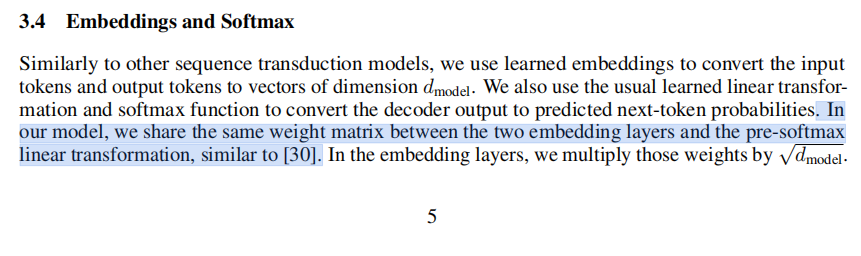

+ 在原始的Transformer论文里，就可以看到，`wte`和`lm_head`层的权重是共享的
+ 引用的论文： [Using the Output Embedding to Improve Language Models](https://arxiv.org/abs/1608.05859)
+ 引用的论文： [Tying Word Vectors and Word Classifiers: A Loss Framework for Language Modeling](https://arxiv.org/abs/1611.01462)
+ 在[OpenAI-gpt2/src/model.py](https://github.com/openai/gpt-2/blob/master/src/model.py#L171)中，有：
  ```python
      def model(hparams, X, past=None, scope='model', reuse=False):
        ....
        wte = tf.get_variable('wte', [hparams.n_vocab, hparams.n_embd],
                             initializer=tf.random_normal_initializer(stddev=0.02))
        ....
        h_flat = tf.reshape(h, [batch*sequence, hparams.n_embd])
        logits = tf.matmul(h_flat, wte, transpose_b=True)   # 可以看到，这里直接用了wte来作为lm_head, 所以这里直接提现了共享权重
        logits = tf.reshape(logits, [batch, sequence, hparams.n_vocab])
        results['logits'] = logits
        return results
  ```

---

其他实现：
+ OpenAI发的TensorFlow版本的gpt2： 
  + <https://github.com/openai/gpt-2/blob/master/src/model.py#L171>
  + 默认开启权重共享
+ Huggingface的Transformer库的gpt2实现: 
  + <https://github.com/huggingface/transformers/blob/main/src/transformers/models/gpt2/configuration_gpt2.py#L103>
  + <https://huggingface.co/docs/transformers/v5.22.1/en/model_doc/gpt2#transformers.GPT2Config>
  + 默认`tie_word_embeddings: bool = True`

---

| 特性 | `nn.Embedding` | `nn.Linear` |
| :--- | :--- | :--- |
| **输入类型** | **整数张量** (LongTensor)，如 Token ID | **浮点张量** (FloatTensor)，如隐藏层状态 |
| **输入 Shape** | `(*, )` 任意维度的整数，如 `(batch, seq_len)` | `(*, in_features)`，最后一维必须是输入特征数 |
| **输出 Shape** | `(*, embedding_dim)` | `(*, out_features)` |
| **权重 Shape** | `(num_embeddings, embedding_dim)` | `(out_features, in_features)` **（注意是 out × in）** |
| **梯度更新** | **稀疏更新**：反向传播时，仅更新被索引到的行，其余行梯度为0 | **稠密更新**：整个权重矩阵都参与前向和反向计算 |

这里直接权重共享:
1. `nn.Embedding`和`nn.Linear`的`weight`的shape一样，都是`(50257, 768)`
2. `nn.Embedding`的`weight`是用来进行索引的，在反向时是稀疏更新
3. `nn.Linear`的`weight`是用来进行映射的，在反向时是稠密更新


## 3.7 ❗data_ptr 指向 和 .grad 的关系
和 [3.8 ❗self.transformer.wte.weight  = self.lm_head.weight 背后执行了什么](#38-selftransformerwteweight---selflm_headweight-背后执行了什么) 也有关，看完把[3.8 ❗self.transformer.wte.weight  = self.lm_head.weight 背后执行了什么](#38-selftransformerwteweight---selflm_headweight-背后执行了什么)也看了
```python
# 直接去  code\gpt2\train_gpt2.py 把下面这个函数的这几句取消注释，在箭头那行打断点
def train_test():
    ...
    # 验证 wte和lm_head是否也是梯度共享的
    #  
    loss.backward()  # 反向传播，计算梯度
    weight_data_ptr = model.transformer.wte.weight.data_ptr()
    weight_grad_ptr = model.transformer.wte.weight.grad.data_ptr()
    print("权重数据 (data) 的内存地址:", weight_data_ptr)    # 权重数据 (data) 的内存地址: 47336914944
    print("权重梯度 (grad) 的内存地址:", weight_grad_ptr)    # 权重梯度 (grad) 的内存地址: 48723132416
    print(f"\n两者的地址相同吗? {weight_data_ptr == weight_grad_ptr}") # 两者的地址相同吗? False
    # 所以  weight.data_ptr()   和 weight.grad.data_ptr() 是两个不同的对象
    
    print(model.transformer.wte.weight.grad)  
    print(model.lm_head.weight.grad)  
    print(type(model.transformer.wte.weight))  # <class 'torch.nn.parameter.Parameter'>
->  print( (model.transformer.wte.weight.grad== model.lm_head.weight.grad).all() ) # True  因为wte和lm_head是共享权重的，所以梯度也是共享的
    # tensor(True, device='cuda:0')
    return 
```

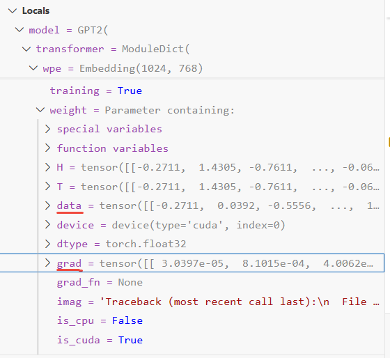

+ 这里可以看到， `data`和`grad`是分别使用两个tensor来表示的，同时，这两个tensor里的grad都是空，grad.data里放的才是 wte的weight的grad
+ 在上面打印中，执行反向后可以看到
  ```python
    weight_data_ptr = model.transformer.wte.weight.data_ptr()
    weight_grad_ptr = model.transformer.wte.weight.grad.data_ptr()
    print("权重数据 (data) 的内存地址:", weight_data_ptr)    # 权重数据 (data) 的内存地址: 47336914944
    print("权重梯度 (grad) 的内存地址:", weight_grad_ptr)    # 权重梯度 (grad) 的内存地址: 48723132416
    # 这两个的内存地址不同
  ```

---

同时根据[pytorch/c10/core/TensorImpl.h](https://github.com/pytorch/pytorch/blob/main/c10/core/TensorImpl.h#L3309)
```h
class C10_TensorImpl_Size_Check_Dummy_Class : private TensorImpl {
  // Names of (non-bitfield) fields in TensorImpl; used to provide
  // compile-time info about fields whose size changes unexpectedly.
  enum class FieldNameEnum {
    storage_,     // 这部分是存储 data的
    autograd_meta_, // 这部分是管理grad的，这里面会额外再有一个TensorImpl
    extra_meta_,
    version_counter_,
    pyobj_slot_,
    sizes_and_strides_,
    storage_offset_,
    numel_,
    data_type_,
    device_opt_,
    key_set_,
    TOTAL_SIZE
  };
```

以及：[PyTorch internals/ezyang's blog](https://blog.ezyang.com/2019/05/pytorch-internals/), 直接在页面中搜索`grad`

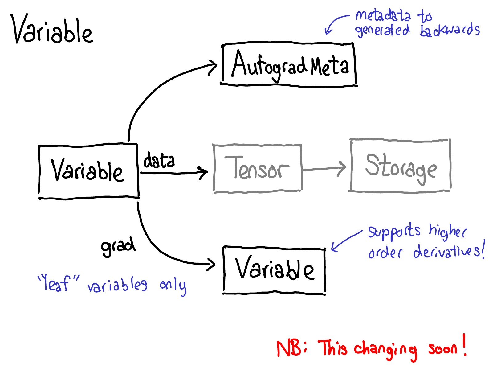

---

结合AI的回答：
```bash
[Python 层面]
  +-----------------------------+
  |  nn.Parameter (Python 对象)  |  <-- 你代码中的 lm_head.weight 或 wte.weight
  +-----------------------------+
               | (包裹/Wrapper)
               v
[C++ 层面: ATen]
  +-----------------------------+
  |      TensorImpl (控制中心)   |  <-- 只有一个实例！
  |-----------------------------|
  | sizes: [2, 2]               |
  | dtype: torch.float32        |
  | requires_grad: True         |
  |-----------------------------|
  | storage_  ------------------+-----> [ Storage 1: 权重数据 ]
  | (指向 Data)                 |      | data_ptr(): 0xAAAA (物理内存 A) |
  |-----------------------------|      +---------------------------------+
  | autograd_meta_ --------------+
  | (仅当 requires_grad=True)   |
  +-----------------------------+      +---------------------------------+
               |                       |      AutogradMeta               |
               |                       |---------------------------------|
               |                       | grad_fn_: <SumBackward0 object> |
               +---------------------> | grad_: -----------------------+ |
                                       +---------------------------------+ |
                                                                           |
                                                                           v
                                                             +-----------------------------+
                                                             |   TensorImpl (梯度控制中心)  | <-- 独立的梯度 Tensor
                                                             |-----------------------------|
                                                             | sizes: [2, 2]               |
                                                             | requires_grad: False        |
                                                             |-----------------------------|
                                                             | storage_ -------------------+-----> [ Storage 2: 梯度数据 ]
                                                             | (指向 Grad Data)                  | data_ptr(): 0xBBBB (物理内存 B) |
                                                             +---------------------------------+---------------------------------+
```

这个结果就和
```python
  weight_data_ptr = model.transformer.wte.weight.data_ptr()
  weight_grad_ptr = model.transformer.wte.weight.grad.data_ptr()
  print("权重数据 (data) 的内存地址:", weight_data_ptr)    # 权重数据 (data) 的内存地址: 47336914944
  print("权重梯度 (grad) 的内存地址:", weight_grad_ptr)    # 权重梯度 (grad) 的内存地址: 48723132416
  # 这两个的内存地址不同
```
一致了

---

##  3.8 ❗self.transformer.wte.weight  = self.lm_head.weight 背后执行了什么

和 [3.7 ❗data_ptr 指向 和 .grad 的关系](#37-data_ptr-指向-和-grad-的关系) 是一个问题，先看 [3.7 ❗data_ptr 指向 和 .grad 的关系](#37-data_ptr-指向-和-grad-的关系)

直接打断点，调试，看程序执行是什么样的，如果是vscode，需要debug的时候设置一下`launch.json`,详见： [x.6 vscode调试进入 torch魔法代码](#x6-vscode调试进入-torch魔法代码)

```python
# code\gpt2\train_gpt2.py 函数中对这行代码打断点，执行到这里后，按F11 Step Into
# class GPT2(nn.Module)->def __init__(self, config: GPT2Config):
self.transformer.wte.weight  = self.lm_head.weight

↓

# C:\Users\shanhuang\AppData\Roaming\Python\Python310\site-packages\torch\nn\modules\module.py
  def __getattr__(self, name: str) -> Union[Tensor, "Module"]:
      if "_parameters" in self.__dict__:
          _parameters = self.__dict__["_parameters"]  # 一开始停在这里，继续F10 Step Over
          if name in _parameters:   # name = 'lm_head',  _parameters = {}  继续F10 Step Over
              return _parameters[name]  #  _parameters = {}
          if "_buffers" in self.__dict__:
              _buffers = self.__dict__["_buffers"]
              if name in _buffers:
                  return _buffers[name]  #  _buffers = {}
          if "_modules" in self.__dict__:
              modules = self.__dict__["_modules"]
              if name in modules:
                  return modules[name]  # modules = {'transformer': ModuleDict((wte): Embedding(50257, 768) (wpe): Embedding(1024, 768)...
          raise AttributeError(
              f"'{type(self).__name__}' object has no attribute '{name}'"
          )
# 这个函数遍历两三次之后，看到name是 wte，执行完这个函数，就会跳转到`__setattr__`函数了
def __setattr__(self, name: str, value: Union[Tensor, "Module"]) -> None:
  params = self.__dict__.get("_parameters")
  if isinstance(value, Parameter):
    ...
    self.register_parameter(name, value)  # self._parameters[name] = param

def register_parameter(self, name: str, param: Parameter | None) -> None:
  ...
  self._parameters[name] = param
```
+ [pytorch/torch/nn/modules/module.py __setattr__()函数](https://github.com/pytorch/pytorch/blob/v2.15.0/torch/nn/modules/module.py#L1980)
+ 即：对于 `self.transformer.wte.weight  = self.lm_head.weight`
  1. **触发 `__setattr__`**：`self.transformer.wte` 是一个 `nn.Embedding` 实例（继承自 `nn.Module`）。执行 `wte.weight = ...` 时，会调用 `nn.Module.__setattr__` 方法。
  2. **参数注册机制**：`nn.Module.__setattr__` 会检查被赋值的对象类型。如果发现赋值的对象是一个 `nn.Parameter`（`nn.Linear` 的 `weight` 默认就是 `requires_grad=True` 的 `nn.Parameter`），它**不会**将其当作普通的 Python 属性，而是将其注册到该模块的 `_parameters` 字典中。
  3. **引用共享**：执行后，`self.transformer.wte._parameters['weight']` 和 `self.lm_head._parameters['weight']` 在 Python 层面指向了**内存中的同一个 `nn.Parameter` 对象**。


关于`赋值顺序`，把谁的值给谁
```python
# 在 Python 语言的最底层设计中，A = B 永远只是“让名字 A 指向名字 B 当前指向的内存对象”
# 表现出来的就是： B的值赋给了A，但是实际上是： A的指针指向了B的内存首地址
self.transformer.wte.weight  = self.lm_head.weight

# 这句在执行的时候，触发的是 self.transformer.wte 这个对象的 __setattr__ 方法。
def __setattr__(self, name: str, value: Union[Tensor, "Module"])

# self (即被修改的对象)：是 self.transformer.wte（一个 nn.Embedding 实例）。
# name：是字符串 'weight'。
# value：是 self.lm_head.weight（一个 nn.Parameter 实例，即 lm_head 的权重对象）。
# 最终生效的关键代码  
# self._parameters[name] = param
# 即执行的是  self.transformer.wte._parameters[weight] = self.lm_head.weight
```

这里涉及到python原生的两个魔法函数的作用：

| 特性 | `__setattr__` | `__getattr__` |
| :--- | :--- | :--- |
| **拦截动作** | 属性**赋值** (`obj.x = 1`) | 属性**读取** (`obj.x`) |
| **触发条件** | **每次**赋值都会触发 | **仅当属性找不到时**触发 |
| **核心用途** | 参数校验、状态同步、只读控制 | 动态属性生成、代理模式、惰性加载 |
| **易错点** | 内部赋值必须用 `super()` 或 `__dict__`，否则死循环 | 内部如果访问了不存在的属性，会再次触发自身导致死循环 |

---

这里的赋值操作，对比`deepcopy()`操作, 在[torch/nn/parameter.py](https://github.com/pytorch/pytorch/blob/main/torch/nn/parameter.py#L85)中
```python
def __deepcopy__(self, memo):
    if id(self) in memo:
        return memo[id(self)]
    else:
        result = type(self)(
            self.data.clone(memory_format=torch.preserve_format), self.requires_grad
        )
        memo[id(self)] = result
        return result
```
+ `clone()` 方法在底层 C++ 会调用 `c10::cuda::CUDACachingAllocator`（如果是 GPU）或 CPU 的内存分配器，`申请一块全新的、物理隔离的显存/内存空间`，并将原 Tensor 的数据逐字节拷贝过去。
+ `type(self)(...)`会实例化一个新的 `Python Parameter` 对象，Python 解释器会为其分配 `PyObject` 头部及属性字典所需的堆内存
+ 关于 **data 的复制** ，体现在`self.data.clone(memory_format=torch.preserve_format)`
  + `self.data`：获取 Parameter 底层包装的纯 Tensor（即权重数据）。
  + `.clone()`：执行数据的物理深拷贝。
  + `memory_format=torch.preserve_format`：这是一个工程细节，确保拷贝后的 Tensor 保持原有的内存布局（例如是连续的 contiguous，还是 channels_last 格式）
+ 关于 **grad 的复制（隐式重置为 None）**
  + 代码中没有任何地方拷贝 `self.grad`。
  + 执行 `type(self)(new_data, self.requires_grad)` 时，新创建的 Parameter 的 grad 属性默认是 `None`。
  + 这是因为 `grad` 是反向传播时动态计算出来的中间产物，不属于模型的“固有状态”。
  + LLM 的梯度张量与权重张量一样大（甚至更大，如果保留了高阶导数）。深拷贝时不拷贝 grad，可以直接节省一半的峰值显存。


## 3.9 ❗共享权重的反向过程
以gpt为例：
```python
class GPT2(nn.Module):
    def __init__(self, config: GPT2Config):
        super().__init__()
        self.config = config
        self.transformer = nn.ModuleDict(dict(
            wte = nn.Embedding(self.config.vocab_size, self.config.n_embed),
            wpe = nn.Embedding(self.config.block_size, self.config.n_embed),
            h = nn.ModuleList(Block(config) for _ in range(self.config.n_layer)),
            ln_f = nn.LayerNorm(self.config.n_embed) 
        ))
        self.lm_head = nn.Linear(self.config.n_embed, self.config.vocab_size, bias = False)
        self.transformer.wte.weight  = self.lm_head.weight
    
    def forward(self,idx):
        B, T = idx.size() 
        assert T <= self.config.block_size, f"Cannot forward sequence of length {T}, block size is only {self.config.block_size}"

        pos = torch.arange(0,T,dtype=torch.long, device=idx.device) 
        pos_emb = self.transformer.wpe(pos) 
        tok_emb = self.transformer.wte(idx)  
        x = pos_emb + tok_emb 
        for block in self.transformer.h:
            x = block(x)
        x = self.transformer.ln_f(x)
        logits = self.lm_head(x) 
        return logits
```
这里很明显，只考虑 以下几个节点： `wte(lm_head)`, `wpe`, `transformer.h`, `transformer.ln_f`, `logits(loss)`
```bash
# 正向的流动顺序（在micrograd中会记录prev 上个节点）
# 这里只关注 wte/lm_head部分，暂时不考虑wpe

# 元组的第一个元素是prev，第二个是当前
(x, wte/lm_head)
(wte/lm_head, transformer.h)
(transformer.h, transformer.ln_f)
(transformer.ln_f, logits(loss))

# 前向就是上面箭头指向左边，反向就是上面箭头指向右边。。。
```
正向顺序和反向是一一对应的，如图：

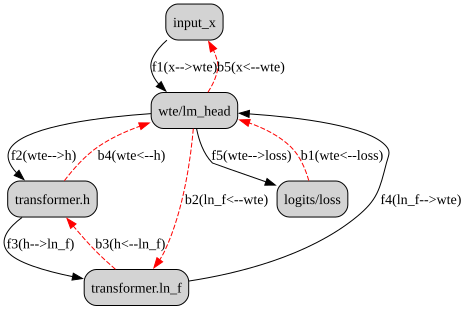

```python
import graphviz

def draw_llm_graph():
    dot = graphviz.Digraph(comment='LLM Computation Graph')
    dot.attr('node', shape='box', style='rounded,filled', fillcolor='lightgrey')
    dot.node('x', 'input_x')
    dot.node('wte', 'wte/lm_head')
    dot.node('h', 'transformer.h')
    dot.node('ln_f', 'transformer.ln_f')
    dot.node('loss', 'logits/loss')
    # 【关键】所有 label 的值必须用双引号包裹
    # forward/data  f1的f表示forward
    dot.edge('x', 'wte', style='solid', color='black', label='f1(x-->wte)')
    dot.edge('wte', 'h', style='solid', color='black', label='f2(wte-->h)')
    dot.edge('h', 'ln_f', style='solid', color='black', label='f3(h-->ln_f)')
    dot.edge('ln_f', 'wte', style='solid', color='black', label='f4(ln_f-->wte)')
    dot.edge('wte', 'loss', style='solid', color='black', label='f5(wte-->loss)')
    # backward/grad   b1的b表示backw
    dot.edge('loss', 'wte', style='dashed', color='red', label='b1(wte<--loss)')
    dot.edge('wte', 'ln_f', style='dashed', color='red', label='b2(ln_f<--wte)')
    dot.edge('ln_f', 'h', style='dashed', color='red', label='b3(h<--ln_f)')
    dot.edge('h', 'wte', style='dashed', color='red', label='b4(wte<--h)')
    dot.edge('wte', 'x', style='dashed', color='red', label='b5(x<--wte)') # 从这里就可以看出来，就是把正向的过程，倒着，把箭头换个方向即可
    
    output_filename = 'E:/learnGPT/learnGPTfromScratch/code/gpt2/llm_graph'
    dot.render(output_filename, format='svg', cleanup=True)
    print(f"图像已成功保存为 {output_filename}.svg")
    # print(dot.source) # 这个输出的dot内容，直接复制到draw.io里会丢失样式，很容易解析错误

draw_llm_graph()

```
按照[Autogenerated dependency graphs](https://www.drawio.com/docs/diagram-types/dependency-graphs/#autogenerated-dependency-graphs)的操作，
1. 新建一个`llm_graph.drawio`, 工具栏`Arrange`->`Insert`->`Advanced`->`from text`, 在`From text`的对话框里，`Close`的左侧有个下拉框，改为`Diagram`,复制上面的`graphviz dot`内容
2. 但是这个输出的dot内容，直接复制到draw.io里会`丢失样式`，很容易`解析错误`(遇到`->`就直接解析为新的线，遇到空格就是新的节点)，
3. 还是换成保存为`svg`文件，然后直接截图得到更好的图像（`png`和`svg`图像显示有差异，`svg`图像更清晰）


## 3.10 gpt2初始化问题
### 1. LayerNorm 和 nn.Linear(Conv1d)
+ [Layer Normalization](https://arxiv.org/abs/1607.06450)
+ <https://docs.pytorch.org/docs/2.15/generated/torch.nn.LayerNorm.html>
  + pytorch实现里的， `elementwise_affine`这个参数就是控制要不要有$\gamma$(默认初始化为全1)和$\beta$(默认初始化为全0)
  + 之前在 <code\zero_gpt\7_start_GPT.ipynb>中有涉及到  `Xavier` 初始化 和 `Kaiming` 初始化
+ 以gpt2这里的线性层的初始化为例：
  ```python
    # 自注意力机制中的
    self.c_attn = nn.Linear(config.n_embed, 3*config.n_embed) 
    self.c_proj = nn.Linear(config.n_embed, config.n_embed) 

    # MLP中的
    self.c_fc = nn.Linear(config.n_embed, 4*config.n_embed)
    self.c_proj = nn.Linear(4*config.n_embed, config.n_embed)
  ```
  + 设置为 std=0.02, 其实类似于`Xavier` 初始化中 服从$\mathcal{N}(0, \sqrt{\frac{1}{infeatures}}) = (0, \sqrt{\frac{1}{768}})$
  + 对于 gpt2的最小版本， 是 `(1/768)**0.5 = 0.0360`
  + 对于 gpt2的其他版本， $d_{model} = 1024， 1280，1600$来说，得到的结果就分别是：
    + `(1/1024)**0.5 = 0.03125`
    + `(1/1280)**0.5 = 0.02795084971874737`
    + `(1/1600)**0.5 = 0.025` 


>[!TIP]
>**gpt2 里需要额外设置初始化，是因为TensorFlow本身对于自定义的层以及相关参数没有给出默认优化后的初始化设置**，所以才需要人工额外调整
> + 所以会看到实验中，如果不按照gpt2的设置，前向的loss是`tensor(10.8736, device='cuda:0', grad_fn=<NllLossBackward0>)`
> + 而按照gpt2的初始化设置后，前向的loss是`tensor(10.9520, device='cuda:0', grad_fn=<NllLossBackward0>)`
> + 反而gpt2的初始化设置与理想的损失：`-ln(1/50257) = 10.82`差距更大

gpt2的代码是2019年左右出的，kaiming_init是 2015年发表的论文，xavier_init 是 2010年左右发表的论文
+ 找了一些古早的文档，tf已经停止运营了，所以想找API都不好找了
+ 根据[tf.get_variable](https://zhuanlan.zhihu.com/p/30844533), 所以默认`tf.get_variable`是需要自己指定`初始化方案的`
  ```python
  def conv1d(x, scope, nf, *, w_init_stdev=0.02):
    with tf.variable_scope(scope):
        *start, nx = shape_list(x)
        w = tf.get_variable('w', [1, nx, nf], initializer=tf.random_normal_initializer(stddev=w_init_stdev))
        b = tf.get_variable('b', [nf], initializer=tf.constant_initializer(0))
        c = tf.reshape(tf.matmul(tf.reshape(x, [-1, nx]), tf.reshape(w, [-1, nf]))+b, start+[nf])
        return c

  def norm(x, scope, *, axis=-1, epsilon=1e-5):
    """Normalize to mean = 0, std = 1, then do a diagonal affine transform."""
    with tf.variable_scope(scope):
        n_state = x.shape[-1].value
        g = tf.get_variable('g', [n_state], initializer=tf.constant_initializer(1))
        b = tf.get_variable('b', [n_state], initializer=tf.constant_initializer(0))
        u = tf.reduce_mean(x, axis=axis, keepdims=True)
        s = tf.reduce_mean(tf.square(x-u), axis=axis, keepdims=True)
        x = (x - u) * tf.rsqrt(s + epsilon)
        x = x*g + b
        return x

  wpe = tf.get_variable('wpe', [hparams.n_ctx, hparams.n_embd],
                        initializer=tf.random_normal_initializer(stddev=0.01))
  wte = tf.get_variable('wte', [hparams.n_vocab, hparams.n_embd],
                        initializer=tf.random_normal_initializer(stddev=0.02))
  get_variable(name, shape=None, dtype=None, initializer=None,
  initializer:
        1. If `None` (the default), the default initializer passed in
    the variable scope will be used.
        2. If that one is `None` too, a `glorot_uniform_initializer` will be used.
        3. If a Tensor, in which case the variable is initialized to this value and shape.
  ```
+ 所以 **gpt2 这样设置权重，完全是因为当时的tf没有自动给出优化的初始方案**

### 2. residual layers采用 pre-norm带来的问题
gpt2论文中有：

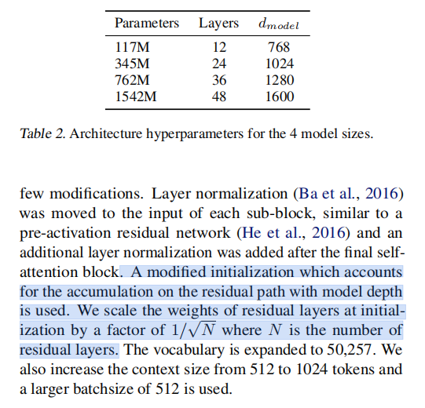

这里会有对残差流进行scale的原因，是因为gpt2用的是`pre-norm`方式
```python
def forward(self, x):
    x = x + self.attn(self.ln_1(x))  
    x = x + self.mlp(self.ln_2(x))
    return x
```
**Pre-LayerNorm (Pre-LN)** 架构会导致**残差流方差累积**问题。
- **传统的 Post-LN**：`x = LayerNorm(x + Sublayer(x))`。残差相加后立刻进行归一化，天然地将残差流的方差控制在合理范围。
- **GPT-2 采用的 Pre-LN**：`x = x + Sublayer(LayerNorm(x))`。
  - LayerNorm 只作用于子层的**输入**，而残差流 `x` 本身在连续相加时，**不会**被重新归一化。
  - 在初始化阶段，如果每个子层（Attention 或 MLP）的输出方差约为 1，那么经过 $N$ 层残差累加后，残差流的总方差会增长到 $O(N)$。对于深层网络（如 GPT-2 XL 的 48 层），这会导致训练初期的激活值和梯度方差过大，引发训练不稳定。
- 为了解决这个问题，GPT-2 论文提出：
  - **在初始化时，将残差分支的输出投影层（即 Attention 的 `c_proj` 和 MLP 的第二个 `c_proj`）的权重标准差缩小 $1/\sqrt{N}$ 倍**。
  - 这样每层贡献的方差变为 $O(1/N)$，累加 $N$ 层后，总方差依然能保持在健康的 $O(1)$ 水平 
  - 注意，这个操作是 老师实现的，[nanogpt-from-scratch/model.py](https://github.com/varad-more/nanogpt-from-scratch/blob/main/model.py#L370)
  - 但是确实和 Huggingface的实现一样的，都是对

```python
# standard deviation grows inside the residual stream
# 残差流中的标准差增长
import torch
x = torch.zeros(768)
n = 100

for i in range(n):
    x+= torch.randn(768)
print(x.std())  # tensor(9.4192)

# 这里残差连接加法后的方差变化，其实和线性层初始化是一个问题，（100，10)*(10,100)=(100,100)， 这(100,100)个数，每个都是 10和10元素对应相乘后再相加，所以是加了10次
# 多个方差为1的分布相加，最后加多少次，标准差就是根号下多少
# 这里直接加了100次，所以标准差就约等于 100**0.5 = 10
```
### 3. 最简单的例子说明不同缩放的区别

先去：[### 4. 现有实现(huggingface)](#4-现有实现huggingface)中看这个残差连接的求导，

本质上，这个式子，更关心的是$x = x+ F(x)$中$F(x)$的值，对于MLP和Attention模块来说，就是最后一个`c_proj`层的权重要尽量为0 → 方差尽量小

这里完全不关注等式右边的$x$, 因为求导之后就是1，

所以这里的加法关注的不是$x + F(x)$, 而是单纯关注$F(x)$被加多次带来的问题

```python
# 优化方法1
import torch
x = torch.zeros(768)
n = 100
for i in range(n):
    x+=torch.randn(768)*n**(-0.5)
print(x.std())


# 优化方法2
import torch
x = torch.zeros(768)
n = 100
for i in range(n):
    x+= torch.randn(768)
x = x*n**(-0.5)
print(x.std())


# 优化方法3
import torch
x = torch.zeros(768)
n = 100
for i in range(1,n+1):
    x+=torch.randn(768)*i**(-0.5)
print(x.std())
```
**优化1和优化2**的对比： 
+ 二者的区别在于进行缩放的时刻， 优化1是每次加法的时候都缩放，优化2是直接最后缩放一次
  + **在纯数学和统计学的理想假设下，这两种做法是完全等价的。**: 根据方差的线性性质，如果每次增加的随机变量独立同分布，那么“每次加的时候缩小 $1/\sqrt{N}$” 和 “全部加完之后整体缩小 $1/\sqrt{N}$”，最终结果的方差是相同的（都会收敛到 1 左右）。
  + 但是**神经网络不是简单的线性累加，而是逐层的非线性变换，且每一层的输出会作为下一层的输入。**
+ **中间激活值的方差会“中途爆炸”**
  + 假设在残差网络中，第 $l$ 层的隐藏状态计算为：
    $$ x_l = x_{l-1} + F(x_{l-1}, W_l) $$
  + 其中 $F$ 是残差分支（包含 Attention 或 MLP）。
  - **GPT-2 的做法（逐层缩放）**：每经过一层，残差分支的贡献方差被控制在 $O(1/N)$。因此，无论在第 1 层还是第 50 层，$x_l$ 的总方差始终保持在健康的 $O(1)$ 水平。
  - **简化做法（最后缩放）**：在前 $N-1$ 层中，残差分支的贡献方差是 $O(1)$。这意味着在第 $k$ 层时，$x_k$ 的方差会线性增长到 $O(k)$。如果 $N=100$，那么在第 50 层时，激活值的方差已经是初始状态的 50 倍左右。
+ **非线性激活函数直接“饱和失效”**
  - GPT-2 的残差分支内部包含 `gelu` 等非线性激活函数。这些函数在输入值过大或过小时，会进入**饱和区**（导数趋近于 0）。
  - 采用“最后缩放”的做法，中间层的 $x$ 值会变得极其巨大。当这些巨大的值传入下一层的 `gelu` 或 `tanh` 时，激活函数的输出将变成一条平坦的直线，导致**梯度消失**，反向传播时权重根本无法更新，模型训练会直接崩溃。
+ **LayerNorm 的数值稳定性被破坏**
  + 虽然 GPT-2 使用的是 Pre-LayerNorm（在残差分支内部先做 LayerNorm），但 LayerNorm 的计算依赖于输入数据的均值和方差。如果残差流 $x$ 的数值范围随着层数剧烈膨胀，会导致：
  - 浮点数计算精度丢失（大数吃小数）。
  - 即使 LayerNorm 强行将其拉回均值为 0、方差为 1，其缩放参数（$\gamma$）和偏移参数（$\beta$）的梯度也会因为输入分布的极端变化而变得极不稳定，破坏 Adam 等优化器的动量估计。


**优化1和优化3**的对比：
+ 同样都是每次进行残差分支相加时，对残差分支进行缩放，一个是使用`N`,另一个是使用当前相加的次数`i`
+ 这里需要提前搞清楚一个概念：
  ```python
    import torch
    # 示例1
    x = torch.zeros(768)
    n = 100
    for i in range(n):
        x+=torch.randn(768)*n**(-0.5)
    print(x.std())
    # tensor(0.9721)  这是 多次独立采样求和

    # 示例2
    x = torch.zeros(768)
    x = x + 100*(torch.randn(768)*n**(-0.5))
    print(x.std())
    # tensor(10.0891)  这是 单次采样后放大
  ```
  - 对于示例1，
    - 相当于循环了 100 次，`torch.randn` 被调用了 100 次，产生了 **100 个相互独立** 的随机变量 $Z_1, Z_2, ..., Z_{100}$。
    - **单次方差**：每次加上的项是 $0.1 \times Z_i$, 注意：($\sqrt{\frac{1}{100}} = \frac{1}{10} = 0.1$)，其方差为 $0.1^2 \times \text{Var}(Z_i) = 0.01$。
    - **总方差**：根据概率论，**独立**随机变量之和的方差，等于它们方差的**和**。
      $$ \text{Var}(X_1) = \sum_{i=1}^{100} \text{Var}(0.1 \times Z_i) = 100 \times 0.01 = 1 $$
    - **结果**：`x.std()` 会非常接近 **1.0**。
  - 对于示例2，
    -  `torch.randn` **只被调用了 1 次**，只产生了一个随机变量 $Z$。然后这个**同一个**随机变量被乘以了常数 $10$ （因为 $100 \times 100^{-0.5} = 10$）。
    - **总方差**：根据概率论，随机变量乘以常数 $c$，其方差会放大 **$c^2$ 倍**。
      $$ \text{Var}(X_2) = \text{Var}(10 \times Z) = 10^2 \times \text{Var}(Z) = 100 \times 1 = 100 $$
    - **结果**：`var`方差是100，则标准差`x.std()` 会非常接近 **10.0**。
  - 因此，**示例1和示例2并不等价**！不可以把示例1简化为： $x + (F(x)\times \sqrt{\frac{1}{100}})\times 100$
  - **独立随机变量求和**与**标量乘法**在方差计算上的核心差异。在深度学习中，控制方差的关键在于控制**每一次独立采样**的幅度，而不是试图去修正已经累积完成的总和。
+ 每次都缩放`N`，则可以简化为公式为上面的，就不用讨论了，肯定是`std=1`
+ 每次都缩放`i`，则可以计算为:
  - 第一层，加上的项是 $1 \times Z_i$, 注意：($\sqrt{\frac{1}{1}} = \frac{1}{1} = 1$)，其方差为 $1^2 \times \text{Var}(Z_i) = 1$。
  - 第二层，加上的项是 $\frac{1}{2} \times Z_i$, 注意：($\sqrt{\frac{1}{2}}$)，其方差为 $(\sqrt{\frac{1}{2}})^2 \times \text{Var}(Z_i) = \frac{1}{2}$。
  - 则整体的计算为:
    $$ \text{Var}(X_1) = (1 + \frac{1}{2} +  \frac{1}{3} +  \frac{1}{100})\times Z_i = \sum_{i=1}^{k} \frac{1}{i} \approx \ln(k) \quad \text{(调和级数)} = ln(100) \approx 4.605$$
  - `math.log(3) = 1.0986`所以可以认为：**只要大于等于3层，用这种每层的层数来进行缩放的，最后方差依然会放大，且不同层的信号尺度不一致，会给 LayerNorm 和优化器带来不必要的波动**。
+ 类似的，每次缩放`N`的计算公式就可以表达为:
  $$ \text{Var}(X_1) = \sum_{i=1}^{N} \text{Var}(\sqrt\frac{1}{N} \times Z_i) = \sum_{i=1}^{N} \frac{1}{N} = N* \frac{1}{N} = 1$$
  - 以第$k$层为例，则方差可以表示为: $\text{Var}(x_k) \approx k \times \frac{1}{N} = \frac{k}{N}$
  - 因为 $k \le N$（当前层数永远小于等于总层数），所以 **$\frac{k}{N} \le 1$**。同时**前几层方差偏小（$\frac{k}{N} < 1$）不是坏事**，在训练的最初阶段，模型权重是随机初始化的，产生的梯度噪声极大。前几层的激活值方差较小（例如第 1 层只有 $1/N$），相当于在网络的前端提供了一层**隐式的正则化或 Warmup 效果**，防止初期的剧烈更新直接摧毁浅层特征。随着训练进行，权重会偏离初始分布，方差会自然增长到健康水平。
  - 这意味着，**无论网络运行到第几层，激活值的方差永远被严格限制在 $1$ 以内！**
  - 同时当到达最后一层（$k=N$）时，方差恰好达到最大值 $1$，完美归一化。本质上是**设定了一个“全局方差上界 (Global Variance Upper Bound)”，确保网络中任何一层的激活值都不会爆炸。**
+ 综上，确实**只有保证每层都基于总层数缩放，才能保证最后的方差是1**

### 4. 现有实现(huggingface)
现有实现：
1. openai的TensorFlow实现的gpt2的官方给的里没有开源代码没有体现这个操作，issue里有人问，<https://github.com/openai/gpt-2/blob/master/src/model.py#L123>
2. huggingface的实现, [transformers/src/transformers/models/gpt2/modeling_gpt2.py](https://github.com/huggingface/transformers/blob/main/src/transformers/models/gpt2/modeling_gpt2.py#L433)里有以下：
   ```python
    @torch.no_grad()
    def _init_weights(self, module):
        """Initialize the weights."""
        super()._init_weights(module)
        if isinstance(module, Conv1D):
            init.normal_(module.weight, mean=0.0, std=self.config.initializer_range)
            if module.bias is not None:
                init.zeros_(module.bias)

        # Reinitialize selected weights subject to the OpenAI GPT-2 Paper Scheme:
        #   > A modified initialization which accounts for the accumulation on the residual path with model depth. Scale
        #   > the weights of residual layers at initialization by a factor of 1/√N where N is the # of residual layers.
        #   >   -- GPT-2 :: https://openai.com/blog/better-language-models/
        #
        # Reference (Megatron-LM): https://github.com/NVIDIA/Megatron-LM/blob/main/megatron/model/gpt_model.py
        # Megatron-LM的代码改位置了：
        # https://github.com/NVIDIA/Megatron-LM/blob/v2.0/megatron/model/gpt_model.py#L74
        # 会引用到其他两个文件：
        # https://github.com/NVIDIA/Megatron-LM/blob/v2.0/megatron/model/utils.py#L32
        # https://github.com/NVIDIA/Megatron-LM/blob/v2.0/megatron/model/language_model.py#L45
        if isinstance(module, (GPT2Attention, GPT2MLP)):
            # Special Scaled Initialization --> 2 residual paths (attention and MLP) per Transformer Block
            std = self.config.initializer_range / math.sqrt(2 * self.config.n_layer)
            init.normal_(module.c_proj.weight, mean=0.0, std=std)
   ```

所以可以认为现有实现，都是

**在初始化时，将残差分支的输出投影层（即 Attention 的 `c_proj` 和 MLP 的第二个 `c_proj`）的权重标准差缩小 $1/\sqrt{N}$ 倍， N = (2 * self.config.n_layer)**
```python
def forward(self, x):
    # attn中forward的最后一个操作: y = self.c_proj(y)
    x = x + self.attn(self.ln_1(x))  
    # mlp中的forward的最后一个操作: self.c_proj(self.gelu(self.c_fc(x)))
    x = x + self.mlp(self.ln_2(x))
    return x
```

但是我一开始的设想是, 对于`code\gpt2\train_gpt2.py`中的`Block`中的残差连接，因为执行了两次残差连接，即：做了两次加法，一般是认为有两个残差层，所以要乘以$\sqrt\frac{1}{2}$，即：
```python
def forward(self, x):
    x = x + self.attn(self.ln_1(x))  
    x = x + self.mlp(self.ln_2(x))
    x = x*2**(-0.5)
    return x
```

所以 **为什么是缩放 `c_proj` 的权重，而不是在 $x = x + \text{attn}(x)$ 之后直接对 $x$ 乘以缩放系数？**
+ **为了保护“恒等映射”的梯度流不被破坏。**
+ 残差网络之所以能训练得深，核心在于它提供了**恒等映射（Identity Mapping）** 的捷径。在标准的残差块中，前向传播是：
  $$ x_l = x_{l-1} + F(x_{l-1}) $$
+ 直接求导可知：
  $$\frac{\partial x_l}{\partial x_{l-1}}= 1 + \frac{\partial F(x_{l-1})}{\partial x_{l-1}}$$

  - 由于梯度为**1**就保证了在反向传播时，梯度可以无损地、原封不动地穿过无数层传回底层，从根本上解决了梯度消失问题。
  - 所以希望$\frac{\partial x_l}{\partial x_{l-1}} \approx 1$, 则需要$\frac{\partial F(x_{l-1})}{\partial x_{l-1}} \approx 0$
+ 一般$F(x_{l-1})$是`MLP`或者`Attention`, 这里直接简化表示为$\frac{\partial F(x_)}{\partial x} \approx 0$
+ 以`MLP`为例，`x = x + self.mlp(self.ln_2(x))`, 则前向计算过程可以抽象为：
  $$ F(x) = W_{c_{proj}} \cdot( \text{Norm}(x) ) $$
  - 因为 `MLP`的前向是`return self.c_proj(self.gelu(self.c_fc(x)))`, 最后一层也是`c_proj`,和`Attention`的分析一样，所以看一个就可以 
+ 以`Attention`为例，`x = x + self.attn(self.ln_1(x)) `, 则前向计算过程可以抽象为：
  $$ F(x) = W_{c_{proj}} \cdot( \text{Norm}(x) ) $$
  - $\text{Norm}$ 是 LayerNorm
  - $W_{c_{proj}}$ 是**最后一个线性投影层**（在 GPT-2 代码中就是 `c_proj` 的权重矩阵）。
  - 如果想要 $\frac{\partial F}{\partial x} \approx 0$, 最简单的方式就是让$W_{c_{proj}} \approx 0$
  - gpt2的做法是：将$W_{c_{proj}}$的权重初始化标准差缩小了 $1/\sqrt{N}$ 倍。
因为 $N$（层数）通常很大（比如 12 层、48 层甚至 96 层），所以 $1/\sqrt{N}$ 是一个**非常小的值**（例如 $1/\sqrt{48} \approx 0.14$，再乘以基础标准差 0.02，最终 $W_{out}$ 的初始标准差只有 0.0028 左右）。**整个乘积 $\frac{\partial F}{\partial x}$ 都会被强行拉低，接近于 0。**


### 5. zero-initialized attention mechanism
+ [On Zero-Initialized Attention: Optimal Prompt and Gating Factor Estimation](https://arxiv.org/abs/2502.03029)
+ [LLaMA-Adapter: Efficient Fine-tuning of Language Models with Zero-init Attention](https://arxiv.org/abs/2303.16199)

直接对Atten的最后一层$W_{c_{proj}}$权重初始化为0，达到真正的初始化的时候导数为0。

“全零初始化”在数学上完美地实现了绝对的恒等映射，彻底杜绝了训练初期的梯度爆炸/消失问题

## 3.11 根据gpt3的训练细节来调整超参

```python
# 结合gpt3的论文 附录B Details of Model Training 来修改超参
optimizer = torch.optim.AdamW(model.parameters(), lr = 3e-4, betas=(0.9, 0.95), eps=1e-8)
...

loss.backward() 
# 根据gpt3论文 clip the global norm of the gradient at 1.0 梯度裁剪控制到1.0
norm = torch.nn.utils.clip_grad_norm_(model.parameters(), 1.0)

# 添加这里用的 cosine learning decay schdule with warmup
# 这里和原文不同的地方在于：原文的衰减周期是前260十亿的tokens训练，而不是完整的max_steps
# 而这衰减周期设置的长度和max_steps一样长，所以其实`it>max_steps`这部分是没有发挥作用的
max_lr = 3e-4
min_lr = max_lr*0.1
warm_steps = 10
max_steps = 50
def get_lr(it):
  if it<warm_steps:
    return max_lr/warm_steps*(it+1)   
  # 通常更严谨的写法是 max_lr * (it / warm_steps)，这样 it=0 时学习率为 0。
  # 加了 +1 可能是为了避免初始学习率过小导致前期梯度更新太慢，属于工程上的小 trick。
  if it>max_steps:
    return min_lr
  # warm_steps<=it<=max_steps, 所以  0<=it - warm_steps<=max_steps - warm_steps 
  # 所以 decay_ratio∈[0,1]
  decay_ratio = (it - warm_steps)/(max_steps - warm_steps) # 算出这个steps位于cosine decay中的哪一步 
  assert 0<=decay_ratio<=1  
  # 注意，这里这个0~1范围限制了只会用到cos图像的0~ π/2左右的范围，所以整体是个单调下降的函数曲线
  # (sinx)' = cosx   (cosx)'= -sinx  所以对于cox来说，其倒数是-sinx，即在[0,π]范围内，梯度都是负数，所以确实是单调下降的函数
  coeff = 0.5*(1.0 + math.cos(math.pi*decay_ratio))
  # math.pi*decay_ratio 把取值范围从[0,1]→ [0,π]，则经过 math.cos,结果值范围就是[1,-1]
  # 为了防止出现负数，加1 → [2,0]
  # 再*0.5缩放回[1,0]范围
  # coeff 代表了当前学习率在“最大”和“最小”之间的相对位置比例。
  # 经过上述操作，就把 [0,1]的decay_ratio 变成了[1,0]的coeff，这个coeff就是随着时间不断减小的一个衰减值
  return min_lr + coeff*(max_lr - min_lr)
  # 线性插值映射到实际学习率 coeff=0和1的时候，刚好位于各自的边界

```
主要包括：
1. 优化器设置
2. 梯度裁剪：
   + 如果不进行梯度裁剪，则如果遇到一个比较差数据的batch，loss异常大，就会导致梯度异常大，这种情况就会严重干扰模型训练，打乱整个优化过程
   + 注意，这里的梯度裁剪本质是个in-place操作，即：对模型的参数的梯度是原地操作(`Gradients are modified in-place.`)
   + 保留这个返回值是为了进行之后的可视化(`Total norm of the parameter gradients (viewed as a single vector)`)
   + 关于norm：
     + 返回的这个 Total norm 就是裁剪前，模型所有参数梯度构成的全局向量的 L2 长度,即：缩放前计算的所有梯度的长度值
     + 可以根据这个norm来观察模型训练的情况，如果比较平稳，说明模型状态良好；如果norm持续攀升，说明训练过程出现了问题，模型正在失去稳定性
     + 如果出现了spike(突然的峰值/尖刺)，则说明训练过程出现了某种问题或者不稳定现象
        ```bash
          step    0 | loss: 10.947336 | norm: 28.5691 | dt: 24266.69ms | tok/sec: 675.16
          step    1 | loss: 9.388559  | norm: 6.1854  | dt: 108.82ms   | tok/sec: 150559.62
          step    2 | loss: 8.949835  | norm: 2.4913  | dt: 107.79ms   | tok/sec: 152003.64
          step    3 | loss: 8.764280  | norm: 2.8577  | dt: 103.81ms   | tok/sec: 157829.95
          step    4 | loss: 8.770796  | norm: 10.1800 | dt: 94.01ms    | tok/sec: 174285.31
          step    5 | loss: 8.454692  | norm: 2.0296  | dt: 94.21ms    | tok/sec: 173904.68
          step    6 | loss: 8.337821  | norm: 2.4194  | dt: 93.58ms    | tok/sec: 175081.02
          step    7 | loss: 8.063896  | norm: 1.7720  | dt: 93.26ms    | tok/sec: 175684.39
          step    8 | loss: 7.771032  | norm: 2.0228  | dt: 94.04ms    | tok/sec: 174218.59
        ```
      + 在训练的最初几个阶段，梯度norm数值偏高并不罕见，但是随着训练的进行，逐渐会稳定在1以下
      + 这是因为模型初始化的时候完全是随机的，因此，训练初期会进行大量的学习，但这种学习过程主要是掌握 输出词元的偏置分布(`biases of output tokens`), 所以初期会有些不稳定，但通常只需要几次迭代就可以稳定下来
3. **cosine learning decay schdule with warmup**
   1. and we use cosine decay for learning rate down to 10% of its value, over 260 billion tokens (after 260 billion tokens, training continues at 10% of the original learning rate). There is a linear LR warmup over the first 375 million tokens.
   2. 大意就是: 前375百万的tokens用的是一个线性LR预热，学习率从0上升到`max_lr`, 然后后续是一个cosine decay，这个cosine decay的学习率在前260千亿的tokens训练过程中一直降低到原始学习率的10%(即`max_lr*0.1`)，之后就一直保持`max_lr*0.1`的学习率
   3. 运行结果示例：
      + 这里是按照 `max_lr=3e-4`运行的结果，可以看到，前10(`step 0`~ `setp 9`)个阶段，是warmup阶段，lr一直在线性增大，损失下降也算比较快
      
        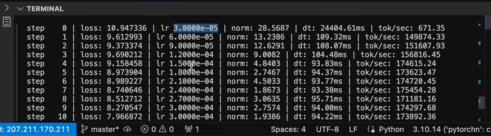
      + 之后就是 `cosine learning decay schdule` 的部分，可以看到，lr在缓慢下降(慢，快，慢)变化

        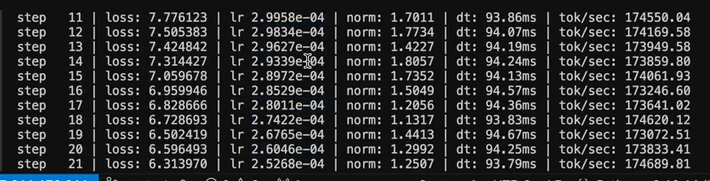
      + 在之后就是按照设定的最低学习率(原始的10%一直训练了)

        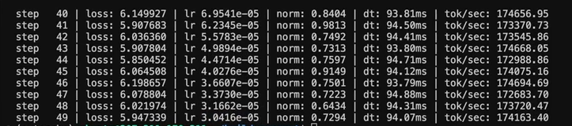
4. 这里的`lr`设置，也是参考gpt3论文的
   
   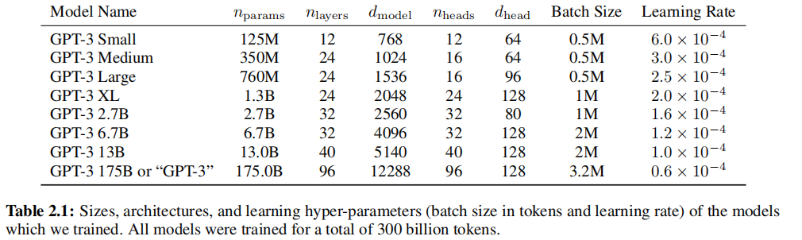
5. batch size设置的问题， 
   > We also gradually increase the batch size linearly from a small value (32k tokens) to the full value over the first 4-12 billion tokens of training, depending on the model size. Data are sampled without replacement during training (until an epoch boundary is reached) to minimize overfitting.
   + 即：根据相应的模型尺寸，逐步线性增大batch_size, 在前40-120亿tokens训练过程中，逐步从一个小的batch_size尺寸(32k)增加到完整尺寸(lr设置里的表格，比如对于GPT3-small， 最大的batch_size=0.5M，即从 3.2w→50w )
   + 同时，在训练过程中，数据会进行不放回抽样（直到达到一个训练轮结束），以尽量减少过拟合。
   + 老师没有这么做，
     + 因为这样会让很多计算变复杂，**优化的每一步tokens数量都在变**，对硬件计算并不友好，
     + 同时在老师的认知里，**这种方法带来的提升并不显著**
   + 这样做的原因是因为训练前期是一种不典型状态，训练初期学的都是一些简单的偏置项，学到的都是**最简单的可以改变loss的东西(比如：如何去忽视训练集中出现频率较低的tokens)**。
     + 所以这时候**每个样本产生的梯度具有极高的相关性，即：优化的初期阶段，这些梯度看起来大致相同**，因为这些梯度表达都是哪些token要出现，哪些token不要出现。→ **初期每个样本产生的梯度导致优化的方向是类似的**
     + 因此如果说初期的东西没啥区别，那用0.5M和用32k得到的结果都差不多，那完全可以用个小点的`batch_size`；而到了优化后期，由于在前期把这些简单的东西都学过了，这会才开始真正学习真正重要的细节差异，样本产生的梯度的相关性降低，此时开始，这些样本的梯度才开始具有统计效力(`statistical power`)→ **后期每个样本产生的梯度导致优化的方向才是各有不同的，这时候才有统计效力/学习细节的价值**

## 3.12 梯度裁剪实现原理
根据[torch.nn.utils.clip_grad_norm_(parameters, max_norm, norm_type=2.0, error_if_nonfinite=False, foreach=None)](https://docs.pytorch.org/docs/2.15/generated/torch.nn.utils.clip_grad_norm_.html)
+ > The norm is computed over the norms of the individual gradients of all parameters, as if the norms of the individual gradients were concatenated into a single vector. Gradients are modified in-place.<br/>This function is equivalent to `torch.nn.utils.get_total_norm()` followed by `torch.nn.utils.clip_grads_with_norm_()` with the total_norm returned by get_total_norm.
+ 简单来说，就是把所有的梯度张量拼到一起，然后进行norm
+ 对应的`norm_type=2.0`,其实就是[torch.linalg.vector_norm(x, ord=2, dim=None, keepdim=False, *, dtype=None, out=None)](https://docs.pytorch.org/docs/2.15/generated/torch.linalg.vector_norm.html#torch.linalg.vector_norm)这里的 `ord = 2`，执行的计算其实是
`sum(abs(x)^{ord})^{(1 / ord)}`也就是先平方再开方，再求和

再根据[torch.nn.utils.clip_grads_with_norm_(parameters, max_norm, total_norm, foreach=None)](https://docs.pytorch.org/docs/2.15/generated/torch.nn.utils.clip_grads_with_norm_.html#torch.nn.utils.clip_grads_with_norm_)
$$grad = grad * \min(\frac{max\_norm}{total\_norm + 1e-6}, 1)$$
+ 这里的`total_norm`就是上面`norm_type=2`计算得到的所有梯度向量拼到一起，进行平方再开方，再求和的结果
+ 这里的`max_norm`对应的就是`torch.nn.utils.clip_grad_norm_(model.parameters(), 1.0)`里设置的1.0(也就是这个函数的`max_norm`参数)

这里大概举个例子：
```python
import numpy as np
a = np.array([3,10,20,6,5])
a = a*(1/np.sqrt(np.sum(np.power(a,2))))
print(a)
# [0.12565617 0.41885391 0.83770782 0.25131234 0.20942695]
# 用这种方案，就可以把整个数组一起按照比例缩放到要求的max_norm以下了
```

梯度裁剪（Gradient Clipping）实现的核心原理是**向量 L2 范数的齐次性（Homogeneity）**。

简单来说：**当你对一个向量的每一个元素（即每个参数的梯度）都乘以同一个标量系数时，这个向量的整体长度（L2 范数）也会精确地按该系数缩放。**

1. **数学推导：缩放系数的计算**
   + 假设模型有 $N$ 个参数，我们将所有参数的梯度展平（flatten）并拼接成一个巨大的梯度向量 $\mathbf{g}$：
    $$ \mathbf{g} = [g_1, g_2, ..., g_N]^T $$

   + 这个整体梯度向量的 L2 范数（即代码中的 `total_norm`）为：
    $$ ||\mathbf{g}||_2 = \sqrt{\sum_{i=1}^N g_i^2} $$

   + 目标是：如果 $||\mathbf{g}||_2 > max\_norm$，就通过乘以一个缩放系数 $c$，让缩放后的梯度 $c \times \mathbf{g}$ 的范数刚好等于 $max\_norm$。
   + 根据向量范数的齐次性性质 $||c\mathbf{g}||_2 = |c| \cdot ||\mathbf{g}||_2$，我们可以列出等式：
    $$ |c| \cdot ||\mathbf{g}||_2 = max\_norm $$
   + 解得缩放系数 $c$：
    $$ c = \frac{max\_norm}{||\mathbf{g}||_2} $$
   +  **综合两种情况：**
      - 当 $||\mathbf{g}||_2 \le max\_norm$ 时，不需要裁剪，梯度本身就已经在安全范围内了，不需要进行任何缩放。在数学上，“保持原样”就意味着乘以 1，即系数 $c = 1$。
      - 当 $||\mathbf{g}||_2 > max\_norm$ 时，需要裁剪，系数 $c = \frac{max\_norm}{||\mathbf{g}||_2}$。
   + 将两者合并，就得到了代码中的核心公式：
    $$ c = \min\left(1, \frac{max\_norm}{||\mathbf{g}||_2}\right) $$
2. **`1e-6`** 的作用
   + 在实际代码中，分母会加上一个极小值 $\epsilon$（如 `1e-6`）：
   $$ c = \min\left(1, \frac{max\_norm}{||\mathbf{g}||_2 + \epsilon}\right) $$
   + 是为了**防止除零错误（Divide by Zero）**：在某些极端情况下（例如模型刚初始化、某些参数没有参与前向计算、或者梯度恰好全为 0），`total_norm` 会等于 0。如果不加 $\epsilon$，`max_norm / 0` 会导致计算出 `inf` 或 `NaN`，进而污染整个模型的梯度。加上 `1e-6` 后，如果 `total_norm` 为 0，算出来的 $c$ 会是一个极大的数，但经过 `min(1, 极大数)` 截断后，$c$ 依然等于 1，梯度保持原样（即 0），保证了数值稳定性。
3. PyTorch 源码视角的实现细节
   + 虽然数学上我们把所有梯度看作一个大向量 $\mathbf{g}$，但在 PyTorch 的实际源码实现中，**并不会真的把所有梯度拼接成一个大 Tensor**（因为 LLM 参数量极大，拼接会消耗大量显存并导致内存碎片）。
   + PyTorch 的实际计算逻辑如下：
      1. **计算总范数（不拼接向量）**：
         遍历所有需要计算梯度的参数，分别计算每个参数梯度张量的 L2 范数的平方，然后**求和**，最后**开根号**。
         $$ total\_norm = \sqrt{\sum_{p} ||\nabla p||_2^2} $$
         这在数学上等价于拼接后求范数，但内存效率极高。

      2. **计算缩放系数**：
         $$ clip\_coef = \frac{max\_norm}{total\_norm + \epsilon} $$
         $$ clip\_coef = \min(clip\_coef, 1.0) $$

      3. **原地缩放（In-place 操作）**：
         再次遍历所有参数，将每个参数的梯度张量直接乘以这个标量 `clip_coef`。
         ```python
         for p in parameters:
             p.grad.detach().mul_(clip_coef)
         ```
         因为 `mul_` 是原地操作，所以不会开辟新的显存空间。

>[!NOTE]
>这种方式的好处在于：**只改变了梯度的“整体步长”（范数），而完全没有改变梯度的“方向”（各个参数梯度之间的相对比例）。** 
><br/>**对于向量的梯度来说，本身就不可以改变方向，本身就是只改变每个梯度分量的长度(长度就是L2-norm)**
><br/>对于LLM 训练，由于模型参数量巨大（几十B甚至上百B）且 Batch Size 很大，极易出现 Loss Spike（梯度爆炸）。
><br/>`clip_grad_norm_` 是稳定大模型训练的标配（`max_norm` 通常设为 `1.0`）。当某个 batch 导致梯度爆炸时，它会把所有参数的梯度等比例缩小，确保参数更新的“总步长”不超过安全阈值，从而避免模型权重被破坏。


## 3.13 cosine decay learning schedule with warmup(带有预热的余弦衰减学习率调度)

**相关论文和理论说明**
+ resnet: **4.2. CIFAR-10 and Analysis**这个部分 以及 [Accurate, Large Minibatch SGD: Training ImageNet in 1 Hour](https://arxiv.org/abs/1706.02677)
  
  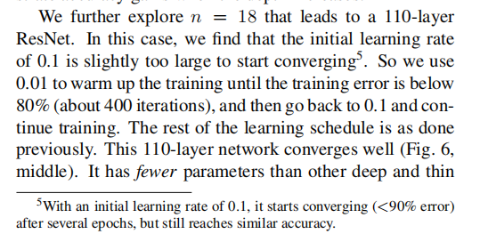
+ 在[博客园-Warmup预热学习率](https://www.cnblogs.com/LiuXinyu12378/p/13615601.html)文章中，有：
  + **what**: 
    + Warmup是在ResNet论文中提到的一种学习率预热的方法，
    + 它在**训练开始的时候先选择使用一个较小的学习率，训练了一些epoches或者steps(比如4个epoches,10000steps),再修改为预先设置的学习来进行训练。**
  + **why**: 
    + 由于刚开始训练时,模型的权重(weights)是随机初始化的，此时若选择一个较大的学习率,可能带来模型的不稳定(振荡)，
    + 选择Warmup预热学习率的方式，可以使得开始训练的几个epoches或者一些steps内学习率较小,
    + 在预热的小学习率下，模型可以慢慢趋于稳定,等模型相对稳定后再选择预先设置的学习率进行训练,使得模型收敛速度变得更快，模型效果更佳。
    + Example：Resnet论文中使用一个110层的ResNet在cifar10上训练时，先用0.01的学习率训练直到训练误差低于80%(大概训练了400个steps)，然后使用0.1的学习率进行训练。
  + **why**中提到的warmup是`constant warmup`，它的不足之处在于从一个很小的学习率一下变为比较大的学习率可能会导致训练误差突然增大。
  + 18年Facebook(Kaiming,He, 即： [Accurate, Large Minibatch SGD: Training ImageNet in 1 Hour](https://arxiv.org/abs/1706.02677))提出了gradual warmup来解决这个问题，即从最初的小学习率开始，每个step增大一点点，直到达到最初设置的比较大的学习率时，采用最初设置的学习率进行训练。
+ 所以这里所看到的 **cosine decay learning schedule with warmup(带有预热的余弦衰减学习率调度)** 也是一种`gradual warmup`


---

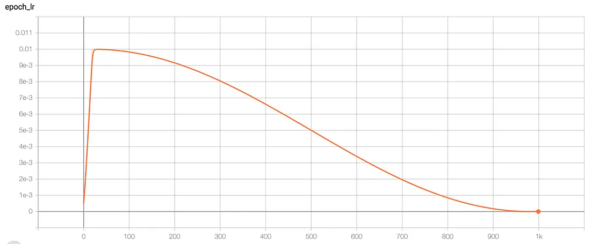

图自：[Cosine Learning rate decay](https://scorrea92.medium.com/cosine-learning-rate-decay-e8b50aa455b)
+ 在早期的 CV 或 NLP 任务中，常用的是 Step Decay（每隔几个 epoch 学习率除以 10）。
+ 但在 LLM 训练中，Cosine Decay 被证明效果更好。
+ **原因**：余弦下降 (Cosine Decay)：学习率下降的速度是 “慢 -> 快 -> 慢”。
  + 初期（慢）：刚结束 warmup 时，曲线比较平缓，学习率下降得很慢，能让模型在较大学习率下充分探索损失空间；
  + 中期（快）：在训练中段，曲线变得陡峭，学习率快速下降。
  + 末期（慢）：在训练末期，曲线再次变得平缓，学习率极其缓慢地逼近 min_lr，不会像 Step Decay 那样“断崖式”下跌，有利于模型在最后阶段进行更精细的参数微调和收敛。
  + 这部分 `慢-快-慢` 对应的刚好是 **cosx的速率曲线(梯度变化曲线)→ -sinx 在[0, π]之间的时候，是从0减小到-1，再从-1慢慢增大到0；对应的就是梯度负的越来越多（cos的数值下降越来越快），然后负的越来越少(cos的数值下降越来越慢)**
+ 关键代码：
  ```python
    coeff = 0.5*(1.0 + math.cos(math.pi*decay_ratio))
    return min_lr + coeff*(max_lr - min_lr)
  ```

---

cosine图像

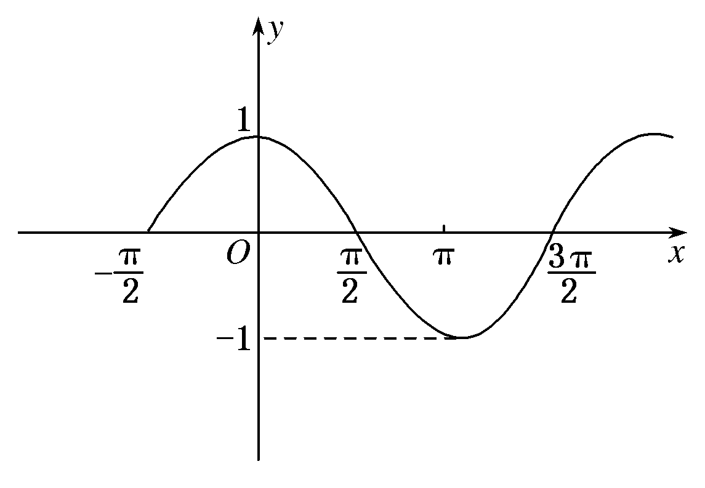

```python
import numpy as np
import matplotlib.pyplot as plt
plt.rcParams['font.sans-serif'] = ['SimHei', 'Arial Unicode MS', 'PingFang HK']
plt.rcParams['axes.unicode_minus'] = False  # 正常显示负号
x = np.linspace(-0.5, np.pi + 0.5, 400)
y_sin_neg = -np.sin(x)
y_cos = np.cos(x) 
plt.figure(figsize=(9, 6))
plt.plot(x, y_sin_neg, label=r'$y = -\sin(x)$ (下降速率)', color='#1f77b4', linewidth=2.5)
# 绘制 y = cos(x) 参考曲线 (虚线)
plt.plot(x, y_cos, label=r'$y = \cos(x)$ (学习率系数参考)', color='gray', linestyle='--', linewidth=1.5)

# 重点高亮 [0, π] 区间
x_focus = np.linspace(0, np.pi, 200)
y_focus = -np.sin(x_focus)
plt.fill_between(x_focus, y_focus, 0, color='#1f77b4', alpha=0.15, label='重点区间 $[0, \pi]$')

# 添加关键点标注
plt.plot(0, 0, 'ro', markersize=6)
plt.annotate('起点 (0, 0)\n下降速率为0', xy=(0, 0), xytext=(0.3, 0.3),
             arrowprops=dict(facecolor='black', arrowstyle='->', lw=1))

# 谷值点 (π/2, -1) -> 对应下降速率的"峰值"绝对值
plt.plot(np.pi/2, -1, 'ro', markersize=6)
plt.annotate('谷值 -1\n(学习率下降最快点)', xy=(np.pi/2, -1), xytext=(np.pi/2 + 0.3, -0.7),
             arrowprops=dict(facecolor='black', arrowstyle='->', lw=1))

# 终点 (π, 0)
plt.plot(np.pi, 0, 'ro', markersize=6)
plt.annotate('终点 (π, 0)\n下降速率回归0', xy=(np.pi, 0), xytext=(np.pi - 1.2, 0.3),
             arrowprops=dict(facecolor='black', arrowstyle='->', lw=1))
             
# cos(x) 的峰值 1
plt.annotate('参考: cos(x) 峰值 1', xy=(0, 1), xytext=(0.3, 0.8), color='gray', fontsize=10)

# 美化图表
plt.axhline(0, color='black', linewidth=1)  # x轴
plt.axvline(0, color='black', linewidth=1)  # y轴

# 设置刻度，使用 LaTeX 格式显示 π
plt.xticks([0, np.pi/2, np.pi], ['0', 'π/2', 'π'], fontsize=12)
plt.yticks([-1, 0, 1], fontsize=12)

plt.title(r'函数 $y = -\sin(x)$ 图像及其在 LLM 学习率调度中的物理意义', fontsize=14, pad=15)
plt.xlabel('x (对应 decay_ratio * π)', fontsize=12)
plt.ylabel('y', fontsize=12)

plt.legend(loc='upper right', fontsize=11)
plt.grid(True, linestyle=':', alpha=0.7)

# 调整布局并显示
plt.tight_layout()
plt.show()
```
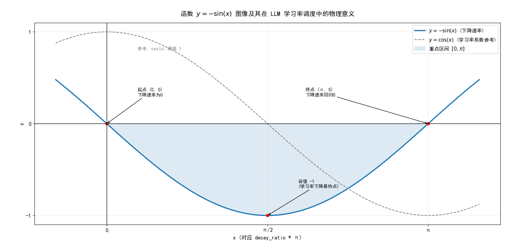


---

**现有框架实现**
+ [github-huggingface/transformers-get_cosine_schedule_with_warmup](https://github.com/huggingface/transformers/blob/v4.23.1/src/transformers/optimization.py#L104)
+ [transformers-get_cosine_schedule_with_warmup文档](https://huggingface.co/docs/transformers/v5.23.0/en/main_classes/optimizer_schedules#transformers.get_cosine_schedule_with_warmup)
+ [meta-pytorch/torchtune/get_cosine_schedule_with_warmup](https://meta-pytorch.org/torchtune/0.2/generated/torchtune.modules.get_cosine_schedule_with_warmup.html)


## 3.14 weight decay分组
以前在 `code\1_micrograd_demo.ipynb`中也简单涉及过 `weight decay`和`L2`正则,

可以往上看看: [## 3.5 AdamW优化器和weight decay](#35-adamw优化器和weight-decay)

---

为什么对**权重参数**进行衰减是合理的：
+ 可以将其视为一种正则化手段：通过整体降低权重值(pulling down all the weights), 迫使优化过程更均衡的去利用更多的参数，避免单个权重值过大
+ 这相当于迫使网络把计算任务更多的分配到更多的参数上

>[!NOTE]
>**只对参与矩阵乘法（特征映射）的权重矩阵进行正则化，不对负责平移（Bias）和缩放（Norm）的参数进行正则化。**

关于这样做的理论：
1. 沐神的d2l的这个章节，可以看看：[4. 多层感知机 -> 4.5. 权重衰减](https://zh.d2l.ai/chapter_multilayer-perceptrons/weight-decay.html)
   1. 这里面在推导`损失函数L2`和直接`weight_decay`的时候，就把`bias`去掉了
2. [AdamW的weight_decay为何不作用于偏置和LayerNorm参数?](https://ask.csdn.net/questions/9579361)


结合LLM给的答案，有：
+ `Weight Decay` 的核心数学目的只有一个：**在参数更新的过程中，引入一个与参数自身大小成正比的“向零收缩”的力**。
  + 这种 **“向零收缩”对 2D 权重有益，而对 1D 偏置和 Norm 参数有害** 。
+ 假设有一个`参数` $\theta$（它可以是 `权重矩阵` $W$、`偏置向量` $b$ 或 `Norm 参数` $\gamma$），原始的`损失函数`为 $L(\theta)$， `weight decay`为$\lambda$。
  + **传统 L2 正则化（以 SGD 为例）**: Weight Decay 等价于在损失函数中加入 L2 正则化项
    $$ L_{total}(\theta) = L(\theta) + \frac{\lambda}{2} ||\theta||^2 $$
    对其求导，得到实际用于更新的梯度(`g`就是gradient，梯度的意思)：
    $$ g_{total} = \frac{\partial L_{total}}{\partial \theta} = \frac{\partial L}{\partial \theta} + \lambda \theta = g + \lambda \theta $$
    代入 SGD 的更新公式（$\eta$ 为学习率）：
    $$ \theta_{t+1} = \theta_t - \eta g_{total} = \theta_t - \eta (g + \lambda \theta_t) $$
    化简，得到：
    $$ \theta_{t+1} = (1 - \eta \lambda)\theta_t - \eta g $$
  + **解耦权重衰减（Decoupled Weight Decay，以 AdamW 为例）**：
    
    AdamW 修复了自适应学习率下 L2 正则化失效的问题，它不修改梯度，而是直接在参数更新步进行衰减：
    $$ \theta_{t+1} = \theta_t - \eta \cdot \text{AdamStep}(g) - \eta \lambda \theta_t $$
    化简，得到：
    $$ \theta_{t+1} = (1 - \eta \lambda)\theta_t - \eta \cdot \text{AdamStep}(g) $$
  + 从上述两个例子可知：$\lambda$(`weight decay`)的影响体现在:  
    $$(1 - \eta \lambda)\theta_t$$
    即： **在参数更新的过程中，引入一个与参数自身大小成正比的“向零收缩”的力**，**无论底层优化器是什么，Weight Decay 在参数更新层面的数学本质，都是给参数乘上了一个 $(1 - \eta \lambda)$ 的衰减系数（通常 $\eta \lambda \ll 1$）。**

    这意味着，**在每一步更新中，参数 $\theta$ 都会不由自主地向 $0$ 收缩。**
+ 在神经网络中，不同的参数承担着完全不同的几何与物理变换任务。强迫它们向 0 收缩，会产生完全不同的后果。

||2D 权重矩阵 $W$ |1D 偏置 $b$|1D Norm 参数 $\gamma, \beta$ |
|---|---|---|---|
|参数的物理意义|$W$ 负责特征空间的**线性映射**（旋转、缩放、投影）|$b$ 负责特征空间的**平移**（改变激活函数的阈值）|LayerNorm 先将特征归一化为均值 0、方差 1。参数 $\gamma$ (缩放) 和 $\beta$ (平移) 的作用是**恢复网络的表达能力**，让网络能够学习到不同特征通道所需的特定方差和均值。|
|向 0 收缩的数学意义|强迫 $\lVert W \rVert_F^2$（Frobenius 范数）变小|强迫 $b \to 0$|强迫 $\gamma \to 0$（或初始值 1），$\beta \to 0$|
|深层解释|如果不对 $W$ 进行约束，模型为了在训练集上达到极低的 Loss，可能会让 $W$ 中某些特定维度的值变得极大，从而“死记硬背”训练集中的噪声（即过拟合）。<br/>引入 $(1 - \eta \lambda)W_t$ 后，相当于在特征空间中施加了一个**各向同性的收缩力**。<br/它强迫模型不能依赖少数几个极大的权重值，而是必须将信息**更平滑、更分布式**地分配到整个权重矩阵中。这极大地提升了模型的泛化能力。|在真实的物理世界和数据分布中，特征的均值往往**不是 0**。偏置 $b$ 的核心作用，就是让网络有能力拟合这种非零均值的数据分布。<br/>如果对 $b$ 施加 Weight Decay，优化器会强迫 $b$ 趋向于 0。这在数学上等价于**强制假设所有输入特征的均值都为 0**。这直接剥夺了网络拟合真实数据分布均值的能力，导致模型欠拟合，限制了表达能力。|如果衰减 $\gamma$，会强制限制特征方形的缩放比例，使得网络无法放大那些对当前任务重要但方差较小的特征；如果衰减 $\beta$，又回到了上述偏置 $b$ 的问题，强制特征均值为 0。<br/>这直接**破坏了 LayerNorm “归一化后再恢复”的设计初衷**，使得深层网络中不同层之间的特征尺度传递变得僵硬，严重影响深层 Transformer 的训练稳定性和表达能力。

>[!NOTE]
>**Weight Decay 的数学本质是引入 $(1-\eta\lambda)$ 的向零收缩项。对于负责特征空间变换的 2D 权重矩阵，这种收缩能限制范数、平滑特征、防止过拟合，是有益的正则化；但对于负责平移的 1D 偏置和负责恢复表达能力的 1D Norm 参数，这种收缩会强制引入“零均值/零缩放”的错误先验，破坏模型的拟合能力和训练稳定性，因此必须将其排除在衰减组之外。**

----

在[code/gpt2/train_gpt2.py](../code/gpt2/train_gpt2.py)中，有以下代码：
```python
decay_params = [p for n, p in param_dict.items() if p.dim() >= 2]
nodecay_params = [p for n, p in param_dict.items() if p.dim() < 2]

optim_group = [
    {'params': decay_params, 'weight_decay': weight_decay},
    {'params': nodecay_params, 'weight_decay': 0.0}
]

optimizer = torch.optim.AdamW(optim_group, lr=learning_rate, device=device, betas=(0.9,0.95), eps=1e-8)
# 在优化器设置中，对参数进行了分组，一部分使用weight_decay，另一部分不使用
```
---

有**以下实现**:
+ 最初的实现来源于[BERT: Pre-training of Deep Bidirectional Transformers for Language Understanding](https://arxiv.org/abs/1810.04805): 论文中没有明说，但是提供的tf代码里有相关定义[bert/optimization.py](https://github.com/google-research/bert/blob/master/optimization.py#L59)
  ```python
      optimizer = AdamWeightDecayOptimizer(
          learning_rate=learning_rate,
          weight_decay_rate=0.01,
          beta_1=0.9,
          beta_2=0.999,
          epsilon=1e-6,
          exclude_from_weight_decay=["LayerNorm", "layer_norm", "bias"])
  ```
  文章中没有详细描述`weight decay`具体的作用对象，但是给出的源码里有分组

  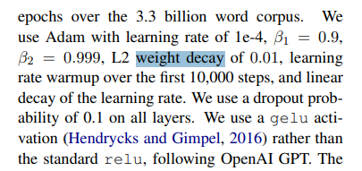
+ 在`transformers`也将其作为一个固定操作写在了代码中，[transformers/src/transformers/trainer.py](https://github.com/huggingface/transformers/blob/v5.23.0/src/transformers/trainer.py#L1259)
  ```python
    def get_decay_parameter_names(self, model: nn.Module) -> list[str]:
        """
        Get all parameter names that weight decay will be applied to.

        This function filters out parameters in two ways:
        1. By layer type (instances of layers specified in ALL_LAYERNORM_LAYERS)
        2. By parameter name patterns (containing 'bias', or variation of 'norm')
        """
        forbidden_name_patterns = [r"bias", r"layernorm", r"rmsnorm", r"(?:^|\.)norm(?:$|\.)", r"_norm(?:$|\.)"]
        # 按“维度”分组（Karpathy 的做法）是一种在特定架构（纯 Transformer）下的快捷写法，而按“名称/模块类型”分组是更通用、更严谨的工业级写法。
        decay_parameters = get_parameter_names(model, [nn.LayerNorm], forbidden_name_patterns)
        return decay_parameters
    
    decay_parameters = self.get_decay_parameter_names(opt_model)
    optimizer_grouped_parameters = [
    {
        "params": [p for n, p in opt_model.named_parameters() if (n in decay_parameters and p.requires_grad)],
        "weight_decay": self.args.weight_decay,
    },
    {
        "params": [p for n, p in opt_model.named_parameters() if (n not in decay_parameters and p.requires_grad)],
        "weight_decay": 0.0,
    }]
  ```
+ 在[066、优化器参数分组策略：Weight Decay 只作用于 Weight 不作用于 Bias 的实现](https://blog.csdn.net/sundong_3/article/details/161824934)的提示下，发现`yolo`里也有这样的实现，
  + 源码：[ultralytics/engine/trainer.py](https://github.com/ultralytics/ultralytics/blob/main/ultralytics/engine/trainer.py#L1237)
  + API文档：[ultralytics.engine.trainer.BaseTrainer.build_optimizer](https://docs.ultralytics.com/reference/engine/trainer#ultralytics.engine.trainer.BaseTrainer.build_optimizer)
  ```python
  for module_name, module in unwrap_model(model).named_modules():
    for param_name, param in module.named_parameters(recurse=False):
        fullname = f"{module_name}.{param_name}" if module_name else param_name
        if param.ndim in {2, 4} and use_muon:  # muon only orthogonalizes matrices and conv filters
            g[3][fullname] = param  # muon params
        elif "bias" in fullname:  # bias (no decay)
            g[2][fullname] = param
        elif isinstance(module, bn) or "logit_scale" in fullname:  # weight (no decay)
            # ContrastiveHead and BNContrastiveHead included here with 'logit_scale'
            g[1][fullname] = param
        else:  # weight (with decay)
            g[0][fullname] = param
  ```


# 4. 训练
## 4.1 认识硬件/充分发挥硬件性能

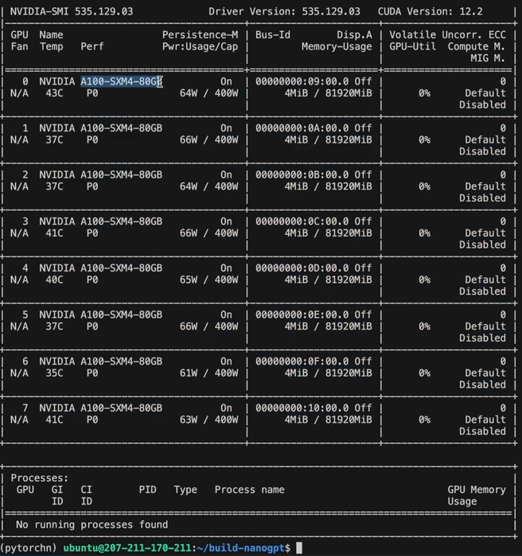

老师的卡，8个[A100的80GB的卡](https://www.nvidia.com/content/dam/en-zz/Solutions/Data-Center/a100/pdf/nvidia-a100-datasheet-us-nvidia-1758950-r4-web.pdf)，对应的型号是：**A100 80GB SXM**， 真富裕啊

想知道某个卡的情况，直接搜索 卡型号+datasheet，例如： `A100 datasheet`;

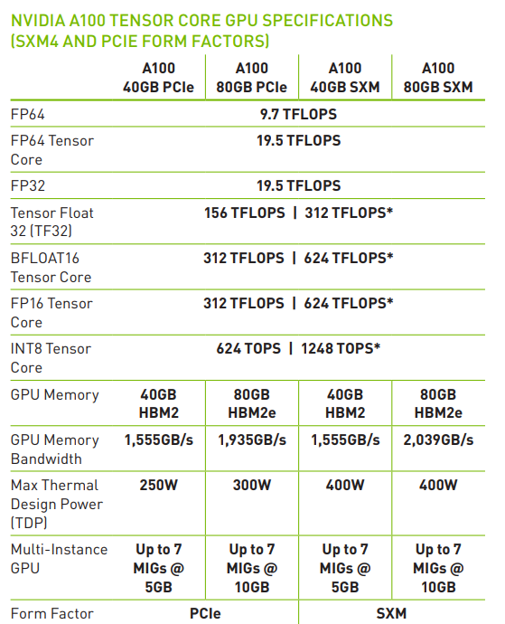

+ 虽然A100最高支持`FP64`的精度，但是一般在深度学习中，用不到那么高的精度；科学计算才会用到`FP64`
+ 对于深度学习的训练来说，一般使用`FP32`(单精度浮点数即可)，即：每秒 19.5万亿次浮点数计算的性能， T(tera,万亿)
+ 有带星号的，是稀疏技术的，目前业界基本没有使用稀疏矩阵的，所以可以不看，主要看前面那个没有星号的就好
+ 除了显存之外，带宽也是另一个限制因素，**事实上，很多深度学习训练任务都受限于内存带宽 memory bound**; 核心算子大部分时候都受限于内存带宽运不过来数据，所以很多时候都在等待，处在`idle`空闲状态，所以gpu的利用率在60%左右就已经很不错了~

默认情况下，pytorch的浮点数都是`float32`，
```bash
>>> logits.dtype
torch.float32
```

关于数据精度： [Floating-Point 8: An Introduction to Efficient, Lower-Precision AI Training](https://developer.nvidia.com/blog/floating-point-8-an-introduction-to-efficient-lower-precision-ai-training/) 这里有张图不错

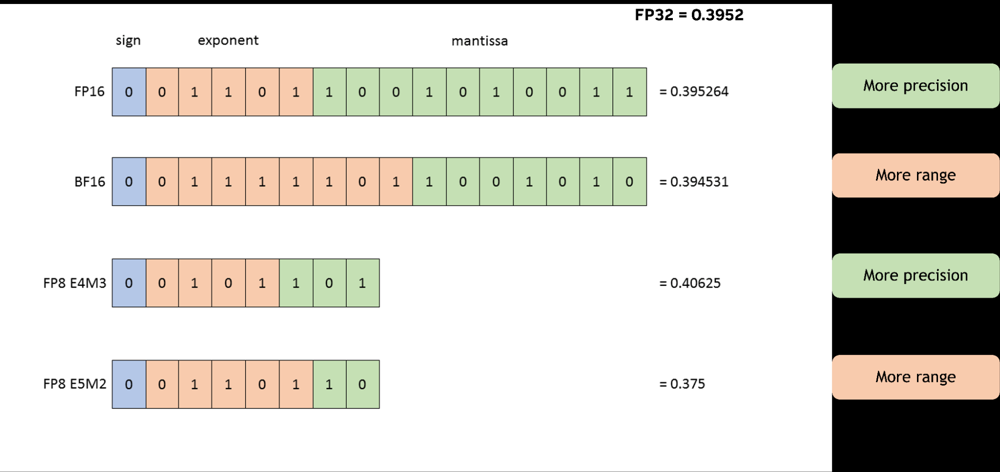

## 4.x 优化速度对比

|序号| —— | batch时间 | tokens吞吐量 | 其他 |
|---|---|---|---|---|
|1|**FP32精度** | 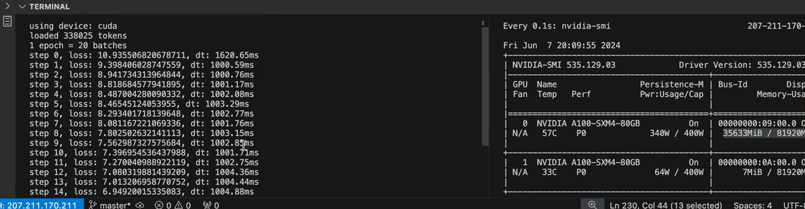 | 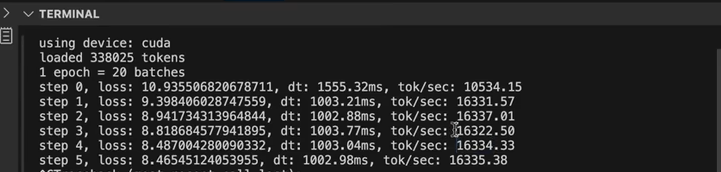<br/>**每秒大约处理1.63w个tokens**<br/>`FP32`是`1000ms`左右 | 8GB的显存无法执行比较大的batch(`B=16, T=1024`), 显存消耗基本是: `35GB/80GB`<br/>由于增加了batch_size， 所以1epoch只需要20个step即可<br/>首次迭代的时间比较长，因为首次的话，pytorch会执行一些初始化操作，比如：初始化梯度/张量缓冲区等 |
|2|**TF32精度** | 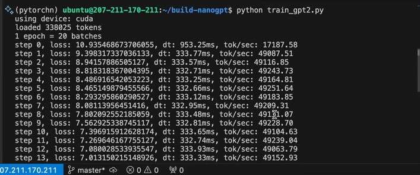 | 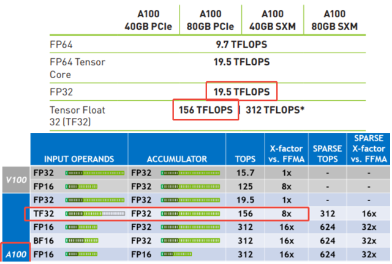虽然在A100的架构手册上写：改为TF32之后是提升8倍，但是**实测下来只有3倍**。 | 根据 [NVIDIA Docs Hub Homepage -> NVIDIA Deep Learning Performance -> Train With Mixed Precision -> pytorch](https://docs.nvidia.com/deeplearning/performance/mixed-precision-training/index.html#pytorch)<br/>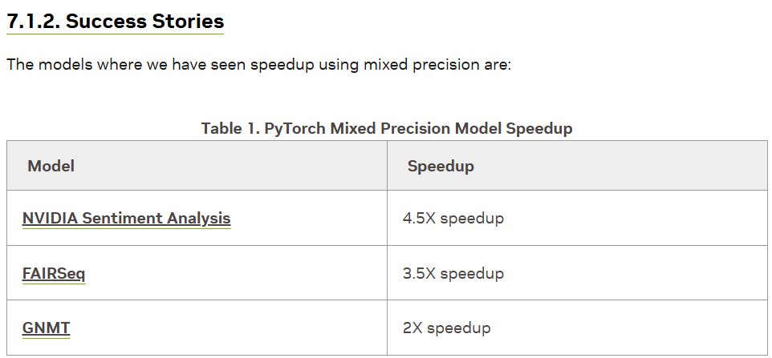<br/>1. 由于网络结构不同，矩阵乘法在整个网络计算量中的占比不同，因此，加速的倍数不一定是8倍，一般都低于8倍<br/>2. 网络带宽问题，虽然TF32理论上可以提供更高的吞吐量，但是搬运这些数据也会消耗很多时间，这些时间无法被提升<br/>**结论：** 我们无法改变要搬运的参数数量，但是可以减少要搬运的参数的位数，即从使用`TF32`变成使用`BF16`，这样要搬运的数据就少了一半 |
|3|**BF16** | 看上面 `A100 datasheet` 和 `图9` 的图<br/>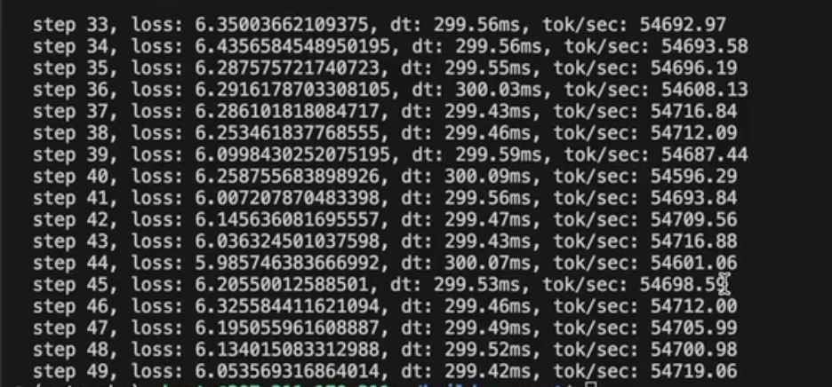 | `TP32`是`330ms`多,`BF16`是`300ms`多,有增长,但是也没有很多 | |
|4|**BF16+torch.compile** | 下面的`4.3`才说到了`torch.compile`<br/>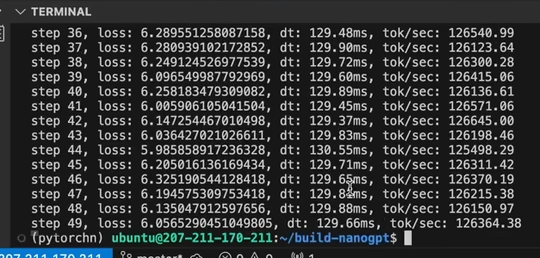 | 相比于单纯`BF16`的`300ms`，这里添加`torch.compile`之后来到了`129ms`, 即**仅仅只靠编译模型，就得到了 300/129=2.33倍的速度提升** | |
|5|**BF16 + torch.compile + FlashAttention**<br/>`FlashAttention`指的是`F.scaled_dot_product_attention`|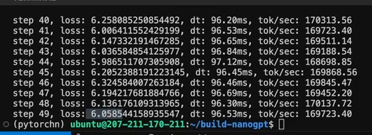|可以看到，在不影响损失的情况下，比不开启Attention优化又快了很多，从 `129ms` → `96ms`|
|6|**BF16 + torch.compile + FlashAttention + 优化奇数超参** |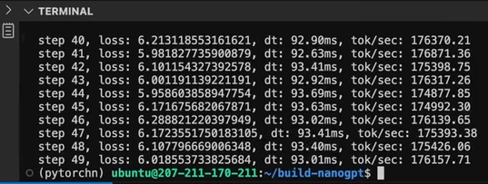|可以看到，比上面速度又快了一些，哪怕是增加了`vocab_size`，增大了计算量，但是速度反而更快了<br/>从`96.5ms`→`93ms`, 速度提升 **4%** 左右|
|7|**BF16 + torch.compile + FlashAttention + 优化奇数超参 + AdamW fused kernel**|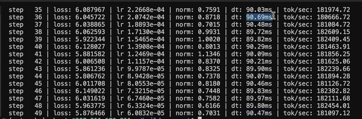|`AdamW`中开启`fused`,速度又快了一些<br/>从`93ms`→`90ms`|
|8|实验7的基础上+**梯度累积**|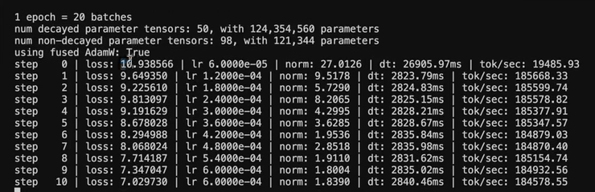| 基本等于 `90ms*32=2880ms`|
|9|实验7的基础上+ **梯度累积** + DDP|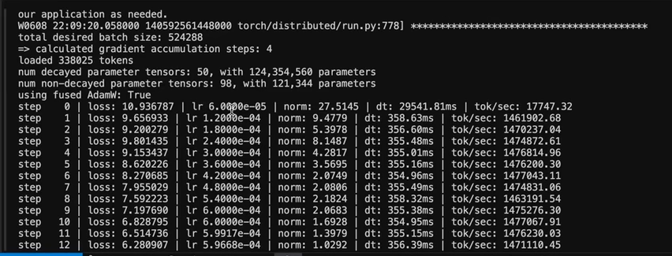 | 360ms左右 = 2880/8|`grad_accum_steps = total_batch_size//(B * T * ddp_world_size) `<br/>`print(f"=> caculated gradient accumulation steps: {grad_accum_steps}")`<br/>这里会发现，实验8的单个GPU的梯度累积是32个梯度累积step，而实验九是8个GPU同时DDP，梯度累积的step是4，也就是之前单块GPU的32个累积step平分到8个gpu，因此ddp中的每个gpu只需要4个step.<br/>但是实验8和实验9的loss并不同，本质上其实都是32个step，这是因为 Dataloader加载的数据batch问题，详见代码里的注释，搜索`next_batch`|


## 4.2 Tensor Cores以及混合精度
### 4.2.1 理论说明
如果想了解一些关于GPU的内容，可以去`developer blog`搜索，[developer blog/开发者博客 链接](https://developer.nvidia.com/blog)。
+ 比如： `Tensor cores`就可以看到: [NVIDIA Ampere Architecture In-Depth](https://developer.nvidia.com/blog/nvidia-ampere-architecture-in-depth/)， 这个是详细讲述`A100`的`tensor cores`架构的
  + 同时在[Accelerating Medical Image Segmentation with NVIDIA Tensor Cores and TensorFlow 2](https://developer.nvidia.com/blog/accelerating-medical-image-segmentation-tensor-cores-tensorflow-2/)可以看到，要充分利用`Tensor Cores`可以开启混合精度
    ```python
      tf.keras.mixed_precision.experimental.set_policy('mixed_float16')
      # 所以早年TF2.0对Tensor Cores混合精度这种支持还是比较前沿的
    ```


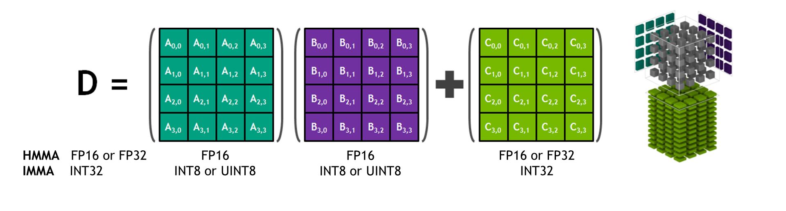   
+ 上图(老师的图)来自： 
  + [Accelerating WinML and NVIDIA Tensor Cores](https://developer.nvidia.com/blog/accelerating-winml-and-nvidia-tensor-cores/)
  + [Automatic Mixed Precision for NVIDIA Tensor Core Architecture in TensorFlow](https://developer.nvidia.com/blog/nvidia-automatic-mixed-precision-tensorflow/)
  + [Tensor Core Programming Using CUDA Fortran](https://developer.nvidia.com/blog/tensor-core-programming-using-cuda-fortran/)： 这里有关于这张图的详细解释
  + [Video Series: Mixed-Precision Training Techniques Using Tensor Cores for Deep Learning](https://developer.nvidia.com/blog/video-mixed-precision-techniques-tensor-cores-deep-learning/): 一系列视频，下面也有参考链接，基本很全面了
  + NVIDIA的Doc: [NVIDIA Docs Hub Homepage -> NVIDIA Deep Learning Performance -> Train With Mixed Precision](https://docs.nvidia.com/deeplearning/performance/mixed-precision-training/index.html)
  + [NVIDIA Tensor Core Programming](https://leimao.github.io/blog/NVIDIA-Tensor-Core-Programming/), 一直没有在NVIDIA的网站里找到高分辨率的图，这个博客里有
  + [Unlocking Tensor Core Performance for Machine Learning Interatomic Potentials](https://developer.nvidia.com/blog/unlocking-tensor-core-performance-for-machine-learning-interatomic-potentials/)
+ [Mixed Precision Training](https://arxiv.org/abs/1710.03740)


----

关于**Tensor core**最完善的学习资料是：[NVIDIA A100 Tensor Core GPU Architecture](https://images.nvidia.com/aem-dam/en-zz/Solutions/data-center/nvidia-ampere-architecture-whitepaper.pdf)

直接目录索引到：**图9**

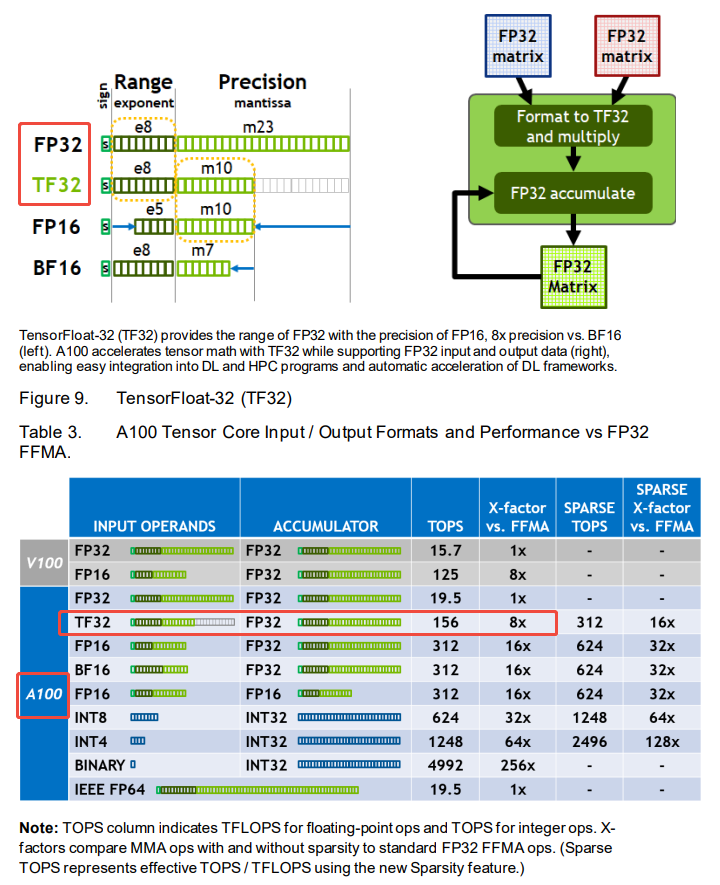

对于页面上半的图：
+ `FP32`，通常是32位，1个符号位(`s`),有8个指数位(`e8`)，23个尾数(`mantissa, m23`)
+ `TF32`和`FP32`一样，都是32位, 都是1个符号位(`s`),有8个指数位(`e8`)，但是其**尾数位在浮点数运算过程中会被截断**
  + 因此对于`TF32`来说，实际上只用了19位，而非完整的32位，末尾的13位会被截断丢弃
  + 计算过程都是在`instruction`(指令)内部完成，因此`pytorch`中并不能看到这种现象
+ TensorFloat-32（TF32）在保持FP32数值范围的同时，具备与FP16相当的精度，精度是BF16的8倍（左图）。
+ **A100通过TF32加速张量计算，同时支持FP32输入和输出数据**（右图），可轻松集成到深度学习和高性能计算程序中，并实现深度学习框架的自动加速。
  + 即：`input`和`output`以及`Accumulate`都保持FP32，但是在内部计算过程中，擦作数会被截断以提升计算速度
+ `BF16`和`TF32`非常像，都是8位指数（即：可表示的数据范围是一样的），但是`BF16`截断的尾数更多，所以相比于`TF32`，同样范围内的数据，`BF16`的数据精度更低
+ 而`FP16`则改变了数值的表示范围，指数位只有5个，即：FP16无法完整表示FP32(单精度浮点数)的全部数值范围
  + 由于`FP16`出现的比较早，所以前期确实有些人用这个格式训练
  + 但是由于数值表示范围的问题，需要配套使用一些`gradient scaling operations`梯度缩放操作
  + 随着A100（Ampere架构的诞生），BF16就成为了使用的主流
+ 关于pytorch中`BF16`对计算精度带来的影响，详见：
  + ✅[pytorch -> Recipes -> Automatic Mixed Precision](https://docs.pytorch.org/tutorials/recipes/recipes/amp_recipe.html)
  + [User Guide -> Developer Notes -> Automatic Mixed Precision examples](https://docs.pytorch.org/docs/2.15/notes/amp_examples.html)
  + 重点关注: [Adding torch.autocast#](https://docs.pytorch.org/tutorials/recipes/recipes/amp_recipe.html#adding-torch-autocast),
    ```python
      with torch.autocast(device_type=device, dtype=torch.float16):
    ```
  + 对应的文档:[class torch.autocast](https://docs.pytorch.org/docs/2.15/amp.html#torch.autocast),关键点:
    ```python
      # Creates model and optimizer in default precision
      model = Net().cuda()
      optimizer = optim.SGD(model.parameters(), ...)

      for input, target in data:
          optimizer.zero_grad()

          # Enables autocasting for the forward pass (model + loss)
          # 1. 只建议用autocast作为前向过程(包括损失计算)的上下文管理器,不建议用autocast来管理反向传播,反向传播的操作类型会和autocast管理的前向操作中的一致
          # 2. 在autocast管理的区域里,张量可能是任何dtype的,因此不可以用half()或者bfloat16()之类的指定Tensor的数据类型
          with torch.autocast(device_type="cuda"):
              output = model(input)
              loss = loss_fn(output, target)

          # Exits the context manager before backward()
          loss.backward()
          optimizer.step()
    ```


同样的情况在下面的表格中也可以看到，`TF32`在实际计算的时候，后面13位是空白状态
+ 虽然采用这种数据格式会增加计算速度，但是代价是：降低了计算精度
+ **只要你能接受微小的精度妥协，这几乎就是零成本的性能提升**
+ **代码完全不用改，这种优化完全封装在运算内部，用户感知就是运算速度提升了8倍**

### 4.2.2 实测(pytorch中启用TF32, BF16)
在pytorch中启用混合精度：
+ [NVIDIA Docs Hub Homepage ->  NVIDIA Deep Learning Performance -> Train With Mixed Precision -> pytorch](https://docs.nvidia.com/deeplearning/performance/mixed-precision-training/index.html#pytorch)
+ [Accelerating Generative AI Part III: Diffusion, Fast](https://pytorch.org/blog/accelerating-generative-ai-3/), 页面搜索`TF32`,有： 
  > Since we use an A100 GPU (Ampere architecture) here, we can specify `torch.set_float32_matmul_precision("high")` to benefit from the TF32 precision format.
+ 根据[Docs > torch > torch.set_float32_matmul_precision](https://docs.pytorch.org/docs/2.6/generated/torch.set_float32_matmul_precision.html)
  + 这个API很早就有了， 至少从torch2.6就支持了，torch最新的版本2.15也没有废弃
  + 2.15版本的文档看着舒服点：[Reference API->torch->torch.set_float32_matmul_precision](https://docs.pytorch.org/docs/2.15/generated/torch.set_float32_matmul_precision.html)
  + 但是 根据：[TensorFloat-32 (TF32) on Ampere (and later) devices](https://docs.pytorch.org/docs/2.15/notes/cuda.html#tensorfloat-32-tf32-on-ampere-and-later-devices)以及[TensorFloat-32 (TF32) on Nvidia Ampere (and later) devices](https://docs.pytorch.org/docs/2.15/notes/numerical_accuracy.html)
  + 似乎仅限于A100(`Ampere`之后的架构才可以开启这个特性)

```python
train_loader = DataloaderLite(B=16, T=1024)

   for i in range(50):
        t0 = time.time()
        x,y = train_loader.next_batch() 
        x = x.to(device)
        y = y.to(device)
        logits = model(x)  
        loss = F.cross_entropy(logits.view(-1, logits.size(-1)), y.view(-1))
        optimizer.zero_grad()
        loss.backward() 
        optimizer.step()
        torch.cuda.synchronize() 
        t1 = time.time()
        dt = (t1 -t0)*1000  # miliseconds(毫秒)
        tokens_per_sec = train_loader.B * train_loader.T / (t1 - t0) # 每秒处理的token数量 tokens per second throughout
        print(f"step {i}, loss: {loss.item()}, time: {dt:.2f}ms")
```
+ 当CPU调度GPU的时候，本质上只是在给GPU安排任务，只是在调度一些计算任务
+ 所以CPU给GPU发完指令之后，就会去继续执行别的后续指令了
+ 可能就会导致：`GPU`和`CPU`时钟不同步
  + 例如：上面的代码可能会给`GPU`一下子堆积了很多计算任务，但是`CPU`可能已经执行到计时部分了，此时：`CPU`执行得到的时间并不是真正的`GPU`执行时间
  + 本质上是个异步问题
+ 可以使用`torch.cuda.synchronize()`, 等待所有GPU操作(等待之前给GPU调度的任务)完成，确保计时准确
+ 另外，我们**更关注的不是每个batch的处理时间，而是tokens的处理时间**

执行时，同步使用`nvitop/watch 0.1 nvidia-smi`来监控用量

----

当使用`autocast`时,会改变张量的数据类型. 而`torch.set_float32_matmul_precision("high")`其实不会改变数据类型(只是改变数据计算的规则,但是FP32依然是FP32)
```python
# torch.set_float32_matmul_precision("high")
with torch.autocast(device_type=device, dtype=torch.bfloat16):
    logits = model(x)  # logits.dtype = torch.bfloat16, 
    loss = F.cross_entropy(logits.view(-1, logits.size(-1)), y.view(-1))
# 但是不是所有的数据的类型都会改变
# model.transformer.wte.weight.dtype = torch.float32
# 但是激活值,逻辑值都是 bf16
# 这就是称为混合精度的原因... 有些依然保持FP32,有些被降低为了bf16
```
+ 根据[torch.amp -> CUDA Ops that can autocast to float16](https://docs.pytorch.org/docs/2.15/amp.html#cuda-ops-that-can-autocast-to-float16)以及其后的`CUDA Ops that can autocast to float32`
```bash
# CUDA Ops that can autocast to float16
__matmul__, addbmm, addmm, addmv, addr, baddbmm, bmm, chain_matmul, multi_dot, conv1d, conv2d, conv3d, conv_transpose1d, conv_transpose2d, conv_transpose3d, GRUCell, linear, LSTMCell, matmul, mm, mv, prelu, RNNCell

# CUDA Ops that can autocast to float32
__pow__, __rdiv__, __rpow__, __rtruediv__, acos, asin, binary_cross_entropy_with_logits, cosh, cosine_embedding_loss, cdist, cosine_similarity, cross_entropy, cumprod, cumsum, dist, erfinv, exp, expm1, group_norm, hinge_embedding_loss, kl_div, l1_loss, layer_norm, log, log_softmax, log10, log1p, log2, margin_ranking_loss, mse_loss, multilabel_margin_loss, multi_margin_loss, nll_loss, norm, normalize, pdist, poisson_nll_loss, pow, prod, reciprocal, rsqrt, sinh, smooth_l1_loss, soft_margin_loss, softmax, softmin, softplus, sum, renorm, tan, triplet_margin_loss

# 即: 大部分和矩阵乘法相关的都可以autocast到float16,但是大部分的损失函数都是只能保持float32
```


这里可以大概算一下，`nn.Linear`在整个网络中的参数量占比
```bash
1层 lm_head(768, 50257) 
n_layer = 12
MLP模块 c_fc(768, 4*768)， c_proj(4*768, 768)
CasualSelfAttention模块 c_attn(768, 3*768),  c_proj(768, 768)

线性层的参数量为:
768*50257 + 12*(768*4*768*3) = 123532032 / 124M = 123532032/ (124*10**6) = 123532032/ (1.24*10**8) = 99.6226%
```

## 4.3 torch.compile
[Introduction to torch.compile](https://docs.pytorch.org/tutorials/intermediate/torch_compile_tutorial.html)
+ [Reference API -> torch ->torch.compile](https://docs.pytorch.org/docs/2.15/generated/torch.compile.html)
+ [torch.compile End-to-End Tutorial](https://docs.pytorch.org/tutorials/intermediate/torch_compile_full_example.html)
+ `torch.compile`是pytorch提供的一项非常出色的基础设施(`infrastructure`)，
  + 本质上是神经网络的编译器(`compiler`)，类似于`gcc`是C/C++的编译器一样
  + `torch.compile`是`pytorch2.0`的新特性，主要是为了加速模型的训练和推理，类似于`tensorflow`的`XLA`编译器
  + 用法很简单：
    ```python
      model = GPT2(GPT2Config()) # 直接用默认的gpt-2的配置来初始化一个模型
      model.to(device)  
      model = torch.compile(model)    # 编译需要等待一段时间。。这点也很gcc对待c程序一样
      # model.compile()

      # 编译后，再去看模型，类型就变了
      >>> type(model)
      <class 'torch._dynamo.eval_frame.OptimizedModule'>

      # 注意，编译后，想去访问模型相关的内容，就有点问题了 例如：
      logits = model(x)
      import code; code.interact(local=locals())
      # 就会报错
      File "C:\Users\shanhuang\AppData\Roaming\Python\Python310\site-packages\torch\_inductor\cpp_builder.py", line 135, in check_compiler_exist_windows  
          raise RuntimeError(f"Compiler: {compiler} is not found.") from exc
      torch._dynamo.exc.BackendCompilerFailed: backend='inductor' raised:
      RuntimeError: Compiler: cl is not found.

      Set TORCH_LOGS="+dynamo" and TORCHDYNAMO_VERBOSE=1 for more information


      You can suppress this exception and fall back to eager by setting:
          import torch._dynamo
          torch._dynamo.config.suppress_errors = True
    ```
  > <https://docs.pytorch.org/tutorials/intermediate/torch_compile_tutorial.html#basic-usage> 
  ><br/>`basic-usage`中有关于`Module`的使用优化:
  ><br/>We can also optimize `torch.nn.Module` instances by either calling its `.compile()` method or by directly `torch.compile`-ing the module. This is equivalent to `torch.compile`-ing the module’s `__call__` method (which indirectly calls `forward`).
  ><br/><br/>优化`torch.nn.Module`实例有两种方法：
  ><br/>1. 调用module的`.compile()`方法，类似`model.compile()`
  ><br/>2. 通过直接对模块使用 `torch.compile`。这等同于对模块的 `__call__` 方法使用 `torch.compile`（该方法会间接调用 `forward`）。

+ 编译后的程序运行速度会变快，详见：[### 4.2.2 实测(pytorch中启用TF32, BF16)](#422-实测pytorch中启用tf32-bf16)最下面的对比表格
  ><https://docs.pytorch.org/tutorials/intermediate/torch_compile_tutorial.html#demonstrating-speedups>
  ><br/>`demonstrating-speedups`中解释了为什么会加速
  ><br/> And indeed, we can see that running our model with `torch.compile` results in a significant speedup.**Speedup mainly comes from reducing Python overhead and GPU read/writes, and so the observed speedup may vary on factors such as model architecture and batch size**. For example, if a model’s architecture is simple and the amount of data is large, then the bottleneck would be GPU compute and the observed speedup may be less significant.
  ><br/> **加速主要来源于减少了 Python 的开销以及 GPU 的读写操作，因此实际的加速效果可能因模型架构和批处理大小等因素而有所不同**。例如，如果模型结构简单且数据量较大，那么瓶颈在于 GPU 的计算能力，此时观察到的加速效果可能不明显。

**编译的作用**：
+ **Python 的开销降低**：
  + 定义model时缩写的`nn.ModuleDict`这类的东西，本质上是对希望网络执行操作的算法描述
  + `torch.compile`会查看整个网络定义，找出需要实际执行的操作(`operations`), 由于有很明确的计算图(知道操作顺序/下一步操作)，因此就不需要在即时模式(`eager mode`)下运行了
  + 就不用像python这种解释器一样逐行/逐层执行，**原始的即时模式(`eager mode`)(原始的python解释器)是在执行过程中逐步实例化所有的运算操作**
    + python解释器只能看到当前的代码，所以只能顺序执行
    + 而`torch.compile`可以看到`model`的所有定义，因此可以对这个执行过程进行优化
  + `torch.compile`首先会把`python interpreter`(python解释器)从整个前向过程中移除，然后将整个网络编译成一个整体对象(object),整个过程不涉及python解释器
+ **GPU 的读写操作减少**：
  + 以非线性激活函数`gelu`为例，`kernel fusion`内核融合
  ```python
    self.gelu = nn.GELU(approximate='tanh')
    # 这里定义的gelu本质上就是下面这个计算式子
    # https://docs.pytorch.org/docs/2.15/generated/torch.nn.GELU.html
    # 直接实现公式，肯定是和pytorch的nn.GELU内部的计算逻辑等效
    class TanhGELU(nn.Module):
      def forward(self, input):
        return 0.5 * input * (1.0 + torch.tanh(math.sqrt(2.0 / math.pi) * (input + 0.044715 * torch.pow(input, 3.0))))
    # 当python解释器遇到这个计算时，比如说会首先调用一个kernel，计算torch.pow(input, 3.0) 算完了，GPU把结果存到HBM里
    # 下一个操作也是，所以会GPU的中间计算结果会频繁访问HBM进行数据读写
    # 就导致上面这个操作会变成GPU和HBM之间反复的数据传输
    # 没有torch.compile，也就无法优化这一过程，理由是相同的，单纯的python编译器是无法看到下一步操作的，所以无法对完整的计算过程进行优化
    # 但是用了torch.compile,就可以知道，上面这一整串计算都是逐元素的，所以可以把输入数据一次性传入GPU，然后对每个元素依次执行上面的所有运算，所有操作完成再去写入HBM，而不是一个运算写一次暂存一次。
    # 这就是所谓的 kernel fusion 内核融合的一个典型案例
    # 关于 GPU和HBM的关系，详见：## 4.4 GPU的存储分级以及和HBM的关系
  ```
  + HBM(High‑Bandwidth Memory)高带宽内存, 图自: [Improving GPU Memory Oversubscription Performance](https://developer.nvidia.com/blog/improving-gpu-memory-oversubscription-performance/)。 
  + 简单来说，就是GPU和CPU一样，都有运算单元和存储单元，传输需要时间
  
  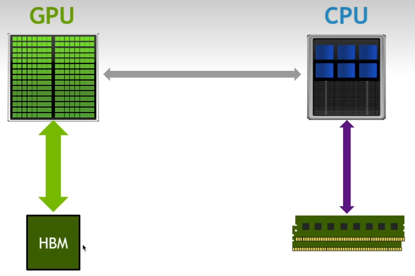

>[!NOTE]
>+ 除非是debug，否则建议默认启用`torch.compile`

## 4.4 GPU的存储分级以及和HBM的关系
以A100为例：
+ [NVIDIA Ampere Architecture In-Depth](https://developer.nvidia.com/blog/nvidia-ampere-architecture-in-depth/)
+ [nvidia-ampere-architecture-whitepaper.pdf](https://images.nvidia.com/aem-dam/en-zz/Solutions/data-center/nvidia-ampere-architecture-whitepaper.pdf)直接目录跳转到Figure6和Figure7

**GA100 Streaming Multiprocessor (SM): 流式多处理器**:  GA100 Full GPU with 128 SMs. The A100 Tensor Core GPU has 108 SMs.
+ 一个`TPC`是竖着的两个`SM`
+ 一个`GPC`是横着的8个`TPC`
+ 一个GA100是8个`GPC` = `8*8*2` = 128个SMs

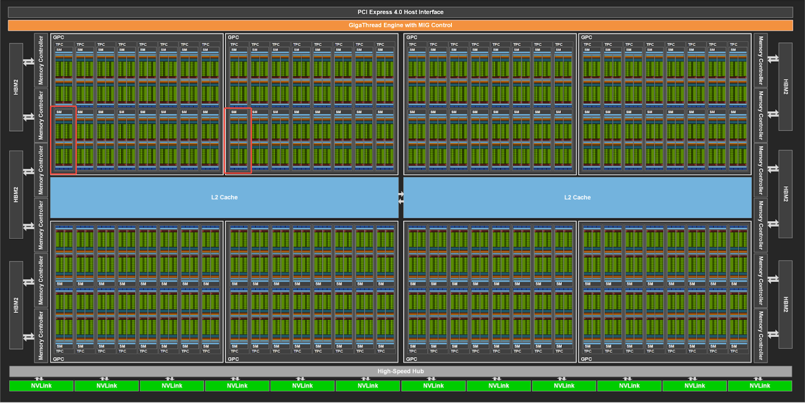

上图红色框的就是单个`SM`,其结构细节如下：

**A100 (GA100) SM architecture**

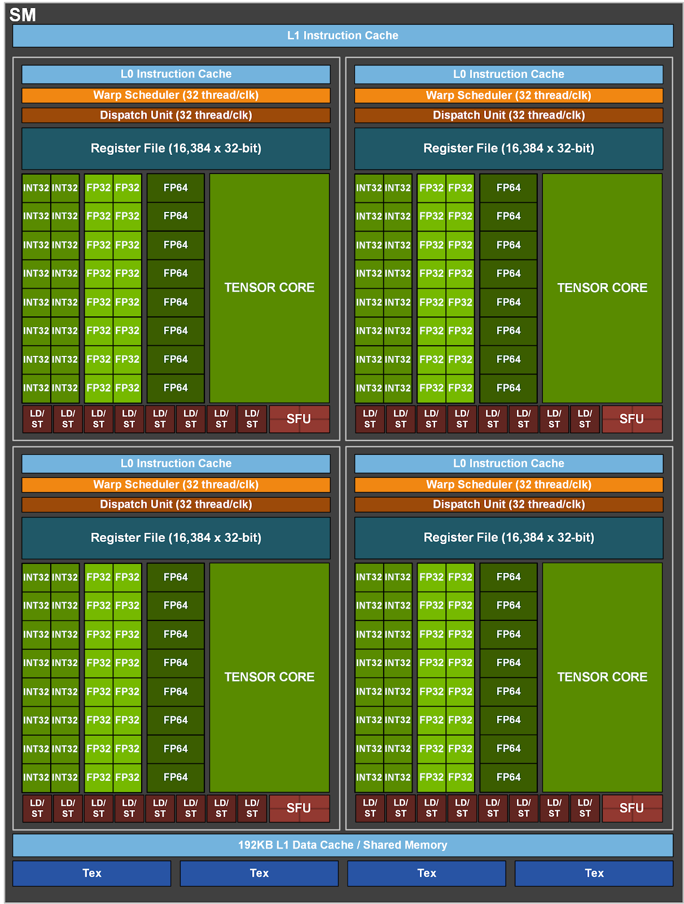

从上图可以知道：
+ GPU芯片内部除了计算模块外，也集成了一些存储,包括：
  + `Register File，寄存器` 
  + `L0 Instruction Cache`, 
  + `L1 data cache/shared memory`, 
  + `L2 cache`
+ 但是大部分存储还都是位于`GPU`芯片外的`HBM`, 即`HBM`和`GPU`在物理上是两个独立的芯片，需要通过一些方式连起来
  + 虽然 **GA100 Streaming Multiprocessor (SM)** 这个图里，HBM在两侧，但是其实是独立的
  + 同时`HBM`和`GPU`内部的存储，两个硅片的物理层面也完全不同
  + `HBM`的主要物理构成是：晶体管和电容器
  + 而`GPU`内部的存储主要是`SRAM`(静态随机存取存储器)
+ `SM`就是主要用于计算的
  + 其中有很多内容，比如： `Tensor Core`就是主要针对矩阵乘法运算的
  + 其他还有针对`INT32`, `INT64`, `FP64`等数据类型的不同计算单元

---

另一个结构略有不同的GPU：

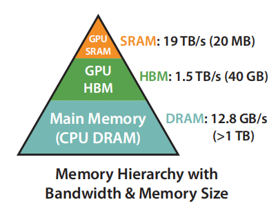

+ 图自：[FlashAttention: Fast and Memory-Efficient Exact Attention with IO-Awareness](https://arxiv.org/abs/2205.14135)
  + CPU一般是DRAM，比如：配置了一个1T的固态硬盘，但是固态硬盘的读写速度是 12.8GB/s, 这种读写速度对GPU来说会导致时间非常昂贵
  + 类似的，`HBM`的读写速度相对于`GPU`内部的`SRAM`，也是慢了10倍
  + 访问速度和存储容量不可兼得
  + 所以对于GPU的使用来说，一般是把数据先放到`HBM`里(`global memory`)中，当需要计算时，再传到GPU里的计算单元
+ 关于`FlashAttention`,这个博客文章不错（至少配图很好）: [Why FlashAttention Is So Fast](https://x.com/zhangchitc/article/2117964204242342329)

## 4.5 FlashAttention
虽然`torch.compile`可以优化很多操作，但是仍然有很多运算其无法识别，比如：`FlashAttention`就是`torch.compile`无法识别优化的

[FlashAttention: Fast and Memory-Efficient Exact Attention with IO-Awareness](https://arxiv.org/abs/2205.14135)
+ 2022年斯坦福的论文，是一种用来提升Attention速度的算法
+ 后续还出了：[FlashAttention-2: Faster Attention with Better Parallelism and Work Partitioning](https://arxiv.org/abs/2307.08691)
+ pytorch的实现，
  + <https://docs.pytorch.org/docs/2.15/generated/torch.nn.functional.scaled_dot_product_attention.html>
  + 参考了： 
  + [`FlashAttention-2`: Faster Attention with Better Parallelism and Work Partitioning](https://arxiv.org/abs/2307.08691)
  + [Memory-Efficient Attention](https://github.com/facebookresearch/xformers): 

可以看看： [Attention 机制哪家强？SDPA、FlashAttention、xFormers、手动实现全面对比 - 一条放浪不羁的爬虫的文章 - 知乎](
https://zhuanlan.zhihu.com/p/1898470649938293363)
|实现方式|	特点	|适用场景|
|---|---|---|
|xFormers|Meta 开源的优化库，支持多种 Attention 变体（如 Linformer、Local Attention）|研究、自定义 Attention|
|FlashAttention|斯坦福提出的 IO 优化 Attention，减少显存访问|长序列训练（如 LLM）|
|SDPA（PyTorch 官方）|PyTorch 2.0+ 内置的 F.scaled_dot_product_attention，自动选择最优后端|生产环境首选|


除了上面这个广泛支持了的，近几年还有更多：
+ [FlashAttention-3: Fast and Accurate Attention with Asynchrony and Low-precision](https://arxiv.org/abs/2407.08608)
+ [FlashAttention-4: Algorithm and Kernel Pipelining Co-Design for Asymmetric Hardware Scaling](https://arxiv.org/abs/2603.05451)

```python
# FlashAttention能以极高的效率实现这四行代码的功能(即: Attention)
att = (q@k.transpose(-2,-1))*(1/math.sqrt(k.size(-1))) #(B,nh,T,T)
att = att.masked_fill(self.bias[:,:,:T,:T]==0,float('-inf'))  
att = F.softmax(att, dim = -1)
y = att@v  #(B,nh,T,T)@(B,nh,T,ns)=(B,nh,T,ns)

# 具体的替代方式是:
torch.nn.functional.scaled_dot_product_attention
y = F.scaled_dot_product_attention(q, k, v, is_casual = True)
# is_casual 是否是因果 之前gpt2中的注意力机制的名字是 因果自注意力机制
# CasualSelfAttention
# 但是torch.compile没有自动识别上面四句代码，将其自动转换为scaled_dot_product_attention的实现，这点是比较奇怪的
```

$$
\begin{align}
\text{QKV 线性投影： }&Q = XW^Q, \quad K = XW^K, \quad V = XW^V \\
\text{缩放点积注意力: }&\mathrm{Attention}(Q, K, V) = \mathrm{softmax}\left( \frac{QK^\top}{\sqrt{d_k}} \right) V \\
\text{带因果掩码的版本： }&\mathrm{Attention}(Q, K, V) = \mathrm{softmax}\left( \frac{QK^\top}{\sqrt{d_k}} + M \right) V, \quad M_{ij} = \begin{cases} 0, & j \le i \\ -\infty, & j > i \end{cases} \\
\text{多头注意力： }&\mathrm{MultiHead}(Q, K, V) = \mathrm{Concat}(\mathrm{head}_1, \dots, \mathrm{head}_h) W^O \\
&\mathrm{head}_i = \mathrm{Attention}(QW_i^Q, \; KW_i^K, \; VW_i^V)
\end{align}
$$

**FlashAttention**本质上是一种内核融合(`kernel fusion`)操作,如下图所示(图自flashattention的论文)

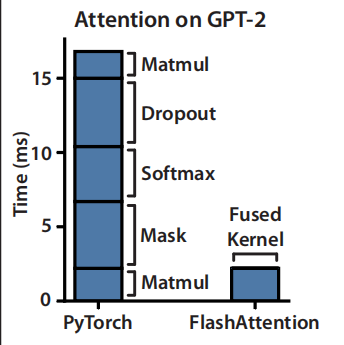

可知：
1. 对于`pytorch`来说，Attention机制的实现是`Matmul, Dropout, Softmax, Mask, Matmul`这5个`kernel`的操作
   ```python
    att = (q@k.transpose(-2,-1))*(1/math.sqrt(k.size(-1)))        # 对应 第一个操作 Matmul kernel
    att = att.masked_fill(self.bias[:,:,:T,:T]==0,float('-inf'))  # 对应 第四个操作 Mask
    att = F.softmax(att, dim = -1)                                # 对应 第三个操作 Softmax
    y = att@v  #(B,nh,T,T)@(B,nh,T,ns)=(B,nh,T,ns)                # 对应 第五个操作 Matmul
    # 暂时没写Dropout
   ```
   + `Torch.compile`无法对`Attention`进行优化（无法自动识别/发现这种内核融合模式）
   + 无法识别的原因在于：需要对注意力机制的具体实现方式进行算法层面的重写(`Algorithmic rewrite`)
2. 而如果采用了`FlashAttention`实现，则就只有一个kernel，即: `Fused kernel`(融合的kernel)
   1. 另外一个值得注意的点是，从浮点数运算的次数来看，`FlashAttention`实际上比`pytorch`默认的`Attention`执行了更多的计算操作
   2. 但是`FlashAttention`的执行速度却更快，比标准的快7.6倍
      > FlashAttention does not read and write the large 𝑁 × 𝑁 attention matrix to HBM, resulting in an **7.6×**
speedup on the attention computation.
   3. 快的原因在于其重点关注`HBM`和`GPU`内部的`SRAM`的存储和传输，**精心排列了计算过程，显著减少了对`HBM`的读写过程**
   4. 即：相比于更多的浮点运算次数，HBM的传输耗时才是真的瓶颈~

---

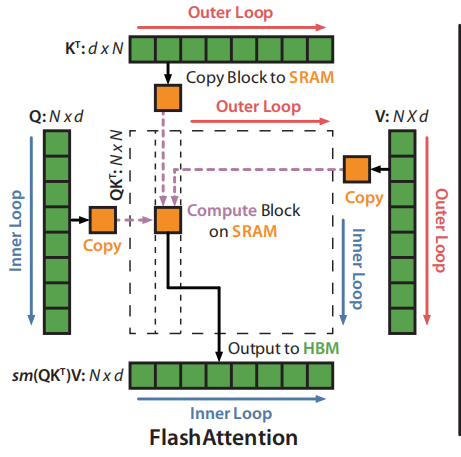

如上图所示（图自flashattention的论文），**FlashAttention**的实施过程：
1. 确保全程不会生成$N \times N$矩阵，即上面四行代码中的`attn`(对于`gpt2`来说，就是不会真的生成(768,768)的矩阵)，不生成则就不需要临时存储到`HBM`中，也不会从`HBM`中读取，即：避免了`HBM`对$N \times N$矩阵的读写。
   1. 如果考虑到是`batch`中的情况(即:考虑到并发)，则实际上需要和`HBM`进行读写交换的数据量会更大
2. 实现这一过程的关键在于之前提出的： `online Softmax`
   1. 即：在没有拿到所有输入值的情况下，通过增量计算的方式完成归一化处理
   2. 具体做法是：引入两个变量$m,l$, 通过对其迭代更新实现Softmax的在线计算
   3. 可参考论文： 
      1. NVIDIA的[Online normalizer calculation for softmax](https://arxiv.org/abs/1805.02867)
      2. google的[Self-attention Does Not Need O(n2) Memory](https://arxiv.org/abs/2112.05682)

## 4.6 检查网络中是否有非偶数的超参/调整是否会有影响

有些数字处理起来很顺手，有些则很棘手
+ 一般对于`batch_size`来说，都建议设置成偶数，比如：16,32,64这种;如果没有凑整，则需要进行额外的边界处理，比如:13,27这种
+ 同时当处理神经网络代码或者编写CUDA代码时，都应该优先使用偶数类的数字
  + CUDA的底层机制本质上围绕2的幂次展开，大量内核函数也是是2的幂次为基础进行编写的
  + 常见的blocks尺寸一般也是16，48这种基于2的幂次的数字
+ 能够被2多次整除的，即: 包含多个2的幂次因子的数，就很好
+ 如果输入数据不符合整数特征，系统就需要针对各种逻辑进行特殊的边界处理

>[!NOTE]
>**经验法则**：<br/>
>检查代码中是否包含非偶数字

例如：gpt2中,词表大小= 50257, 建议做法是：**增大这个数值，直到变成最近的2的幂次的数或者可以被2/4/8/16/64/128整除的数字(即越能被更多的2的幂次整除越好)**,  
+ 则满足这一要求的数字为: 50304(`50304/64=786`, `50304/128=393`)<br/>
+ `model = GPT2(GPT2Config(vocab_size= 50304))`
+ 词表修改之后，其实在功能上不会有很大的影响
  + 例如，对于莎士比亚这个数据集来说，原始的 50257 个词表，本身也就只会有1000多个发挥作用，所以 `wte`的那个(50257 vocab_size, 768 n_embed)词嵌入矩阵，本身在优化过程中，其他没有发挥作用的就会被优化为趋近于0
  + 所以哪怕把 50257 → 50304，多了一些不存在的词表，但是并不会影响词嵌入矩阵将其优化为0
  + 只是会多占用一些存储，别的就没什么了
+ 关于词表增大反而速度加快的原因：
  + CUDA的计算单元有很多`block tiles`,如果尺寸不匹配这些`tiles`,则系统会调用很多 `boundary kernels`来介入处理剩余的部分
  + 简单来说，就是内核会把输入数据切分，优先处理规整的部分(能分块的)，然后第二阶段再专门处理剩余的部分（处理剩余部分的那些kernel效率会比较低下）
  + 这部分技术详见  [## 4.7 CUDA底层对于分块(2的幂次的计算要求苛刻的原因)](#47-cuda底层对于分块2的幂次的计算要求苛刻的原因)
+ 注意：
  + 存储只是在定义的个别位置有影响，但是计算是每一步，每一个操作都在影响，所以这个的影响会更大，因为计算有很多很多步

## 4.7 CUDA底层对于分块(2的幂次的计算要求苛刻的原因)

这一问题在深度学习和高性能计算领域非常经典。这并非指代某单一的具体“CUDA API”或“库函数”，而是涉及**CUDA底层硬件架构（特别是SIMT架构和Tensor Core）与并行计算分块策略（Tiling）相结合时，所衍生出的“维度对齐（Dimension Alignment）与填充（Padding）优化技术”**。

在底层实现上，这主要依赖于 **cuBLAS（CUDA基础线性代数子程序库）的底层调度机制** 以及 **GPU的SIMT（单指令多线程）执行模型**。

1. **核心本质：SIMT架构下的 Tiling（分块）与 Tail（尾部）处理**
   + 所谓的“规整部分快速处理，剩余部分低效处理”，本质上是CUDA中 **Grid-Block-Thread 层级划分** 与 **共享内存（Shared Memory）Tiling** 带来的必然结果。
   *   **分块（Tiling）机制**：GPU计算矩阵乘法（如GEMM）时，不会让每个线程计算一个元素，而是将大矩阵切分成小块（Tile，如 16x16, 32x32, 64x64 等2的幂次），分配给一个 Thread Block 处理。这样可以将数据加载到高速的 Shared Memory 中复用。
   *   **边界/尾部处理（Boundary/Tail Processing）**：当矩阵的维度（如 50257）不能被 Tile 大小（如 64）整除时，就会产生“边缘”数据（50257 % 64 = 9）。
       *   **低效原因1（分支发散）**：如果在同一个 Kernel 中处理，线程必须加入 `if (row < M && col < N)` 的判断。在CUDA的 Warp（32个线程为一组）执行模型中，这会导致**分支发散（Branch Divergence）**，部分线程闲置，效率大打折扣。
       *   **低效原因2（额外Kernel）**：高度优化的库（如cuBLAS）通常会采用“分离策略”：先用一个极致优化的主 Kernel（调用 Tensor Core）处理能整除的“规整部分”（50240），然后再启动一个额外的、普通的 **Boundary Kernel（边界Kernel）** 来处理剩下的 17 个元素。这个额外的 Kernel 无法使用高级硬件特性，且存在 Kernel Launch（内核启动）的额外开销。
2. **大模型加速的核心：Tensor Core 的严苛维度对齐要求**
   * 对于LLM（如GPT-2）而言，词表大小修改带来的加速，最核心的原因是**满足了 Tensor Core（张量核心）的硬件指令对齐要求**。
   *   **什么是 Tensor Core**：从 Volta 架构开始，NVIDIA GPU 引入了专门用于矩阵乘加的 Tensor Core，其速度是普通 CUDA Core 的数倍甚至数十倍。
   *   **严苛的对齐要求**：Tensor Core 底层执行的是 WMMA (Warp Matrix Multiply-Accumulate) 或 MMA 指令。这些硬件指令对矩阵的维度（M, N, K）有**严格的硬性要求**。例如，在 FP16/BF16 精度下，M、N、K 通常必须是 **8 或 16 的倍数**（在某些新架构和INT8下要求是 32 的倍数）。
   *   **不满足对齐的后果**：如果 `vocab_size = 50257`，在进行最后的 Logits 计算（这是一个 $Hidden\_size \times Vocab\_size$ 的矩阵乘法）时，由于 50257 不是 8 或 16 的倍数，cuBLAS 在底层评估后，可能会**放弃使用 Tensor Core**，降级使用普通的 SIMT CUDA Core 路径；或者在底层偷偷进行动态 Padding，这都会导致计算效率下降。
   *   **修改后的效果**：改为 `50304`（50304 是 8, 16, 32, 64, 128 的公倍数），完美契合所有 Tensor Core 的对齐要求。cuBLAS 可以直接调用最高效的 Tensor Core GEMM 指令，无需任何降级或额外处理。
3. **内存带宽优化：Memory Coalescing（内存合并访问）**
   * CUDA 的全局内存（Global Memory）访问机制也高度依赖 2 的幂次对齐。
   *   **合并访问原理**：当一个 Warp（32个线程）同时访问全局内存时，如果它们访问的内存地址是**连续的且对齐的**（通常是 32位、64位或 128位对齐），硬件会将这 32 次访问合并为一次或少数几次内存事务（Memory Transaction），从而最大化内存带宽。
   *   **不对齐的惩罚**：如果数据结构的维度不是 2 的幂次或特定倍数，线程访问的内存地址可能会出现跨 Cache Line（缓存行，通常 128 Bytes）的情况，导致内存事务无法合并，内存带宽利用率断崖式下跌。将 `vocab_size` 调整为 2 的幂次倍数，可以确保 Embedding 矩阵（`wte`）在内存中的步长（Stride）完美对齐，提升数据加载效率。

---

**结合 GPT-2 词表修改的具体场景分析**

在 GPT-2 中，`vocab_size` 主要影响两个地方：
1.  **`wte` (Word Token Embedding)**：查表操作（Embedding Lookup），将 token ID 映射为向量。
2.  **`LM Head` (Language Model Head)**：这是一个 Linear 层，用于将最后的 hidden states 映射回词表空间，计算 Logits（用于计算 CrossEntropy Loss 或生成下一个词）。其权重矩阵维度是 `[vocab_size, hidden_size]`。

**速度加快的真正发力点在 `LM Head` 的矩阵乘法（GEMM）上：**
*   在训练或推理的最后一步，需要计算 $Y = X \times W^T$，其中 $X$ 的维度是 `[batch_size * seq_len, hidden_size]`，$W^T$ 的维度是 `[hidden_size, vocab_size]`。
*   当 `vocab_size = 50257` 时，这个 GEMM 的 N 维度是 50257。如前所述，它破坏了 Tensor Core 的对齐，且产生了难以处理的 Tail（尾部）。
*   当改为 `vocab_size = 50304` 时，N 维度变成了 50304。cuBLAS 可以将其完美划分为多个 16x16 或 32x32 的 Tile，全程由 Tensor Core 满载运行，**彻底消除了 Boundary Kernel 的启动开销和分支发散**。

---

>[!NOTE]
>**总结**<br/>
>这一现象，本质上是 **“以微小的空间（显存/内存）换取极致的时间（计算效率）”的 Padding（填充）思想在 CUDA 底层的具象化体现**。
>涉及的CUDA 技术包括：
>1.  **Tensor Core 硬件指令的维度对齐机制**（最核心原因）。
>2.  **SIMT 架构下的 Tiling（分块）与 Warp 调度机制**（解释了为什么会有边界低效处理）。
>3.  **Memory Coalescing（内存合并访问）机制**（解释了内存带宽的对齐要求）。

在 LLM 研究和工程落地中，这种“对齐优化”（如将 hidden_size 设为 128 的倍数，将 vocab_size 设为 64 的倍数，将 seq_len 设为 8 的倍数等）是极其常规且必要的性能调优手段。

## 4.8 可视化
+ [把RL训练直播给全世界看：小米 MiMo-V2.6 实时面板深度拆解](https://zhuanlan.zhihu.com/p/2084083614585832108)
  + https://mimo.xiaomi.com/rl/#overview

## 4.9 gradient accumulation梯度累积

**gradient accumulation梯度累积**这一技术可以通过串行计算的方式，模拟设定的任意批次大小(`simulate in a serial way any arbitrary batch size`)
+ 即只需要通过处理多个序列，延长计算时间，把更多序列的梯度加起来，就可以模拟出50w tokens的批次大小的效果
+ 这里执着于设置batch_size = 0.5m，和gpt3论文一致，是因为在优化过程中，`lr`，`batch_size`, `AdamW优化参数`，`weight_decay`这些参数之间有着复杂的关系，因此最好和gpt3保持一致~ 不然可能会容易有问题。
  + 老师的A100是80GB的单卡，也无法直接容纳下 50w的tokens

```python
# 常规的前向+反向
import torch

# super simple little MLP
net = torch.nn.Sequential(
    torch.nn.Linear(16, 32),
    torch.nn.GELU(),
    torch.nn.Linear(32, 1)
)

torch.random.manual_seed(42)
x = torch.randn(4, 16)
y = torch.randn(4, 1)
net.zero_grad()
yhat = net(x)
loss = torch.nn.functional.mse_loss(yhat, y) #注意，mse_loss这里取得是4个样本的平均值
loss.backward()
print(net[0].weight.grad.view(-1)[:10])
# tensor([-0.1250,  0.0048,  0.0357, -0.0314,  0.0432, -0.0541, -0.0706, -0.1194, -0.0961, -0.1053])

# the loss objective here is (due to reduction='mean')
# L = 1/4 * [
#            (y[0] - yhat[0])**2 +
#            (y[1] - yhat[1])**2 +
#            (y[2] - yhat[2])**2 +
#            (y[3] - yhat[3])**2
#          ]
# NOTE: 1/4!


# 梯度累积的前向+反向
# now let's do it with grad_accum_steps of 4, and B=1
# the loss objective here is different because
# accumulation in gradient <----> SUM in loss
# i.e. we instead get:
# L0 = (y[0] - yhat[0])**2
# L1 = (y[1] - yhat[1])**2
# L2 = (y[2] - yhat[2])**2
# L3 = (y[3] - yhat[3])**2
# L = L0 + L1 + L2 + L3
# NOTE: the "normalizer" of 1/4 is lost
net.zero_grad()
for i in range(4):
    yhat = net(x[i])
    loss = torch.nn.functional.mse_loss(yhat, y[i])
    # loss = loss/4 
    loss.backward()
print(net[0].weight.grad.view(-1)[:10])
# tensor([-0.5002,  0.0193,  0.1428, -0.1257,  0.1727, -0.2163, -0.2825, -0.4775, -0.3843, -0.4211])  # 不执行 loss = loss/4 
# tensor([-0.1250,  0.0048,  0.0357, -0.0314,  0.0432, -0.0541, -0.0706, -0.1194, -0.0961, -0.1053])  # 取消对loss = loss/4 的注释
# tensor([-0.1250,  0.0048,  0.0357, -0.0314,  0.0432, -0.0541, -0.0706, -0.1194, -0.0961, -0.1053])  # 上面常规的一个batch_size=4的结果

# 针对到代码中，从B=16=2**4，T=1024=2**10，变成32个B=16，T=1024, = 2**19
# 如果想实现2**19的单个batch，则平均所基于的样本数应该是 2**19, 即损失应该是 1/2**19
# 但是现在 平均基于的样本数是 2**14，即损失应该是 1/2**14
# 所以如果真的想通过累积达成大batch size, 则得到的loss还需要额外除以32

# 换句话说，如果loss里用的reduction方式不是mean，而是sum，则就不需要进行上面这个规约操作了
# https://docs.pytorch.org/docs/2.14/generated/torch.nn.CrossEntropyLoss.html
# reduction (str, optional) – Specifies the reduction to apply to the output: 'none' | 'mean' | 'sum'. 'none': no reduction will be applied, 'mean': the weighted mean of the output is taken, 'sum': the output will be summed. Note: size_average and reduce are in the process of being deprecated, and in the meantime, specifying either of those two args will override reduction. Default: 'mean'
```

## 4.10 tensor.detach作用(梯度累积)
```python
loss_accum+=loss.detach()
```
`detach`是将张量从计算图里分离出来，变成叶子节点，就可以只关注数值，不考虑梯度
+ **本质**： 将当前 Tensor 从原有的计算图中剥离出来，使其成为一个不需要梯度的新叶子节点，同时在底层保持内存的零拷贝共享。
  + 在 PyTorch 的动态计算图（Dynamic Computational Graph）中，每个 Tensor 都有两个关键属性：`grad_fn`（记录如何计算该节点的函数）和 `requires_grad`（是否需要计算梯度）。
  + 调用 `y = x.detach()` 时，底层发生了以下变化：
    + **切断 grad_fn**：y 的 `grad_fn` 变为 None。这意味着 y 不再记录它是如何从 x 计算而来的。
    + **重置 requires_grad**：`y.requires_grad` 被强制设置为 `False`。
    + **成为新的“叶子节点”（Leaf Tensor）**：在 PyTorch 中，只有叶子节点（即用户直接创建的、非由计算图生成的节点）才会被保留梯度（`.grad`）。`detach()` 将 y 伪装成了一个不需要梯度的叶子节点。
  + 梯度截断效应：如果后续基于 y 继续计算得到 z，并执行 z.backward()，梯度会回传到 y 就停止了，绝对不会继续回传到 x。这就是 **detach() 最核心的数学意义：阻断梯度流**。
+ **零拷贝（Zero-copy）与共享存储**
  + 文档中提到的`Returned Tensor shares the same storage with the original one.`
    + 底层实现：`detach()` 不会分配新的内存来复制数据。返回的 `Tensor y` 和原 `Tensor x` 的 `data_ptr()` 是完全相同的。它们只是同一个底层 Storage（存储块）的两个不同“视图”（View），拥有各自独立的 Tensor 元数据（如 shape, stride, requires_grad, grad_fn），但共享物理数据。
    + 性能意义：这是一个 $O(1)$ 时间复杂度的操作，无论 Tensor 有多大（比如在 LLM 中处理巨大的 hidden states），detach() 的开销都几乎为零。
+ **In-place 修改会触发错误**
  + 文档中提到的`In-place modifications on either of them will be seen, and may trigger errors in correctness checks.`
  + PyTorch 的 `Autograd` 引擎为了防止梯度计算错误，引入了`Version Counter`（版本计数器）
    + 当 `x` 参与前向传播生成中间节点时，Autograd 会记录下当时 `x` 的版本号，例如：`v1`
    + 如果你通过 `y = x.detach()` 获取 `y`，由于共享内存，此时对 y 进行 `In-place` 修改（如 `y += 1` 或 `y[0] = 0`），底层 x 的数据也会改变，同时 x 的版本计数器会递增, 变为 `v2`。
    + 当后续执行 `loss.backward()` 时，Autograd 反向遍历计算图，发现 `x` 的当前版本`v2`与前向传播时记录的版本`v1`不一致。
    + 为了防止计算出错误的梯度，`Autograd` 会直接抛出 `RuntimeError: one of the variables needed for gradient computation has been modified by an inplace operation`
  + 严谨的解决方案：如果你需要修改数据且保留原计算图的梯度，必须使用 `y = x.detach().clone()`。`clone()` 会进行深拷贝（Deep copy），打破内存共享，从而避免版本号冲突。


**梯度累积过程中， loss的梯度变化情况**
```python
# ========== 第 i 次迭代 ==========

# 1. 创建全新的计算图节点
logits = model(x)           # 新 Tensor，grad_fn = <MmBackward> 等
loss = F.cross_entropy(...) # 新 Tensor，grad_fn = <CrossEntropyLossBackward>
                            # ↑ 注意：这里的 loss 是一个全新的 Python 变量，
                            #   指向一个全新的 Tensor 对象。
                            #   上一次迭代的 loss 对象如果没有其他引用，已被 GC 回收。

# 2. 标量除法，创建新的计算图节点
loss = loss / grad_accum_steps  
                            # 又一个新的 Tensor，grad_fn = <DivBackward>
                            # 原来的 cross_entropy 结果被丢弃（但仍在计算图中，
                            # 因为新 loss 的 grad_fn 指向它）

# 3. detach 创建新 Tensor，原 loss 不受影响
detached_loss = loss.detach()  
                            # 新 Tensor，grad_fn = None，共享存储
                            # loss 本身：grad_fn = <DivBackward>，完好无损

# 4. 累加到 loss_accum（纯 Python/数值操作，不涉及计算图）
loss_accum += detached_loss 
                            # loss_accum 是 requires_grad=False 的标量 Tensor
                            # in-place 修改它不会触发版本检查错误

# 5. 反向传播，梯度累加到 model 参数的 .grad 上
loss.backward()             # 沿着 loss → div → cross_entropy → model 反向传播
                            # 计算出的梯度 累加 到各参数的 .grad 属性中
```

## 4.11 DDP(Distributed Data Parallel)
官方文档/教程:
+ [torch.nn -> DistributedDataParallel](https://docs.pytorch.org/docs/2.15/generated/torch.nn.parallel.DistributedDataParallel.html)
+ [Getting Started with Distributed Data Parallel](https://docs.pytorch.org/tutorials/intermediate/ddp_tutorial.html)

DP是过时的技术了

### WORLD_SIZE,RANK,LOCAL_RANK说明
在分布式系统中，我们需要区分**逻辑拓扑**（进程在通信网络中的位置）和**物理拓扑**（进程在物理硬件上的位置）。这三个变量正是为了映射这两种拓扑而设计的。

*   **`WORLD_SIZE` (全局进程总数)**
    *   **严谨定义**：当前分布式任务中，所有参与计算的进程（Process）的总和。
    *   **物理意义**：在标准的单卡单进程（Single-Process Per-GPU）模式下，`WORLD_SIZE` 等于全局 GPU 的总数（机器数 $\times$ 单机 GPU 数）。
    *   **逻辑意义**：它定义了全局通信域（Global Process Group）的规模。所有的 AllReduce、Broadcast 等集合通信操作，其数据切分和聚合的基数都是 `WORLD_SIZE`。

*   **`RANK` (全局进程编号)**
    *   **严谨定义**：当前进程在整个 `WORLD_SIZE` 中的全局唯一标识（Global ID），取值范围是 `[0, WORLD_SIZE - 1]`。
    *   **逻辑意义**：它是进程在**逻辑通信域**中的绝对坐标。在 NCCL 等通信后端中，`RANK` 决定了进程在通信树（Communication Tree）或环形拓扑（Ring Topology）中的节点位置。
    *   **注意**：`RANK` 是全局唯一的，**绝不能**用 `RANK` 去绑定物理 GPU，否则在多机多卡时会导致设备越界或冲突。

*   **`LOCAL_RANK` (局部进程编号)**
    *   **严谨定义**：当前进程在其所在的物理机（Node）内部的编号，取值范围是 `[0, LOCAL_WORLD_SIZE - 1]`（`LOCAL_WORLD_SIZE` 即单机卡数）。
    *   **物理意义**：它是进程在**物理硬件**上的局部坐标。它的核心作用是**实现进程与物理 CUDA 设备的亲和性绑定**。


在实际编写 DDP（或 FSDP/DeepSpeed）代码时，这三个变量的使用有着严格的界限：
1. 物理设备绑定（必须用 `LOCAL_RANK`）
    ```python
    import torch
    import os

    local_rank = int(os.environ['LOCAL_RANK'])
    # 严谨做法：将当前进程绑定到本机的第 local_rank 块 GPU 上
    torch.cuda.set_device(local_rank) 
    ```
    **为什么不用 RANK？** 假设你有 2 台机器，每台 8 张卡。机器 A 的进程 RANK 是 0-7，机器 B 的进程 RANK 是 8-15。如果机器 B 的进程执行 `torch.cuda.set_device(rank)`，会直接抛出 `CUDA error: invalid device ordinal`，因为机器 B 上只有 0-7 号物理 GPU。
2. 初始化分布式通信组（必须用 `RANK` 和 `WORLD_SIZE`）
    ```python
    import torch.distributed as dist

    rank = int(os.environ['RANK'])
    world_size = int(os.environ['WORLD_SIZE'])

    # 初始化全局通信域，必须使用全局唯一的 rank 和 world_size
    dist.init_process_group(backend='nccl', rank=rank, world_size=world_size)
    ```
3. 数据加载与分布式采样器（用 `RANK` 和 `WORLD_SIZE`）
    ```python
    from torch.utils.data.distributed import DistributedSampler

    # 确保每个进程（RANK）加载不重叠的数据分片，总份数为 WORLD_SIZE
    sampler = DistributedSampler(dataset, num_replicas=world_size, rank=rank)
    dataloader = DataLoader(dataset, sampler=sampler)
    ```
4. 全局状态控制（用 `RANK`）
    在 LLM 训练中，我们通常只需要在 Rank 0 打印日志、保存 Checkpoint、计算全局 Validation Loss，以避免 I/O 冲突和日志刷屏。
    ```python
    if rank == 0:
        save_checkpoint(model, optimizer, step)
        wandb.log({"loss": loss})
    ```


### DDP模型封装参数说明
```python
from torch.nn.parallel import DistributedDataParallel as DDP
if ddp:
    model = DDP(model, device_ids = [ddp_local_rank]) # 这里的device_ids放的一定是local_rank
```
+ 关于老师的代码和DDP官方文档有点冲突的地方：
  + [torch.nn.parallel.DistributedDataParallel](https://docs.pytorch.org/docs/2.15/generated/torch.nn.parallel.DistributedDataParallel.html), 页面中搜索`multi-device`就可以快速找到`device_ids`的参数说明，这个参数说明很烂
  + `单机8卡8进程DDP`不符合文档中所说的 `multi-device`, 
  + 文档中的 `multi-device module`s 不是指物理机上有多个GPU，也不是指启动了多个进程，而是指在同一个进程（Process）内部，模型被放置或拆分在了多个GPU上。
  + 单机8卡8进程：采用的是 `One Process Per GPU` 原则。虽然物理机上有8张卡，但对于这8个进程中的任意一个进程而言，它只绑定并管理 1张GPU。因此，对单个进程来说，模型属于 `single-device module`。
  + 真正的 `multi-device` 场景：在同一个进程内，模型跨越了多张卡。例如在 LLM 训练中，如果你在单进程内实现了张量并行（Tensor Parallelism）或流水线并行（Pipeline Parallelism），把模型的第一层放在 `cuda:0`，第二层放在 `cuda:1`；或者你在单进程内嵌套使用了 `torch.nn.DataParallel`。这时候模型才是 `multi-device module`。
+ `device_ids=[local_rank]` 与 `device_ids=None` 的底层差异
  +  `device_ids=[ddp_local_rank]`
    + 相当于明确告诉 DDP：“当前这个进程只负责 ddp_local_rank 这一张卡”。
    + DDP 的行为：它会接管设备管理。在 `forward` 时，`DD`P 会检查输入数据，如果数据没在当前设备上，它会自动帮你把数据搬运到该设备上（或者抛出清晰的跨设备报错）。它确保了梯度计算和通信严格限制在这张卡上。
  + `device_ids=None` 时`
    + 相当于告诉 DDP：“我不管设备了，你自己看着办”。
    + DDP 的行为：它会“盲目”信任你，放弃设备管理。它假设你已经通过 `model.to(local_rank)` 和 `data.to(local_rank)` 把模型和数据完美放置在了正确的设备上。如果你忘了手动 `.to()`，DDP 不会帮你搬数据，而是直接在底层报出晦涩的 `Expected all tensors to be on the same device` 错误。
  + 注：如果是 CPU 训练，模型在 CPU 上，没有 CUDA device id，所以必须设为 None。

### DDP前向和反向过程结合梯度累积
前向传播过程中，模型不需要有任何改动，DDP的实现也是和常规的前向是一致的；

但是反向则不同，每个独立的gpu都会有自己这部分数据产生的所有参数的梯度，在反向传播结束后，调用allReduce操作进行全局归约，这一操作的本质是对所有节点的梯度进行平均处理，然后把计算得到的平均值同步到所有节点去， 这样每个节点最终都会得到相同的平均梯度值。
+ [dist_tuto/Collective Communication](https://docs.pytorch.org/tutorials/intermediate/dist_tuto.html#collective-communication)中有：All-Reduce操作等的说明

---

```python
for step in range(max_steps):
    t0 = time.time()
    optimizer.zero_grad()
    loss_accum = 0.0
    for micro_step in range(grad_accum_steps):
        x,y = train_loader.next_batch() 
        x = x.to(device)
        y = y.to(device)
    
        with torch.autocast(device_type=device, dtype=torch.bfloat16):
            logits = model(x)  
            loss = F.cross_entropy(logits.view(-1, logits.size(-1)), y.view(-1))
        loss = loss/grad_accum_steps  
        loss_accum+=loss.detach()
        loss.backward() 
```
对于DDP的反向传播，由于这里启动了梯度累积，希望能逐步累加，而不是每次计算后都进行同步操作
+ 即：希望 micro_step 到达 grad_accum_steps-1 的时候，再去平均所有的梯度
+ 即: 所有进程自己的梯度累积操作执行完了之后，再进行进程之间的梯度allReduce操作
+ [no_sync()](https://docs.pytorch.org/docs/2.15/generated/torch.nn.parallel.DistributedDataParallel.html#torch.nn.parallel.DistributedDataParallel.no_sync)
  + `no_sync()`文档示例写的很一般，去源码中可以看到：其实就是换了一个梯度对象`self.require_backward_grad_sync`
    ```python
      ddp = torch.nn.parallel.DistributedDataParallel(model, pg)
      with ddp.no_sync():
          for input in inputs:
              ddp(input).backward()  # no synchronization, accumulate grads
      ddp(another_input).backward()  # synchronize grads
    ```
  + https://github.com/pytorch/pytorch/blob/v2.15.0/torch/nn/parallel/distributed.py#L1680
  ```python
    @contextmanager
    def no_sync(self):
        old_require_backward_grad_sync = self.require_backward_grad_sync
        self.require_backward_grad_sync = False
        try:
            yield
        finally:
            self.require_backward_grad_sync = old_require_backward_grad_sync
  ```
  + 在整个文档中进行查看，会发现就是`self.require_backward_grad_sync`决定是否要进行反向的梯度同步的，所以可以考虑直接用这个变量来控制是否要进行同步
+ 所以可以实现可以改为：
  ```python
    with torch.autocast(device_type=device, dtype=torch.bfloat16):
        logits = model(x)  
        loss = F.cross_entropy(logits.view(-1, logits.size(-1)), y.view(-1))
    loss = loss/grad_accum_steps   # 这步也会算在loss的梯度里面
    loss_accum+=loss.detach()
    if ddp:
        model.require_backward_grad_sync = (micro_step == grad_accum_steps-1)
        # 即：只在梯度累积的最后一步把require_backward_grad_sync变为True(执行梯度同步)，其余都是False(不执行梯度同步) 
    loss.backward() 
    
    # 如果非要用文档里给的context上下文环境，则就需要变成:
    if ddp:
      if micro_step < = grad_accum_steps-1:
        with ddp.no_sync():
          loss.backward()   # no synchronization, accumulate grads
       else:
          loss.backward()  # 最后一步才同步
  ```
+ 老师这样做的原因是为了避免写 上下文管理器和重复代码，但是如果未来pytorch改了实现，可能就拿不到`require_backward_grad_sync`这个变量了

---

但是目前的这部分代码，虽然成功平均了梯度，但是实际上`loss_accum`(损失累积)这部分并没有受到影响，因为并没有被包裹在`DDP`容器中

因此，如果打印loss的话，**只会打印自己这个进程的loss，而不是所有进程的在这个step的总/平均loss**，loss不一致了~
```python
loss_accum = 0.0
for micro_step in range(grad_accum_steps):
    x,y = train_loader.next_batch() 
    x = x.to(device)
    y = y.to(device)
    with torch.autocast(device_type=device, dtype=torch.bfloat16):
        logits = model(x)  
        loss = F.cross_entropy(logits.view(-1, logits.size(-1)), y.view(-1))
    loss = loss/grad_accum_steps  
    loss_accum+=loss.detach()
    if ddp:
        model.require_backward_grad_sync = (micro_step == grad_accum_steps-1)
    loss.backward() 

# 因此，需要添加以下代码，和梯度类似，也是进行allReduce，即：把所有的loss也传给其他节点，一起算个平均值即可
import torch.distributed as dist
if ddp:
  dist.all_reduce(loss_accum, op=dist.ReduceOp.AVG)

# 这样之后所有进程的loss_accum的值就是一样的，只需要让main_process打印一次即可
```
参考：[Writing Distributed Applications with PyTorch](https://docs.pytorch.org/tutorials/intermediate/dist_tuto.html#collective-communication), 页面中搜索`dist.all_reduce`


### DDP.module
在[torch.nn.parallel.DistributedDataParallel](https://docs.pytorch.org/docs/2.15/generated/torch.nn.parallel.DistributedDataParallel.html)中，有：
```bash
Variables:
module (Module) – the module to be parallelized.

# 因此，之前的代码里
if ddp:
    model = DDP(model, device_ids = [ddp_local_rank]) # 这里的device_ids放的一定是local_rank
raw_model = model.module if ddp else model
optimizer = raw_model.configure_optimizers(weight_decay = 0.1, learning_rate = 6e-4, device = device)
# 这里必须要明确到原始model是因为configure_optimizers里有调用以下，所以必须确认到module这级
param_dict = {pn:p for pn, p in self.named_parameters()}
param_dict = {pn:p for pn, p in param_dict.items() if p.requires_grad}
```
在[torch/nn/parallel/distributed.py](https://github.com/pytorch/pytorch/blob/v2.15.0/torch/nn/parallel/distributed.py#L967)中，有
```python
self.module = module
```
在 `PyTorch` 源码中，`DistributedDataParallel` 继承自 `nn.Module`。执行 `model = DDP(model, ...)` 时，`DDP` 并没有修改你传入的原始模型，而是**将原始模型作为了它自身的一个属性。**

### DDP的极简DataLoader带来的数据边界不对齐问题

为了追求极致的 I/O 性能，研究者往往会抛弃 `PyTorch` 官方笨重的 `DataLoader`，转而手写极简的数据迭代器，但这会引入分布式状态下的数据边界（`Epoch Boundary`）对齐问题。

```python
# if self.current_position + B*T + 1 >= self.tokens.size(0):   # 以前单个GPU的数据重置标准
if self.current_position + B*T*num_processes + 1 >= self.tokens.size(0):  # 现在8个gpu的数据重置标准
    self.current_position = self.B * self.T * self.process_rank
# 单gpu和8gpu ddp的数据重置标准不同，导致每个梯度累积(32step vs 4step)的loss不同，要验证这种差异是否在可接受的范围内
# 有个简单的方案：大幅减小总批次的大小，即：make the total batch_size smaller，
```
+ **单卡逻辑**：只要当前 GPU 还能读出一个 `B*T` 大小的数据，就继续训练。
+ **DDP 逻辑**：在分布式中，一个 `Global Step` 需要所有 8 张卡同时计算并同步梯度。因此，必须确保**所有 8 张卡**都能读出自己的 `B*T` 数据。如果剩余 token 不够 8 张卡同时读取（即 `< B*T*8`），就必须提前结束当前 Epoch，进行重置。

```python
self.current_position = self.B * self.T * self.process_rank
```
+ 当触发重置时，代码并没有让所有 GPU 都从索引 `0` 开始读。而是让 `rank 0` 从 `0` 开始，`rank 1` 从 `B*T` 开始，`rank 2` 从 `2*B*T` 开始……
+ 这是一种极其高效且粗暴的**数据分片（Sharding）策略**。它确保了在下一个 Epoch 的第一步，8 张 GPU 读取的数据是**绝对不重叠**的，避免了 DDP 中多卡读取相同数据导致的梯度计算错误，同时省去了 `DistributedSampler` 复杂的索引分发开销。

---

在理论完美的分布式训练中，8卡的 loss 曲线应该和单卡完全一致（只是训练时间缩短为 1/8）。但实际中会出现差异，因为：
1.  **数据边界截断效应（Data Truncation）**：
    单卡时，Epoch 结尾可能只浪费了最后几个 token；但在 8 卡下，为了凑齐一个 Global batch，可能会**丢弃尾部 `8*B*T-1` 个 token**。这导致单卡和 8 卡在一个 Epoch 内实际看到的 token 总数和分布产生了微小差异。
2.  **数据读取顺序的交织（Interleaved Ordering）**：
    单卡是严格顺序读取 `0, 1, 2...`。8 卡下，虽然每个卡内部是顺序的，但全局来看，数据是被切块交织读取的。这种顺序的改变，结合 LLM 自回归的特性，会导致前向传播时的上下文微环境发生变化。

---
**举例说明：**
假设有一个极小的数据集，总共只有 **100 个 tokens**。设定 `B=2`, `T=2`，即一个 Micro-batch 需要 `4` 个 tokens。

||单 GPU 训练|8 GPU DDP 训练|
|---|---|---|
|消耗|每个 step 消耗 4 个 tokens|每个 Global step 消耗 `4 * 8 = 32` 个 tokens|
|过程|Step 1: 读 tokens [0:4]<br/>Step 2: 读 tokens [4:8]<br/>...<br/>Step 24: 读 tokens [96:100]<br/>Step 25: 判断 `current_position(100) + 4 > 100`，**触发重置**|Step 1: 8张卡分别读 [0:4], [4:8], [8:12] ... [28:32]。共消耗 32 个<br/>Step 2: 8张卡分别读 [32:36] ... [60:64]。共消耗 32 个<br/>Step 3: 8张卡分别读 [64:68] ... [92:96]。共消耗 32 个<br/>**此时 current_position 到了 96**,准备 Step 4：判断 `96 + 32 > 100`，**触发重置**！
|结果|完美读完 100 个 tokens，浪费了 0 个|尾部剩下的 4 个 tokens `[96:100]` 被**直接丢弃**了，没有参与训练|

+ **Loss 差异的体现**：
  + 单卡训练了 25 个 step，用尽了 100 个 token；8 卡只训练了 3 个 Global step（相当于单卡的 24 个 micro-step），且**丢弃了最后 4 个 token**。
  + 如果在单卡下，最后 4 个 token 恰好包含了某个关键的 Loss 突变点（比如某段特殊的代码或文本），单卡的最终 Loss 就会和 8 卡产生差异。
+ **为什么 大幅减小批次的大小 (make the  batch_size smaller) 这个简单的有效？**
  + 假设我们将 `B` 减半，`Micro-batch` 从 4 变成 2。则在 8 卡下，一个 `Global step` 消耗 16 个 tokens。
  + 当 `current_position` 到达 96 时，`96 + 16 > 100` 依然成立，丢弃 4 个 token。
  + **但是**，如果数据集非常大（比如 100 亿 tokens），丢弃 4 个 token 的比例是 `4e-10`。即减小 Batch size，虽然绝对丢弃量可能变化，但**每个 step 的梯度更新方差会变大，模型对数据边界的敏感度会降低**，且更小的 batch 意味着在接近边界时，数据截断带来的“相对误差”在整体 Loss 计算中的权重被稀释了。这能让 8 卡的 Loss 曲线在宏观上更平滑地贴合单卡的理论曲线，方便 Debug 分布式通信是否正确。
+ 但是**降低总批次的代价**
  1.  **训练吞吐量下降**：Batch size 减小，GPU 的矩阵乘法利用率（MFU）会降低。
  2.  **梯度方差增大**：更小的 Batch 意味着梯度估计的噪声更大，可能需要更精细的学习率 Warmup 或更小的 Learning Rate。


>[!NOTE]
> 这段代码完美体现了工业界 LLM 训练的 **“工程妥协美学”**。
> + PyTorch 官方的 `DataLoader` + `DistributedSampler` 在数学上是最严谨的，但它在处理 LLM 这种 TB 级连续文本流时，由于大量的 Python 锁、多进程通信和复杂的索引计算，会导致严重的 I/O 瓶颈。
> + 这段手写代码牺牲了“单卡与多卡 Loss 绝对一致”的理论严谨性，换取了**极致的数据读取性能**。
> + 在实际的 LLM 预训练中，只要数据量足够大（几十 TB），这种边界截断带来的 Loss 差异完全在可接受的噪声范围内。这也是为什么顶尖的 LLM 框架（如 Megatron, DeepSpeed）底层也会采用类似这种直接操作内存指针的极简数据加载逻辑的原因。

## 4.12 为什么LLM预训练一般用global_steps而不用epoch

>[!NOTE]
>**prompt**: 为什么LLM的预训练阶段，似乎没有epoch这个概念，只有global_steps或者说total_steps的概念，但是在以前的CV算法里，就会有很明显的epoch概念，所以LLM是无所谓完整的数据被完整的训练过几轮的吗？

---

**LLM 预训练并非“无所谓”完整数据被训练几轮，而是客观上“做不到”遍历完整数据，且在工程和研究范式上，`global_steps` 是比 `epoch` 更精确、更可靠的控制粒度。**

可以从以下四个核心维度来理解这种范式转移
1. **数据规模与“分数轮次”（Fractional Epoch）**
   + 在 CV 中（如 ImageNet），数据集大小是固定的（约 128 万张图片），跑完一个 epoch 成本可控，且通常需要经过几十个 epoch 才能收敛。
   + 但在 LLM 预训练中，数据量是 TB/PB 级别（数 Trillion 的 tokens）。
     - **跑不完一轮**：受限于算力预算，绝大多数 LLM 预训练在结束时，**连 1 个完整的 epoch 都跑不完**（通常只消耗了总语料库的 10% ~ 50%）。这就是所谓的 **Fractional Epoch（分数轮次）**。
     - **差异化重复采样**：LLM 训练并非对所有数据一视同仁。
       - 现代 LLM 训练（如基于 Chinchilla 缩放定律的优化）会采用**重要性采样**(`Data Mixture` & `Sub-sampling`（数据混合与子采样）), 设定一个 Data Mixture（数据配比），比如 60% 网页、20% 代码、15% 书籍、5% 论文。
       - 高质量数据（如代码、科学文献、高质量对话）会被重复采样 2~4 次（>1 epoch），而低质量数据（如普通网页爬取数据）可能只被看 0.1~0.5 次（<1 epoch）。
       - 低质量的 Common Crawl 数据可能只被抽样 10%（相当于在总库里跑了 0.1 epoch），而高质量的维基百科或代码数据可能会通过 upsampling 被重复喂给模型 3 到 5 次（相当于 3~5 epochs）。
       - 不同质量的数据域（Domain）被遍历的次数（Epochs）完全不同，“全局统一的一个 Epoch”在数学上和工程上就不复存在了。
1. **工程容错与 Checkpoint 机制**：LLM 训练动辄持续数周甚至数月，涉及成百上千张 GPU。在这种规模下，硬件故障（GPU 掉卡、ECC 错误、网络抖动）是**常态而非异常**。
   - 如果以 `epoch` 为基准，假设一个 epoch 需要 20 天，在第 19 天发生故障，那么这 19 天的优化器状态（Optimizer States，如 AdamW 的一阶/二阶动量）和学习率进度将面临巨大的恢复难题。
   - 以 `global_steps` 为基准，框架可以每隔 500 或 1000 个 steps 保存一次 Checkpoint。发生故障时，只需从最近的 step 无缝恢复（Resume），学习率调度器和优化器状态都能精确对齐。`step` 是分布式训练中最小、最可靠的原子单位。
2. **数据加载范式**：流式读取（Streaming） vs 静态加载
   - **CV 范式**：数据集可以完全加载到内存或高速 SSD 中，DataLoader 可以轻松地对其进行 shuffle，并明确知道何时“一轮结束”。
   - **LLM 范式**：数据量大到无法单机存储，通常采用**流式数据加载器**（如 Megatron-LM 的 custom dataloader 或 WebDataset）。数据是从分布式文件系统（如 HDFS、S3）中源源不断地读取、tokenize 并打包成 micro-batches 喂给模型的。在这种流式管道中，数据是没有明确的“边界”的，自然也就没有传统意义上的“一轮结束”，只有“已经处理了多少个 batches (steps)”。
3. **优化器与学习率调度的数学本质**：从优化理论来看，神经网络的更新是由梯度下降的步数驱动的，而不是由“是否看完了一遍数据”驱动的。
   - 学习率调度器（如 Cosine Decay with Warmup）的公式是 $LR = f(global\_step)$。
   - AdamW 优化器的动量累积也是基于 $t$ (即 step) 进行偏差校正的（Bias Correction: $m_t / (1 - \beta_1^t)$）。
   框架底层（如 PyTorch、DeepSpeed、Megatron）的调度逻辑完全绑定在 `global_step` 上。强行引入 `epoch` 反而会在多机多卡、梯度累积（Gradient Accumulation）和微批次（Micro-batch）的复杂计算中引入不必要的转换误差。

| 维度 | 传统 CV 训练 | LLM 预训练 |
| :--- | :--- | :--- |
| **数据规模** | 固定、较小（GB级别），可全量内存加载 | 海量、动态增长（TB/PB级别），流式读取 |
| **Epoch 概念** | 核心概念，通常需 50~300 个 epochs 收敛 | 被弱化，通常为 **Fractional Epoch** (如 0.5 ~ 2.0) |
| **控制粒度** | Epoch / Iteration | **Global Step** (绝对主导) |
| **数据重复策略** | 所有数据均匀重复 N 次 | 按质量差异化重复（高质量数据 >1 轮，低质量 <1 轮） |
| **容错恢复** | 按 Epoch/Iteration 恢复 | 严格按 `global_step` 保存和恢复 Checkpoint |

如果你看到某些论文或代码库（如 Hugging Face `TrainingArguments`）中仍然出现了 `num_train_epochs`，这通常是为了**向下兼容**或用于**SFT（监督微调）阶段**。

因为在 SFT 阶段，数据集相对较小（几万到几十万条），跑 2~5 个完整的 epoch 是常见且合理的做法。但在 Pre-training（预训练）阶段，`max_steps` 或 `total_training_tokens` 才是唯一的真理。

----

**扩展延伸**
+ “分数轮次”（Fractional Epoch）一般不是LLM预训练领域的专用术语，专用术语一般是：
  + `Token Budget`（Token 预算）与 `Total Training Tokens`
    + **在 LLM 中，衡量训练规模的绝对核心指标是模型总共消耗的 Token 数量，而不是跑了多少个 Epoch**。
    + 比如 Llama 3 405B 训练了 15T (15万亿) Tokens，Qwen 系列也明确公布了其训练的 Token 数。
    + 无论底层的网页语料库是 10T 还是 100T，研究人员只关心“模型吃了多少 Tokens”。只要达到了 Token Budget，训练就结束，根本不在乎这算 0.1 个 epoch 还是 3 个 epoch。
+ **LLM 训练轮数的最权威理论**，DeepMind 的 `Chinchilla` 论文（`Compute-Optimal`）
  + Chinchilla 提出了一个著名的经验法则：模型参数量与训练 Token 数应该是 1:20 的比例（即 1B 参数需要 20B Tokens）
  + 这个法则背后的潜台词其实是 “1-Epoch 原则”：
    + 在理想的 Compute-Optimal 状态下，每个 Token 应该且只应该被模型看一次（即 1 个 Epoch）。
    + 早期的 LLM（如 GPT-3, 175B 参数，只用了 300B Tokens）在后来被学术界批评为 Over-trained（过度训练），因为它们把有限的数据翻来覆去看了很多遍（相当于跑了多个 epoch），浪费了算力。
    + 比如文章: [饮鸩止渴？LLM训练要不要过采样/训多个epoch](https://zhuanlan.zhihu.com/p/671634621), 这里给的结论就是：不要repeat，大部分时候都是负面影响
    + 现在的 LLM 都在追求极致的 1-Epoch 训练，即准备一个极其庞大的语料库，模型刚好只把里面的数据看一遍。

# 5. 数据集
测试可以用小的莎士比亚数据集，但是真的想训练的话就要找个大点的
+ 在`gpt2`论文中, 有**2.1. Training Dataset**数据集，提到了`WebText`数据集,现在开源的有类似的是`openwebtext`,老师在[data/openwebtext/prepare.py](https://github.com/karpathy/nanoGPT/blob/master/data/openwebtext/prepare.py)给的也是`openwebtext`
+ 在`gpt3`论文中，有**2.2 Training Dataset**数据集，提到了`Common Crawl`数据集
+ 其他还有：
  + [SlimPajama: A 627B token, cleaned and deduplicated version of RedPajam](https://www.cerebras.ai/blog/slimpajama-a-627b-token-cleaned-and-deduplicated-version-of-redpajama)
    + 论文：[SlimPajama-DC: Understanding Data Combinations for LLM Training](https://arxiv.org/abs/2309.10818)
  + 这个页面很详细介绍了大规模数据处理的流程，可以看看：[FineWeb: decanting the web for the finest text data at scale](https://huggingface.co/spaces/HuggingFaceFW/blogpost-fineweb-v1)
    + 论文：[The FineWeb Datasets: Decanting the Web for the Finest Text Data at Scale](https://arxiv.org/abs/2406.17557)
    + 最终训练决定采用的数据集是： [HuggingFaceFW/fineweb-edu](https://huggingface.co/datasets/HuggingFaceFW/fineweb-edu)的 `sample-10BT: a subset randomly sampled from the whole dataset of around 10B gpt2 tokens`版本，因为根据老师的经验，这个数量的大小就足够得到媲美`gpt2`性能的模型了
    + [HuggingFaceFW/fineweb-edu/sample/10BT](https://huggingface.co/datasets/HuggingFaceFW/fineweb-edu/tree/main/sample/10BT)

## 5.1 Huggingface——datasets

```python
fw = load_dataset("HuggingFaceFW/fineweb-edu", name=remote_name, split="train")
```
根据：
+ [datasets.load_dataset](https://huggingface.co/docs/datasets/v5.2.0/en/package_reference/loading_methods#datasets.load_dataset)
  + 这个函数返回的对象是` → Dataset or DatasetDict`
+ 进一步，[Dataset](https://huggingface.co/docs/datasets/v5.2.0/en/package_reference/main_classes#datasets.Dataset)
  + 本质上是一个`Apache Arrow table`对象，所以会以类似字典的方式访问数据
+ 还可以看看：[Differences between Dataset and IterableDataset](https://huggingface.co/docs/datasets/v5.2.0/en/about_mapstyle_vs_iterable#differences-between-dataset-and-iterabledataset)
  ```bash
    When you have a regular Dataset, you can access it using my_dataset[0]. This provides random access to the rows. Such datasets are also called “map-style” datasets.
  ```
  + `map-style`
+ 同时还有一些处理建议: [Eager data processing and lazy data processing](https://huggingface.co/docs/datasets/v5.2.0/en/about_mapstyle_vs_iterable#eager-data-processing-and-lazy-data-processing)
  ```python
    my_dataset = my_dataset.map(process_fn)  # process_fn is applied on all the examples of the dataset
    print(my_dataset[0])
  ```

## 5.2 map vs imap

**核心区别**

| 特性 | `pool.map()` | `pool.imap()` |
| :--- | :--- | :--- |
| **返回值** | `list` (完整列表) | `iterator` (迭代器) |
| **内存占用** | **高**。所有结果必须同时驻留内存 | **低**。惰性求值，按需产出结果 |
| **阻塞行为** | **阻塞**。直到所有任务执行完毕才返回 | **非阻塞**。提交任务后立即返回迭代器，在 `next()` 时阻塞 |
| **顺序保证** | 严格保证与输入顺序一致 | 严格保证与输入顺序一致 |
| **异常抛出** | 任务执行时立即抛出（但在主线程表现为阻塞后抛出） | 只有当迭代器遍历到出错的那个任务时，才抛出异常 |
| **本质** |底层会等待所有 worker 进程完成任务，将结果全部收集到主进程的一个大列表中。<br/>如果处理 100 万条 LLM 推理数据，则这 100 万个结果对象会瞬间撑爆内存|底层使用了更细粒度的任务队列。主进程维护一个结果缓冲区，worker 完成一个任务，结果就放入队列，主进程通过迭代器消费。<br/>**可以“边计算、边处理、边释放内存”**|
|**IPC开销**|`自动分块`: `map()` 在底层会自动计算一个合理的 `chunksize`（将 iterable 分成若干块发给 worker）。这大大减少了主进程和子进程之间的 IPC（进程间通信）开销。|`imap()` 默认的 `chunksize=1`。这意味着**每处理一个元素，就要进行一次进程间通信**。<br/>如果单次任务执行时间极短（比如几毫秒），`imap()` 会因为频繁的 IPC 通信导致性能极差，甚至比单线程还慢。<br/>因此，如果使用`imap`，**必须手动指定 `chunksize`**

**`multiprocessing.Pool`**：这是真正的进程池，有 `map()` 和 `imap()`。
*   **数据量小、需要完整列表、不想操心 chunksize** -> 用 `map()`。
*   **数据量极大、内存受限、需要流式处理** -> 用 `imap()`（**切记调大 chunksize**）。
*   **数据量极大、且不在乎输出顺序** -> 用 `imap_unordered()`（**性能最优**）

把以下代码放到一个脚本中运行：
```python
import multiprocessing as mp
def clean_text(text):
    return text.lower().strip()

# windows环境下 多线程必须在main里运行
if __name__ == '__main__':
    data_iter = (f"text_{i}" for i in range(100)) 
    
    # 使用进程池，核心数设为 CPU 物理核心数
    print(f"物理核心数为: {mp.cpu_count()}")
    with mp.Pool(processes=mp.cpu_count()) as pool:
        results_iter = pool.imap(clean_text, data_iter, chunksize=16)
        print(type(results_iter))
          
        count = 0
        for count, result in enumerate(results_iter, start=1):
            pass # 处理结果
        print(f"实际处理完成的元素数量: {count}")
# 物理核心数为: 16
# <class 'generator'>
# 实际处理完成的元素数量: 100
```
+ `chunksize=16` 绝对不是指“只处理/返回 16 个元素”，而是指 **每次打包发送给子进程的任务批次大小**。
+ 在 `multiprocessing` 中，`chunksize` 控制的是 IPC（进程间通信）的粒度，而不是数据的截断。
  + 执行`pool.imap(clean_text, data_iter, chunksize=16)` 时，底层实际发生的是：
  + **分块（Chunking）**：主进程从 data_iter 中取出任务，每凑齐 16 个，就打包成一个“任务块（chunk）”。
    + 100 个任务，会被分成 7 个 chunk：
      + Chunk 1: 任务 1~16
      + Chunk 2: 任务 17~32
      + ...
      + Chunk 6: 任务 81~96
      + Chunk 7: 任务 97~100（不足 16 个，作为最后一个 chunk）
  + **分发与执行**：这 7 个 `chunk` 被放入任务队列。
    + `子进程（Worker）`每次从队列取出一个 chunk，在子进程内部循环执行 16 次 clean_text。
  + **结果打包**：子进程算完一个 chunk 后，将这 16 个结果打包成一个 List，通过管道返回给主进程。
  + **解包与产出**（关键）：主进程的 `IMapIterator` 收到这个包含 16 个结果的 List 后，不会直接把这 16 个结果作为一个整体返回，而是将其解包（flatten），按顺序逐个 yield 出来。
+ `results_iter` (IMapIterator) 在底层不断从子进程接收 List，并逐个 yield 元素。
  + 因此，enumerate 计数了 100 次。
  + `chunksize` 对 `IMapIterator` 的外部表现是完全透明的，它只影响底层的通信效率，不改变数据的总量。


---

再详细解释下： `for tokens in pool.imap(tokenize, fw, chunksize=16)`这句话
+ **底层（IPC 通信层）：集装箱运输**
   +  主进程把 16 个文档打包成一个 `Chunk`（集装箱），扔进队列。
  + 某个 `Worker` 进程（比如 CPU 1）取出这个 `Chunk`，在其内部循环 16 次，调用 16 次 `tokenize(doc)`。
  + Worker 算完后，把这 16 个文档的 token 数组打包成一个 `List：[array_1, array_2, ..., array_16]`，通过管道发回给主进程。
  + 此时，确实是一次性传回了 16 个结果。
+ **上层（业务逻辑层）：拆箱零售**
  + 主进程的 `IMapIterator` 收到了这个包含 16 个元素的 List。
  + `IMapIterator` 不会把这个 List 直接扔给你的 for 循环。它会充当一个“缓冲分发器”，将这个 List 解包（flatten），然后逐个 yield。
    + 即`for tokens in pool.imap(...)`执行时：
    + 第 1 次循环：拿到 array_1 （1 个文档的 token）
    + 第 2 次循环：拿到 array_2 （1 个文档的 token）
    + ...
    + 第 16 次循环：拿到 array_16 （1 个文档的 token）
+ `chunksize` 只是让底层少跑了 16 次通信，但上层业务逻辑的粒度没有丝毫改变。
+ `chunksize` 对主进程的 for 循环是完全透明的。imap 严格保证一一映射（1-to-1 mapping）。

# 6. 评估
老师这里推荐了一个比较老的评测集：

**HellaSwag**
+ [HellaSwag: Can a Machine Really Finish Your Sentence?](https://arxiv.org/abs/1905.07830)
  + <https://rowanzellers.com/hellaswag/>
  + 最新的排行榜都是2023年了，LLM进化和淘汰真快啊
  + [EvalScope/支持的数据集/LLM评测集/HellaSwag](https://evalscope.readthedocs.io/zh-cn/v1.8.0/benchmarks/hellaswag.html)
  + paperswithcode好像和Huggingface整合了： [Tasks/General/Reasoning/HellaSwag](https://paperswithcode.co/benchmark/hellaswag)
    + 现在这个网站好像只显示大模型的评测结果，不显示以前那些非Transformer结构的结果了。。。
  + [Papers with Code](https://baike.baidu.com/item/Papers%20with%20Code/69513858)这个网站也是起起落落啊
+ gpt2没用这个评测集，gpt3用了，现在常见的基座模型都会用这个评测，所以可以看到`DeepSeek-V4.1-Flash Base`也用了这个
  + 这个评测集的好处在于： 过程平滑，有早期信号(都是单选题，初始正确概率25%，不管模型多大或者训得怎么样，都可以从25%这个早期信号看到模型的性能变化)
+ 因为基座模型不认识问答，所以需要以下面这种方式来引导基座模型进行评测：

  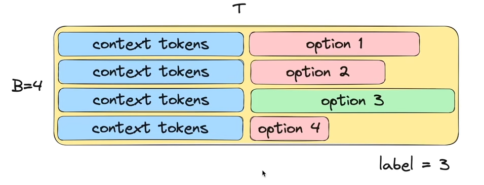


# 其他
## x.1 pytorch的matrix vs tensor
+ <https://docs.pytorch.org/docs/2.14/generated/torch.matmul.html>中有：
  + `The first N-2 dimensions of each argument, the batch dimensions, are broadcast (and thus must be broadcastable). The last 2, the matrix dimensions, are handled as in the matrix-matrix product.`
    >[!NOTE]
    > 即：如果在进行矩阵相关的操作，但是输入的tensor维度大于2，则前`N-2`(减法)的维度都被认为是`batch`, 只有最后两个维度被认为是矩阵维度
+ 对于`torch.tril: Returns the lower triangular part of the matrix (2-D tensor) or batch of matrices input, the other elements of the result tensor out are set to 0.`
  + `Matrix`：在 PyTorch 中默认指代 2D Tensor（最后两维）。
  + `Batch of`：指代在 Matrix 前面附加的任意数量的维度（Batch 维度）。
  + `batch of matrices` 在 PyTorch 开发者的共识中，就等价于“最后两维是矩阵，前面是 Batch”。
+ **PyTorch 处理高维张量时的“全局通用约定”（Global Convention）**
  + **矩阵维度规则**：对于任何带有“矩阵”语义的操作（如 `tril`, `triu`, `matmul`, `bmm`, `det`, `inv`, `svd`, `eig` 等），**永远假设最后两个维度（dim=-2, dim=-1）是矩阵的行和列**。
  + **Batch 维度规则：前面的所有维度（dim=0 到 dim=-3）都是 Batch 维度**。操作会在这些 Batch 维度上独立、并行地进行（或者通过 Broadcasting 广播机制对齐）。

## x.2 model.eval()什么时候发挥作用

**如果模型中绝对没有使用任何依赖 `self.training` 状态的模块（如 Dropout、BatchNorm 等），那么调用 `model.eval()` 和不调用，在前向传播的数学计算结果上是完全没有区别的。**
+  `model.eval()` 的本质
   + 在 PyTorch 中，`model.eval()` 的源码非常简单，它仅仅是递归地将模型中所有子模块的 `self.training` 属性从 `True` 修改为 `False`。
   - 对于 `BatchNorm`、`Dropout` 等模块，它们的 `forward` 函数内部会判断 `if self.training:`，从而在训练和推理时执行不同的逻辑。
   - 对于 `Linear`、`Conv2d`、`ReLU`、`LayerNorm`、`RMSNorm` 等绝大多数基础模块，它们的 `forward` 函数**根本不检查** `self.training` 状态，因此无论 `eval()` 还是 `train()`，计算逻辑完全一致。
   + 即：`BatchNorm`、`Dropout` 等模块需要`eval()`是因为有`self.training`这个参数的修改
+ 注意： - `model.eval()` **不会**关闭梯度计算（Autograd 引擎依然会构建计算图）。
  - 如果推理时只调用了 `model.eval()` 而没有关闭梯度，模型依然会计算并保存中间变量的梯度，导致**显存占用翻倍，且推理速度变慢**。

    **正确的做法是：**
    在推理时，必须配合使用上下文管理器来关闭梯度：
    ```python
    model.eval()
    with torch.no_grad():  # 或者使用更高效的 torch.inference_mode()
        output = model(input)
    ```

---

在`code\gpt2\train_gpt2.py`中的`sample_test()`函数把`model.eval() `注释掉，不影响结果（需要确认代码里没有`nn.Dropout()`）

## x.3  model.to(device) vs x = x.to(device)

>[!NOTE]
> **`model.to(device)` 是“原地修改（In-place）”模型内部的参数和缓冲区；而 `x.to(device)` 是“创建一个新张量”并返回。**

### x.3.1 model.to
在 PyTorch 中，`model`（即 `nn.Module` 的实例）本质上是一个**容器**，它内部包含了多个子模块、参数（`nn.Parameter`）和缓冲区（Buffer）。

调用 `model.to(device)` 时，底层实际执行的是：
1. **递归遍历**：它会递归地遍历模型内的每一个子模块。
2. **原地修改参数**：对于每一个参数和缓冲区，它会调用类似 `param.data = param.data.to(device)` 的操作。
3. **返回自身**：`nn.Module.to()` 方法最终返回的是 `self`（即模型对象本身）。

>[!IMPORTANT]
>+ **结论**：模型**内部引用的参数张量**的设备属性被**原地（in-place）** 改变了，但是对象本身的内存地址没有变，所以不需要重新赋值。(`self`指向的内存地址没变)
>+ 这里需要区分两个关键概念： `Python 对象的内存地址` 和 `张量底层数据的物理存储位置`
>    + Python 对象层（永远在 CPU 内存中）： 
>       + `model` 是一个 `nn.Module` 的 Python 对象。
>       + Python 解释器运行在 CPU 上，它管理的所有对象（包括 `nn.Module` 本身，以及它内部维护的存放参数的字典 `_parameters`）都**永远分配在 CPU 的系统内存（RAM）中**。
>       + “内存地址不变”（即 `id(model)` 不变），指的是这个 **Python 外壳对象**在 CPU 内存中的地址没有变。
>+ **C++ 底层数据层（可以在 CPU 或 GPU）**：
>   + `nn.Module` 内部包含的 `nn.Parameter` 本质上是 `torch.Tensor`。
>   + `Tensor` 在 Python 层只是一个“句柄（Handle）”，它内部包含一个指针（`data_ptr`），指向 C++ 底层实际存储数据的内存块。
>   + 当调用 `model.to('cuda')` 时，底层发生的是：
>       + 在 GPU 显存中分配一块新空间。
>       + 把数据从 CPU 拷贝到 GPU。
>       + **修改 Tensor 句柄内部的 `data_ptr` 指针**，让它指向 GPU 上的新地址。

----

### x.3.2 tensor.to

>[!NOTE]
>`x = x.to(device)` 需要重新赋值

对于张量（`torch.Tensor`），PyTorch 的设计哲学是**元数据不可变**。张量的 `device`、`dtype`、`shape` 等元数据一旦确定，就不能被原地修改。

当调用 `x.to(device)` 时，底层实际执行的是：
1. 如果 `x` 已经在目标设备上，为了性能优化，它会直接返回 `x` 本身。
2. 如果 `x` 不在目标设备上（比如从 CPU 到 GPU），它会在目标设备上**分配一块全新的显存/内存**。
   1. **数据拷贝**：将原张量的数据拷贝到新分配的内存中。
   2. **返回新对象**：生成并返回一个**全新的张量对象**，原来的张量 `x` 依然留在原设备上，没有任何改变。


为什么这里不通过**修改 Tensor 句柄内部的 `data_ptr` 指针**，让它指向 GPU 上的新地址，来实现`x`的移动？
+ `Tensor`的结构:
  + Tensor（张量句柄）：包含形状（shape）、步长（stride）、偏移量（offset）等元数据。
  + TensorImpl（实现细节）：`Tensor` 指向它。
  + Storage（存储块）：`TensorImpl` 指向它。真正的 `data_ptr`（指向物理内存的指针）是保存在 Storage 里的
+ 如果在`to`的时候直接改了 `data_ptr`，
  ```python 
    # 例一： 视图（View）与内存共享彻底崩溃
     x = torch.randn(10, 10)      # x 在 CPU
     y = x.view(100)              # y 是 x 的视图，x 和 y 共享同一个 CPU Storage
     x = x.to('cuda')             # 假设这里直接修改了 x 的 data_ptr 指向 GPU
     
     # 如果直接修改 x 的底层指针
     # 则 y 的底层依然指向原来的 CPU Storage。
     # 则为了节省内存，PyTorch 把原来的 CPU Storage 释放了，y 瞬间变成了野指针（Dangling Pointer），程序直接崩溃。

     # 例二： 自动求导（Autograd）计算图断裂
     x = torch.randn(10, requires_grad=True)
     y = x * 2
     z = y.sum()
    # 此时计算图是：z -> y -> x
    # 如果直接修改了 x 的底层指针
    # 当执行 z.backward() 时，Autograd 引擎去计算 x 的梯度，发现 x 的底层指针已经指向了 GPU，而梯度累加器（Gradient Accumulator）还在 CPU 上，或者计算图的拓扑结构因为指针的突变而无法对齐，反向传播直接报错或计算出完全错误的梯度。
  ```

### x.3.3 Module.to的底层实现

PyTorch 的设计哲学是：**张量的元数据（Device, Dtype）是不可变的（Immutable）**。
+ 因此`Tensor`要挪，必须创建一个新张量
+ 而`model`是原地操作，是因为`model`只是那些张量的封装，本身这个壳的指针是不变的
  + [文档：torch.Tensor/torch.Tensor.to](https://docs.pytorch.org/docs/2.15/generated/torch.Tensor.to.html#torch-tensor-to)
  + [文档：Module.to()](https://docs.pytorch.org/docs/2.15/generated/torch.nn.Module.html#torch.nn.Module.to)
+ [源码：torch/nn/modules/module.py-> to()](https://github.com/pytorch/pytorch/blob/v2.15.0/torch/nn/modules/module.py#L1259)
  + 需要看旧一点的torch版本：<https://github.com/pytorch/pytorch/blob/0c455332e8ca7b3c426b7eb95b696eef7bedee47/torch/nn/modules/module.py#L385>
  + 有以下关键内容：
   ```python
      # https://github.com/pytorch/pytorch/blob/0c455332e8ca7b3c426b7eb95b696eef7bedee47/torch/nn/modules/module.py#L573
      def to(self, *args, **kwargs):
          # 1. 解析 device, dtype, non_blocking 等参数
          device, dtype, non_blocking, convert_to_format = torch._C._nn._parse_to(*args, **kwargs)

          # 2. 定义一个闭包函数 convert，它的作用就是调用张量的 .to() 方法
          def convert(t):
              if convert_to_format is not None and t.dim() in (4, 5):
                  # 处理内存格式（如 channels_last），这里省略
                  return t.to(device, dtype if t.is_floating_point() else None, non_blocking, memory_format=convert_to_format)
              # 核心：调用底层张量的 to()，返回一个新的张量/参数
              return t.to(device, dtype if t.is_floating_point() else None, non_blocking)

          # 3. 将 convert 函数传递给核心方法 _apply
          return self._apply(convert)
      # https://github.com/pytorch/pytorch/blob/0c455332e8ca7b3c426b7eb95b696eef7bedee47/torch/nn/modules/module.py#L385
      def _apply(self, fn, recurse=True):
        # 1. 递归处理子模块 (Children)
        if recurse:
            for module in self.children():
                module._apply(fn, recurse)
        ...
        # 2. 核心：遍历并替换自身的 Parameters (参数)
        for key, param in self._parameters.items():
            if param is not None:
                # 调用传入的 fn (即上面的 convert 函数)
                # param.to(...) 会在 GPU 上创建一个新张量，并返回
                param_applied = fn(param)
                
                # 【关键代码】：将字典中的旧引用，替换为 fn 返回的新引用！
                # 如果返回的不是 Parameter，还需要重新包装一下
                if param_applied is not param:
                    self._parameters[key] = nn.Parameter(param_applied, requires_grad=param.requires_grad)
                    
        # 3. 核心：遍历并替换自身的 Buffers (缓冲区，如 BatchNorm 的 running_mean)
        for key, buf in self._buffers.items():
            if buf is not None:
                buf_applied = fn(buf)
                # 【关键代码】：同样，替换字典中的引用
                if buf_applied is not buf:
                    self._buffers[key] = buf_applied

        # 4. 返回自身 (self)
        return self
   ```

### x.3.4 总结和延伸
* **为什么 `x = x.to(device)` 需要赋值？**
  + 因为对于普通张量 `x`，PyTorch 没有类似 `_apply` 这样的容器机制去替换它的底层引用。`x.to()` 只能返回一个新对象，如果您不写 `x = ...`，变量 `x` 在 Python 命名空间里依然绑定着那个旧的 CPU 张量。

* **为什么 `model.to(device)` 不需要赋值？**
  + 因为 `model.to()` 最终调用了 `_apply()`。`_apply()` 在内部通过 `self._parameters[key] = ...` **原地修改了模型内部字典的引用**。
  并且请注意 `_apply()` 的最后一行：**`return self`**。
  它返回的是模型对象本身。所以 `model = model.to(device)` 实际上等同于 `model = model`，毫无意义。

*  这里存在一个**致命的性能瓶颈**：
   + `_apply` 是**串行、逐个参数**调用 `fn(param)` 的。
     对于一个 7B 的 LLM，有几千个 `nn.Parameter`。这意味着 `model.to('cuda')` 会触发**几千次**独立的 CPU 到 GPU 的内存拷贝（PCIe 传输）。
     这种细粒度的拷贝不仅慢，而且在拷贝期间，GPU 的计算单元是闲置的。
   + **这就是为什么在 LLM 领域，会极力避免使用原生的 `model.to()`：**
       1. **HuggingFace 的 `device_map="auto"`**：它在底层完全绕过了 `nn.Module.to()`。它使用 `init_empty_weights` 初始化空壳模型，然后直接读取 Safetensors 权重文件，**按层（Layer）甚至按张量分块（Shard）**，以最大的块（Chunk）一次性通过 DMA（直接内存访问）搬运到 GPU 上，将 PCIe 的带宽利用率榨干。
       2. **DeepSpeed/Megatron**：在分布式初始化时，也是直接在目标设备上分配内存并加载分片权重，绝不会在 CPU 上实例化完整模型后再调用 `to()`。


## x.4 交叉熵损失

之前的 [code\3_MLP_makemore.ipynb](../code/3_MLP_makemore.ipynb)
```python
F.cross_entropy(logits, Y)

V.S.

counts = logits.exp()
prob = counts/counts.sum(1,keepdim = True)
loss = - prob[torch.arange(32), Y].log().mean()

# 所以Y的作用仅仅是索引正确类的index
```

---

>[!NOTE]
>pytorch的[`CrossEntropyLoss`文档](https://docs.pytorch.org/docs/2.15/generated/torch.nn.CrossEntropyLoss.html), 
><br/>这个文档其实写的更简洁：[torch.nn.functional.cross_entropy](https://docs.pytorch.org/docs/2.15/generated/torch.nn.functional.cross_entropy.html)
><br/>但是直接搜索`CrossEntropyLoss`先出来的链接是上面那个复杂的~

几个容易造成误区的关键点(直接用llm把source里的说明部分全都翻译一下。。)
+ The `input` is expected to contain the unnormalized logits for each class (which do `not` need to be positive or sum to 1, in general). `input` has to be a Tensor of size $(C)$ for unbatched input, $(minibatch, C)$ or $(minibatch, C, d_1, d_2, ..., d_K)$ with $K \geq 1$ for the `K`-dimensional case. The last being useful for higher dimension inputs, such as computing cross entropy loss per-pixel for 2D images.
  + `input`: 包含对每个类的没有归一化过的`logits`, 不是必须保证和为1，即：不需要额外提前进行softmax归一化；
  + 对于`unbatched`的输入，`input`必须是$(C)$的张量
  + 对于`batch`的输入，`input`必须是$(minibatch, C)$或$(minibatch, C, d_1, d_2, ..., d_K)$shape的张量，对于后者， $K \geq 1$是针对于`K`维的情况
  + 这里 $C = \text{number of classes}$, $N =\text{batch size}$
+ `target`（目标标签）应包含以下两种形式之一：
  - `Class indices`，取值范围为 $[0, C)$，其中 $C$ 为类别总数；如果指定了 `ignore_index`，该损失函数也会接受此索引值（该索引不一定在正常的类别取值范围内）。当未进行归约（即 `reduction` 设置为 `'none'`）时，此情况下的损失计算公式如下：

    $$
    \ell(x, y) = L = \{l_1,\dots,l_N\}^\top, \quad l_n = - w_{y_n} \log \frac{\exp(x_{n,y_n})}{\sum_{c=1}^C \exp(x_{n,c})} \cdot \mathbb{1}\{y_n \neq \text{ignore\_index}\}
    $$

    其中，$x$ 为输入，$y$ 为目标标签，$w$ 为权重，$C$ 为类别总数。如果 `reduction` 参数不为 `'none'`（默认为 `'mean'`），
    
    标记 $x_{n,y_n}$中  
    
    **$n$ (样本索引)** 代表展平（flatten）后的第 $n$ 个样本。如果输入是 2D 的 `(batch_size, C)`，那么 $n \in [0, \text{batch\_size}-1]$；如果是处理图像分割或序列的 3D/4D 张量，$n$ 则跨越了 batch 维度以及空间维度 $d_1, \dots, d_k$.  
    
    **$y_n$ (真实类别索引)**代表第 $n$ 个样本的**真实标签（Ground Truth）** 所对应的类别下标。

    $x_{n,y_n}$ 表示：**对于第 $n$ 个样本，模型在“它真实的正确类别 $y_n$”上输出的原始预测得分（logit）。**

    $$
    \ell(x, y) = \begin{cases}
        \sum_{n=1}^N \frac{1}{\sum_{n=1}^N w_{y_n} \cdot \mathbb{1}\{y_n \neq \text{ignore\_index}\}} l_n, & \text{if reduction} = \text{'mean'};\\
        \sum_{n=1}^N l_n, & \text{if reduction} = \text{'sum'}.
    \end{cases}
    $$

    需要注意的是，这种情况在数学上等价于先对输入应用 `LogSoftmax`，然后再计算 `NLLLoss`。 即
    ```python
      counts = logits.exp()
      prob = counts/counts.sum(1,keepdim = True)
      loss = - prob[torch.arange(32), Y].log().mean()
    ```

  - `每个类别的概率`；当小批量（minibatch）中的每个样本需要包含多个类别的标签信息时（例如混合标签 blended labels、标签平滑 label smoothing 等场景），这种形式非常有用。当未进行归约（即 `reduction` 设置为 `'none'`）时，此情况下的损失计算公式如下：

    $$
    \ell(x, y) = L = \{l_1,\dots,l_N\}^\top, \quad l_n = - \sum_{c=1}^C w_c \log \frac{\exp(x_{n,c})}{\sum_{i=1}^C \exp(x_{n,i})} y_{n,c}
    $$

    其中，$x$ 为输入，$y$ 为目标标签，$w$ 为权重，$C$ 为类别总数。如果 `reduction` 参数不为 `'none'`（默认为 `'mean'`），则：

    $$
    \ell(x, y) = \begin{cases}
        \frac{\sum_{n=1}^N l_n}{N}, & \text{if reduction} = \text{'mean'};\\
        \sum_{n=1}^N l_n, & \text{if reduction} = \text{'sum'}.
    \end{cases}
    $$

  **注意**：通常情况下，当 `target` 采用**类别索引**（即第一种情况）时，该损失函数的计算性能更好，因为这种形式允许底层进行高度优化的计算。只有当“每个样本只能属于单一类别”这一假设过于严苛，无法满足实际需求时，才建议将 `target` 设置为类别概率分布。


----


1.  **Softmax 概率计算**：$\frac{\exp(x_{n,y_n})}{\sum_{c=1}^C \exp(x_{n,c})}$
    *   这就是标准的 Softmax 公式。分子是真实类别的 logit 指数，分母是所有 $C$ 个类别 logit 指数之和。计算结果就是模型预测第 $n$ 个样本属于真实类别 $y_n$ 的**概率 $p$**。
2.  **负对数似然 (NLL)**：$-\log(\dots)$
    *   对概率取对数并加负号。预测概率 $p$ 越接近 1，$\log(p)$ 越接近 0，Loss 越小；$p$ 越接近 0，Loss 越大。
3.  **类别权重**：$w_{y_n}$
    *   对应 PyTorch 中的 `weight` 参数。$w_{y_n}$ 表示真实类别 $y_n$ 的权重。主要用于处理**类别不平衡**问题（例如长尾分布），给少数类更大的权重。
4.  **忽略掩码**：$\mathbb{1}\{y_n \not= \text{ignore\_index}\}$
    *   这是一个指示函数。如果真实标签 $y_n$ 等于 `ignore_index`，则该项为 0，该样本的 loss 为 0，**不参与反向传播的梯度计算**。

---

映射到 LLM 的 **Next-token prediction (自回归语言模型)** 任务中

在 LLM 的 LM Head 输出后，计算 Loss 时：
*   **$C$ (类别数)**：等于 **词表大小 (Vocab Size)**，比如 32000 或 128000。
*   **$N$ (样本总数)**：等于 `batch_size * seq_len`（如果是 causal LM，通常还会减去 1，因为输入和标签有错位）。也就是当前 batch 中**所有需要预测的 token 总数**。
*   **$y_n$ (真实标签)**：第 $n$ 个位置上的**目标 token ID**（即输入序列往后错位一位的 token）。
*   **$x_{n, y_n}$**：模型在第 $n$ 个位置，预测出**真实目标 token ID** 的那个 logit 值。
*   **$\text{ignore\_index}$**：通常被设置为 **`pad_token_id`**。在 LLM 训练时，一个 batch 内的序列长度不一，短序列会用 pad token 补齐。设置 `ignore_index=pad_token_id` 后，模型在计算 loss 时就会**自动忽略所有 padding 位置**，只计算有效 token 的交叉熵。

---

数值稳定性 (Numerical Stability)

PyTorch 底层**并没有**直接按这个公式算，而是利用了 **LogSumExp trick** 进行了数学等价变换：
$$ -\log \frac{\exp(x_{n,y_n})}{\sum_{c} \exp(x_{n,c})} = -x_{n,y_n} + \log \sum_{c} \exp(x_{n,c}) $$
在计算 $\log \sum \exp(x_{n,c})$ 时，PyTorch 会先减去一个最大值 $m = \max_c(x_{n,c})$ 来保证指数运算的数值稳定性：
$$ \log \sum_{c} \exp(x_{n,c}) = m + \log \sum_{c} \exp(x_{n,c} - m) $$


## x.5 torch.long vs. torch.int64
在 [torch.dtype](https://docs.pytorch.org/docs/2.15/tensor_attributes.html#torch-dtype)文档中，可以看到：

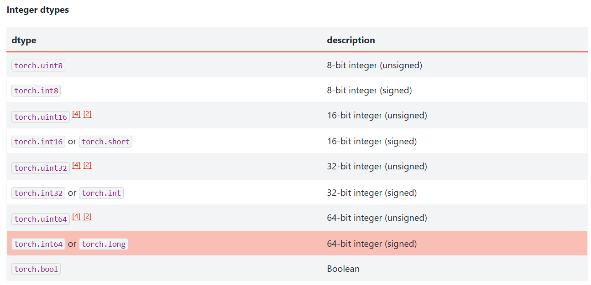

所以 `torch.long`和`torch.int64`是一个玩意。。。

在[torch.Tensor.long](https://docs.pytorch.org/docs/2.15/generated/torch.Tensor.long.html) 中，有: `self.long() is equivalent to self.to(torch.int64). `


## x.6 vscode调试进入 torch魔法代码

想看看`self.transformer.wte.weight  = self.lm_head.weight`这句话到底跳转到了哪里，设置vscode的`launch.json`，重点是在默认生成的这个文件里，添加`"justMyCode": false`

VSCode 的 Python 调试器 (debugpy) 默认开启了 `"justMyCode": true`。
+ 这导致：调试器会自动跳过所有非你本人编写的代码（包括 site-packages 下的 PyTorch 源码）。
+ 因此按 F11 尝试进入 `_setattr_` 时，调试器发现它在 `PyTorch` 库里，就会直接执行完毕并跳到下一行。

开启后，就可以直接进去了

```json
{
    // Use IntelliSense to learn about possible attributes.
    // Hover to view descriptions of existing attributes.
    // For more information, visit: https://go.microsoft.com/fwlink/?linkid=830387
    "version": "0.2.0",
    "configurations": [
        {
            "name": "Python Debugger: Current File",
            "type": "debugpy",
            "request": "launch",
            "program": "${file}",
            "console": "integratedTerminal",
            "justMyCode": false  // <--- 关键：将这里的 true 改为 false
        }
    ]
}
```

## x.7 运行过程 + 交互式调试

| 对比维度 | `code.interact(local=locals())`<br/>**基础暂停** | `IPython.embed()`<br/>**增强交互** | `breakpoint()` (Python 3.7+)<br/>**专业单步调试** |
| :--- | :--- | :--- | :--- |
| **核心定位** | 基础交互式暂停 | 增强型交互式暂停 | **真正的单步调试器 (Debugger)** |
| **依赖情况** | Python 内置，零依赖 | 需第三方库 (`pip install ipython`) | Python 内置，零依赖 |
| **上下文注入** | **手动** (需显式传 `locals()`) | **自动** (默认注入局部和全局变量) | **自动** (拥有完整的执行上下文) |
| **交互体验** | 原生 REPL (简陋，无高亮/补全) | **极佳** (语法高亮、自动补全、对象内省) | 命令行调试模式 (无语法高亮，纯命令驱动) |
| **核心能力** | 只能查看和简单计算变量 | 支持魔术命令 (如 `%timeit`)、快速查看对象属性 | **单步执行、查看调用栈、动态修改代码逻辑** |
| **退出方式** | `exit()` 或 `Ctrl+D` | `exit()` 或 `Ctrl+D` | `c` (continue) 或 `Ctrl+D` |
| **痛点/优点** |  * 必须手动传 `locals()`，如果还想用全局变量，得写成 `code.interact(local=locals(), globals=globals())`，非常繁琐。<br/>* 没有自动补全，没有语法高亮，查看复杂对象（如 PyTorch 的 Tensor）时，输出格式不够友好。|  * **自动上下文**：不需要传 `locals()`，直接就能访问当前所有的变量。<br/>* **对象内省（神器）**：输入 `tensor_name?` 或 `model.forward??`，可以直接在终端查看该对象的文档、源码和类型。在研究 LLM 源码（如 HuggingFace Transformers）时，快速查看某个类的实现极其方便。<br/>* **魔术命令**：可以使用 `%timeit` 测试某段 Attention 计算或数据预处理的耗时；使用 `%hist` 查看刚才输入的命令历史。|Python 3.7 引入的内置函数，底层默认调用 `pdb`（Python Debugger）。本质不是“交互式计算”，而是 **接管程序的控制流** <br/>* **单步执行**：可以一行一行地执行代码（`n` 下一步，`s` 进入函数内部），这对于排查 LLM 训练中复杂的梯度消失、NaN 问题、或者分布式训练（DeepSpeed/FSDP）的状态同步问题至关重要。<br/>* **查看调用栈**：输入 `w` (where)，可以清晰看到当前代码是被哪几层函数调用进来的，帮助理清复杂的模型前向传播逻辑。<br/>* **动态修改**：可以在调试时直接给变量重新赋值（例如把某个导致 OOM 的 batch_size 强行改小），然后输入 `c` 继续运行，而不需要重启漫长的模型加载过程。
| **本质** |最原始的“打桩”调试。它就像在代码里挖了个坑，程序掉进去后，给您一个最基础的 Python 命令行。|IPython 提供的增强型交互式环境。在算法和数据科学领域，IPython 几乎是标配。|
|**使用场景**|   |**日常数据探查与源码阅读**<br/>处理数据、或者阅读 HuggingFace 源码想搞清楚某个中间变量（如 `hidden_states`、`attention_mask`）的 shape 和具体数值时，用它最顺手。它的 `?` 内省功能能帮您快速看懂源码|**排查复杂 Bug 与逻辑错误**<br/>当模型训练 Loss 不降、出现 NaN、或者分布式训练卡死时，用 `breakpoint()` 配合单步调试，去追踪数据在每一层网络中的流转情况|
|**用法**|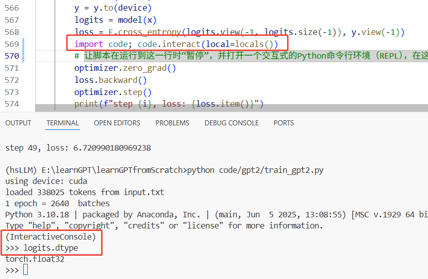<br/>`Use exit() or Ctrl-Z plus Return to exit`, 输入`exit()`会直接结束整个程序，输入`Ctrl+Z`则会继续程序的下一步，直到`return`才是exit|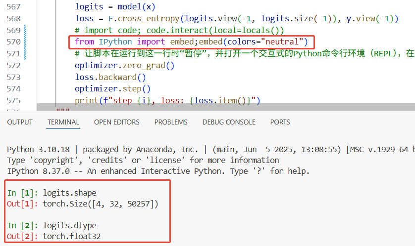<br/>这个退出后，不会影响代码的执行，所以如果是在`for`循环的话，还会重复进入`Ipython`中|
|**代码**|`import code; code.interact(local=locals())`|`from IPython import embed;embed(colors="neutral") `<br/>`colors="neutral"`，防止在某些终端下颜色显示错乱|

**其他**
1. **IDE 可视化调试**: 不用写`breakpoint()`。直接在行号旁边打个红点，使用 Debug 模式运行。IDE 的可视化调试器底层也是基于 `pdb` 的，但它提供了图形化的变量查看器（可以直观展开 Tensor 的维度）、条件断点和表达式求值，是排查 LLM 复杂 Bug 效率最高的方式。
2. 美化`breakpoint()`
    ```bash
      # pdb的命令行界面太丑，可以在终端执行
      export PYTHONBREAKPOINT="IPython.terminal.debugger.set_trace"
      # 替换breakpoint()的底层调试器是可以通过环境变量替换的，触发时就会进入 IPython 的调试环境，既拥有单步调试的能力，又拥有 IPython 漂亮的语法高亮和自动补全！
    ```
3. **常用 Pdb 命令速记**：
  * `n` (next): 执行下一行（不进入子函数）。
  * `s` (step): 执行下一行（**进入**子函数内部）。
  * `c` (continue): 继续运行，直到遇到下一个断点。
  * `p 变量名` (print): 打印变量。
  * `l` (list): 查看当前代码上下文。
  * `w` (where): 打印调用栈。


## x.8 optimizer.param_groups
pytorch中修改`lr`的方法：
```python
for param_group in optimizer.param_groups:
    # import code; code.interact(local=locals()) # 暂停开启交互式，就可以看到这个对象支持的keys了
    # param_group.keys()
    # dict_keys(['params', 'lr', 'betas', 'eps', 'weight_decay', 'amsgrad', 'foreach', 'maximize', 'capturable', 'differentiable', 'fused'])
    param_group['lr'] = lr
```

参考：[torch.optim](https://docs.pytorch.org/docs/2.15/optim.html), 页面搜索`param_groups`和`lr`, 在[Per-parameter options](https://docs.pytorch.org/docs/2.15/optim.html#per-parameter-options)中，有：
```python
# 如果想指定每个层的学习率，则可以
optim.SGD([
    {'params': model.base.parameters(), 'lr': 1e-2},
    {'params': model.classifier.parameters()}
], lr=1e-3, momentum=0.9)

optim.SGD([
    {'params': model.base.named_parameters(), 'lr': 1e-2},
    {'params': model.classifier.named_parameters()}
], lr=1e-3, momentum=0.9)
```

---

分清楚当前优化器中有多少个对象，

以 [torch.optim->AdamW](https://docs.pytorch.org/docs/2.15/generated/torch.optim.AdamW.html)为例：
```bash
class AdamW(
    params: ParamsT,
    lr: float | Tensor = 0.001,
    betas: Tuple[float | Tensor, float | Tensor] = (0.9, 0.999),
    eps: float = 1e-8,

params (iterable) – iterable of parameters or named_parameters to optimize or iterable of dicts defining parameter groups. When using named_parameters, all parameters in all groups should be named
```
即：`params`这个参数必须是要进行优化的可迭代的`parameters`/`named_parameters`对象,或者是定义了parameter groups的可迭代的字典，如果使用`named_parameters`,则所有groups里的所有参数都需要是命名过的

```python
optimizer = torch.optim.AdamW(model.parameters(), lr = 3e-4, betas=(0.9, 0.95), eps=1e-8)
# 这里初始化的时候，只传入了一个参数 param_groups

for param_group in optimizer.param_groups:
  import code; code.interact(local=locals()) # 暂停开启交互式，就可以看到这个对象支持的keys了
  param_group['lr'] = lr
# 因此，执行这个代码查看时
> param_group.keys()
dict_keys(['params', 'lr', 'betas', 'eps', 'weight_decay', 'amsgrad', 'foreach', 'maximize', 'capturable', 'differentiable', 'fused'])
> len(optimizer.param_groups)
1
> type(optimizer.param_groups)
<class 'list'>
# 所以其实不需要写成for循环，直接 optimizer.param_groups[0]['lr'] = lr 即可
```

进一步查看[torch.optim-Constructing it](https://docs.pytorch.org/docs/2.15/optim.html#constructing-it)中的示例：
```python
# 可迭代的`parameters`
optimizer = optim.SGD(model.parameters(), lr=0.01, momentum=0.9)
optimizer = optim.Adam([var1, var2], lr=0.0001)

# 可迭代的`named_parameters`
optimizer = optim.SGD(model.named_parameters(), lr=0.01, momentum=0.9)
# 定义了parameter groups的可迭代的字典
optimizer = optim.Adam([('layer0', var1), ('layer1', var2)], lr=0.0001)

# 通过观察优化器的定义就知道到底有多少个param_groups了
```


---

**注意**，如果`model`是`compile`过的，得先注释，不然没法正确进入`cli`交互程序，报错内容为:
```bash
File "C:\Users\shanhuang\AppData\Roaming\Python\Python310\site-packages\torch\_inductor\cpp_builder.py", line 135, in check_compiler_exist_windows  
    raise RuntimeError(f"Compiler: {compiler} is not found.") from exc
torch._dynamo.exc.BackendCompilerFailed: backend='inductor' raised:
RuntimeError: Compiler: cl is not found.  #这部分是windows无法正确找到 cl来进行编译，下面则是交互模式和compiler冲突的报错

Set TORCH_LOGS="+dynamo" and TORCHDYNAMO_VERBOSE=1 for more information


You can suppress this exception and fall back to eager by setting:
    import torch._dynamo
    torch._dynamo.config.suppress_errors = True
```

`code.interact` 与 `torch.compile` 的冲突：
+ `torch.compile` (Dynamo) 的工作原理是“追踪（Trace）”你的 Python 代码来构建计算图。当它执行到 `code.interact` 时，程序会暂停等待标准输入（stdin）。Dynamo 的 Tracer 极度讨厌非确定性的 I/O 操作，这会导致图捕获失败、挂死，或者产生不可预期的行为。
+ 所以如果想要交互式运行，建议先注释掉`compile`,等调试完毕，再开启

## x.9 torch.compile注意事项(windows编译问题)
```bash
File "C:\Users\shanhuang\AppData\Roaming\Python\Python310\site-packages\torch\_inductor\cpp_builder.py", line 135, in check_compiler_exist_windows  
    raise RuntimeError(f"Compiler: {compiler} is not found.") from exc
torch._dynamo.exc.BackendCompilerFailed: backend='inductor' raised:
RuntimeError: Compiler: cl is not found.

Set TORCH_LOGS="+dynamo" and TORCHDYNAMO_VERBOSE=1 for more information
```
上面报错的原因：
+ `torch.compile` 默认使用的 **`inductor` 后端在 Windows 平台上需要依赖 C++ 编译器**来将生成的代码编译为动态链接库，系统环境中找不到 Microsoft Visual C++ 的编译器（`cl.exe`）。
+ 解决方法：安装并配置 C++ 编译器（推荐，保留加速效果），需要安装并让 PyTorch 找到 `cl.exe`。

1. **安装 Visual Studio Build Tools**：
   - 下载 [Visual Studio Build Tools](https://visualstudio.microsoft.com/visual-cpp-build-tools/)。
   - 运行安装程序，在工作负载中勾选 **“使用 C++ 的桌面开发” (Desktop development with C++)**。
   - 确保右侧安装了 MSVC 生成工具和 Windows SDK。
2. **通过开发者命令行运行（最简单）**：
   - 安装完成后，不要在普通的 CMD 或 PowerShell 中运行代码。
   - 在 Windows 开始菜单搜索并打开 **“x64 Native Tools Command Prompt for VS 2022”**（或对应你的 VS 版本）。
   - 在这个特定的终端里激活你的 conda/venv 环境，然后运行你的 Python 脚本。这个终端会自动配置好 `cl.exe` 的环境变量。
3. **永久配置环境变量（可选）**：
   - 如果不想每次都用开发者命令行，需要手动将 `cl.exe` 所在路径（如 `C:\Program Files\Microsoft Visual Studio\2022\Community\VC\Tools\MSVC\14.xx.xxxxx\bin\Hostx64\x64`）添加到系统的 `PATH` 环境变量中。


## xx.10 model.named_parameters()
这里的`named_parameters`,对于模型来说，其实就是模型定义时候用的内容，例如下面这个定义
+ 但是很明显，这里只有`transformer`相关的`named_parameters`, 定义中的`lm_head`却没有，**并不是因为 `transformer` 使用了 `ModuleDict`**（`nn.Linear` 确实也是 `nn.Module` 的子类，正常情况下一样会被遍历到）。
+ 导致  在 `named_parameters()` 中没有`lm_head`的原因为：**权重共享导致的参数去重**，以及 **`bias=False`**。
  1. **Weight Tying（权重绑定/共享）**: 调用 `model.named_parameters()` 时，PyTorch 底层会递归遍历所有的 `nn.Module`。为了防止同一个参数被多次返回（这会导致优化器重复更新或计算错误），`named_parameters()` 的源码内部维护了一个 `memo` 集合，用来记录已经访问过的参数的内存地址（即 `id(p)`）。
      ```python
      self.transformer.wte.weight = self.lm_head.weight
      ```
  2. 辅助原因：`bias=False` 让 `lm_head` 彻底失去独有参数。 如果 `lm_head` 还有其他的参数，它依然会出现在结果中。但是由于设置了 `bias=False`，`lm_head` 内部**只有 `weight` 这一个参数**（没有 `bias`）。其唯一的参数 `weight` 因为权重共享被去重了，`lm_head` 就再也没有任何属于自己的参数了，所以它在 `named_parameters()` 的结果中彻底消失了。
+ 可以在交互式环境中进行以下验证:
    ```bash
     # 验证 1：证明它们是同一个内存对象
    ```python
      >>> id(model.transformer.wte.weight) == id(model.lm_head.weight)
      True
      # 验证 2：如果开启 bias，lm_head 就会重新出现
      # 临时把 bias 加回来（注意：实际训练中不要随便改，这里仅做验证）
      import torch
      import torch.nn as nn
      >>> model.lm_head.bias = nn.Parameter(torch.zeros(model.config.vocab_size))
      >>> param_dict = {pn:p for pn, p in model.named_parameters()}
      >>> 'lm_head.bias' in param_dict
      True
      >>> 'lm_head.weight' in param_dict
      False  # weight 依然被去重了
    ```
+ 结合[torch.nn.Module.named_parameters](https://docs.pytorch.org/docs/2.15/generated/torch.nn.Module.html#torch.nn.Module.named_parameters)的定义
  ```bash
    named_parameters(prefix='', recurse=True, remove_duplicate=True)

    Return an iterator over module parameters, yielding both the name of the parameter as well as the parameter itself.
    会返回module的参数，nn.Linear也是module的继承类
      prefix (str) – prefix to prepend to all parameter names. 
      recurse (bool) – if True, then yields parameters of this module and all submodules. Otherwise, yields only parameters that are direct members of this module. 
                       默认会对module和所有的submodule进行迭代，如果设置为False的话，只会迭代当前这个module的参数
      remove_duplicate (bool, optional) – whether to remove the duplicated parameters in the result. Defaults to True. 
                                          默认会移除结果中重复的参数，因此，没有bias的lm_head就被wte这个重复移除了
  ```
+ [Model.named_parameters() will lose some layer modules](https://discuss.pytorch.org/t/model-named-parameters-will-lose-some-layer-modules/14588/8)，这个帖子说了两个情况：
  1. 共享导致某个层消失
  2. 有些特殊的moduel没有参数(就更没有需要学习的参数)，比如: [torch.nn AdaptiveMaxPool3d](https://docs.pytorch.org/docs/2.15/generated/torch.nn.AdaptiveMaxPool3d.html), [ torch.nn.modules.flatten.Flatten](https://docs.pytorch.org/docs/2.15/generated/torch.nn.modules.flatten.Flatten.html), [torch.nn.Dropout](https://docs.pytorch.org/docs/2.15/generated/torch.nn.Dropout.html)等

```python
# 之前的网络结构定义是:
self.transformer = nn.ModuleDict(dict(
    wte = nn.Embedding(self.config.vocab_size, self.config.n_embed),
    wpe = nn.Embedding(self.config.block_size, self.config.n_embed),
    h = nn.ModuleList(Block(config) for _ in range(self.config.n_layer)),
    ln_f = nn.LayerNorm(self.config.n_embed) 
))
self.lm_head = nn.Linear(self.config.n_embed, self.config.vocab_size, bias = False)
self.transformer.wte.weight  = self.lm_head.weight

# 在model定义结束后进行交互式
model = GPT2(GPT2Config(vocab_size= 50304)) 
model.to(device)  
import code; code.interact(local=locals())

>>> param_dict = {pn:p for pn, p in model.named_parameters()}
>>> param_dict.keys()
dict_keys(['transformer.wte.weight', 'transformer.wpe.weight', 'transformer.h.0.ln_1.weight', 'transformer.h.0.ln_1.bias', 'transformer.h.0.attn.c_attn.weight', 'transformer.h.0.attn.c_attn.bias', 'transformer.h.0.attn.c_proj.weight', 'transformer.h.0.attn.c_proj.bias', 'transformer.h.0.ln_2.weight', 'transformer.h.0.ln_2.bias', 'transformer.h.0.mlp.c_fc.weight', 'transformer.h.0.mlp.c_fc.bias', 'transformer.h.0.mlp.c_proj.weight', 'transformer.h.0.mlp.c_proj.bias', 'transformer.h.1.ln_1.weight', 'transformer.h.1.ln_1.bias', 'transformer.h.1.attn.c_attn.weight', 'transformer.h.1.attn.c_attn.bias', 'transformer.h.1.attn.c_proj.weight', 'transformer.h.1.attn.c_proj.bias', 'transformer.h.1.ln_2.weight', 'transformer.h.1.ln_2.bias', 'transformer.h.1.mlp.c_fc.weight', 'transformer.h.1.mlp.c_fc.bias', 'transformer.h.1.mlp.c_proj.weight', 'transformer.h.1.mlp.c_proj.bias', 'transformer.h.2.ln_1.weight', 'transformer.h.2.ln_1.bias', 'transformer.h.2.attn.c_attn.weight', 'transformer.h.2.attn.c_attn.bias', 'transformer.h.2.attn.c_proj.weight', 'transformer.h.2.attn.c_proj.bias', 'transformer.h.2.ln_2.weight', 'transformer.h.2.ln_2.bias', 'transformer.h.2.mlp.c_fc.weight', 'transformer.h.2.mlp.c_fc.bias', 'transformer.h.2.mlp.c_proj.weight', 'transformer.h.2.mlp.c_proj.bias', 'transformer.h.3.ln_1.weight', 'transformer.h.3.ln_1.bias', 'transformer.h.3.attn.c_attn.weight', 'transformer.h.3.attn.c_attn.bias', 'transformer.h.3.attn.c_proj.weight', 'transformer.h.3.attn.c_proj.bias', 'transformer.h.3.ln_2.weight', 'transformer.h.3.ln_2.bias', 'transformer.h.3.mlp.c_fc.weight', 'transformer.h.3.mlp.c_fc.bias', 'transformer.h.3.mlp.c_proj.weight', 'transformer.h.3.mlp.c_proj.bias', 'transformer.h.4.ln_1.weight', 'transformer.h.4.ln_1.bias', 'transformer.h.4.attn.c_attn.weight', 'transformer.h.4.attn.c_attn.bias', 'transformer.h.4.attn.c_proj.weight', 'transformer.h.4.attn.c_proj.bias', 'transformer.h.4.ln_2.weight', 'transformer.h.4.ln_2.bias', 'transformer.h.4.mlp.c_fc.weight', 'transformer.h.4.mlp.c_fc.bias', 'transformer.h.4.mlp.c_proj.weight', 'transformer.h.4.mlp.c_proj.bias', 'transformer.h.5.ln_1.weight', 'transformer.h.5.ln_1.bias', 'transformer.h.5.attn.c_attn.weight', 'transformer.h.5.attn.c_attn.bias', 'transformer.h.5.attn.c_proj.weight', 'transformer.h.5.attn.c_proj.bias', 'transformer.h.5.ln_2.weight', 'transformer.h.5.ln_2.bias', 'transformer.h.5.mlp.c_fc.weight', 'transformer.h.5.mlp.c_fc.bias', 'transformer.h.5.mlp.c_proj.weight', 'transformer.h.5.mlp.c_proj.bias', 'transformer.h.6.ln_1.weight', 'transformer.h.6.ln_1.bias', 'transformer.h.6.attn.c_attn.weight', 'transformer.h.6.attn.c_attn.bias', 'transformer.h.6.attn.c_proj.weight', 'transformer.h.6.attn.c_proj.bias', 'transformer.h.6.ln_2.weight', 'transformer.h.6.ln_2.bias', 'transformer.h.6.mlp.c_fc.weight', 'transformer.h.6.mlp.c_fc.bias', 'transformer.h.6.mlp.c_proj.weight', 'transformer.h.6.mlp.c_proj.bias', 'transformer.h.7.ln_1.weight', 'transformer.h.7.ln_1.bias', 'transformer.h.7.attn.c_attn.weight', 'transformer.h.7.attn.c_attn.bias', 'transformer.h.7.attn.c_proj.weight', 'transformer.h.7.attn.c_proj.bias', 'transformer.h.7.ln_2.weight', 'transformer.h.7.ln_2.bias', 'transformer.h.7.mlp.c_fc.rmer.h.8.ln_1.bias', 'transformer.h.8.attn.c_attn.weight', 'transformer.h.8.attn.c_attn.bias', 'transformer.h.8.attn.c_proj.weight', 'transformer.h.8.attn.c_proj.bias', 'transformer.h.8.ln_2.weight', 'transformer.h.8.ln_2.bias', 'transformer.h.8.mlp.c_fc.weight', 'transformer.h.8.mlp.c_fc.bias', 'transformer.h.8.mlp.c_proj.weight', 'transformer.h.8.mlp.c_proj.bias', 'transformer.h.9.ln_1.weight', 'transformer.h.9.ln_1.bias', 'transformer.h.9.attn.c_attn.weight', 'transformer.h.9.attn.c_attn.bias', 'transformer.h.9.attn.c_proj.weight', 'transformer.h.9.attn.c_proj.bias', 'transformer.h.9.ln_2.weight', 'transformer.h.9.ln_2.bias', 'transformer.h.9.mlp.c_fc.weight', 'transformer.h.9.mlp.c_fc.bias', 'transformer.h.9.mlp.c_proj.weight', 'transformer.h.9.mlp.c_rmer.h.8.ln_1.bias', 'transformer.h.8.attn.c_attn.weight', 'transformer.h.8.attn.c_attn.bias', 'transformer.h.8.attn.c_proj.weight', 'transformer.h.8.attn.c_proj.bias', 'transformer.h.8.ln_2.weight', 'transformer.h.8.ln_2.bias', 'transformer.h.8.mlp.c_fc.weight', 'transformer.h.8.mlp.c_fc.bias', 'transformer.h.8.mlp.c_proj.weight', 'transformer.h.8.mlp.c_proj.bias', 'transformer.h.9.ln_1.weight', 'transformer.h.9.ln_1.bias', 'transformer.h.9.attn.c_attn.weight', 'transformer.h.9.attn.c_attn.bias', 'transformer.h.9.attn.c_proj.weight', 'transformer.h.9.attn.c_proj.bias', 'transformer.h.9.ln_2.weight', 'trarmer.h.8.ln_1.bias', 'transformer.h.8.attn.c_attn.weight', 'transformer.h.8.attn.c_attn.bias', 'transformer.h.8.attn.c_proj.weight', 'transformer.h.8.attn.c_proj.bias', 'transformer.h.8.ln_2.weight', 'transformer.h.8.ln_2.bias', 'transformer.h.8.mlp.c_fc.weight', 'transformer.h.8.mlp.c_fc.bias', 'transformer.h.8.mlp.c_proj.weight', 'transformer.h.8.mlp.c_proj.bias', 'transformer.h.9.ln_1.weight', 'transformer.h.9.ln_1.bias', 'transformer.h.9.attn.c_attn.wrmer.h.8.ln_1.bias', 'transformer.h.8.attn.c_attn.weight', 'transformer.h.8.attn.c_attn.bias', 'transformer.h.8.attn.c_proj.weight', 'transformer.h.8.attn.c_proj.bias', 'transformer.h.8.ln_2.weight', 'transformer.h.8.ln_2.bias', 'transformer.h.8.mlp.c_fc.weight', 'transformer.h.8.mlp.c_fc.bias', 'transforrmer.h.8.ln_1.bias', 'transformer.h.8.attn.c_attn.weight', 'transformer.h.8.attn.c_attn.bias', 'transformer.h.8.attn.c_proj.weight', 'transformer.h.8.attn.c_proj.bias', 'transformer.h.8.ln_2.weight', 'transformer.h.8.ln_2.bias', 'transformer.h.8.mlp.c_fc.weight', 'transformer.h.8.mlp.c_fc.bias', 'transformer.h.8.mlp.c_proj.weight', 'transformer.h.8.mlp.c_proj.bias', 'transformer.h.9.ln_1.weight', 'transformer.h.9.ln_1.bias', 'transformer.h.9.attn.c_attn.wrmer.h.8.ln_1.bias', 'transformer.h.8.attn.c_attn.weight', 'transformer.h.8.attn.c_attn.bias', 'transformer.h.8.attn.c_proj.weight', 'transformer.h.8.attn.c_proj.bias', 'transformer.h.8.ln_2.weight', 'transformer.h.8.ln_2.bias', 'transformer.h.8.mlp.c_fc.weight', 'transformer.h.8.mlp.c_fc.bias', 'transformer.h.8.mlp.c_proj.weight', 'transformer.h.8.mlp.c_proj.bias', 'transformer.h.9.ln_1.weight', 'transformer.h.9.ln_1.bias', 'transformer.h.9.attn.c_attn.wn.c_proj.bias', 'transformer.h.8.ln_2.weight', 'transformer.h.8.ln_2.bias', 'transformer.h.8.mlp.c_fc.weight', 'transformer.h.8.mlp.c_fc.bias', 'transformer.h.8.mlp.c_proj.weight', 'transformer.h.8.mlp.c_proj.bias', 'transformer.h.9.ln_1.weight', 'transformer.h.9.ln_1.bias', 'transformer.h.9.attn.c_attn.wmer.h.8.mlp.c_proj.weight', 'transformer.h.8.mlp.c_proj.bias', 'transformer.h.9.ln_1.weight', 'transformer.h.9.ln_1.bias', 'transformer.h.9.attn.c_attn.weight', 'transformer.h.9.attn.c_attn.bias', 'transformer.h.9.attn.c_proj.weight', 'transformer.h.9.attn.c_proj.bias', 'transformer.h.9.ln_2.weight', 'transformer.h.9.ln_2.bias', 'transformer.h.9.mlp.c_fc.weight', 'transformer.h.9.mlp.c_fc.bias', 'transformer.h.9.mlp.c_proj.weight', 'transformer.h.9.mlp.c_proj.bias', 'transformer.h.10.ln_1.weight', 'transformer.h.10.ln_1.bias', 'transformer.h.10.attn.c_attn.weight', 'transformer.h.10.attn.c_attn.bias', 'transformer.h.10.attn.c_proj.weight', 'transformer.h.10.attn.c_proj.bias', 'transformer.h.10.ln_2.weight', 'transformer.h.10.ln_2.bias', 'transformer.h.10.mlp.c_fc.weight', 'transformer.h.10.mlp.c_fc.bias', 'transformer.h.10.mlp.c_proj.weight', 'transformer.h.10.mlp.c_proj.bias', 'transformer.h.11.ln_1.weight', 'transformer.h.11.ln_1.bias', 'transformer.h.11.attn.c_attn.weight', 'transformer.h.11.attn.c_attn.bias', 'transformer.h.11.attn.c_proj.weight', 'transformer.h.11.attn.c_proj.bias', 'transformer.h.11.ln_2.weight', 'transformer.h.11.ln_2.bias', 'transformer.h.11.mlp.c_fc.weight', 'transformer.h.11.mlp.c_fc.bias', 'transformer.h.11.mlp.c_proj.weight', 'transformer.h.11.mlp.c_proj.bias', 'transformer.ln_f.weight', 'transformer.ln_f.bias'])
```