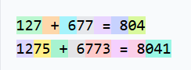
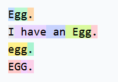
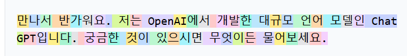
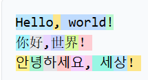
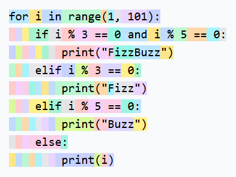
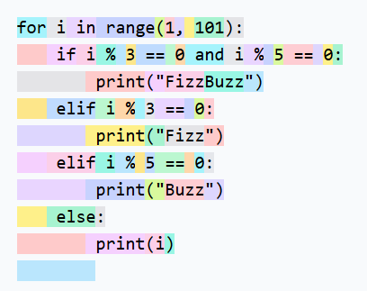
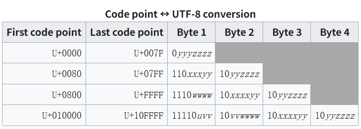

- [P9: 构建 GPT 分词器](#p9-构建-gpt-分词器)
  - [链接](#链接)
- [1. Tokenization](#1-tokenization)
  - [1.1 是很多奇怪现象的核心原因](#11-是很多奇怪现象的核心原因)
  - [1.2. tiktokenizer.vercel.app示例](#12-tiktokenizervercelapp示例)
- [2. unicode字符集， utf-8编码，utf-16编码以及utf-32编码](#2-unicode字符集-utf-8编码utf-16编码以及utf-32编码)
  - [2.1 unicode字符集 vs. utf-x编码](#21-unicode字符集-vs-utf-x编码)
  - [2.2 三种 UTF 编码的区别解析](#22-三种-utf-编码的区别解析)
  - [2.3. utf-8编码过程示例](#23-utf-8编码过程示例)
  - [2.4. UTF-8 的精妙之处](#24-utf-8-的精妙之处)
- [3. BPE](#3-bpe)
  - [3.1 基本原理](#31-基本原理)
  - [3.2 为什么不直接用UNICODE码点作为pair的基础单元](#32-为什么不直接用unicode码点作为pair的基础单元)
  - [3.3 UNICODE码点一定是一个整数吗？](#33-unicode码点一定是一个整数吗)
  - [3.4 总结](#34-总结)
  - [3.5 utf-8非法起始字节](#35-utf-8非法起始字节)
  - [3.6 gpt2pattern(模式匹配)](#36-gpt2pattern模式匹配)
- [4. 其他分词算法](#4-其他分词算法)

# P9: 构建 GPT 分词器
## 链接
B站视频链接：
+ [Andrej Karpathy【中英⚡从零构建 GPT（重制版）|Neural Networks: Zero to Hero】](https://www.bilibili.com/video/BV1mqrTBvEaf/?p=3&spm_id_from=333.1007.top_right_bar_window_history.content.click&vd_source=1019ffdc843339404e9df6ae52ff9e77)

Github项目：
+ <https://github.com/karpathy/makemore>
+ [Github: karpathy/nn-zero-to-hero](https://github.com/karpathy/nn-zero-to-hero)

关键链接：
+ minBPE code: <https://github.com/karpathy/minbpe>
+ [Google Colab](https://colab.research.google.com/drive/1y0KnCFZvGVf_odSfcNAws6kcDD7HsI0L?usp=sharing)
+ <https://tiktokenizer.vercel.app/>


---

LLM中很多古怪的现象，往往都能追溯到分词(`Tokenizer`)这一步, 例如：
+ [为什么 MiniMax 大模型无法识别马嘉祺是谁？ - mm叶文洁的回答 - 知乎](https://www.zhihu.com/question/2017049686331127666/answer/2036149386116342692)
+ 这个其实就是因为`Tokenzier`这一步出了问题


# 1. Tokenization
## 1.1 是很多奇怪现象的核心原因

Tokenization is at the heart of much weirdness of LLMs. Do not brush it off.

- Why can't LLM spell words? **Tokenization**.
- Why can't LLM do super simple string processing tasks like reversing a string? **Tokenization**.
- Why is LLM worse at non-English languages (e.g. Japanese)? **Tokenization**.
- Why is LLM bad at simple arithmetic? **Tokenization**.
- Why did GPT-2 have more than necessary trouble coding in Python? **Tokenization**.
- Why did my LLM abruptly halt when it sees the string "<|endoftext|>"? **Tokenization**.
- What is this weird warning I get about a "trailing whitespace"? **Tokenization**.
- Why the LLM break if I ask it about "SolidGoldMagikarp"? **Tokenization**.
- Why should I prefer to use YAML over JSON with LLMs? **Tokenization**.
- Why is LLM not actually end-to-end language modeling? **Tokenization**.
- What is the real root of suffering? **Tokenization**.

分词是LLM诸多奇怪现象的核心原因，切勿忽视。
- 为什么LLM无法拼写单词？**分词**。
- 为什么LLM无法完成像字符串反转这样简单的字符串处理任务？**分词**。
- 为什么LLM在非英语语言（如日语）上表现更差？**分词**。
- 为什么LLM在简单的算术运算上表现不佳？**分词**。
- 为什么GPT-2在Python编程时遇到的困难比实际需要更多？**分词**。
- 为什么我的LLM看到“bit”这个字符串时突然停止？**分词**。
- 我收到的关于“尾随空格”的奇怪警告是什么意思？**分词**。
- 为什么当我问LLM“SolidGoldMagikarp”时它会出错？**分词**。
- 为什么我应该在使用LLM时更倾向于用YAML而不是JSON？**分词**。
- 为什么LLM实际上并不是端到端的语言建模？**分词**。
- 真正的痛苦根源是什么？**分词**。


## 1.2. tiktokenizer.vercel.app示例

Good tokenization web app: [https://tiktokenizer.vercel.app](https://tiktokenizer.vercel.app)
+ 注意，这个网页支持很多种分词工具，默认显示的是`OpenAI Models: gpt-4o`, 那些chat模型是有角色区分的，选择`OpenAI Encodings: gpt-2`,则就是单纯的编码，不区分角色，直接对所有文本进行编码
+ 复制下面这段文字进去，就可以看到编码结果了

Example string:

```
Tokenization is at the heart of much weirdness of LLMs. Do not brush it off.

127 + 677 = 804
1275 + 6773 = 8041

Egg.
I have an Egg.
egg.
EGG.

만나서 반가워요. 저는 OpenAI에서 개발한 대규모 언어 모델인 ChatGPT입니다. 궁금한 것이 있으시면 무엇이든 물어보세요.

for i in range(1, 101):
    if i % 3 == 0 and i % 5 == 0:
        print("FizzBuzz")
    elif i % 3 == 0:
        print("Fizz")
    elif i % 5 == 0:
        print("Buzz")
    else:
        print(i)
        
```

使用`OpenAI Encodings: gpt-2`分词时，上面这段文字刚好是`300个`token， 面的id和上面的单词是有对应关系的，自己滑动一下就看到了

|`OpenAI Encodings: gpt-2`现象|说明|
|---|---|
||**关于数字的token表示，是完全随机的**，`127`这个数字只用了一个token来表示，而`677`的`6`和`77`被拆开用两个token来表示，其余大部分数字也都是被拆成2~3个部分进行token表示的|
||同一个词语，出现在句首，句中，句末，表示也不同<br/>`Egg`出现在句首，会被拆成两个token表示；而出现在句末，则只会作为一个token表示；同时大小写也有所差异|
|<br/>|chatGPT在处理非英语的语言时效果要差一些<br/>这不仅是因为SFT/RLHF的语料中，非英语的内容要远远少于英语；同时也是因为预训练(tokenizer的语料里)非英语的内容也很少<br/>同时还有一个原因，就是对于日语，韩语，中文这些语言，其token的压缩率非常有限，即<br/>Hello, world! 你好,世界！ 안녕하세요, 세상！<br/>表达相同的内容，非英语的语言切割的chunk粒度更细，需要更多的token来表示(这里中文的叹号就用了三个token)<br/>对于Transformer固定的上下文窗口来说，表达相同的意思，非英语文本都被拉伸了。。可以理解为英语的tokens分布更均衡，而非英语的相当于在英语的分布上拉伸<br/>即英语的tokens分布一般都是很大的bins，而其他非英语的则会有很严重的长尾效应，即有很多小的边界tokens<br/><br/>对应的jupyter文件里也有一部分讨论这个的: [## Byte-Pair Encoding(BPE算法) 标题上面的几个cell](../code/9_Tokenizer.ipynb)|
||代码里的每个空格都是一个单独的token，很明显，如果用这种`gpt-2`的分词方式，处理代码的方式就会很低效；<br/>所以`gpt-2`处理python代码效果很差，这与编程/语言模型本身无关，<br/>而是这些无意义的空格占据了大量的Transformer网络的上下文空间（序列长度不够用了），同时有效代码在整个序列中被分割的很零散|


----

如果把分词从`OpenAI Encodings: gpt-2`改为`cl100k_base`，则
+ 分词数量从300一下子降低到185，分词数量降低了非常多，
  + 根据[Language Models are Unsupervised Multitask Learners](https://cdn.openai.com/better-language-models/language_models_are_unsupervised_multitask_learners.pdf), The vocabulary is expanded to 50,257
  + gpt-2的词表大小为`50257`
  + 根据[Large Language Model Tokenizer Bias: A Case Study and Solution on GPT-4o](https://arxiv.org/html/2406.11214v2), For GPT-4, the vocabulary size includes 100,256 predefined common tokens, while this number increases to 199,997 in GPT-4o.
  + gpt-4的`cl100k_base`的词表大小为`100,256`
  + 由于**词表扩大了将近2倍，所以表示使用的token数量就降低了将近一半~**
+ [hello-gpt-4o-语言令牌化](https://openai.com/zh-Hans-CN/index/hello-gpt-4o/), 这里也着重列举了非英语语言在tokenizer过程中的token变化(`新令牌生成器压缩`)

词表扩大：
+ 当词表扩大为原来的2倍，则可以认为：Transformer可以看到的上下文窗口也是以前的两倍长(信息密度变高了)
+ 但是与之对应的是，嵌入表(`embedding`)的规模也会扩大,同时输出层的softmax计算量也会变大~

---


|`cl100k_base`对比|说明|
|---|---|
|| 当使用`cl100k_base`分词时，可以看到，代码的缩进空格部分有了明显的改善！<br/>所以`gpt2`到`gpt4`的代码能力的改进，不仅在于语言模型，架构设计和优化细节的改进，很大程度上还归功于tokenizer的设计|

Much glory awaits someone who can delete the need for tokenization. But meanwhile, let's learn about it.

从NLP任务中移除分词，会是个里程碑式的工作~


# 2. unicode字符集， utf-8编码，utf-16编码以及utf-32编码

## 2.1 unicode字符集 vs. utf-x编码
||Unicode|utf-x编码|
|---|---|---|
|基本概念|Unicode 是一本“字典”（字符集）|UTF-8/16/32 是这本字典的“三种不同打包运输方式”（编码实现）。|
|具体说明|Unicode（统一码/万国码）是一个**字符集（Character Set）**。它给世界上所有的文字、符号（包括汉字、英文、Emoji、甚至盲文）分配了一个**唯一的逻辑编号**，这个编号叫做**码点（Code Point）**。| UTF（Unicode Transformation Format）是具体的“编码方式”，是 Unicode 的**编码实现（Encoding）**。它规定了如何将 Unicode 的“码点”转换成计算机能存储和传输的“字节流（Bytes）”。|
|表达形式|通常以 `U+` 开头，加上十六进制数字表示。例如，汉字“中”的 Unicode 码点是 `U+4E2D`，Emoji“😀”的码点是 `U+1F600`。|
|局限|Unicode **只规定了编号，没规定怎么在计算机里存储**。计算机只认识 0 和 1（字节），如果你直接存 `4E2D`，计算机不知道这是一个 16 进制的数字，还是四个 ASCII 字符。因此，需要具体的**编码规则**来把码点转换成字节序列。<br/>本质上是因为Unicode的字符集有17w+,所以需要多个16进制数字来表示，|

---

## 2.2 三种 UTF 编码的区别解析

这三种编码方式的核心区别在于：**每个字符占用多少个字节（Byte），以及如何处理不同语言的字符。**
|——|utf-8|utf-16|utf-32|
|---|---|---|---|
|编码规则|**变长编码**，使用 **1 到 4 个字节**来表示一个 Unicode 码点。<br/>- 英文字母/数字（ASCII字符）：1 字节<br/>- 拉丁语系、希腊语等：2 字节<br/>- 汉字、日文、韩文等：3 字节<br/>- Emoji 或生僻字：4 字节|**变长编码**，使用 **2 或 4 个字节**表示一个码点。<br/>-  **BMP（基本多文种平面）字符**（包括绝大多数常用汉字、英文、日文等，码点在 `U+0000` 到 `U+FFFF`）：固定 **2 字节**。<br/>- **辅助平面字符**（如 Emoji、罕见汉字，码点在 `U+10000` 到 `U+10FFFF`）：使用 **4 字节**（通过“代理对 Surrogate Pair”机制，用两个 2 字节的特殊编码组合表示）。|**定长编码**，**任何字符都固定占用 4 个字节（32 bit）**。|
|最大特点|**完美向下兼容 ASCII**。纯英文文本用 UTF-8 编码和用传统的 ASCII 编码完全一样。它采用了“前缀码”设计（通过字节开头的 `0` 或 `1` 的个数来识别字节边界），即使数据截断也能快速恢复，不会乱码。|大小端问题（Endian）。因为 2 个字节有先后顺序，所以衍生出了 **UTF-16 LE**（小端序，Windows 常用）和 **UTF-16 BE**（大端序）。为了区分顺序，有时会在文件开头加一个 **BOM（Byte Order Mark，字节顺序标记）**。|直接把 Unicode 码点用 4 个字节存起来（例如 `U+4E2D` 直接存为 `00 00 4E 2D`）。|
|优点|空间利用率极高（英文不浪费空间）；容错率极高；网络传输最安全。|在处理绝大多数常用字符（2字节）时，处理速度比 UTF-8 快，因为大部分字符长度固定，方便内存中随机访问。|极其简单。因为每个字符都是 4 字节，所以可以像数组一样，通过 `索引 * 4` 瞬间找到第 N 个字符，**处理速度最快**。|
|缺点|因为变长，在内存中处理时，不能直接通过索引随机访问第 N 个字符，必须从头遍历计算长度。|对纯英文文本来说，比 UTF-8 浪费一倍空间；存在 BOM 和大小端的烦恼；遇到 4 字节的 Emoji 时，同样面临变长带来的索引计算问题。|**极其浪费空间**。哪怕存一个纯英文的 TXT 文件，体积也是 UTF-8 的 4 倍。|
|应用场景|互联网绝对的霸主（变长编码）<br/>**网页（HTML）、网络传输（HTTP/JSON）、Linux/Unix 文件系统、数据库存储**。目前 95% 以上的网页都使用 UTF-8。| UTF-16：Java/JS/Windows 的内部选择（变长编码）<br/>**Windows 操作系统内部 API、Java 语言内部字符串表示、JavaScript 语言内部、iOS/macOS 底层部分 API**。|简单粗暴的“空间换时间”（定长编码）<br/>极少用于存储和网络传输。主要用于**某些底层图形库、内部文本处理引擎**（在内存中临时展开处理，处理完再转回 UTF-8）。|


| 特性 | UTF-8 | UTF-16 | UTF-32 |
| :--- | :--- | :--- | :--- |
| **编码类型** | 变长（1-4 字节） | 变长（2 或 4 字节） | 定长（固定 4 字节） |
| **英文字符占用** | 1 字节 | 2 字节 | 4 字节 |
| **常用汉字占用** | 3 字节 | 2 字节 | 4 字节 |
| **Emoji/生僻字** | 4 字节 | 4 字节（代理对） | 4 字节 |
| **兼容 ASCII** | 完美兼容 | 不兼容 | 不兼容 |
| **空间效率** | 极高（最省空间） | 中等 | 极低（最浪费空间） |
| **处理/检索速度** | 较慢（需遍历计算长度）| 较快（大部分定长2字节）| 最快（直接按索引乘4） |
| **大小端/BOM问题**| 无（按字节流解析） | 有（LE/BE，可能有BOM）| 有（LE/BE，可能有BOM） |
| **主要应用场景** | **网络传输、文件存储、Web** | **Windows内部、Java/JS内存** | **内部文本处理引擎** |

## 2.3. utf-8编码过程示例

UTF-8 的核心编码规则表：UTF-8 是一种**变长编码**，它设计了 1 到 4 个字节的模板。规则如下：

| Unicode 码点范围 (十六进制) | 二进制位数 | UTF-8 编码模板 (字节) | 占用字节数 |
| :--- | :--- | :--- | :--- |
| `000000` - `00007F` | 7 ~ 1 位 | `0xxxxxxx` | 1 字节 |
| `000080` - `0007FF` | 11 ~ 8 位 | `110xxxxx 10xxxxxx` | 2 字节 |
| `000800` - `00FFFF` | 16 ~ 12 位 | `1110xxxx 10xxxxxx 10xxxxxx` | 3 字节 |
| `010000` - `10FFFF` | 21 ~ 17 位 | `11110xxx 10xxxxxx 10xxxxxx 10xxxxxx`| 4 字节 |

**规则解析（重点）：**
1. **模板中的 `x`**：是用来填写 Unicode 码点二进制位的地方。
2. **前缀标识**：
   * 单字节以 `0` 开头（完美兼容 ASCII）。
   * 多字节的首字节以连续的 `1` 开头，**`1` 的个数代表这个字符总共占用几个字节**（例如 `1110` 开头，说明是 3 字节）。
   * 多字节的后续字节，**一律以 `10` 开头**。
3. **填充顺序**：将 Unicode 的二进制位，**从左到右（从高位到低位）** 依次填入 `x` 的位置。如果 Unicode 的二进制位数不够 `x` 的总容量，高位补 `0`。

---

**具体转换过程演示（以汉字“中”为例）**
```python
char = "中"
# 1. 获取十进制的 Unicode 码点
decimal_code = ord(char)
print(f"十进制码点: {decimal_code}")  
# 输出: 十进制码点: 20013

# 2. 转换为十六进制 (Python 默认的 hex 格式)
hex_code = hex(decimal_code)
print(f"十六进制码点: {hex_code}")  
# 输出: 十六进制码点: 0x4e2d

# 对应的二进制为:
binary_code = bin(decimal_code)
print(f"二进制码点: {binary_code}")  # 返回的字符串会带有 0b 前缀（表示 binary

# 3. 格式化为标准的 Unicode 表示法 (U+XXXX)
# :04X 表示：至少4位，不足补0，字母大写 (X)
unicode_str = f"U+{ord(char):04X}"
print(f"标准 Unicode 值: {unicode_str}")  

# 输出：
十进制码点: 20013
十六进制码点: 0x4e2d
二进制码点: 0b100111000101101
标准 Unicode 值: U+4E2D
```

1. 获取 Unicode 码点并转为二进制
   * 汉字“中”的 Unicode 码点是 `U+4E2D`。
   * 将其转换为 16 位二进制（不足 16 位高位补 0），这里因为本身是15位，所以最靠近2字节，所以补足成2字节：
     `0100 1110 0010 1101`
2. 判断使用哪个模板
   * 查看码点 `4E2D`，它落在 `000800 - 00FFFF` 这个区间。
   * 因此，我们选择 **3 字节模板**：
     `1110xxxx 10xxxxxx 10xxxxxx`
3. 将二进制位填入 `x` 中
   * 3 字节模板总共有 `4 + 6 + 6 = 16` 个 `x`。
   * 我们的二进制刚好是 16 位，直接**从左到右**依次填入：

    ```text
    Unicode 二进制:  0100   111000   101101
                    ↓↓↓↓   ↓↓↓↓↓↓   ↓↓↓↓↓↓
    3字节模板:     1110xxxx 10xxxxxx 10xxxxxx
                    ↓↓↓↓   ↓↓↓↓↓↓   ↓↓↓↓↓↓
    填充得到三字节 11100100 10111000 10101101

    ```
4. 转换为十六进制（最终结果）:将上面得到的 3 个 8 位二进制数，分别转回十六进制：
  * `11100100` -> **`E4`**
  * `10111000` -> **`B8`**
  * `10101101` -> **`AD`**
  ```python
    > int("11100100", 2),int("10111000", 2), int("10101101", 2)  
    # 输出
    (228, 184, 173)
    
    > list(char.encode("utf-8"))
    # 输出
    [228, 184, 173]
  ```

>[!NOTE]
> + 汉字“中”在 UTF-8 编码下，最终在计算机里存储的字节流就是 **`E4 B8 AD`**。
> + 这也与 Python 中 ` '中'.encode('utf-8') ` 输出的 `b'\xe4\xb8\xad'` 完全吻合。

---

## 2.4. UTF-8 的精妙之处

1. **绝对兼容 ASCII**：
   英文字符的 Unicode 都在 `00-7F` 之间，用 UTF-8 编码时，直接走 1 字节模板 `0xxxxxxx`。这意味着，**纯英文的 UTF-8 文件和纯英文的 ASCII 文件在底层字节是完全一模一样的**。老系统不用改代码就能直接读 UTF-8 的英文。
2. **无字节序（Endian）问题**：
   UTF-16 和 UTF-32 需要区分大端序和小端序（先存高位还是低位），而 UTF-8 是按**字节流**逐个处理的，根本不存在字节序的烦恼。
3. **强大的自同步与容错能力**：
   因为多字节的首字节是 `110...`、`1110...`，后续字节是 `10...`。
   如果在网络传输中**丢失了第一个字节**，接收端看到后面的 `10...` 知道这是“残缺”的后续字节，会直接丢弃，直到遇到下一个 `0...` 或 `110...` 才会重新开始解析。**它绝不会把半个汉字错认成另一个字符**，极大地减少了乱码扩散。

**总结**：UTF-8 的转换过程，本质上就是**根据字符的大小，选择一个带“前缀标识”的固定模板，然后把 Unicode 二进制位像填空一样塞进去**的过程。


# 3. BPE
## 3.1 基本原理
wiki上的解析其实就很清晰：[Byte-pair encoding](https://en.wikipedia.org/wiki/Byte-pair_encoding)

hugging-face上的教程也很清晰: [BPE tokenization 算法](https://huggingface.co/learn/llm-course/zh-CN/chapter6/5)

以wiki上的教程为例，本质上**在训练BPE算法的时候，就是输入序列不断缩短/压缩，词表不断增大/扩充的过程**

1. 假设要进行编码的序列是: 
   > aaabdaaabac
   
   这个序列目前的长度是11，词表为4(['a', 'b', 'c', 'd'])
2. 对于当前序列，出现频率最高的字节对是`aa`, 因此用一个不在当前词表中的符号来替换它，比如，用`Z`来替换`aa`,得到：
   > ZabdZabac

   此时序列长度变为9，词表为5(['a', 'b', 'c', 'd', 'Z'])
3. 继续迭代，当前出现频率最高的字节对是`ab`, 假设用`Y`来替换`ab`,得到：
   > ZYdZYac

   此时序列长度变为7，词表为6(['a', 'b', 'c', 'd', 'Z', 'Y'])
4. 继续迭代，当前出现频率最高的字节对是`ZY`, 假设用`X`来替换`ZY`,得到：
   >XdXac

   此时序列长度变为5，词表为7(['a', 'b', 'c', 'd', 'Z', 'Y', 'X'])


## 3.2 为什么不直接用UNICODE码点作为pair的基础单元

**prompt: 为什么BPE算法是对字节进行配对找出现次数最多呢？不能直接从UNICODE的码点直接找码点对的出现次数来修改词表吗？ 现在的大模型词表动不动也是32万，UNICODE码点17万多，不是更方便吗？**

详见： [BPE算法原理探讨](https://chat.qwen.ai/s/ddf919e4-a315-491b-85a0-ab12d059d806?fev=0.3.14), 和AI聊了很久，才得到了合适的结论

---

**1. Lossless Round-trip(对“脏数据”和未知字符的绝对鲁棒性)**

真实世界的互联网文本充满了“脏数据”：损坏的编码、截断的 UTF-8 序列(例如：被截断的 4 字节 Emoji)、混合编码的文本（例如 UTF-8 网页中混入了 GBK 或 Windows-1252 编码的老旧数据），未分配的 Unicode 码点、甚至是混合的二进制数据。

*   **基于 Unicode 码点**：当解码器遇到一个非法的 UTF-8 字节序列，或者一个尚未被 Unicode 联盟定义的码点时，基于码点的 Tokenizer 会直接报错（如抛出 `UnicodeDecodeError`），或者被迫引入特殊的 `<UNK>`（未知）标记，导致信息丢失。
  + 基于 Unicode 码点：Tokenizer 的第一步必须是 “解码” (Decode)，即将原始字节流转换为 Unicode 码点序列。当遇到损坏的字节流时，标准解码器只有两种选择：
    + 抛出异常（如 Python 的 UnicodeDecodeError），导致整个进程崩溃。
    + 使用替换字符（如 U+FFFD）来代替损坏的部分。 **无论哪种，原始信息都永久丢失了**。模型永远无法学到这段数据的真实分布，且 会污染语料。
*   **基于字节（Byte-level）**：字节是计算机存储的绝对底层。任何文件、任何乱码、任何二进制数据，都可以被无损地拆解为 0~255 的字节序列。Byte-level BPE 保证了对**任何输入**都能进行无损的 Tokenization 和 Detokenization，永远不会有真正的 OOV（Out-of-Vocabulary，词表外）问题，最坏的情况只是退化为单字节表示。
*  **Lossless Round-trip**， `Byte-level BPE`不需要“解码”步骤。直接把原始字节流（0~255 的整数）作为输入。
   *  无论这段数据是完美的英文、损坏的 Emoji、还是乱码的 GBK 中文，对 BPE 来说，它们都只是普通的字节序列。
   *  其可以保证： 100% 的无损往返：任何字节序列 → Token IDs → 解码回完全相同的原始字节序列。
   *  这种对“脏数据”的绝对免疫力，是任何基于上层抽象（如码点）的方案都无法提供的。


---

**2. 词表预算（Vocabulary Budget）的绝对耗尽**

大模型的词表大小（Vocabulary Size, $V$）是一个**严格的硬约束**。因为模型的 Embedding 层和 LM Head 层的参数量直接等于 $V \times d_{model}$。
以 Llama 3 为例，它的词表大小被严格设定为 **128,256**。这是一个经过精密计算的预算，多一个都会显著增加显存占用和计算量。
*   **如果基于 Unicode 码点**：
    + Unicode 15.0 标准中，**已分配的码点数量约为 149,186 个**（这还不包括 100 多万个保留/私有码点）。
    + 这意味着，如果你要支持所有 Unicode 字符，你的**初始基础词表大小直接就是 149,186**。
    + **矛盾：**：你的总预算只有 128,256，但你的基础单元就已经有 149,186 个了。
      + 词表在**第 0 次迭代时就已经爆了**。即使强行截断，只保留常用的 10 万个码点作为基础词表，你也**只剩下 28,256 个预算**用于 BPE 合并。
      + 这区区 2 万多次合并，根本不足以将长单词（如 "unbelievable"）或常见词组压缩成单个 Token。
      + 模型的序列长度将极其冗长，导致 Attention 的 $O(N^2)$ 计算量直接爆炸。

*   **如果基于 Byte**：
    + 基础词表大小严格等于 **256**。这意味着，还有 **128,000** 的词表预算。
    + 这 128,000 个位置，可以**100% 用于数据驱动的高频合并**。算法可以奢侈地将 "ing", "tion", "的", "hello" 甚至整个高频单词都合并成独立的 Token。
*   **结论**：
    *   基于 Byte，是用 256 的极小代价，换取了 128,000 的“压缩空间”；
    *   基于 Unicode，是还没开始压缩，预算就已经被 15 万个（其中 90% 在语料中只出现 0 次或 1 次的）生僻字符彻底耗尽。


---

**3. 组合字符（Combining Characters）的隐形陷阱**

Word-level BPE 可以省事。但在处理某些语言时，基于码点的 Word-level 依然会翻车。

以泰文或印地文为例。一个“视觉上不可分割的字符”（Grapheme），在 Unicode 中是由 **1 个基础字母码点 + 多个音调/元音符号码点** 组合而成的。
例如，泰文的 `ำ` 实际上是两个码点：基础字符 `U+0E32` (ส) + 音调符号 `U+0E33` (ำ)。

*   **如果基于码点**：如果不引入极其复杂的“字形簇（Grapheme Cluster）”预处理规则，BPE 算法会天真地认为这是两个独立的 Token。它可能会把基础字母和后面的标点符合并，而把音调符号孤立出来。这会导致模型完全无法学习该语言的正确发音和语义关联。
*   **如果基于 Byte**：在 UTF-8 编码下，这个组合字符的字节是**连续存储**的（例如 `E0 B8 B3`）。BPE 算法不需要懂任何泰文语法，它只会发现这几个字节在语料中总是高频地捆绑在一起出现，于是自动将它们合并为一个 Token。**字节序列天然地保持了视觉字符的完整性**，无需任何语言学规则介入。

---

**总结**

现代大模型（如 GPT-4, Llama 3, Qwen 等）使用的 `tiktoken` 或 Hugging Face `tokenizers` 库，无一例外都采用了 **Byte-level BPE**。

工业界选择 Byte-level BPE，**不是因为“它算得更快”（在 Word-level 优化下，两者速度差异可接受），而是因为：**

1. **词表预算的数学铁律**：Unicode 的 15 万基础码点会直接撑爆大模型有限的词表预算（如 128k），导致没有空间进行有意义的子词压缩；而 Byte 的 256 个基础单元，留出了 99.8% 的预算用于高效压缩。
2. **绝对的鲁棒性**：只有字节层面，才能在不进行任何“解码”的前提下，保证对互联网上任何损坏、混合、畸形数据的 100% 无损处理。
3. **免规则的语言适应性**：字节序列天然绑定了多语言组合字符，让 BPE 纯粹由数据驱动，无需编写脆弱的语言学预处理规则。

## 3.3 UNICODE码点一定是一个整数吗？

上面回答中有**像 Emoji 这样由多个码点组成的复杂字符（如 👨‍👩‍👧‍👦 实际上是 7 个码点，但在字节层面只是一串固定的字节序列，极易被合并）。** ，和印象里的认知有出入，因此提问：

**prompt: Emoji 这样由多个码点组成的复杂字符,emoji是多个码点组成的吗？ 码点不是一个整数ID吗？**

----

**回答**

你问到了 Unicode 标准中最核心、也最容易让人产生误解的一个概念！

首先，**你的理解完全正确：码点（Code Point）确实就是一个整数 ID**（范围从 `U+0000` 到 `U+10FFFF`）。

但是，问题的关键在于：**“我们眼睛看到的一个视觉字符”（术语叫 Grapheme Cluster，字形簇），并不总是等于“一个码点”。**

Unicode 联盟在设计时，为了保持标准的扩展性和兼容性，大量使用了 **“组合”** 的方式。很多复杂的 Emoji，在底层确实是由**多个码点（多个整数 ID）拼接而成**的。

---

**1. 简单 Emoji：确实是 1 个码点**

有些基础 Emoji 确实只对应一个整数 ID。
*   😀 (Grinning Face) = `U+1F600` （1 个码点）

---

**2. 带修饰的 Emoji：2 个码点**

Unicode 没有为每一种肤色的大拇指都分配一个新的独立码点，而是采用了“基础字符 + 修饰符”的组合方式。
*   👍🏻 (浅肤色大拇指) = `U+1F44D` (大拇指) + `U+1F3FB` (浅肤色修饰符) 
*   **底层是 2 个整数 ID**，但操作系统/浏览器的渲染引擎会把它们画成 1 个图形。

---

**3. ZWJ 组合 Emoji：多个码点（最典型的例子）**
为了表示“家庭”、“职业+性别”等复杂概念，Unicode 引入了一个特殊的控制字符：**ZWJ (Zero Width Joiner，零宽连字符，码点为 `U+200D`)**。它的作用是把前后的码点“粘”在一起，让渲染引擎把它们显示为一个整体。

以你提到的 **👨‍👩‍👧‍👦 (家庭：男+女+女+男)** 为例，它在底层**根本不是 1 个码点，而是整整 7 个码点组成的序列**：
1. `U+1F468` (男人 👨)
2. `U+200D` (ZWJ 零宽连字符)
3. `U+1F469` (女人 👩)
4. `U+200D` (ZWJ 零宽连字符)
5. `U+1F467` (女孩 👧)
6. `U+200D` (ZWJ 零宽连字符)
7. `U+1F466` (男孩 👦)

**你眼睛看到的是 1 个 Emoji，但计算机底层处理的是 7 个整数 ID。**

---

**4. 国旗 Emoji：2 个码点**
Unicode 也没有为世界上 200 多个国家的国旗各自分配独立码点，而是使用了 26 个“区域指示符字母”（Regional Indicator Symbols，对应 A-Z）。
*   🇨🇳 (中国国旗) = `U+1F1E8` (区域指示符 C) + `U+1F1F3` (区域指示符 N)
*   **底层是 2 个整数 ID**。

---

**这为什么让“基于码点的 BPE”变得极其困难？**

假设我们强行用“码点”作为 BPE 的基础单元来训练大模型，我们会遇到什么灾难？

1. **语义割裂**：对于 `👨‍👩‍👧‍👦`，基于码点的 Tokenizer 会把它看作 7 个独立的单元。如果 BPE 没有恰好学到把这 7 个特定码点合并在一起的规则，它就会被切分成多个 Token（比如 `👨` + `ZWJ` + `👩`...）。这不仅浪费 Token 数量，还会让模型难以理解这是一个完整的“家庭”概念。
2. **组合爆炸的变体**：光是“大拇指”这个动作，加上 5 种肤色，再乘以男女性别，就会产生大量看似不同、但底层逻辑相同的码点序列。基于码点的统计会变得非常稀疏。
3. **渲染与处理的脱节**：Tokenizer 需要自己去实现复杂的 Unicode Grapheme Cluster 边界检测算法（比如 `UnicodeSegmentation` 库），才能勉强把 7 个码点识别为“一个用户感知的字符”，这大大增加了工程复杂度。

---

**为什么 Byte-level BPE 是“降维打击”？**

回到基于**字节（Byte）** 的 BPE，一切变得异常简单：

无论一个 Emoji 背后是 1 个码点还是 7 个码点，当它被编码为 **UTF-8 字节流** 时，它就是一串**固定不变的字节序列**。

例如 `👨‍👩‍👧‍👦` 的 UTF-8 字节序列是固定的：
`F0 9F 91 A8` (男) + `E2 80 8D` (ZWJ) + `F0 9F 91 A9` (女) + `E2 80 8D` (ZWJ) + `F0 9F 91 A7` (女孩) + `E2 80 8D` (ZWJ) + `F0 9F 91 A6` (男孩)
*(总共 25 个字节)*

**BPE 算法根本不需要知道什么是“码点”，什么是“ZWJ”，什么是“国旗规则”。** 
它只看到：在训练语料中，这 25 个字节的序列高频地捆绑在一起出现。于是，BPE 会在训练过程中，逐步将这 25 个字节合并成 1 个 Token。

---

**总结**
*   **码点确实是一个整数 ID**，你的理解没错。
*   但 **1 个视觉字符 ≠ 1 个码点**。复杂的 Emoji 是 Unicode 通过多个码点（加上 ZWJ 等控制符）“拼”出来的。
*   如果基于码点做 BPE，会被这种“一对多”的组合逻辑搞得晕头转向，统计效率极低。
*   基于**字节**做 BPE，直接绕过了所有 Unicode 的复杂组合规则，把一切（无论是英文字母、汉字、还是由 7 个码点组成的复杂 Emoji）都降维成纯粹的、固定的字节序列，由数据驱动自动合并。这就是工业界选择 Byte-level BPE 的根本原因。

## 3.4 总结

>[!NOTE]
> **总结**
> 1. 对于UNICODE字符，因为需要保存到计算机，或者进行传输，因此需要编码成字节流，因此出现了`utf-8`,`utf-16`以及`utf-32`这样的字符编码方案
>     + **UNICODE → utf-8, 码点→字节表示**
> 2. 对于一串文本，经过`utf-8`得到的字节表示列表，这个字节列表就相当于初始词表是 [0,255],词表大小为256，后续使用BPE，来不断缩短字节表示列表的长度，增加词表的大小

为什么没有采用其他方式作为统计出现频次输入的编码方式：详见：[32-为什么不直接用unicode码点作为pair的基础单元](#32-为什么不直接用unicode码点作为pair的基础单元)的总结部分

## 3.5 utf-8非法起始字节



| 字节类型 | 二进制格式 | 十六进制范围 | 作用 |
| :--- | :--- | :--- | :--- |
| **单字节 (ASCII)** | `0xxxxxxx` | `0x00` - `0x7F` | 表示英文字母、数字等（0~127） |
| **多字节起始字节** | `110xxxxx`<br>`1110xxxx`<br>`11110xxx` | `0xC0` - `0xDF`<br>`0xE0` - `0xEF`<br>`0xF0` - `0xF7` | 告诉解码器：“注意，这是一个多字节字符的**开头**，后面还有 1~3 个字节跟着我。” |
| **多字节后续字节** | **`10xxxxxx`** | **`0x80` - `0xBF`** | 告诉解码器：“我不是开头，我只是**跟在别人后面的数据**。” |

`0x80` 转换成二进制是 **`10000000`**。对应 **`10xxxxxx`** 的模式，这意味着它是一个 **“后续字节”**。

```python
print(bytes([114]).decode("utf-8")) # r
byte_ = bytes([226,128,153])
print(byte_.decode("utf-8")) # '’'
```

根据[bytes.decode(encoding='utf-8', errors='strict')](https://docs.python.org/3/builtins/stdtypes.html#bytes.decode), 当编码发生错误的时候，这里是可以选择错误处理的方式的：[Error Handlers](https://docs.python.org/3/library/codecs.html#error-handlers)
```python
print(bytes([128]).decode("utf-8", errors="replace")) # 输出 �
print(bytes([128]).decode("utf-8", errors="strict")) # 报错

---------------------------------------------------------------------------
UnicodeDecodeError                        Traceback (most recent call last)
Cell In[126], line 6
      3 print(bytes([128]).decode("utf-8", errors="replace"))
      4 # https://docs.python.org/3/library/codecs.html#error-handlers
      5 # https://docs.python.org/3/builtins/stdtypes.html#bytes.decode
----> 6 print(bytes([128]).decode("utf-8", errors="strict"))

UnicodeDecodeError: 'utf-8' codec can't decode byte 0x80 in position 0: invalid start byte
```

## 3.6 gpt2pattern(模式匹配)

正则匹配参考：
+ regex库：  <https://github.com/mrabarnett/mrab-regex>
+ java文档里也有regex实现的文档: <https://docs.oracle.com/javase/7/docs/api/java/util/regex/Pattern.html>
+ 菜鸟教程: <https://www.runoob.com/regexp/regexp-syntax.html>
+ regular-expressions.info网站: <https://www.regular-expressions.info/unicode.html>
  + <https://www.regular-expressions.info/refunicode.html>

```python
import regex as re
gpt2pat = re.compile(r"""'s|'t|'re|'ve|'m|'ll|'d| ?\p{L}+| ?\p{N}+| ?[^\s\p{L}\p{N}]+|\s+(?!\S)|\s+""")
print(re.findall(gpt2pat, "Hello world"))
```

基于正则的**预分词（Pre-tokenization）**：在进行 BPE（字节对编码）子词切分之前，先将原始文本按照语义和字符类型切分成较大的“词块”（如单词、数字、标点、空格）。

由 `|`（或逻辑）分隔，正则引擎会**从左到右**尝试匹配，一旦匹配成功就截取该部分。

---

**1. 英文缩写与所有格后缀**
```regex
r"""'s|'t|'re|'ve|'m|'ll|'d| ?\p{L}+| ?\p{N}+| ?[^\s\p{L}\p{N}]+|\s+(?!\S)|\s+"""

's|'t|'re|'ve|'m|'ll|'d
```
**含义**：匹配英语中常见的缩写形式和所有格后缀。

**作用**：在英文中，像 `don't`、`I'm`、`John's` 这样的词，如果按普通单词切分，可能会被错误地截断。将这些后缀单独列为匹配项，可以确保它们在分词时被当作一个独立的整体（或至少保证 `'t`、`'s` 不会被从中间劈开），帮助模型更好地理解词形变化。
+ `It's  ( 's → is)`
+ `I don't like ( n't → not)`
+ `you're  ( 're → are)`
+ `I've worked here for nearly two years. ( 've → have)`, 口语缩写形式, 网络英语上会比较多
+ `I'm  ( 'm → am)` 
+ `I'll to go to sleep.( 'll → will)`
+ `I'd like to  ( 'd → would)`


---

**2. 字母（单词）**

```regex
r"""'s|'t|'re|'ve|'m|'ll|'d| ?\p{L}+| ?\p{N}+| ?[^\s\p{L}\p{N}]+|\s+(?!\S)|\s+"""

 ?\p{L}+
# 注意，这里？前面有个空格
```
**含义**：
- ` ?`：匹配 0 个或 1 个空格（前导空格）。
- `\p{L}`：匹配**任何 Unicode 字母**（包括英文字母、中文汉字、日文假名、带音标的拉丁字母等）。
  + 在<https://docs.oracle.com/javase/7/docs/api/java/util/regex/Pattern.html>中，有：`[\p{L}] 	Any letter`
  + 在<https://github.com/mrabarnett/mrab-regex>中，有：`[\p{L}--QW] # Set containing all letters except 'Q' and 'W'`
  + `\p` 代表 Property（属性），它是一个前缀，表示要根据 Unicode 标准里的字符属性来匹配。
- `+`：匹配 1 次或多次。
  
**作用**：匹配**带有最多一个前导空格的连续字母串**。把前导空格和单词绑定在一起（例如把 `" hello"` 作为一个整体），这对于保留文本的格式和空格信息至关重要。

---

**3. 数字**

```regex
r"""'s|'t|'re|'ve|'m|'ll|'d| ?\p{L}+| ?\p{N}+| ?[^\s\p{L}\p{N}]+|\s+(?!\S)|\s+"""

 ?\p{N}+
# 注意，这里？前面有个空格
```
**含义**：
- ` ?`：0 个或 1 个空格。
- `\p{N}`：匹配**任何 Unicode 数字**（包括 0-9、罗马数字、中文数字等）。
  - 在<https://github.com/mrabarnett/mrab-regex>中，有`[\p{N}--[0-9]] # Set containing all numbers except '0' .. '9'`
- `+`：1 次或多次。
**作用**：匹配**带有最多一个前导空格的连续数字串**。将数字与字母分开，避免像 `abc123` 这样的混合字符串被当成一个词。

---

**4. 标点符号与特殊字符**
```regex
r"""'s|'t|'re|'ve|'m|'ll|'d| ?\p{L}+| ?\p{N}+| ?[^\s\p{L}\p{N}]+|\s+(?!\S)|\s+"""

 ?[^\s\p{L}\p{N}]+
# 注意，这里？前面有个空格
```
**含义**：
- ` ?`：0 个或 1 个空格。
- `[^\s\p{L}\p{N}]+`：匹配 1 个或多个**既不是空白（`\s`）、也不是字母（`\p{L}`）、也不是数字（`\p{N}`）** 的字符。
  - 根据  <https://www.runoob.com/regexp/regexp-syntax.html>
  - `^`匹配输入字符串的开始位置。在方括号表达式中使用时，表示不接受方括号内的字符集合（取反）。要匹配 `^` 字符本身，请使用 `\^`。
  - `\s` 匹配所有空白符（包括换行），`\S` 匹配所有非空白符（不包括换行），两者合并即可匹配任意字符。
  - `\p{L}\p{N}`同上

**作用**：匹配**标点符号、特殊符号、Emoji 表情等**（如 `!`、`@`、`。`、`，`、`😀`）。同样，允许带一个前导空格。这确保了标点符号不会和单词或数字粘连在一起。

---

**5. 末尾的空白字符**
```regex
r"""'s|'t|'re|'ve|'m|'ll|'d| ?\p{L}+| ?\p{N}+| ?[^\s\p{L}\p{N}]+|\s+(?!\S)|\s+"""

\s+(?!\S)
```
**含义**：
- `\s+`：匹配 1 个或多个空白字符（空格、换行符、制表符等）。
- `(?!\S)`：**负向先行断言**，表示匹配的位置后面**不能**是非空白字符（即后面必须是空白字符，或者是字符串的结尾）。
  - `( )`	标记一个子表达式的开始和结束位置。子表达式可以获取供以后使用。要匹配这些字符，请使用 \( 和 \)。

**作用**：专门用来匹配**位于文本末尾的连续空白**，或者**后面紧跟着字符串结尾的空白**。这有助于在文本末尾的换行或空格被单独、干净地切分出来。

---

**6. 普通的空白字符**

```regex
\s+
```
**含义**：匹配 1 个或多个普通的空白字符。

**作用**：匹配**单词之间的空格、段落间的换行等**。作为最后的兜底选项，处理所有不属于上述情况的空白字符。

---

>[!NOTE]
>**总结**
> 1. **保留空格信息**：通过 ` ?` 将“一个空格”与后面的单词/数字/标点绑定（如 `" world"`），模型就能知道单词之间是否有空格。如果空格被完全独立切分，模型就会丢失词边界信息。
> 2. **多语言支持**：使用了 `\p{L}` 和 `\p{N}` 而不是简单的 `a-z` 或 `0-9`，这使得该分词器天生支持中文、日文、韩文、阿拉伯文等全球各种语言。
> 3. **字符隔离**：严格将“字母”、“数字”、“标点”分开。例如 `Hello, world! 123` 会被切分为 `["Hello", ", ", "world", "! ", "123"]`（具体空格归属视匹配顺序而定），这种细粒度的切分有利于后续的 BPE 算法学习子词。


# 4. 其他分词算法

直接把字节序列输入到LLM中: [MEGABYTE: Predicting Million-byte Sequences with Multiscale Transformers](https://arxiv.org/abs/2305.07185)